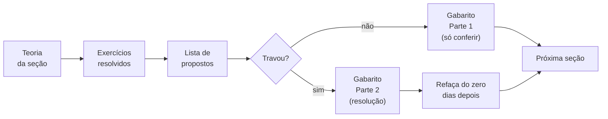

# Como usar este material

| ← Índice | 🏠 | Próximo → |
| :--- | :---: | ---: |
| [Comece aqui](README.md) | [Página inicial](../README.md) | [⭐ Revisão de Pré-Cálculo](revisao-pre-calculo.md) |

> **Tempo de leitura:** 5 minutos. Vale a pena — eles economizam horas depois.

---

## 1. O que este material é (e o que não é)

**É** um curso completo de Cálculo 1, escrito para ser lido **direto no navegador**, sem instalar nada. Teoria, exemplos resolvidos, listas de exercícios e gabaritos comentados, cobrindo toda a ementa da UENF.

**Não é** substituto da aula nem do livro. É o que você abre **depois** da aula, quando o caderno não basta, e **antes** da prova, quando o livro é longo demais.

> [!IMPORTANT]
> **O professor é quem define a prova.** Este material segue a ementa, mas ênfase, notação e cronograma variam de turma para turma. Onde houver divergência entre o que está aqui e o que o seu professor disse, **vale o professor**.

---

## 2. O fluxo de estudo

**A regra que importa:** o gabarito tem **duas partes** justamente para você não colar sem querer.

| Parte | O que tem | Quando abrir |
| --- | --- | --- |
| **✅ Parte 1** | só as respostas finais | depois de tentar, para **conferir** |
| **📖 Parte 2** | a resolução completa | só depois de **travar de verdade** |

> [!CAUTION]
> **Ler a resolução dá a sensação de ter aprendido.** Não dá. O que ensina é refazer **do zero**, com a folha em branco, alguns dias depois. Se você só reconhece a resolução quando a vê, você não sabe — você reconhece.

---

## 3. A legenda dos ícones

| Ícone | Significa |
| :---: | --- |
| 📐 | **Definição ou teorema** — o enunciado formal, que cai na prova |
| 📊 | **Leitura de figura** — o que olhar no gráfico ao lado |
| 💡 | **Insight** — a ideia por trás, ou a conexão com outro assunto |
| ⚠️ | **Erro comum** — alguém já perdeu ponto exatamente aqui |
| 🧠 | **Exercício resolvido** |
| 📝 | **Lista de propostos** |
| ✅ | **Gabarito** |
| 🧪 | **Revisão** ou **simulado** |

E as caixas coloridas do GitHub:

> [!NOTE]
> Observação lateral, que não muda o resultado mas evita confusão.

> [!TIP]
> Um atalho, um truque, ou um jeito mais rápido de fazer a mesma coisa.

> [!IMPORTANT]
> Algo que você precisa levar para a prova.

> [!CAUTION]
> Uma armadilha. Leia duas vezes.

---

## 4. Como ler as fórmulas

Toda a matemática aqui é escrita em **LaTeX**, e o GitHub a renderiza automaticamente. Se você está vendo

$$\int_a^b f(x)\thinspace dx = F(b)-F(a)$$

como uma fórmula bonita, está tudo certo.

**Se você está vendo o código em vez da fórmula**, o problema é quase sempre um destes:

| Sintoma | Causa provável | Solução |
| --- | --- | --- |
| Fórmulas aparecem como código | JavaScript bloqueado | libere `github.com` no bloqueador |
| Só algumas aparecem | a página pode ter um erro | [abra uma issue](../../../issues/new?template=01-erro-no-material.yml) |
| No celular, fórmulas cortadas | tela estreita | **deite o aparelho** (modo paisagem) |

> [!TIP]
> **No celular, use o modo paisagem para as páginas de teoria.** As tabelas e as fórmulas longas foram escritas pensando em tela larga; na vertical elas rolam lateralmente, o que funciona, mas incomoda.

---

## 5. Por onde começar

| Sua situação | Comece por |
| --- | --- |
| Vou cursar Cálculo 1 agora | [Diagnóstico de 10 minutos](README.md#o-diagnóstico-de-10-minutos), depois o [Plano de estudos](plano-de-estudos.md) |
| Já estou no meio do semestre | vá direto à unidade que está sendo dada |
| Prova em três dias | [Como não reprovar](como-nao-reprovar.md) e os [simulados](../07-simulados/README.md) |
| Travei numa conta de álgebra | [Revisão de Pré-Cálculo](revisao-pre-calculo.md) |
| Quero só consultar uma fórmula | [Formulário](../06-formulario/README.md) |
| Estou de recuperação / DP | [Plano de estudos](plano-de-estudos.md), seção "semestre comprimido" |

---

## 6. Achou um erro?

Ache mesmo — tem erro aqui. Material escrito por uma pessoa só tem erro de conta, de sinal e de digitação, e o jeito de consertar é alguém avisar.

| Situação | O que fazer |
| --- | --- |
| Uma conta não fecha | [Erro no material](../../../issues/new?template=01-erro-no-material.yml) |
| Uma explicação não ficou clara | [Não entendi](../../../issues/new?template=02-nao-entendi.yml) |
| Faltou um assunto, ou você quer mais exercícios | [Sugestão](../../../issues/new?template=03-sugestao.yml) |
| Quer corrigir você mesmo | veja o [CONTRIBUTING](../CONTRIBUTING.md) |

> 💡 **"Não entendi" é um relatório de bug válido.** Se uma explicação não funcionou para você, provavelmente não funcionou para outras pessoas também — e o problema é do texto, não seu. Avisar melhora o material para a turma inteira.

---

| ← Índice | 🏠 | Próximo → |
| :--- | :---: | ---: |
| [Comece aqui](README.md) | [Página inicial](../README.md) | [⭐ Revisão de Pré-Cálculo](revisao-pre-calculo.md) |

*Sobrevivendo ao Cálculo 1 (UENF)* · por **Nicolau Prates** · [CC BY-SA 4.0](../LICENSE)
