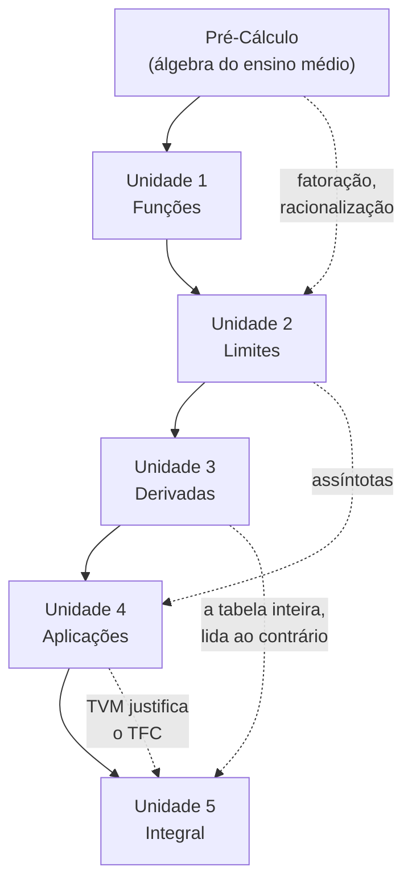

# Plano de estudos

| ← Anterior | 🏠 | Próximo → |
| :--- | :---: | ---: |
| [⭐ Revisão de Pré-Cálculo](revisao-pre-calculo.md) | [Comece aqui](README.md) · [Página inicial](../README.md) | [Como não reprovar](como-nao-reprovar.md) |

> [!IMPORTANT]
> **O cronograma abaixo é uma sugestão, não o calendário da sua turma.** A divisão em três provas, o número de semanas e a ordem dos tópicos **variam por professor**. Pegue o plano de ensino da disciplina na primeira semana e ajuste o que estiver aqui ao que ele disser.
>
> O que **não** varia é a ordem lógica do conteúdo: funções antes de limites, limites antes de derivadas, derivadas antes de integrais. Essa parte é do assunto, não do professor.

---

## 1. O mapa de dependências

Antes de montar qualquer cronograma, entenda o que depende do quê:

> 💡 **As setas pontilhadas são as que pegam gente desprevenida.** A Unidade 5 não depende só da 4: ela depende da **tabela de derivadas da Unidade 3**, lida de trás para frente. Quem chegou na integral sem derivar com fluência vai estudar dois assuntos ao mesmo tempo.

---

## 2. Cronograma sugerido — semestre normal

Supondo **15 semanas** e três avaliações. Ajuste às datas reais da sua turma.

### Bloco P1 — Funções, limites e continuidade

| Semana | Conteúdo | Faça |
| :---: | --- | --- |
| **0** | [Pré-Cálculo](revisao-pre-calculo.md) | o diagnóstico; leia as seções que errou |
| **1** | [1.1](../01-funcoes/1.1-numeros-reais-intervalos-valor-absoluto-desigualdades.md) · [1.2](../01-funcoes/1.2-funcoes-dominio-contradominio-imagem.md) | as duas listas |
| **2** | [1.3](../01-funcoes/1.3-funcoes-elementares-paridade-e-graficos.md) · [1.4](../01-funcoes/1.4-injetoras-sobrejetoras-bijetoras-e-inversas.md) | as duas listas + [revisão da U1](../01-funcoes/exercicios/revisao-unidade-1.md) |
| **3** | [2.1](../02-limites-e-continuidade/2.1-conceito-e-nocao-intuitiva-de-limite.md) · [2.2](../02-limites-e-continuidade/2.2-limites-laterais.md) | as duas listas |
| **4** | [2.3](../02-limites-e-continuidade/2.3-teorema-do-sanduiche.md) · [2.4](../02-limites-e-continuidade/2.4-limites-infinitos-no-infinito-e-assintotas.md) | as duas listas |
| **5** | [2.5](../02-limites-e-continuidade/2.5-continuidade-e-tipos-de-descontinuidade.md) | lista + [revisão da U2](../02-limites-e-continuidade/exercicios/revisao-unidade-2.md) |
| **6** | 🧪 **Revisão para a P1** | [Simulado P1](../07-simulados/simulado-p1-funcoes-e-limites.md) com cronômetro |

### Bloco P2 — Derivadas e aplicações

| Semana | Conteúdo | Faça |
| :---: | --- | --- |
| **7** | [3.1](../03-derivadas/3.1-conceito-interpretacao-geometrica-e-regras-basicas.md) · [3.2](../03-derivadas/3.2-derivadas-das-funcoes-elementares.md) | as duas listas |
| **8** | [3.3](../03-derivadas/3.3-regra-da-cadeia-e-derivada-da-funcao-inversa.md) · [3.4](../03-derivadas/3.4-derivadas-das-funcoes-trigonometricas-inversas.md) | as duas listas |
| **9** | [3.5](../03-derivadas/3.5-problemas-de-taxa-de-variacao.md) | lista + [revisão da U3](../03-derivadas/exercicios/revisao-unidade-3.md) |
| **10** | [4.1](../04-aplicacoes-das-derivadas/4.1-maximos-e-minimos.md) · [4.2](../04-aplicacoes-das-derivadas/4.2-teoremas-de-rolle-e-do-valor-medio.md) | as duas listas |
| **11** | [4.3](../04-aplicacoes-das-derivadas/4.3-regra-de-lhospital.md) · [4.4](../04-aplicacoes-das-derivadas/4.4-crescimento-concavidade-e-esboco-de-graficos.md) | as duas listas + [revisão da U4](../04-aplicacoes-das-derivadas/exercicios/revisao-unidade-4.md) |
| **12** | 🧪 **Revisão para a P2** | [Simulado P2](../07-simulados/simulado-p2-derivadas.md) com cronômetro |

### Bloco P3 — Integral

| Semana | Conteúdo | Faça |
| :---: | --- | --- |
| **13** | [5.1](../05-integrais/5.1-primitivas-e-o-conceito-de-integral.md) · [5.2](../05-integrais/5.2-tecnicas-de-integracao.md) | as duas listas — a 5.2 é a maior do curso |
| **14** | [5.3](../05-integrais/5.3-integral-definida-e-o-teorema-fundamental-do-calculo.md) · [5.4](../05-integrais/5.4-aplicacoes-da-integral-definida.md) | as duas listas |
| **15** | [5.5](../05-integrais/5.5-integrais-improprias.md) | lista + [revisão da U5](../05-integrais/exercicios/revisao-unidade-5.md) |
| — | 🧪 **Revisão para a P3** | [Simulado P3](../07-simulados/simulado-p3-integrais.md) |

---

## 3. A semana típica

Este material supõe cerca de **6 horas semanais** fora da aula. Distribuídas assim:

| Quando | Quanto | O quê |
| --- | :---: | --- |
| **No dia da aula** | 30 min | reler o caderno e a teoria da seção correspondente aqui |
| **Dois dias depois** | 2 h | fazer a lista de propostos — **sem** o gabarito aberto |
| **No fim de semana** | 2 h | conferir pela Parte 1, estudar os erros pela Parte 2 |
| **Na semana seguinte** | 1 h 30 | **refazer do zero** os exercícios que você errou |

> [!TIP]
> **A última linha é a que ninguém faz, e é a que mais rende.** Refazer um exercício errado uma semana depois é o único jeito de saber se você aprendeu ou apenas entendeu a resolução. Reserve esse bloco no calendário como se fosse aula.

---

## 4. Semestre comprimido — se você está atrasado

Se a prova é daqui a duas semanas e você tem a unidade inteira para estudar, **não dá para fazer tudo**. Priorize nesta ordem:

| Prioridade | O que fazer | Por quê |
| :---: | --- | --- |
| **1** | Os **exercícios resolvidos** de cada seção | são o essencial da teoria, já em formato de questão |
| **2** | O **Bloco B** das listas (consolidação) | é o nível de prova |
| **3** | A **revisão da unidade** | formato de prova, conteúdo misto |
| **4** | O **simulado** correspondente | com cronômetro |
| **5** | O Bloco A, se der tempo | fixação |
| — | O Bloco C | **pule** — está acima do nível de prova |

> [!CAUTION]
> **Pular a teoria e ir direto aos exercícios funciona pior do que parece.** Você resolve as questões iguais às do exemplo e trava em qualquer variação. Se o tempo for curtíssimo, leia **ao menos** o quadro "Resumo da página" de cada seção — ele tem o mínimo que precisa estar na sua cabeça.

---

## 5. Se você está de DP ou recuperação

Você já viu o conteúdo uma vez, então o problema não é cobertura — é **lacuna específica**.

1. **Faça os três simulados primeiro**, antes de estudar qualquer coisa. Com cronômetro.
2. **Anote em que questões você travou**, e não o que você errou por distração.
3. **Estude só as seções correspondentes.** Provavelmente serão três ou quatro, não vinte.
4. **Refaça os simulados** uma semana depois.

> 💡 **Reprovação em Cálculo 1 quase nunca é "não entendi nada".** É quase sempre duas ou três lacunas específicas — tipicamente regra da cadeia, esboço de gráficos e técnicas de integração — que derrubam metade das questões. Encontrar as lacunas é mais rápido do que recomeçar.

---

## 6. Cinco hábitos que decidem a nota

| Hábito | Por quê |
| --- | --- |
| **Fazer a lista sem o gabarito aberto** | com ele aberto, você treina reconhecer, não resolver |
| **Refazer os erros dias depois** | é o único teste honesto de aprendizado |
| **Escrever as contas por extenso** | o erro de sinal mora nos passos que você pulou |
| **Desenhar sempre que houver geometria** | otimização, área e volume se resolvem no desenho |
| **Conferir a resposta** | derivada confere integral; substituição confere limite |

---

## 7. O calendário em branco

Copie isto para o seu caderno ou agenda e preencha com as datas reais da sua turma:

| | Data | Conteúdo cobrado |
| --- | --- | --- |
| **P1** | ___/___ | |
| **P2** | ___/___ | |
| **P3** | ___/___ | |
| **Final** | ___/___ | |

> [!IMPORTANT]
> **Preencha a coluna da direita com o que o PROFESSOR disser**, não com o que está neste material. É a informação mais valiosa do semestre, e ela só existe no plano de ensino e no que é dito em aula.

---

| ← Anterior | 🏠 | Próximo → |
| :--- | :---: | ---: |
| [⭐ Revisão de Pré-Cálculo](revisao-pre-calculo.md) | [Comece aqui](README.md) · [Página inicial](../README.md) | [Como não reprovar](como-nao-reprovar.md) |

*Sobrevivendo ao Cálculo 1 (UENF)* · por **Nicolau Prates** · [CC BY-SA 4.0](../LICENSE)
