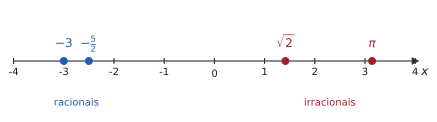
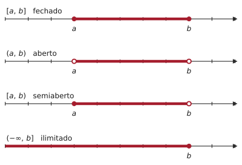
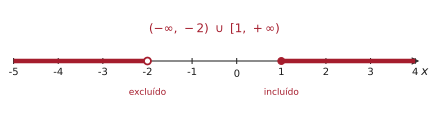
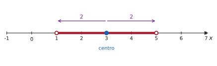
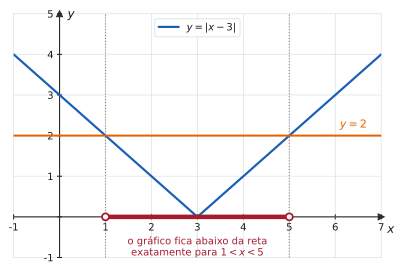

# 1.1 · Números reais, intervalos, valor absoluto e desigualdades

| ← Anterior | 🏠 Índice | Próximo → |
| :--- | :---: | ---: |
| [Unidade 1](README.md) | [Página inicial](../README.md) | [1.2 · Funções](1.2-funcoes-dominio-contradominio-imagem.md) |

---

## 🎯 O que você vai aprender

- Identificar os conjuntos numéricos e entender o que torna $\mathbb{R}$ especial.
- Resolver inequações do 1º grau, do 2º grau e com quociente, usando **quadro de sinais**.
- Escrever qualquer conjunto-solução em **notação de intervalo**.
- Interpretar o **valor absoluto** como distância na reta.
- Resolver equações e inequações com módulo — inclusive as que aparecem na definição formal de limite.

**Pré-requisitos:** [⭐ Revisão de Pré-Cálculo](../00-comece-aqui/revisao-pre-calculo.md) — fatoração e frações algébricas.

---

## Por que isso importa

Esta seção parece Ensino Médio, e em parte é. Mas ela é a **ferramenta de trabalho** do curso inteiro: achar o domínio de uma função é resolver uma inequação; estudar onde uma função cresce é fazer um quadro de sinais; e a definição formal de limite — aquela que aparece na Unidade 2 — é, literalmente, uma frase sobre valor absoluto:

$$\lvert f(x) - L \rvert < \varepsilon \quad \text{sempre que} \quad 0 < \lvert x - a \rvert < \delta$$

Quem não lê essa linha com naturalidade vai decorar limite em vez de entender. Aqui é onde se aprende a lê-la.

---

## 1. Os conjuntos numéricos

A construção dos números segue uma lógica simples: cada conjunto novo aparece porque o anterior não resolvia alguma conta.

| Conjunto | Símbolo | O que é | Apareceu porque |
| --- | :---: | --- | --- |
| Naturais | $\mathbb{N}$ | $\{0, 1, 2, 3, \ldots\}$ | é preciso contar |
| Inteiros | $\mathbb{Z}$ | $\{\ldots, -2, -1, 0, 1, 2, \ldots\}$ | $3 - 5$ não tem resposta em $\mathbb{N}$ |
| Racionais | $\mathbb{Q}$ | quocientes $\dfrac{p}{q}$, com $p, q \in \mathbb{Z}$ e $q \neq 0$ | $3 \div 2$ não tem resposta em $\mathbb{Z}$ |
| Irracionais | $\mathbb{I}$ | os que **não** são quociente de inteiros | $\sqrt{2}$ não tem resposta em $\mathbb{Q}$ |
| Reais | $\mathbb{R}$ | $\mathbb{Q} \cup \mathbb{I}$ | para não haver buracos na reta |

E vale a cadeia de inclusões:

$$\mathbb{N} \subset \mathbb{Z} \subset \mathbb{Q} \subset \mathbb{R}$$

> 💡 **Como reconhecer um racional pela forma decimal.** Um número é racional se, e somente se, sua expansão decimal é **finita** ($0{,}75$) ou **infinita e periódica** ($0{,}333\ldots$, $1{,}2727\ldots$). Se a expansão é infinita e **não** se repete em bloco nenhum — como $\sqrt{2} = 1{,}41421356\ldots$ ou $\pi = 3{,}14159265\ldots$ — o número é irracional.

### 📊 A reta real

A cada número real corresponde exatamente um ponto da reta, e a cada ponto da reta corresponde exatamente um número real. É essa correspondência que permite trocar álgebra por geometria o tempo todo.

> 📊 Observe que os irracionais não são exceções raras perdidas entre os racionais: eles estão em toda parte. Entre dois racionais quaisquer existe um irracional, e entre dois irracionais quaisquer existe um racional.

> [!NOTE]
> **A propriedade que faz o Cálculo existir.** $\mathbb{Q}$ também preenche a reta de forma densa, mas tem buracos: não existe racional cujo quadrado seja $2$. Já $\mathbb{R}$ é **completo** — não tem buraco nenhum. É essa completude que garante que um processo de aproximação infinito (um limite) tenha para onde convergir. Sem ela, não haveria Cálculo.

<b>Curiosidade: por que √2 não é racional</b> (clique para abrir)

Suponha, por absurdo, que $\sqrt{2} = \frac{p}{q}$, com $p$ e $q$ inteiros sem fator comum. Elevando ao quadrado: $2q^2 = p^2$. Logo $p^2$ é par, e portanto $p$ é par — digamos $p = 2k$. Substituindo: $2q^2 = 4k^2$, ou seja, $q^2 = 2k^2$. Então $q^2$ é par, e $q$ também é par. Mas aí $p$ e $q$ têm o fator comum $2$, contrariando a hipótese. A contradição mostra que $\sqrt{2}$ não pode ser escrito como quociente de inteiros.

---

## 2. Desigualdades: as regras do jogo

Toda inequação é resolvida aplicando quatro propriedades. Elas parecem óbvias — e é justamente por isso que a terceira derruba tanta gente em prova.

> 📐 **Propriedades da ordem.** Sejam $a$, $b$ e $c$ números reais.
>
> **(O1) Transitividade.** Se $a < b$ e $b < c$, então $a < c$.
>
> **(O2) Soma.** Se $a < b$, então $a + c < b + c$ — para **qualquer** $c$.
>
> **(O3) Produto por positivo.** Se $a < b$ e $c > 0$, então $ac < bc$.
>
> **(O4) Produto por negativo.** Se $a < b$ e $c < 0$, então $ac > bc$ — **a desigualdade inverte**.
>
> **(O5) Inversão.** Se $0 < a < b$, então $\dfrac{1}{a} > \dfrac{1}{b}$.

> [!WARNING]
> **(O4) é a origem de metade dos erros desta seção.** Somar qualquer coisa aos dois lados é sempre seguro. Multiplicar (ou dividir) só é seguro quando você **sabe o sinal** do que está multiplicando. Se o fator é uma expressão com $x$ dentro, você não sabe o sinal — e aí multiplicar é proibido. A saída está na §4.3.

### Notação

| Símbolo | Lê-se | Inclui o extremo? |
| :---: | --- | :---: |
| $a < b$ | $a$ é menor que $b$ | não |
| $a \leqslant b$ | $a$ é menor ou igual a $b$ | sim |
| $a > b$ | $a$ é maior que $b$ | não |
| $a \geqslant b$ | $a$ é maior ou igual a $b$ | sim |

Uma dupla desigualdade como $-2 < x \leqslant 5$ significa **duas** afirmações simultâneas: $-2 < x$ **e** $x \leqslant 5$.

---

## 3. Intervalos

> 📐 **Definição 1.1.1 (Intervalo).** Dados $a, b \in \mathbb{R}$ com $a < b$, chamam-se intervalos os subconjuntos de $\mathbb{R}$ descritos na tabela abaixo.

| Notação | Descrição | Leitura |
| :---: | :---: | --- |
| $[a,b]$ | $\{x \in \mathbb{R} \mid a \leqslant x \leqslant b\}$ | fechado: inclui os dois extremos |
| $(a,b)$ | $\{x \in \mathbb{R} \mid a < x < b\}$ | aberto: exclui os dois |
| $[a,b)$ | $\{x \in \mathbb{R} \mid a \leqslant x < b\}$ | semiaberto à direita |
| $(a,b]$ | $\{x \in \mathbb{R} \mid a < x \leqslant b\}$ | semiaberto à esquerda |
| $[a,+\infty)$ | $\{x \in \mathbb{R} \mid x \geqslant a\}$ | ilimitado à direita |
| $(a,+\infty)$ | $\{x \in \mathbb{R} \mid x > a\}$ | ilimitado à direita, sem $a$ |
| $(-\infty,b]$ | $\{x \in \mathbb{R} \mid x \leqslant b\}$ | ilimitado à esquerda |
| $(-\infty,b)$ | $\{x \in \mathbb{R} \mid x < b\}$ | ilimitado à esquerda, sem $b$ |
| $(-\infty,+\infty)$ | $\mathbb{R}$ | a reta toda |

> 📊 **A bolinha conta a história:** cheia (●) significa que o extremo **pertence** ao conjunto; vazia (○), que ele **não pertence**. Essa mesma convenção vai reaparecer nos gráficos de funções definidas por partes, na Unidade 2.

> [!IMPORTANT]
> **O símbolo $\infty$ nunca recebe colchete fechado.** Escrever $[2, +\infty]$ é erro, não detalhe de estilo: $+\infty$ **não é um número real**, é uma notação para dizer "cresce sem limitação". Como não é número, não pode pertencer a conjunto nenhum. O certo é $[2, +\infty)$.

### União e interseção

Conjuntos-solução frequentemente são uniões de intervalos:

$$(-\infty,-2) \cup [1,+\infty) \quad \text{significa} \quad x < -2 \ \textbf{ ou } \ x \geqslant 1$$

$$[0,5] \cap (3,8) = (3,5] \quad \text{significa} \quad x \in [0,5] \ \textbf{ e } \ x \in (3,8)$$

> 💡 **Não troque "ou" por "e".** União é "ou" — basta estar em um dos dois. Interseção é "e" — precisa estar nos dois ao mesmo tempo. Escrever $(-\infty,-2) \cap [1,+\infty)$ no lugar da união daria o conjunto vazio, que é o oposto da resposta.

---

## 4. Como resolver uma inequação

O procedimento é sempre o mesmo, em três passos:

Nunca "isole o $x$" à força em inequação com fração ou com produto. Isolar funciona em equação; em inequação, produz erro.

### 4.1 Inequação do 1º grau

#### ✍️ Exemplo 1 — resolva $3x - 5 < x + 7$

**Estratégia.** Só há soma e produto por número de sinal conhecido: dá para isolar $x$ com segurança.

**Solução.**

1. Passando $x$ para a esquerda e $-5$ para a direita (propriedade O2):
   $$3x - x < 7 + 5 \quad \Longrightarrow \quad 2x < 12$$
2. Dividindo por $2$, que é **positivo** — a desigualdade se mantém (O3):
   $$x < 6$$

**Resposta.** $S = (-\infty,\,6)$

---

#### ✍️ Exemplo 2 — resolva $-2x + 1 \geqslant 7$

**Solução.**

1. $-2x \geqslant 6$.
2. Dividindo por $-2$, que é **negativo**: a desigualdade **inverte** (O4).
   $$x \leqslant -3$$

**Resposta.** $S = (-\infty,\,-3]$

> ⚠️ Se você dividiu por $-2$ e escreveu $x \geqslant -3$, teste $x = 0$ no enunciado: $-2(0)+1 = 1$, e $1 \geqslant 7$ é falso. Substituir um valor da sua resposta no enunciado original é a forma mais rápida de pegar esse erro.

### 4.2 Inequação do 2º grau

#### ✍️ Exemplo 3 — resolva $x^2 - x - 6 \geqslant 0$

**Estratégia.** Fatorar e usar o sinal da parábola.

**Solução.**

1. As raízes de $x^2 - x - 6 = 0$ são $x = -2$ e $x = 3$, logo
   $$x^2 - x - 6 = (x+2)(x-3)$$
2. A parábola tem concavidade **para cima** (coeficiente de $x^2$ positivo). Então ela é negativa **entre** as raízes e positiva **fora** delas.

| | $x < -2$ | $x = -2$ | $-2 < x < 3$ | $x = 3$ | $x > 3$ |
| --- | :---: | :---: | :---: | :---: | :---: |
| sinal de $(x+2)(x-3)$ | $+$ | $0$ | $-$ | $0$ | $+$ |

3. Queremos $\geqslant 0$: ficamos com as regiões de sinal $+$ **e** com as raízes.

**Resposta.** $S = (-\infty,\,-2] \cup [3,\,+\infty)$

> 💡 **Regra prática para o 2º grau:** com concavidade para cima, o trinômio tem o sinal **contrário** ao do coeficiente dominante entre as raízes e o **mesmo** sinal fora delas. Em uma frase: *"dentro das raízes, sinal trocado"*.

### 4.3 Inequação com quociente — a armadilha clássica

> [!CAUTION]
> **Nunca multiplique os dois lados pelo denominador.** Em $\dfrac{x-1}{x+2} \geqslant 0$, multiplicar por $x+2$ exigiria saber se $x+2$ é positivo ou negativo — e isso é justamente o que não se sabe. O caminho correto é **estudar o sinal do quociente**, que segue a mesma regra de sinais do produto.

#### ✍️ Exemplo 4 — resolva $\dfrac{x-1}{x+2} \geqslant 0$

**Estratégia.** Localizar os pontos em que numerador e denominador **zeram**, e estudar o sinal de cada fator em cada faixa.

**Solução.**

1. Zeros: o numerador zera em $x = 1$; o denominador zera em $x = -2$. Esses dois valores dividem a reta em três faixas.
2. Quadro de sinais:

| | $x < -2$ | $x = -2$ | $-2 < x < 1$ | $x = 1$ | $x > 1$ |
| --- | :---: | :---: | :---: | :---: | :---: |
| $x - 1$ | $-$ | $-$ | $-$ | $0$ | $+$ |
| $x + 2$ | $-$ | $0$ | $+$ | $+$ | $+$ |
| $\dfrac{x-1}{x+2}$ | $+$ | ∄ | $-$ | $0$ | $+$ |

3. Queremos $\geqslant 0$: tomamos as faixas com sinal $+$ e o ponto em que o quociente **zera** ($x=1$). O ponto $x = -2$ fica **de fora**: ali a expressão nem existe.

**Resposta.** $S = (-\infty,\,-2) \cup [1,\,+\infty)$

> 📊 Note a assimetria das bolinhas: em $x=1$ a bolinha é cheia (o quociente vale $0$, e $0 \geqslant 0$ é verdade); em $x=-2$ é vazia (o quociente não existe). **Zero do numerador entra quando a desigualdade é $\leqslant$ ou $\geqslant$; zero do denominador nunca entra.**

---

#### ✍️ Exemplo 5 — resolva $\dfrac{x-1}{x+2} \leqslant 2$

**Estratégia.** Há um número no lado direito. Antes de qualquer coisa, jogue tudo para a esquerda — e **não** multiplique cruzado.

**Solução.**

1. Passando o $2$ para a esquerda e reduzindo ao mesmo denominador:
   $$\frac{x-1}{x+2} - 2 \leqslant 0 \quad \Longrightarrow \quad \frac{(x-1) - 2(x+2)}{x+2} \leqslant 0$$
2. Desenvolvendo o numerador:
   $$\frac{x - 1 - 2x - 4}{x+2} \leqslant 0 \quad \Longrightarrow \quad \frac{-x-5}{x+2} \leqslant 0$$
3. Multiplicando numerador e denominador por $-1$ — o que equivale a multiplicar a fração por $-1$, e portanto **inverte** a desigualdade:
   $$\frac{x+5}{x+2} \geqslant 0$$
4. Quadro de sinais, com zeros em $x = -5$ e $x = -2$:

| | $x < -5$ | $x = -5$ | $-5 < x < -2$ | $x = -2$ | $x > -2$ |
| --- | :---: | :---: | :---: | :---: | :---: |
| $x + 5$ | $-$ | $0$ | $+$ | $+$ | $+$ |
| $x + 2$ | $-$ | $-$ | $-$ | $0$ | $+$ |
| $\dfrac{x+5}{x+2}$ | $+$ | $0$ | $-$ | ∄ | $+$ |

**Resposta.** $S = (-\infty,\,-5] \cup (-2,\,+\infty)$

> 💡 **Confira sempre com um valor de teste.** Tome $x = 0$, que está na resposta: $\frac{0-1}{0+2} = -0{,}5 \leqslant 2$ ✔. Tome $x = -3$, que **não** está: $\frac{-4}{-1} = 4 \leqslant 2$ ✘. Dois testes de dez segundos e você sabe se a resposta faz sentido.

---

#### ✍️ Exemplo 6 — resolva $x^3 - 4x > 0$

**Solução.**

1. Fatorando: $x^3 - 4x = x(x^2-4) = x(x-2)(x+2)$.
2. Zeros em $-2$, $0$ e $2$ — quatro faixas:

| | $x < -2$ | $-2 < x < 0$ | $0 < x < 2$ | $x > 2$ |
| --- | :---: | :---: | :---: | :---: |
| $x$ | $-$ | $-$ | $+$ | $+$ |
| $x - 2$ | $-$ | $-$ | $-$ | $+$ |
| $x + 2$ | $-$ | $+$ | $+$ | $+$ |
| produto | $-$ | $+$ | $-$ | $+$ |

3. Queremos $> 0$ estrito, então as raízes ficam de fora.

**Resposta.** $S = (-2,\,0) \cup (2,\,+\infty)$

> 💡 **Atalho que funciona:** quando todas as raízes são simples, o sinal **alterna** a cada raiz, da direita para a esquerda. Comece pela faixa mais à direita (onde o produto de fatores positivos é positivo) e vá alternando: $+,\,-,\,+,\,-$. Cuidado: o atalho falha quando há raiz **dupla**, como em $(x-1)^2(x+3)$ — ali o sinal **não** troca ao passar por $x=1$.

---

## 5. Valor absoluto

> 📐 **Definição 1.1.2 (Valor absoluto).** Para todo $x \in \mathbb{R}$,
> $$\lvert x \rvert = \begin{cases} x, & \text{se } x \geqslant 0 \\[4pt] -x, & \text{se } x < 0 \end{cases}$$

Repare que, para $x$ negativo, $-x$ é **positivo**: $\lvert -7 \rvert = -(-7) = 7$. O sinal de menos na definição não torna o resultado negativo — ele conserta o sinal.

> 💡 **A leitura que realmente importa: $\lvert x \rvert$ é a distância de $x$ até a origem.** E, mais geralmente:
> $$\lvert x - a \rvert = \text{distância entre } x \text{ e } a \text{ na reta real}$$
> Toda inequação com módulo pode ser lida em português como uma frase sobre distância. É assim que se resolve sem decorar caso nenhum.

### 📐 Propriedades

| Propriedade | Enunciado | Observação |
| :---: | --- | --- |
| P1 | $\lvert x \rvert \geqslant 0$ | módulo nunca é negativo |
| P2 | $\lvert x \rvert = 0 \iff x = 0$ | distância zero só da origem até ela mesma |
| P3 | $\lvert -x \rvert = \lvert x \rvert$ | simétricos têm o mesmo módulo |
| P4 | $\lvert xy \rvert = \lvert x \rvert \cdot \lvert y \rvert$ | o módulo "entra" no produto |
| P5 | $\left\lvert \dfrac{x}{y} \right\rvert = \dfrac{\lvert x \rvert}{\lvert y \rvert}$, $y \neq 0$ | e no quociente |
| P6 | $\lvert x \rvert^2 = x^2$ | o quadrado apaga o módulo |
| P7 | $\sqrt{x^2} = \lvert x \rvert$ | **não** é $x$ |
| P8 | $\lvert x + y \rvert \leqslant \lvert x \rvert + \lvert y \rvert$ | desigualdade triangular |

> [!WARNING]
> **P7 é a armadilha predileta das provas.** $\sqrt{x^2} = x$ só vale quando $x \geqslant 0$. Para $x = -5$: $\sqrt{(-5)^2} = \sqrt{25} = 5 = \lvert -5 \rvert$, e não $-5$. A raiz quadrada devolve sempre o valor não negativo.

> [!NOTE]
> **Por que P8 não é igualdade.** Tome $x = 3$ e $y = -3$: do lado esquerdo, $\lvert 0 \rvert = 0$; do direito, $3 + 3 = 6$. Quando os sinais são **opostos**, há cancelamento à esquerda e nenhum à direita. A igualdade só vale quando $x$ e $y$ têm o mesmo sinal (ou um deles é zero).

---

## 6. Equações e inequações com valor absoluto

Tudo se reduz a **três equivalências**. Supondo $a > 0$:

> 📐 **Propriedade 1.1.3.**
> $$\lvert u \rvert = a \iff u = a \ \text{ ou } \ u = -a$$
> $$\lvert u \rvert < a \iff -a < u < a$$
> $$\lvert u \rvert > a \iff u > a \ \text{ ou } \ u < -a$$
>
> Aqui $u$ pode ser qualquer expressão: $x$, $2x-1$, $x^2-4$, o que for. As versões com $\leqslant$ e $\geqslant$ são idênticas, trocando as desigualdades estritas.

Em português: **"módulo menor" vira um intervalo** (um "e"); **"módulo maior" vira duas semirretas** (um "ou"). Confundir os dois troca a resposta pelo complementar dela.

#### ✍️ Exemplo 7 — resolva $\lvert 2x - 1 \rvert \leqslant 5$

**Solução.**

1. "Módulo menor ou igual" vira uma dupla desigualdade:
   $$-5 \leqslant 2x - 1 \leqslant 5$$
2. Somando $1$ nos três membros: $-4 \leqslant 2x \leqslant 6$.
3. Dividindo por $2$ (positivo, não inverte): $-2 \leqslant x \leqslant 3$.

**Resposta.** $S = [-2,\,3]$

---

#### ✍️ Exemplo 8 — resolva $\lvert x + 4 \rvert > 3$

**Solução.**

1. "Módulo maior" vira **duas** condições ligadas por **ou**:
   $$x + 4 > 3 \quad \text{ou} \quad x + 4 < -3$$
2. Resolvendo cada uma: $x > -1$ ou $x < -7$.

**Resposta.** $S = (-\infty,\,-7) \cup (-1,\,+\infty)$

> 💡 **Leitura geométrica:** a distância de $x$ até $-4$ é maior que $3$. Logo $x$ está fora do intervalo de centro $-4$ e raio $3$, que é $(-7,-1)$. A resposta é exatamente o complementar desse intervalo — e dava para escrevê-la sem conta nenhuma.

---

#### ✍️ Exemplo 9 — resolva $\lvert x - 2 \rvert = \lvert 2x + 1 \rvert$

**Estratégia.** Com módulo nos dois lados, use: dois números têm o mesmo módulo quando são iguais **ou** simétricos.

**Solução.**

1. **Caso 1:** $x - 2 = 2x + 1 \Longrightarrow -3 = x$.
2. **Caso 2:** $x - 2 = -(2x+1) \Longrightarrow x - 2 = -2x - 1 \Longrightarrow 3x = 1 \Longrightarrow x = \dfrac{1}{3}$.
3. Verificando em $x = -3$: $\lvert -5 \rvert = 5$ e $\lvert -5 \rvert = 5$ ✔. Em $x = \frac13$: $\left\lvert -\frac53 \right\rvert = \frac53$ e $\left\lvert \frac53 \right\rvert = \frac53$ ✔.

**Resposta.** $S = \left\{ -3,\ \dfrac{1}{3} \right\}$

---

### 📊 A mesma inequação, vista de três jeitos

Considere $\lvert x - 3 \rvert < 2$.

**Pela álgebra:** $-2 < x-3 < 2 \Longrightarrow 1 < x < 5$.

**Pela geometria da reta** — os pontos cuja distância até $3$ é menor que $2$:

**Pelo gráfico** — os pontos em que a curva $y = \lvert x-3 \rvert$ fica **abaixo** da reta $y = 2$:

> 📊 As três leituras dão o mesmo $(1,5)$ — e cada uma é útil em um momento diferente. A algébrica resolve; a geométrica confere em cinco segundos; a gráfica é a que você vai usar na Unidade 2, quando a pergunta virar "quão perto de $3$ o $x$ precisa estar?".

> [!IMPORTANT]
> **A notação que vai reaparecer na definição de limite.** Para $\delta > 0$:
> $$\lvert x - a \rvert < \delta \iff a - \delta < x < a + \delta$$
> é o intervalo de **centro $a$ e raio $\delta$** — chamado de **vizinhança** de $a$. E
> $$0 < \lvert x - a \rvert < \delta$$
> é a mesma vizinhança **sem o ponto $a$**, porque $\lvert x-a \rvert > 0$ obriga $x \neq a$. É exatamente isso que o limite quer dizer com *"quando $x$ se aproxima de $a$, sem assumir o valor $a$"*. Guarde esta caixa: você vai voltar a ela em novembro.

---

## ⚠️ Armadilhas

| O erro | Por que está errado | O certo |
| --- | --- | --- |
| $\dfrac{x-1}{x+2} \geqslant 0 \Rightarrow x - 1 \geqslant 0$ | multiplicou por $x+2$, que pode ser negativo e inverter a desigualdade | quadro de sinais |
| $\sqrt{x^2} = x$ | falso para $x < 0$ | $\sqrt{x^2} = \lvert x \rvert$ |
| $\lvert x \rvert < -3$ tem solução | módulo nunca é negativo | $S = \varnothing$ |
| $\lvert x \rvert > -3$ precisa de conta | módulo é sempre $\geqslant 0 > -3$ | $S = \mathbb{R}$ |
| $\lvert x \rvert = 5 \Rightarrow x = 5$ | esqueceu a raiz negativa | $x = 5$ ou $x = -5$ |
| $[2, +\infty]$ | $+\infty$ não é número real | $[2, +\infty)$ |
| $x^2 > 4 \Rightarrow x > 2$ | esqueceu o ramo negativo | $\lvert x \rvert > 2$, logo $x>2$ ou $x<-2$ |
| escrever $\cap$ onde era $\cup$ | "ou" virou "e" | união em conjuntos-solução separados |

> [!TIP]
> **O teste de dez segundos.** Terminou a inequação? Escolha um número **dentro** da sua resposta e um **fora**, e substitua no enunciado original. O de dentro tem de satisfazer; o de fora, não. Esse teste pega quase todos os erros de sinal — e custa menos tempo do que refazer a questão.

---

## 🧠 Exercícios resolvidos

### Exercício Resolvido 1

**Resolva** $\dfrac{x+1}{x-2} \leqslant 3$.

**Estratégia.** Número do lado direito ⇒ passar tudo para a esquerda e reduzir ao mesmo denominador. Multiplicar cruzado está proibido.

**Solução.**

$$\frac{x+1}{x-2} - 3 \leqslant 0 \quad \Longrightarrow \quad \frac{(x+1) - 3(x-2)}{x-2} \leqslant 0 \quad \Longrightarrow \quad \frac{-2x+7}{x-2} \leqslant 0$$

Multiplicando por $-1$ (inverte a desigualdade):

$$\frac{2x-7}{x-2} \geqslant 0$$

Zeros: $x = \frac{7}{2}$ (numerador) e $x = 2$ (denominador).

| | $x < 2$ | $x = 2$ | $2 < x < \frac72$ | $x = \frac72$ | $x > \frac72$ |
| --- | :---: | :---: | :---: | :---: | :---: |
| $2x-7$ | $-$ | $-$ | $-$ | $0$ | $+$ |
| $x-2$ | $-$ | $0$ | $+$ | $+$ | $+$ |
| quociente | $+$ | ∄ | $-$ | $0$ | $+$ |

**Resposta.** $S = (-\infty,\,2) \cup \left[\dfrac{7}{2},\,+\infty\right)$

*Conferência:* $x=0$ dá $\frac{1}{-2} = -0{,}5 \leqslant 3$ ✔ ; $x=3$ dá $\frac{4}{1}=4 \leqslant 3$ ✘ (e $3 \notin S$) ✔.

---

### Exercício Resolvido 2

**Resolva** $\lvert x - 1 \rvert + \lvert x + 2 \rvert < 5$.

**Estratégia.** Com **duas** barras de módulo, divida a reta pelos pontos em que cada expressão interna zera — aqui, $x = 1$ e $x = -2$ — e resolva em cada faixa, retirando os módulos com o sinal correto.

**Solução.**

**Caso 1: $x < -2$.** Então $x-1 < 0$ e $x+2 < 0$, logo $\lvert x-1 \rvert = -(x-1)$ e $\lvert x+2 \rvert = -(x+2)$:

$$-(x-1) - (x+2) < 5 \ \Longrightarrow\ -2x - 1 < 5 \ \Longrightarrow\ x > -3$$

Combinando com a hipótese da faixa: $-3 < x < -2$.

**Caso 2: $-2 \leqslant x < 1$.** Agora $x-1 < 0$ e $x+2 \geqslant 0$:

$$-(x-1) + (x+2) < 5 \ \Longrightarrow\ 3 < 5$$

Verdade sempre. Toda a faixa serve: $-2 \leqslant x < 1$.

**Caso 3: $x \geqslant 1$.** Ambas as expressões são não negativas:

$$(x-1) + (x+2) < 5 \ \Longrightarrow\ 2x + 1 < 5 \ \Longrightarrow\ x < 2$$

Combinando: $1 \leqslant x < 2$.

Unindo os três casos: $(-3,-2) \cup [-2,1) \cup [1,2) = (-3,2)$.

**Resposta.** $S = (-3,\,2)$

> 💡 **A leitura geométrica explica o resultado:** a soma das distâncias de $x$ até $1$ e até $-2$ é menor que $5$. Como os dois pontos distam $3$ entre si, sobram $5-3 = 2$ unidades para repartir, uma para cada lado — e $2$ dividido por $2$ dá $1$ de folga em cada extremo: de $-2-1 = -3$ até $1+1 = 2$. Exatamente o intervalo encontrado.

---

### Exercício Resolvido 3

**Resolva** $\lvert 2x - 1 \rvert \geqslant \lvert x + 3 \rvert$.

**Estratégia.** Módulo dos dois lados e ambos não negativos ⇒ pode-se **elevar ao quadrado** sem perder nem ganhar solução, usando P6.

**Solução.**

$$(2x-1)^2 \geqslant (x+3)^2 \ \Longrightarrow\ 4x^2 - 4x + 1 \geqslant x^2 + 6x + 9$$
$$3x^2 - 10x - 8 \geqslant 0$$

Raízes: $x = \dfrac{10 \pm \sqrt{100 + 96}}{6} = \dfrac{10 \pm 14}{6}$, ou seja, $x = 4$ e $x = -\dfrac{2}{3}$.

Concavidade para cima ⇒ a expressão é $\geqslant 0$ **fora** das raízes.

**Resposta.** $S = \left(-\infty,\,-\dfrac{2}{3}\right] \cup \left[4,\,+\infty\right)$

> [!WARNING]
> Elevar ao quadrado só é seguro **quando os dois lados são não negativos**. Em $\lvert x - 1 \rvert \geqslant x - 3$, por exemplo, o lado direito pode ser negativo, e elevar ao quadrado criaria soluções falsas. Nesse caso, volte para a análise por casos.

---

### Exercício Resolvido 4

**Para quais valores de $x$ a expressão** $\sqrt{\dfrac{x-1}{x+3}}$ **representa um número real?**

**Estratégia.** Raiz quadrada de índice par exige radicando $\geqslant 0$; e o denominador não pode zerar. Este é, na prática, o primeiro exercício de **domínio de função** do curso.

**Solução.** É preciso ter $\dfrac{x-1}{x+3} \geqslant 0$, com $x \neq -3$.

| | $x < -3$ | $-3 < x < 1$ | $x = 1$ | $x > 1$ |
| --- | :---: | :---: | :---: | :---: |
| $x-1$ | $-$ | $-$ | $0$ | $+$ |
| $x+3$ | $-$ | $+$ | $+$ | $+$ |
| quociente | $+$ | $-$ | $0$ | $+$ |

**Resposta.** $S = (-\infty,\,-3) \cup [1,\,+\infty)$

---

### Exercício Resolvido 5

**Demonstre a desigualdade triangular:** $\lvert x + y \rvert \leqslant \lvert x \rvert + \lvert y \rvert$, para todos $x, y \in \mathbb{R}$.

**Estratégia.** Usar que todo número está entre $-\lvert \cdot \rvert$ e $+\lvert \cdot \rvert$, somar as duas desigualdades e reconhecer a forma $\lvert u \rvert \leqslant c$.

**Solução.**

1. Para qualquer real $t$ vale $-\lvert t \rvert \leqslant t \leqslant \lvert t \rvert$ (se $t \geqslant 0$, a desigualdade da direita é igualdade; se $t<0$, a da esquerda é).
2. Aplicando a $x$ e a $y$:
   $$-\lvert x \rvert \leqslant x \leqslant \lvert x \rvert \qquad \text{e} \qquad -\lvert y \rvert \leqslant y \leqslant \lvert y \rvert$$
3. Somando membro a membro (válido por O2):
   $$-\big(\lvert x \rvert + \lvert y \rvert\big) \leqslant x + y \leqslant \lvert x \rvert + \lvert y \rvert$$
4. Pela Propriedade 1.1.3, uma desigualdade da forma $-c \leqslant u \leqslant c$ equivale a $\lvert u \rvert \leqslant c$. Com $u = x+y$ e $c = \lvert x \rvert + \lvert y \rvert$:
   $$\lvert x + y \rvert \leqslant \lvert x \rvert + \lvert y \rvert \qquad \blacksquare$$

---

### Exercício Resolvido 6 — um ensaio para a Unidade 2

**Encontre um número** $\delta > 0$ **tal que, se** $\lvert x - 2 \rvert < \delta$, **então** $\lvert 3x - 6 \rvert < 0{,}1$.

**Estratégia.** Fazer aparecer $\lvert x - 2 \rvert$ dentro da expressão que se quer controlar.

**Solução.**

1. Fatorando o que se quer tornar pequeno:
   $$\lvert 3x - 6 \rvert = \lvert 3(x-2) \rvert = 3\,\lvert x - 2 \rvert$$
   (usando P4, já que $\lvert 3 \rvert = 3$).
2. Queremos $3\,\lvert x-2 \rvert < 0{,}1$, ou seja, $\lvert x-2 \rvert < \dfrac{0{,}1}{3} = \dfrac{1}{30}$.
3. Basta então tomar $\delta = \dfrac{1}{30}$ — ou qualquer valor positivo menor.

**Resposta.** $\delta = \dfrac{1}{30} \approx 0{,}0333$ (qualquer $0 < \delta \leqslant \frac{1}{30}$ serve).

> 💡 **O que acabou de acontecer:** você provou, pela definição, que $\lim_{x \to 2} 3x = 6$. É essa a conta que está por trás da definição formal de limite — e ela é, como você viu, uma conta com valor absoluto e nada mais.

---

## 📝 Agora é com você

➡️ **[Lista 1.1 — exercícios propostos](exercicios/lista-1.1-propostos.md)** · ✅ **[Gabarito](gabaritos/gabarito-1.1.md)**

Faça a lista **antes** de ir para 1.2. Domínio de função, o assunto da próxima página, é inequação disfarçada: quem não resolve inequação com segurança vai travar lá.

---

## Resumo da página

> **Decore:**
> - $\lvert x \rvert = x$ se $x \geqslant 0$, e $-x$ se $x < 0$; sempre $\sqrt{x^2} = \lvert x \rvert$.
> - $\lvert u \rvert < a \iff -a < u < a$  (vira **intervalo**).
> - $\lvert u \rvert > a \iff u > a$ **ou** $u < -a$  (vira **duas semirretas**).
> - $\infty$ nunca leva colchete fechado.
>
> **Saiba fazer:**
> - Passar tudo para um lado, fatorar e montar o quadro de sinais — este é *o* procedimento da seção.
> - Lembrar que multiplicar por expressão de sinal desconhecido é proibido.
> - Ler $\lvert x - a \rvert < \delta$ como "a distância de $x$ até $a$ é menor que $\delta$".
> - Conferir a resposta com um valor de dentro e um de fora.

---

## 📚 Para aprofundar

| Livro | Onde procurar |
| --- | --- |
| **LEITHOLD** | Capítulo 1 — "Números reais, desigualdades e intervalos" e "Valor absoluto" |
| **STEWART** | Apêndice A — "Números, desigualdades e valores absolutos" |
| **THOMAS** | Capítulo de preliminares — "Os números reais e a reta real" |
| **ANTON** | Apêndice de revisão — "Números reais, intervalos e desigualdades" |
| **SWOKOWSKI** | Capítulo 1 — seção sobre desigualdades e valor absoluto |
| **MUNEM & FOULIS** | Capítulo 1 — "Números reais e a reta real" |

> [!NOTE]
> A numeração de capítulos muda de uma edição para outra. Procure pelo **título da seção**, não pelo número.

---

| ← Anterior | 🏠 Índice | Próximo → |
| :--- | :---: | ---: |
| [Unidade 1](README.md) | [Unidade 1](README.md) · [Página inicial](../README.md) | [1.2 · Funções: domínio e imagem](1.2-funcoes-dominio-contradominio-imagem.md) |

*Sobrevivendo ao Cálculo 1 (UENF)* · por **Nicolau Prates** · [CC BY-SA 4.0](../LICENSE)
