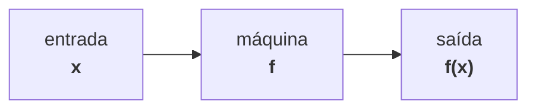
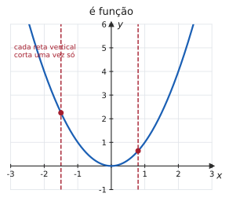
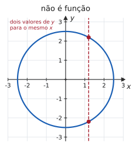
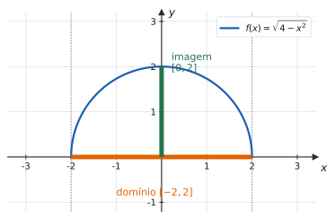
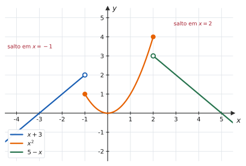
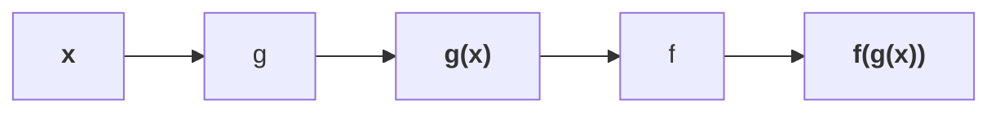

# 1.2 · Funções: conceito, domínio, contradomínio e imagem

| ← Anterior | 🏠 Índice | Próximo → |
| :--- | :---: | ---: |
| [1.1 · Números reais](1.1-numeros-reais-intervalos-valor-absoluto-desigualdades.md) | [Unidade 1](README.md) · [Página inicial](../README.md) | [1.3 · Funções elementares](1.3-funcoes-elementares-paridade-e-graficos.md) |

---

## 🎯 O que você vai aprender

- Reconhecer **o que é** e **o que não é** uma função, inclusive pelo gráfico.
- Distinguir **domínio**, **contradomínio** e **imagem** — três coisas que quase todo aluno mistura.
- Determinar o **domínio natural** de uma função dada por fórmula.
- Determinar a **imagem** por três caminhos diferentes.
- Trabalhar com funções **definidas por partes** e com a **composição** de funções.
- Montar e simplificar o **quociente de Newton** — a conta que define a derivada.

**Pré-requisitos:** [1.1 · Desigualdades e valor absoluto](1.1-numeros-reais-intervalos-valor-absoluto-desigualdades.md) — achar domínio é, quase sempre, resolver uma inequação.

---

## Por que isso importa

Cálculo 1 estuda funções. Se o objeto de estudo não estiver claro, nada do que vem depois fica.

Mais concretamente: **quase toda questão de prova começa com um domínio**. Perguntar onde uma função é contínua, onde ela é derivável, onde ela cresce, qual é a sua assíntota — tudo isso pressupõe saber exatamente onde ela existe. E a seção termina com o **quociente de Newton**, que é literalmente a definição de derivada: quem sai daqui sabendo simplificá-lo chega à Unidade 3 com meio caminho andado.

---

## 1. O que é uma função

A ideia é a de uma **máquina**: entra um número, sai um número — e sempre o mesmo, para a mesma entrada.

> 📐 **Definição 1.2.1 (Função).** Sejam $A$ e $B$ conjuntos não vazios. Uma **função** de $A$ em $B$ é uma correspondência que associa a **cada** elemento $x \in A$ **um único** elemento $y \in B$.
>
> Escreve-se
> $$f : A \longrightarrow B, \qquad x \longmapsto y = f(x)$$

Duas palavras carregam toda a definição:

- **cada** — nenhum elemento de $A$ pode ficar sem resposta;
- **um único** — nenhum elemento de $A$ pode ter duas respostas.

A variável $x$ chama-se **variável independente** (você escolhe); $y$ chama-se **variável dependente** (ela é consequência da sua escolha).

> [!NOTE]
> **Rigor de notação.** A função é $f$; o número $f(x)$ é o **valor** dela em $x$. Dizer "a função $f(x) = x^2$" é, tecnicamente, um abuso de linguagem — mas é um abuso universal, usado em todos os livros desta bibliografia, e este material também o usa. O que você não pode é confundir $f'(a)$ (um número) com $f'(x)$ (uma função), e isso é assunto da Unidade 3.

#### ✍️ Exemplo 1 — calculando valores

Seja $f(x) = x^2 - 3x$. Calcule $f(0)$, $f(2)$, $f(-x)$ e $f(a+1)$.

**Solução.** A regra diz: *troque $x$ pelo que estiver dentro do parêntese*.

$$f(0) = 0^2 - 3 \cdot 0 = 0$$
$$f(2) = 2^2 - 3 \cdot 2 = 4 - 6 = -2$$
$$f(-x) = (-x)^2 - 3(-x) = x^2 + 3x$$
$$f(a+1) = (a+1)^2 - 3(a+1) = a^2 + 2a + 1 - 3a - 3 = a^2 - a - 2$$

> ⚠️ Em $f(-x)$, o quadrado **protege** o sinal: $(-x)^2 = x^2$. Já o termo linear troca de sinal. Essa conta vai reaparecer em 1.3, no teste de paridade.

---

## 2. Quando *não* é função

A exigência "um único $y$ para cada $x$" é o que mais se perde de vista.

#### ✍️ Exemplo 2 — a equação $x = y^2$ define $y$ como função de $x$?

**Não.** Para $x = 4$, por exemplo, teríamos $y = 2$ e $y = -2$: duas saídas para a mesma entrada. A correspondência existe, mas **não é função**.

Já $y = \sqrt{x}$ **é** função: a raiz quadrada, por definição, devolve só o valor não negativo. É por isso que a notação de raiz existe — para escolher **um** dos dois.

### 📊 O teste da reta vertical

> 📐 **Teste da reta vertical.** Uma curva no plano é o gráfico de uma função de $x$ se, e somente se, **nenhuma reta vertical a intersecta em mais de um ponto**.

| | |
| :---: | :---: |
|  |  |

> 📊 À esquerda, cada vertical encontra a curva uma vez só: há uma única saída para cada entrada. À direita, a vertical em $x = 1{,}2$ encontra a circunferência **duas** vezes — e basta uma reta assim para desqualificar a curva.

---

## 3. Domínio, contradomínio e imagem

> 📐 **Definição 1.2.2.** Dada $f : A \to B$:
> - o **domínio** de $f$ é o conjunto $A$ — denotado $D(f)$;
> - o **contradomínio** de $f$ é o conjunto $B$ — denotado $\mathrm{CD}(f)$;
> - a **imagem** de $f$ é o conjunto dos valores efetivamente atingidos:
> $$\mathrm{Im}(f) = \lbrace f(x) \thinspace\thinspace \mathbin{:} \thinspace\thinspace x \in A \rbrace \subseteq B$$

> 💡 **A analogia que resolve a confusão.** Pense num ônibus com 40 lugares e 25 passageiros. O **contradomínio** são os 40 lugares — o espaço que o motorista *reservou*. A **imagem** são os 25 ocupados — o que de fato *aconteceu*. A imagem está sempre contida no contradomínio, e pode ser bem menor que ele.

#### ✍️ Exemplo 3 — com conjuntos finitos

Seja $A = \lbrace -1,\thinspace 0,\thinspace 1,\thinspace 2 \rbrace$, $B = \mathbb{R}$ e $f(x) = x^2$.

Calculando: $f(-1) = 1$, $f(0) = 0$, $f(1) = 1$, $f(2) = 4$.

$$D(f) = \lbrace -1,\thinspace 0,\thinspace 1,\thinspace 2 \rbrace \qquad \mathrm{CD}(f) = \mathbb{R} \qquad \mathrm{Im}(f) = \lbrace 0,\thinspace 1,\thinspace 4 \rbrace$$

Note que $-1$ e $1$ foram para o **mesmo** lugar. Isso é permitido: a definição proíbe uma entrada com duas saídas, não duas entradas com a mesma saída.

### A convenção do domínio natural

Na prática, os exercícios dão só a fórmula, sem dizer qual é o domínio. Vale então a convenção:

> 📐 **Domínio natural.** Quando o domínio não é declarado, entende-se que ele é o **maior subconjunto de $\mathbb{R}$** para o qual a fórmula produz um número real.

### As três regras que determinam o domínio

| Se na fórmula aparece | A exigência é | Em símbolos |
| --- | --- | :---: |
| uma fração | o denominador não pode ser zero | $\text{denominador} \neq 0$ |
| uma raiz de índice **par** | o radicando não pode ser negativo | $\text{radicando} \geqslant 0$ |
| uma raiz par **no denominador** | o radicando tem de ser **estritamente** positivo | $\text{radicando} > 0$ |
| um logaritmo | o logaritmando tem de ser positivo | $\text{logaritmando} > 0$ |

Raiz de índice **ímpar** não exige nada: $\sqrt[3]{-8} = -2$ é um número real perfeitamente legítimo.

> [!TIP]
> Quando há **mais de uma** exigência, o domínio é a **interseção** de todas elas. Resolva uma de cada vez, marque cada conjunto-solução na mesma reta real e tome o que sobrar em comum.

#### ✍️ Exemplo 4 — domínio com fração

$$f(x) = \frac{x+1}{x^2 - 5x + 6}$$

**Solução.** A única exigência é o denominador não zerar. Fatorando, $x^2-5x+6 = (x-2)(x-3)$, que zera em $x=2$ e $x=3$.

**Resposta.** $D(f) = \mathbb{R} \setminus \lbrace 2,\thinspace 3 \rbrace = (-\infty,\thinspace 2) \cup (2,\thinspace 3) \cup (3,\thinspace +\infty)$

#### ✍️ Exemplo 5 — domínio com raiz

$$g(x) = \sqrt{3x - 12}$$

**Solução.** Raiz de índice par exige radicando não negativo: $3x - 12 \geqslant 0 \Rightarrow x \geqslant 4$.

**Resposta.** $D(g) = [4,\thinspace +\infty)$

#### ✍️ Exemplo 6 — duas exigências ao mesmo tempo

$$h(x) = \frac{\sqrt{x+4}}{x^2 - 9}$$

**Solução.** Duas condições simultâneas:

1. **Radicando não negativo:** $x + 4 \geqslant 0 \Rightarrow x \geqslant -4$.
2. **Denominador não nulo:** $x^2 - 9 \neq 0 \Rightarrow x \neq 3$ e $x \neq -3$.

Interseção: tudo a partir de $-4$, tirando $-3$ e $3$.

**Resposta.** $D(h) = [-4,\thinspace -3) \cup (-3,\thinspace 3) \cup (3,\thinspace +\infty)$

> ⚠️ **Fatore antes de concluir.** Muita gente olha $x^2-9$ e tira só $x = 3$, esquecendo $x = -3$. Fatorar como $(x-3)(x+3)$ torna as duas raízes impossíveis de esquecer.

### Como determinar a imagem

Há três caminhos. Escolha conforme a função:

| Caminho | Quando usar |
| --- | --- |
| **Pelo gráfico** | quando você conhece o esboço: a imagem é a "sombra" da curva no eixo $y$ |
| **Completando o quadrado** | funções quadráticas: a imagem começa (ou termina) no $y$ do vértice |
| **Isolando $x$** | funções racionais: resolva $y = f(x)$ para $x$ e pergunte *para quais $y$ existe solução?* |

#### ✍️ Exemplo 7 — imagem pelo vértice

$$f(x) = x^2 - 4x + 3, \qquad D(f) = \mathbb{R}$$

**Solução.** Completando o quadrado:

$$x^2 - 4x + 3 = (x^2 - 4x + 4) - 4 + 3 = (x-2)^2 - 1$$

Como $(x-2)^2 \geqslant 0$ para todo $x$, o menor valor possível é $0$, atingido em $x=2$. Logo $f(x) \geqslant -1$, e todo valor $\geqslant -1$ é atingido.

**Resposta.** $\mathrm{Im}(f) = [-1,\thinspace +\infty)$

#### ✍️ Exemplo 8 — imagem isolando $x$

$$f(x) = \frac{2x+1}{x-3}, \qquad D(f) = \mathbb{R} \setminus \lbrace 3 \rbrace$$

**Estratégia.** Chame $y = f(x)$ e resolva em $x$. Os valores de $y$ para os quais essa conta **tem solução** formam a imagem.

**Solução.**

$$y = \frac{2x+1}{x-3} \ \Longrightarrow \ y(x-3) = 2x+1 \ \Longrightarrow \ yx - 3y = 2x + 1$$

Agrupando os termos com $x$ de um lado:

$$x(y - 2) = 1 + 3y \ \Longrightarrow \ x = \frac{1+3y}{y-2}$$

Essa última expressão produz um $x$ real para **todo** $y$, exceto $y = 2$ (que anularia o denominador).

**Resposta.** $\mathrm{Im}(f) = \mathbb{R} \setminus \lbrace 2 \rbrace$

> 💡 Guarde este resultado: a reta $y = 2$ é a **assíntota horizontal** de $f$, e nenhum ponto do gráfico a toca. Você vai reencontrá-la em [2.4](../02-limites-e-continuidade/2.4-limites-infinitos-no-infinito-e-assintotas.md).

### 📊 Domínio e imagem, no gráfico

> 📊 O **domínio** é a projeção do gráfico sobre o eixo horizontal (o traço laranja); a **imagem**, a projeção sobre o eixo vertical (o traço verde). Para $f(x)=\sqrt{4-x^2}$: $D(f) = [-2,2]$ e $\mathrm{Im}(f) = [0,2]$.

---

## 4. Igualdade de funções

> 📐 **Definição 1.2.3.** Duas funções $f$ e $g$ são **iguais** quando têm o **mesmo domínio** e $f(x) = g(x)$ para todo $x$ desse domínio.

Mesma fórmula não basta — o domínio faz parte da identidade da função.

#### ✍️ Exemplo 9 — duas funções quase iguais

$$f(x) = \frac{x^2 - 1}{x - 1} \qquad \text{e} \qquad g(x) = x + 1$$

**São iguais?** Não. Para $x \neq 1$, de fato

$$\frac{x^2-1}{x-1} = \frac{(x-1)(x+1)}{x-1} = x+1$$

mas $D(f) = \mathbb{R} \setminus \lbrace 1 \rbrace$ enquanto $D(g) = \mathbb{R}$. As funções coincidem em todo ponto **exceto** $x = 1$, onde $f$ simplesmente não existe.

> [!IMPORTANT]
> **Esta é a situação mais importante de toda a Unidade 2.** O gráfico de $f$ é a reta $y = x+1$ com um **furo** em $x=1$. A função não tem valor ali — e mesmo assim os valores dela ficam cada vez mais próximos de $2$ conforme $x$ se aproxima de $1$. É exatamente isso que o limite captura: $\lim_{x \to 1} f(x) = 2$, embora $f(1)$ não exista. Simplificar a fração **só é legítimo porque** $x \neq 1$ o tempo todo.

---

## 5. Funções definidas por partes

Uma função pode ter regras diferentes em regiões diferentes do domínio. O valor absoluto é o exemplo mais conhecido:

$$
\lvert x \rvert = \begin{cases}
x, & \text{se } x \geqslant 0 \\
-x, & \text{se } x < 0
\end{cases}
$$

#### ✍️ Exemplo 10 — avaliando e esboçando

$$
f(x) = \begin{cases}
x + 3, & \text{se } x < -1 \\
x^2, & \text{se } -1 \leqslant x \leqslant 2 \\
5 - x, & \text{se } x > 2
\end{cases}
$$

**(a) Calcule $f(-4)$, $f(-1)$, $f(0)$ e $f(3)$.**

O primeiro passo é sempre **escolher a linha certa**:

| Ponto | Qual linha vale | Conta | Valor |
| :---: | --- | :---: | :---: |
| $x = -4$ | $-4 < -1$ → primeira | $-4+3$ | $-1$ |
| $x = -1$ | $-1$ está em $[-1,2]$ → segunda | $(-1)^2$ | $1$ |
| $x = 0$ | $0$ está em $[-1,2]$ → segunda | $0^2$ | $0$ |
| $x = 3$ | $3 > 2$ → terceira | $5-3$ | $2$ |

**(b) Esboce o gráfico.**

> 📊 Nos pontos de troca, a **bolinha cheia** marca o valor que a função realmente assume, e a **vazia** marca o valor "de onde o outro ramo viria" — que não é atingido. Em $x=-1$, a reta se aproxima de $2$, mas o valor da função é $1$: o gráfico **salta**. Esse salto é o protagonista de [2.2 · Limites laterais](../02-limites-e-continuidade/2.2-limites-laterais.md) e de [2.5 · Continuidade](../02-limites-e-continuidade/2.5-continuidade-e-tipos-de-descontinuidade.md).

**(c) Domínio e imagem.** Todo real recebe exatamente uma regra, logo $D(f) = \mathbb{R}$. Para a imagem, analise ramo a ramo: o primeiro produz $(-\infty,2)$; o segundo, $[0,4]$; o terceiro, $(-\infty,3)$. Unindo tudo:

$$\mathrm{Im}(f) = (-\infty,\thinspace 4]$$

---

## 6. Operações com funções

> 📐 **Definição 1.2.4.** Dadas $f$ e $g$, definem-se
> $$(f+g)(x) = f(x) + g(x), \qquad (f \cdot g)(x) = f(x)\thinspace g(x), \qquad \left(\frac{f}{g}\right)(x) = \frac{f(x)}{g(x)}$$
> O domínio das duas primeiras é $D(f) \cap D(g)$; o da terceira é $D(f) \cap D(g)$ **menos** os pontos onde $g(x) = 0$.

### Composição de funções

É a operação mais importante do curso — e a que dá origem à regra da cadeia, na Unidade 3.

> 📐 **Definição 1.2.5 (Função composta).** A composta de $f$ com $g$ é
> $$(f \circ g)(x) = f\big(g(x)\big)$$
> e seu domínio é o conjunto dos $x \in D(g)$ tais que $g(x) \in D(f)$.

Leia $f \circ g$ como "$f$ **depois de** $g$": aplica-se primeiro a função mais próxima do $x$, que é a de dentro.

#### ✍️ Exemplo 11 — a ordem importa

Sejam $f(x) = \sqrt{x}$ e $g(x) = x - 3$.

$$(f \circ g)(x) = f(x-3) = \sqrt{x-3}, \qquad D = [3,\thinspace +\infty)$$

$$(g \circ f)(x) = g(\sqrt{x}) = \sqrt{x} - 3, \qquad D = [0,\thinspace +\infty)$$

**São funções diferentes**, com domínios diferentes. A composição **não** é comutativa.

> ⚠️ O domínio da composta não é "o domínio da fórmula final". Em $(f \circ g)(x) = \sqrt{x-3}$ a coincidência ajudou, mas nem sempre é assim — veja o Exercício Resolvido 4.

---

## 7. O quociente de Newton

> 📐 **Definição 1.2.6 (Quociente de Newton, ou razão incremental).**
> $$\frac{f(x+h) - f(x)}{h}, \qquad h \neq 0$$

Geometricamente, é a **inclinação da reta que passa por dois pontos** do gráfico: $\big(x,\thinspace f(x)\big)$ e $\big(x+h,\thinspace f(x+h)\big)$. O número $h$ é o deslocamento horizontal entre eles.

Em 100% dos casos, simplificar esse quociente significa **fazer o $h$ do denominador cancelar**. Se ele não cancelou, a conta ainda não acabou.

#### ✍️ Exemplo 12 — três quocientes de Newton

**(a) $f(x) = x^2$.**

$$\frac{(x+h)^2 - x^2}{h} = \frac{x^2 + 2xh + h^2 - x^2}{h} = \frac{h(2x+h)}{h} = 2x + h$$

**(b) $f(x) = \dfrac{1}{x}$.** Some as frações do numerador primeiro:

$$\frac{\frac{1}{x+h} - \frac{1}{x}}{h} = \frac{\frac{x - (x+h)}{x(x+h)}}{h} = \frac{-h}{x(x+h)} \cdot \frac{1}{h} = \frac{-1}{x(x+h)}$$

**(c) $f(x) = \sqrt{x}$.** Aqui a chave é **racionalizar o numerador**:

$$
\begin{aligned}
\frac{\sqrt{x+h} - \sqrt{x}}{h}
&= \frac{\sqrt{x+h} - \sqrt{x}}{h} \cdot \frac{\sqrt{x+h} + \sqrt{x}}{\sqrt{x+h} + \sqrt{x}} \\
&= \frac{(x+h) - x}{h\big(\sqrt{x+h} + \sqrt{x}\big)} \\
&= \frac{h}{h\big(\sqrt{x+h} + \sqrt{x}\big)} \\
&= \frac{1}{\sqrt{x+h} + \sqrt{x}}
\end{aligned}
$$

> 💡 **O que você acabou de fazer.** Faça $h$ tender a zero nos três resultados: $2x$, $-\frac{1}{x^2}$ e $\frac{1}{2\sqrt{x}}$. São exatamente as derivadas de $x^2$, $\frac1x$ e $\sqrt{x}$. A Unidade 3 inteira cabe nesta observação — e a parte difícil, que é a álgebra, você já fez aqui.

---

## ⚠️ Armadilhas

| O erro | Por que está errado | O certo |
| --- | --- | --- |
| confundir contradomínio com imagem | o contradomínio é escolhido; a imagem é consequência | $\mathrm{Im}(f) \subseteq \mathrm{CD}(f)$ |
| $D\left(\frac{\sqrt{x}}{x-2}\right) = \mathbb{R} \setminus \lbrace 2 \rbrace$ | esqueceu a exigência da raiz | $[0,2) \cup (2,+\infty)$ |
| $x^2 - 9 \neq 0 \Rightarrow x \neq 3$ | esqueceu a raiz negativa | $x \neq 3$ **e** $x \neq -3$ |
| $\frac{x^2-1}{x-1} = x+1$ como funções | os domínios são diferentes | iguais **apenas** em $x \neq 1$ |
| $(f \circ g) = (g \circ f)$ | composição não comuta | calcule cada uma separadamente |
| cancelar $h$ antes de simplificar | $\frac{f(x+h)-f(x)}{h}$ não tem $h$ em evidência de saída | desenvolva, **depois** fatore |
| $f(a+b) = f(a) + f(b)$ | só vale para funções muito particulares | substitua $a+b$ inteiro na fórmula |

---

## 🧠 Exercícios resolvidos

### Exercício Resolvido 1

**Dada** $f(x) = x^2 - 3x + 1$, **calcule e simplifique** $\dfrac{f(x+h) - f(x)}{h}$, **com** $h \neq 0$.

**Estratégia.** Desenvolver $f(x+h)$ por completo, subtrair $f(x)$ termo a termo e só então fatorar $h$.

**Solução.**

$$f(x+h) = (x+h)^2 - 3(x+h) + 1 = x^2 + 2xh + h^2 - 3x - 3h + 1$$

Subtraindo $f(x) = x^2 - 3x + 1$, os termos sem $h$ se cancelam:

$$f(x+h) - f(x) = 2xh + h^2 - 3h = h\thinspace (2x + h - 3)$$

Dividindo por $h \neq 0$:

**Resposta.** $\dfrac{f(x+h)-f(x)}{h} = 2x + h - 3$

*(Fazendo $h \to 0$: $f'(x) = 2x - 3$.)*

---

### Exercício Resolvido 2

**Determine o domínio de** $f(x) = \dfrac{\sqrt{5-x}}{\sqrt{x-1}}$.

**Estratégia.** Duas raízes, uma delas no denominador — e são exigências **diferentes**.

**Solução.**

1. Raiz do numerador: $5 - x \geqslant 0 \Rightarrow x \leqslant 5$.
2. Raiz do denominador: o radicando precisa ser **estritamente** positivo, senão o denominador zera: $x - 1 > 0 \Rightarrow x > 1$.

Interseção de $(-\infty,\thinspace 5]$ com $(1,\thinspace +\infty)$:

**Resposta.** $D(f) = (1,\thinspace 5]$

---

### Exercício Resolvido 3

**Determine a imagem de** $f(x) = \dfrac{3x-1}{x+2}$.

**Solução.** Faça $y = \dfrac{3x-1}{x+2}$ e isole $x$:

$$y(x+2) = 3x - 1 \ \Longrightarrow \ yx + 2y = 3x - 1 \ \Longrightarrow \ x(y-3) = -1 - 2y$$

$$x = \frac{-1-2y}{y-3}$$

Há solução para todo $y$, menos $y = 3$.

**Resposta.** $\mathrm{Im}(f) = \mathbb{R} \setminus \lbrace 3 \rbrace$

> 💡 **Atalho que vale para toda função desse tipo.** Em $f(x) = \frac{ax+b}{cx+d}$, o valor excluído da imagem é sempre $\frac{a}{c}$ — aqui, $\frac{3}{1} = 3$ — e o excluído do domínio é $-\frac{d}{c}$, aqui $-2$. Mas saiba **deduzir**: em prova, decoreba sem dedução escorrega.

---

### Exercício Resolvido 4

**Sejam** $f(x) = \dfrac{1}{x-2}$ **e** $g(x) = \sqrt{x}$. **Determine $f \circ g$ e $g \circ f$, com seus domínios.**

**Solução.**

**(a) $f \circ g$.** Primeiro $g$, depois $f$:

$$(f \circ g)(x) = f(\sqrt{x}) = \frac{1}{\sqrt{x} - 2}$$

Domínio: é preciso ter $x \in D(g)$, ou seja, $x \geqslant 0$; e $g(x) \in D(f)$, ou seja, $\sqrt{x} \neq 2$, o que exclui $x = 4$.

$$D(f \circ g) = [0,\thinspace 4) \cup (4,\thinspace +\infty)$$

**(b) $g \circ f$.** Primeiro $f$, depois $g$:

$$(g \circ f)(x) = g\left(\frac{1}{x-2}\right) = \sqrt{\frac{1}{x-2}}$$

Domínio: $x \neq 2$ (para $f$ existir) e $\dfrac{1}{x-2} \geqslant 0$ (para a raiz existir). Como o numerador é $1 > 0$, a fração é positiva exatamente quando $x - 2 > 0$.

$$D(g \circ f) = (2,\thinspace +\infty)$$

> ⚠️ Repare que o caso (a) exigiu **excluir um ponto isolado** que a fórmula final não denuncia sozinha. É por isso que o domínio da composta se determina pela **definição**, e não olhando para a expressão pronta.

---

### Exercício Resolvido 5

**Seja**

$$
f(x) = \begin{cases}
2x + 1, & \text{se } x \leqslant 0 \\
3, & \text{se } 0 < x < 2 \\
x^2 - 1, & \text{se } x \geqslant 2
\end{cases}
$$

**Calcule $f(-3)$, $f(0)$, $f(1)$ e $f(2)$, e determine a imagem de $f$.**

**Solução.**

| Ponto | Linha que vale | Valor |
| :---: | --- | :---: |
| $x=-3$ | $-3 \leqslant 0$ → primeira | $2(-3)+1 = -5$ |
| $x=0$ | $0 \leqslant 0$ → **primeira** (o $\leqslant$ decide) | $2(0)+1 = 1$ |
| $x=1$ | $0 < 1 < 2$ → segunda | $3$ |
| $x=2$ | $2 \geqslant 2$ → terceira | $2^2-1 = 3$ |

**Imagem, ramo a ramo:**

- Para $x \leqslant 0$: $2x+1$ é crescente e vale no máximo $1$ (em $x=0$) → $(-\infty,\thinspace 1]$.
- Para $0 < x < 2$: a função é constante → $\lbrace 3 \rbrace$.
- Para $x \geqslant 2$: $x^2-1$ é crescente a partir de $3$ → $[3,\thinspace +\infty)$.

Unindo: $(-\infty,1] \cup \lbrace 3 \rbrace \cup [3,+\infty)$.

**Resposta.** $\mathrm{Im}(f) = (-\infty,\thinspace 1] \cup [3,\thinspace +\infty)$

> 💡 O ponto $x = 0$ é a pegadinha: ele aparece em duas linhas da descrição, e só uma delas o contém de verdade. Leia sempre os sinais $\leqslant$ e $<$ com atenção — é ali que a questão é ganha ou perdida.

---

### Exercício Resolvido 6

**Mostre que** $f(x) = \dfrac{x^2 - 4}{x - 2}$ **e** $g(x) = x + 2$ **não são a mesma função, e descreva o gráfico de $f$.**

**Solução.**

Para $x \neq 2$:

$$f(x) = \frac{(x-2)(x+2)}{x-2} = x + 2$$

Mas $D(f) = \mathbb{R} \setminus \lbrace 2 \rbrace$ e $D(g) = \mathbb{R}$. Como os domínios diferem, **as funções são diferentes**, ainda que as fórmulas coincidam onde ambas existem.

O gráfico de $f$ é a **reta** $y = x+2$ com um **furo** no ponto $(2,\thinspace 4)$ — ponto que a reta de $g$ possui e o de $f$, não.

> [!IMPORTANT]
> Esse furo é o motivo de o limite existir onde a função não existe. Na Unidade 2 você escreverá $\lim_{x \to 2} f(x) = 4$ e a conta será exatamente esta simplificação — legítima porque, no limite, $x$ se aproxima de $2$ **sem nunca ser** $2$.

---

## 📝 Agora é com você

➡️ **[Lista 1.2 — exercícios propostos](exercicios/lista-1.2-propostos.md)** · ✅ **[Gabarito](gabaritos/gabarito-1.2.md)**

---

## Resumo da página

> **Decore:**
> - Função = **cada** entrada tem **uma única** saída. Teste da reta vertical.
> - Domínio: onde a função existe. Contradomínio: o conjunto de chegada escolhido. Imagem: o que é de fato atingido.
> - As três exigências de domínio: denominador $\neq 0$; radicando par $\geqslant 0$ (ou $> 0$, se estiver no denominador); logaritmando $> 0$.
> - $(f \circ g)(x) = f(g(x))$ — primeiro a de dentro. Não comuta.
>
> **Saiba fazer:**
> - Achar domínio natural resolvendo inequações e intersectando as condições.
> - Achar imagem pelo vértice, pelo gráfico ou isolando $x$.
> - Avaliar e esboçar função definida por partes, com as bolinhas certas.
> - Simplificar o quociente de Newton até o $h$ cancelar — inclusive com fração e com raiz.

---

## 📚 Para aprofundar

| Livro | Onde procurar |
| --- | --- |
| **LEITHOLD** | Capítulo 1 — "Funções e seus gráficos"; "Operações com funções" |
| **STEWART** | Capítulo 1 — "Quatro maneiras de representar uma função"; "Funções novas a partir de antigas" |
| **THOMAS** | Capítulo de preliminares — "Funções e seus gráficos"; "Combinando funções" |
| **ANTON** | Capítulo 1 — "Funções" |
| **SWOKOWSKI** | Capítulo 1 — "Funções"; "Operações com funções" |
| **MUNEM & FOULIS** | Capítulo 1 — "Funções e gráficos" |

---

| ← Anterior | 🏠 Índice | Próximo → |
| :--- | :---: | ---: |
| [1.1 · Números reais](1.1-numeros-reais-intervalos-valor-absoluto-desigualdades.md) | [Unidade 1](README.md) · [Página inicial](../README.md) | [1.3 · Funções elementares](1.3-funcoes-elementares-paridade-e-graficos.md) |

*Sobrevivendo ao Cálculo 1 (UENF)* · por **Nicolau Prates** · [CC BY-SA 4.0](../LICENSE)
