# 1.3 · Funções elementares, paridade e gráficos

| ← Anterior | 🏠 Índice | Próximo → |
| :--- | :---: | ---: |
| [1.2 · Funções](1.2-funcoes-dominio-contradominio-imagem.md) | [Unidade 1](README.md) · [Página inicial](../README.md) | [1.4 · Inversas](1.4-injetoras-sobrejetoras-bijetoras-e-inversas.md) |

---

## 🎯 O que você vai aprender

- Reconhecer **de imediato** o gráfico, o domínio e a imagem das funções elementares.
- Classificar uma função como **par**, **ímpar** ou **nenhuma das duas**, pela definição.
- Obter o gráfico de uma função nova a partir de um gráfico conhecido, por **translação, reflexão e dilatação**.
- Esboçar, sem calcular derivada nenhuma, funções como $y = -2\sqrt{x-1} + 3$ e $y = \lvert x^2 - 4 \rvert$.

**Pré-requisitos:** [1.2 · Domínio e imagem](1.2-funcoes-dominio-contradominio-imagem.md) e a parte de trigonometria da [⭐ Revisão de Pré-Cálculo](../00-comece-aqui/revisao-pre-calculo.md).

---

## Por que isso importa

Em Cálculo, o gráfico é a forma mais rápida de **conferir** se a sua conta faz sentido. Calculou um limite e deu $+\infty$? Olhe o gráfico. Achou que o mínimo é $-1$? Olhe o gráfico.

Mas isso só funciona se você **reconhece a curva na hora**, sem montar tabela de valores. Esta página monta esse repertório. E as transformações da §3 fazem o resto: a partir de uma dúzia de gráficos básicos, você esboça centenas de outros em segundos — habilidade que a Unidade 4 cobra inteira.

---

## 1. O catálogo

### 1.1 Função constante e função afim

$$f(x) = c \qquad\qquad f(x) = ax + b \quad (a \neq 0)$$

| | Constante | Afim |
| --- | :---: | :---: |
| Domínio | $\mathbb{R}$ | $\mathbb{R}$ |
| Imagem | $\lbrace c \rbrace$ | $\mathbb{R}$ |
| Gráfico | reta horizontal | reta de inclinação $a$ |

O número $a$ é o **coeficiente angular**: ele mede quanto $y$ sobe quando $x$ anda uma unidade. O número $b$ é o **coeficiente linear** — onde a reta corta o eixo $y$.

> 💡 Você já provou, no [quociente de Newton](1.2-funcoes-dominio-contradominio-imagem.md#7-o-quociente-de-newton), que a inclinação de uma reta é a mesma em todos os pontos. Isso é o mesmo que dizer: a derivada de $ax+b$ é a constante $a$.

### 1.2 Função quadrática

$$f(x) = ax^2 + bx + c \quad (a \neq 0)$$

O gráfico é uma **parábola**, com concavidade para cima se $a > 0$ e para baixo se $a < 0$. O **vértice** fica em

$$x_v = -\frac{b}{2a}, \qquad y_v = f(x_v)$$

e a imagem é $[y_v,\thinspace +\infty)$ quando $a>0$, ou $(-\infty,\thinspace y_v]$ quando $a<0$.

> [!TIP]
> Para achar $y_v$, **não** decore a fórmula $-\frac{\Delta}{4a}$: calcule $f(x_v)$. É menos conta e menos chance de errar sinal.

### 1.3 Funções potência

$$f(x) = x^n, \qquad n \in \mathbb{N}^{*}$$

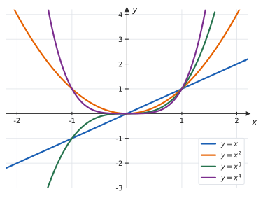

> 📊 O comportamento depende da **paridade do expoente**:
> - **$n$ par** ($x^2$, $x^4$): gráfico em forma de "U", simétrico em relação ao eixo $y$, imagem $[0,+\infty)$;
> - **$n$ ímpar** ($x$, $x^3$): gráfico "subindo" da esquerda para a direita, simétrico em relação à origem, imagem $\mathbb{R}$.
>
> Observe também que, **dentro** de $(-1,1)$, quanto maior o expoente mais a curva se achata contra o eixo; **fora** desse intervalo, quanto maior o expoente mais rápido ela sobe.

### 1.4 Funções raiz

$$f(x) = \sqrt{x} \qquad\qquad f(x) = \sqrt[3]{x}$$

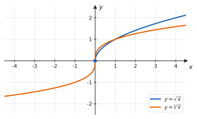

| | $\sqrt{x}$ | $\sqrt[3]{x}$ |
| --- | :---: | :---: |
| Domínio | $[0,\thinspace +\infty)$ | $\mathbb{R}$ |
| Imagem | $[0,\thinspace +\infty)$ | $\mathbb{R}$ |
| Simetria | nenhuma | ímpar |

> 📊 A raiz quadrada é **meia parábola deitada**: é o gráfico de $y=x^2$ com $x \geqslant 0$ refletido na reta $y=x$. Essa observação é o assunto de [1.4](1.4-injetoras-sobrejetoras-bijetoras-e-inversas.md).

### 1.5 Função modular

$$f(x) = \lvert x \rvert$$

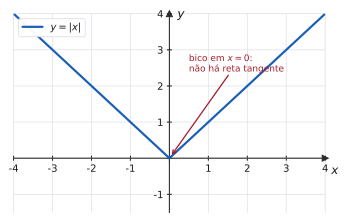

Domínio $\mathbb{R}$, imagem $[0,+\infty)$, função **par**. O gráfico é o de $y=x$ com a parte negativa **rebatida para cima**.

> [!IMPORTANT]
> O "bico" em $x=0$ parece um detalhe estético, mas é um dos pontos mais importantes do curso: ali a função é **contínua** e **não derivável**. É o contraexemplo padrão de "contínua, logo derivável" — afirmação falsa que a Unidade 3 vai desmontar.

### 1.6 Funções racionais básicas

$$f(x) = \frac{1}{x} \qquad\qquad f(x) = \frac{1}{x^2}$$

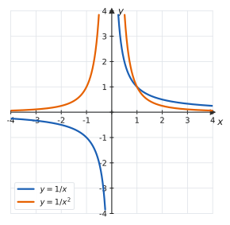

| | $1/x$ | $1/x^2$ |
| --- | :---: | :---: |
| Domínio | $\mathbb{R} \setminus \lbrace 0 \rbrace$ | $\mathbb{R} \setminus \lbrace 0 \rbrace$ |
| Imagem | $\mathbb{R} \setminus \lbrace 0 \rbrace$ | $(0,\thinspace +\infty)$ |
| Simetria | ímpar | par |

> 📊 Em ambos os casos a curva **se aproxima** dos eixos sem nunca tocá-los: o eixo $y$ é **assíntota vertical** e o eixo $x$ é **assíntota horizontal**. A diferença está no sinal: $1/x$ muda de sinal ao cruzar a origem (um ramo sobe, o outro desce), enquanto $1/x^2$ é sempre positiva.

### 1.7 Exponencial e logarítmica

$$f(x) = a^x \quad (a>0,\thinspace a \neq 1) \qquad\qquad f(x) = \log_a x$$

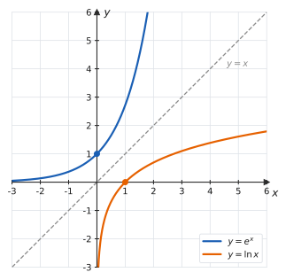

| | $e^x$ | $\ln x$ |
| --- | :---: | :---: |
| Domínio | $\mathbb{R}$ | $(0,\thinspace +\infty)$ |
| Imagem | $(0,\thinspace +\infty)$ | $\mathbb{R}$ |
| Ponto notável | $(0,\thinspace 1)$ | $(1,\thinspace 0)$ |

> 📊 Os dois gráficos são **reflexos um do outro** na reta $y = x$: exponencial e logaritmo são funções **inversas**. Note também que $e^x > 0$ para todo $x$ — a exponencial **nunca** zera, nem fica negativa.

As propriedades que mais aparecem em prova:

| Exponencial | Logaritmo |
| --- | --- |
| $a^{m} \cdot a^{n} = a^{m+n}$ | $\ln(xy) = \ln x + \ln y$ |
| $\dfrac{a^m}{a^n} = a^{m-n}$ | $\ln\dfrac{x}{y} = \ln x - \ln y$ |
| $(a^m)^n = a^{mn}$ | $\ln x^{\thinspace p} = p \ln x$ |
| $a^0 = 1$ | $\ln 1 = 0$, $\ln e = 1$ |
| $e^{\ln x} = x$ (se $x>0$) | $\ln e^x = x$ |

> [!CAUTION]
> $\ln(x+y)$ **não** é $\ln x + \ln y$. O logaritmo transforma **produto** em soma, nunca soma em soma. Esse erro reaparece todo semestre em L'Hôspital e em derivação logarítmica.

### 1.8 Funções trigonométricas

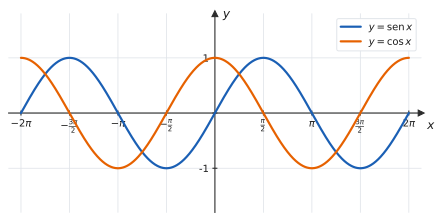

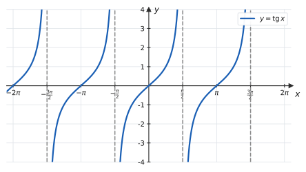

| Função | Domínio | Imagem | Período | Paridade |
| :---: | :---: | :---: | :---: | :---: |
| $\operatorname{sen} x$ | $\mathbb{R}$ | $[-1,\thinspace 1]$ | $2\pi$ | ímpar |
| $\cos x$ | $\mathbb{R}$ | $[-1,\thinspace 1]$ | $2\pi$ | par |
| $\operatorname{tg} x$ | $x \neq \dfrac{\pi}{2} + k\pi$ | $\mathbb{R}$ | $\pi$ | ímpar |

> [!IMPORTANT]
> **Em Cálculo, o argumento está sempre em radianos.** Todas as fórmulas de derivada e de limite trigonométrico — a começar por $\lim_{x\to 0}\frac{\operatorname{sen} x}{x} = 1$ — valem **apenas** em radianos. Se a sua calculadora estiver em graus, as contas vão dar errado sem avisar.

A identidade que sustenta quase tudo:

$$\operatorname{sen}^2 x + \cos^2 x = 1$$

As demais estão reunidas em [A3 · Identidades trigonométricas](../06-formulario/A3-identidades-trigonometricas.md).

### 📋 Resumo do catálogo

| Função | Domínio | Imagem | Paridade |
| --- | :---: | :---: | :---: |
| $c$ | $\mathbb{R}$ | $\lbrace c \rbrace$ | par |
| $ax+b$ ($a \neq 0$) | $\mathbb{R}$ | $\mathbb{R}$ | ímpar se $b=0$ |
| $x^2$ | $\mathbb{R}$ | $[0,\thinspace +\infty)$ | par |
| $x^3$ | $\mathbb{R}$ | $\mathbb{R}$ | ímpar |
| $\sqrt{x}$ | $[0,\thinspace +\infty)$ | $[0,\thinspace +\infty)$ | — |
| $\sqrt[3]{x}$ | $\mathbb{R}$ | $\mathbb{R}$ | ímpar |
| $\lvert x \rvert$ | $\mathbb{R}$ | $[0,\thinspace +\infty)$ | par |
| $1/x$ | $\mathbb{R} \setminus \lbrace 0 \rbrace$ | $\mathbb{R} \setminus \lbrace 0 \rbrace$ | ímpar |
| $1/x^2$ | $\mathbb{R} \setminus \lbrace 0 \rbrace$ | $(0,\thinspace +\infty)$ | par |
| $e^x$ | $\mathbb{R}$ | $(0,\thinspace +\infty)$ | — |
| $\ln x$ | $(0,\thinspace +\infty)$ | $\mathbb{R}$ | — |
| $\operatorname{sen} x$ | $\mathbb{R}$ | $[-1,\thinspace 1]$ | ímpar |
| $\cos x$ | $\mathbb{R}$ | $[-1,\thinspace 1]$ | par |
| $\operatorname{tg} x$ | $x \neq \frac{\pi}{2}+k\pi$ | $\mathbb{R}$ | ímpar |

---

## 2. Funções pares e funções ímpares

> 📐 **Definição 1.3.1.** Seja $f$ uma função cujo domínio é **simétrico** (isto é, $x \in D(f) \Rightarrow -x \in D(f)$). Diz-se que $f$ é
> - **par** quando $f(-x) = f(x)$ para todo $x \in D(f)$;
> - **ímpar** quando $f(-x) = -f(x)$ para todo $x \in D(f)$.

| | |
| :---: | :---: |
| 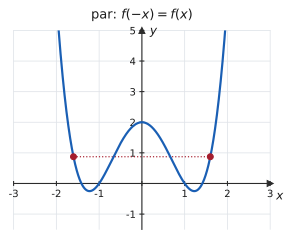 | 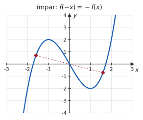 |
| **Par:** o eixo $y$ é um espelho. Dobrando a folha nele, os dois ramos coincidem. | **Ímpar:** girando o gráfico $180°$ em torno da origem, ele fica idêntico. |

### O procedimento, em três passos

1. Verifique se o domínio é **simétrico**. Se não for, a função não é par nem ímpar, e acabou.
2. Calcule $f(-x)$ — substituindo $x$ por $-x$ e simplificando até o fim.
3. Compare com $f(x)$ e com $-f(x)$:
   - igual a $f(x)$ → **par**;
   - igual a $-f(x)$ → **ímpar**;
   - nenhum dos dois → **nem par nem ímpar**.

#### ✍️ Exemplo 1 — três classificações

**(a) $f(x) = x^4 - 3x^2 + 2$.**

$$f(-x) = (-x)^4 - 3(-x)^2 + 2 = x^4 - 3x^2 + 2 = f(x)$$

**Par.**

**(b) $g(x) = x^3 - 3x$.**

$$g(-x) = (-x)^3 - 3(-x) = -x^3 + 3x = -(x^3 - 3x) = -g(x)$$

**Ímpar.**

**(c) $h(x) = x^2 + x$.**

$$h(-x) = x^2 - x$$

Isso não é $h(x) = x^2+x$, nem $-h(x) = -x^2-x$. **Nem par nem ímpar.**

> 💡 **Regra de bolso para polinômios:** só expoentes **pares** (contando a constante como $x^0$) → função par; só expoentes **ímpares** → função ímpar; **mistura** → nenhuma das duas. Mas atenção: isso vale para polinômios, e não para funções em geral. Sempre teste pela definição quando houver raiz, módulo, exponencial ou trigonométrica.

### Propriedades úteis

| Operação | Resultado |
| --- | --- |
| par $+$ par | par |
| ímpar $+$ ímpar | ímpar |
| par $\times$ par | par |
| ímpar $\times$ ímpar | **par** |
| par $\times$ ímpar | ímpar |
| par $+$ ímpar | em geral, nenhuma das duas |

> [!NOTE]
> **A maioria das funções não é nem par nem ímpar** — $e^x$, $\ln x$, $\sqrt{x}$, $x^2+x$. "Nem par nem ímpar" é uma resposta perfeitamente legítima, e muitas vezes é a correta.

Para que serve isso? Para **economizar trabalho**: se $f$ é par, basta estudar $x \geqslant 0$ e espelhar. Além disso, na Unidade 5 você verá que $\int_{-a}^{a} f = 0$ quando $f$ é ímpar — o que resolve algumas integrais sem conta nenhuma.

---

## 3. Transformações de gráficos

Esta é a seção que mais rende em prova: ela permite esboçar uma função desconhecida a partir de uma conhecida, sem tabela de valores e sem derivada.

> 📐 **Tabela das transformações.** Seja $k > 0$ e $y = f(x)$ o gráfico conhecido.

| Nova função | O que acontece com o gráfico | Mexe em |
| :---: | --- | :---: |
| $f(x) + k$ | sobe $k$ unidades | $y$ |
| $f(x) - k$ | desce $k$ unidades | $y$ |
| $f(x - k)$ | desloca $k$ para a **direita** | $x$ |
| $f(x + k)$ | desloca $k$ para a **esquerda** | $x$ |
| $-f(x)$ | reflete no eixo $x$ (vira de cabeça para baixo) | $y$ |
| $f(-x)$ | reflete no eixo $y$ (vira da direita para a esquerda) | $x$ |
| $a\thinspace f(x)$, $a>1$ | estica verticalmente por $a$ | $y$ |
| $a \thinspace f(x)$, $0<a<1$ | achata verticalmente | $y$ |
| $f(ax)$, $a>1$ | **comprime** horizontalmente por $a$ | $x$ |
| $\lvert f(x) \rvert$ | rebate para cima o que estava abaixo do eixo $x$ | $y$ |

> [!WARNING]
> **O sinal "ao contrário" na horizontal.** $f(x-3)$ desloca para a **direita**, não para a esquerda; $f(2x)$ **comprime**, não estica. A razão: a transformação age no *argumento*, antes de a função ser aplicada. Para o gráfico de $f(x-3)$ ter em $x=5$ o valor que $f$ tinha em $2$, ele precisa ter "andado" três unidades para a direita.

### 📊 Vendo as três transformações

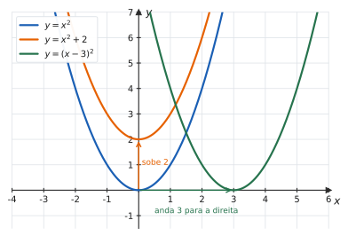

> 📊 **Translações.** A soma de $2$ **fora** da função empurra a curva para cima; o $-3$ **dentro** do argumento empurra para a direita.

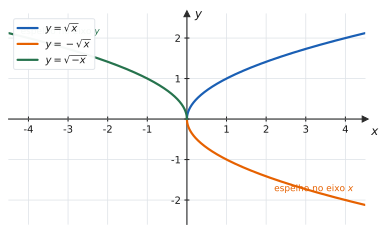

> 📊 **Reflexões.** O sinal de menos **fora** vira o gráfico para baixo; o sinal de menos **dentro** vira para o outro lado.

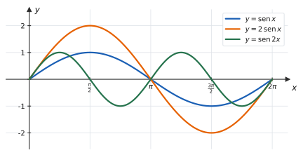

> 📊 **Dilatações.** O $2$ **fora** dobra a altura (a amplitude passa de $1$ para $2$); o $2$ **dentro** dobra a frequência — o período cai de $2\pi$ para $\pi$.

### A ordem importa

Para $y = a\thinspace f(bx + c) + d$, aplique nesta ordem:

Sempre comece **fatorando o argumento**: escreva $f(2x - 6)$ como $f\big(2(x-3)\big)$, para enxergar o deslocamento de $3$ e a compressão de $2$ separadamente.

#### ✍️ Exemplo 2 — esboçando $y = -2\sqrt{x-1} + 3$

Partindo de $y = \sqrt{x}$:

| Passo | Expressão | Efeito |
| :---: | :---: | --- |
| 1 | $\sqrt{x-1}$ | desloca $1$ para a direita — o início do gráfico vai de $(0,0)$ para $(1,0)$ |
| 2 | $2\sqrt{x-1}$ | estica verticalmente pelo fator $2$ |
| 3 | $-2\sqrt{x-1}$ | reflete no eixo $x$: agora a curva **desce** |
| 4 | $-2\sqrt{x-1}+3$ | sobe $3$ — o início vai para $(1,\thinspace 3)$ |

**Resultado:** uma curva que começa em $(1,3)$ e desce indefinidamente para a direita.

$$D = [1,\thinspace +\infty) \qquad \operatorname{Im} = (-\infty,\thinspace 3]$$

#### ✍️ Exemplo 3 — o módulo por fora: $y = \lvert x^2 - 4 \rvert$

1. Esboce $y = x^2 - 4$: parábola com vértice em $(0,-4)$, cortando o eixo $x$ em $-2$ e $2$.
2. Aplique o módulo: **tudo o que estava abaixo do eixo $x$ é rebatido para cima**. O trecho entre $-2$ e $2$ (que era negativo) vira um "arco" positivo com máximo $4$ em $x=0$; o resto fica como estava.

O gráfico resultante tem dois **bicos**, em $x=-2$ e $x=2$ — exatamente onde a função original cruzava o eixo.

$$D = \mathbb{R} \qquad \operatorname{Im} = [0,\thinspace +\infty)$$

> 💡 Bico é sinal de **não derivabilidade**. Guardar isso agora economiza uma questão inteira na Unidade 3.

---

## ⚠️ Armadilhas

| O erro | Por que está errado | O certo |
| --- | --- | --- |
| $f(x-3)$ desloca para a esquerda | a transformação age no argumento | desloca para a **direita** |
| $f(2x)$ estica horizontalmente | o $2$ dobra a velocidade de percurso | **comprime** pela metade |
| $\ln(x+y) = \ln x + \ln y$ | logaritmo transforma produto em soma | $\ln(xy) = \ln x + \ln y$ |
| $\sqrt{x^2} = x$ | falso para $x<0$ | $\sqrt{x^2} = \lvert x \rvert$ |
| "$f(-x) = f(x)$ logo é ímpar" | troca de nome | isso é a definição de **par** |
| testar paridade só com $x=1$ | um caso não prova nada | a identidade tem de valer para **todo** $x$ |
| usar graus em $\operatorname{sen} x$ | as fórmulas do Cálculo pressupõem radianos | sempre radianos |
| $\operatorname{tg} x$ tem domínio $\mathbb{R}$ | ela explode em $\frac{\pi}{2} + k\pi$ | excluir esses pontos |

---

## 🧠 Exercícios resolvidos

### Exercício Resolvido 1

**Classifique quanto à paridade:**

**(a)** $f(x) = x\thinspace\lvert x \rvert$ &nbsp;&nbsp; **(b)** $g(x) = \dfrac{x^2+1}{x^3}$ &nbsp;&nbsp; **(c)** $h(x) = e^x + e^{-x}$ &nbsp;&nbsp; **(d)** $p(x) = \operatorname{sen} x + \cos x$

**Solução.**

**(a)** $f(-x) = (-x)\thinspace\lvert -x \rvert = -x\thinspace\lvert x \rvert = -f(x)$ → **ímpar**.

**(b)** $g(-x) = \dfrac{(-x)^2+1}{(-x)^3} = \dfrac{x^2+1}{-x^3} = -g(x)$ → **ímpar**. (Domínio $\mathbb{R}\setminus\lbrace 0 \rbrace$, que é simétrico.)

**(c)** $h(-x) = e^{-x} + e^{x} = h(x)$ → **par**.

**(d)** $p(-x) = \operatorname{sen}(-x) + \cos(-x) = -\operatorname{sen} x + \cos x$. Não é $p(x)$ nem $-p(x)$ → **nem par nem ímpar**.

> 💡 Em (d), a soma de uma função ímpar com uma par não tem paridade definida — é o caso geral da última linha da tabela de propriedades.

---

### Exercício Resolvido 2

**Determine domínio, imagem e período de** $f(x) = 3 - 2\cos x$.

**Solução.**

O cosseno existe para todo real, então $D(f) = \mathbb{R}$.

Partindo de $-1 \leqslant \cos x \leqslant 1$ e **operando a desigualdade com cuidado**:

$$-1 \leqslant \cos x \leqslant 1$$
$$-2 \leqslant 2\cos x \leqslant 2$$
$$2 \geqslant -2\cos x \geqslant -2 \qquad \text{(multiplicou por } -1\text{: inverteu)}$$
$$5 \geqslant 3 - 2\cos x \geqslant 1$$

**Resposta.** $D(f) = \mathbb{R}$, $\operatorname{Im}(f) = [1,\thinspace 5]$, período $2\pi$.

> ⚠️ O passo do $-1$ é onde se perde ponto: multiplicar uma desigualdade por número negativo **inverte** o sentido. Quem esquece escreve $\operatorname{Im} = [5,1]$, que nem intervalo é.

---

### Exercício Resolvido 3

**Esboce** $y = 2 - \lvert x + 1 \rvert$ **e determine imagem e os pontos onde o gráfico corta os eixos.**

**Solução.** Partindo de $y = \lvert x \rvert$:

| Passo | Expressão | Efeito |
| :---: | :---: | --- |
| 1 | $\lvert x+1 \rvert$ | desloca $1$ para a **esquerda**: o bico vai para $(-1,\thinspace 0)$ |
| 2 | $-\lvert x+1 \rvert$ | reflete no eixo $x$: o "V" vira "Λ" |
| 3 | $2 - \lvert x+1 \rvert$ | sobe $2$: o bico vai para $(-1,\thinspace 2)$ |

O gráfico é um "Λ" com vértice em $(-1,2)$ e lados de inclinação $\pm 1$.

**Imagem:** como $\lvert x+1 \rvert \geqslant 0$, tem-se $y \leqslant 2$, e todo valor $\leqslant 2$ é atingido: $\operatorname{Im} = (-\infty,\thinspace 2]$.

**Cortes nos eixos:**

- com o eixo $y$ ($x=0$): $y = 2 - \lvert 1 \rvert = 1$, ponto $(0,\thinspace 1)$;
- com o eixo $x$ ($y=0$): $\lvert x+1 \rvert = 2 \Rightarrow x+1 = \pm 2 \Rightarrow x = 1$ ou $x = -3$, pontos $(1,0)$ e $(-3,0)$.

---

### Exercício Resolvido 4

**Determine a imagem de** $f(x) = 2 + 3\operatorname{sen}\left(2x - \dfrac{\pi}{3}\right)$ **e o seu período.**

**Solução.**

A imagem **não depende** do que está dentro do seno: qualquer que seja o argumento, o seno percorre todo o intervalo $[-1,1]$.

$$-1 \leqslant \operatorname{sen}\left(2x-\frac{\pi}{3}\right) \leqslant 1 \ \Longrightarrow \ -3 \leqslant 3\operatorname{sen}(\cdot) \leqslant 3 \ \Longrightarrow \ -1 \leqslant f(x) \leqslant 5$$

**Período:** fatorando o argumento, $2x - \frac{\pi}{3} = 2\left(x - \frac{\pi}{6}\right)$. O fator $2$ **comprime** o gráfico pela metade, então o período passa de $2\pi$ para $\pi$.

**Resposta.** $\operatorname{Im}(f) = [-1,\thinspace 5]$ e período $\pi$.

> 💡 Em geral, $y = A + B\operatorname{sen}(kx + c)$ tem imagem $[A - \lvert B \rvert,\thinspace A + \lvert B \rvert]$ e período $\dfrac{2\pi}{\lvert k \rvert}$. Saiba **deduzir**, não só aplicar.

---

### Exercício Resolvido 5

**Mostre que toda função $f$ com domínio simétrico pode ser escrita como a soma de uma função par com uma função ímpar.**

**Estratégia.** Construir as duas parcelas explicitamente, a partir de $f(x)$ e $f(-x)$.

**Solução.** Defina

$$P(x) = \frac{f(x) + f(-x)}{2} \qquad \text{e} \qquad I(x) = \frac{f(x) - f(-x)}{2}$$

**1. $P$ é par:**

$$P(-x) = \frac{f(-x) + f(x)}{2} = P(x) \quad \checkmark$$

**2. $I$ é ímpar:**

$$I(-x) = \frac{f(-x) - f(x)}{2} = -\frac{f(x) - f(-x)}{2} = -I(x) \quad \checkmark$$

**3. A soma reconstrói $f$:**

$$P(x) + I(x) = \frac{f(x)+f(-x)}{2} + \frac{f(x)-f(-x)}{2} = \frac{2f(x)}{2} = f(x) \quad \blacksquare$$

**Aplicação.** Para $f(x) = e^x$:

$$P(x) = \frac{e^x + e^{-x}}{2} = \cosh x \qquad I(x) = \frac{e^x - e^{-x}}{2} = \operatorname{senh} x$$

São o **cosseno hiperbólico** e o **seno hiperbólico** — que aparecem em cabos suspensos, em linhas de transmissão e em várias integrais da Unidade 5.

---

### Exercício Resolvido 6

**A partir do gráfico de $y = \dfrac1x$, esboce $y = \dfrac{2x+1}{x}$ e determine as assíntotas.**

**Estratégia.** A expressão não parece uma transformação de $\frac1x$ — mas vira uma, depois de **separar a fração**.

**Solução.**

$$\frac{2x+1}{x} = \frac{2x}{x} + \frac{1}{x} = 2 + \frac{1}{x}$$

Agora está claro: é o gráfico de $\dfrac1x$ **deslocado $2$ para cima**.

- A assíntota vertical continua sendo $x = 0$ (o deslocamento foi vertical).
- A assíntota horizontal, que era $y = 0$, sobe para $y = 2$.

$$D = \mathbb{R}\setminus\lbrace 0 \rbrace \qquad \operatorname{Im} = \mathbb{R}\setminus\lbrace 2 \rbrace$$

> 💡 **Essa divisão é uma técnica, não um truque.** Toda função racional em que o grau do numerador é maior ou igual ao do denominador pode ser dividida assim — e a parte "sem resto" revela imediatamente a assíntota. Você vai reusar isso em [2.4](../02-limites-e-continuidade/2.4-limites-infinitos-no-infinito-e-assintotas.md) e em [4.4](../04-aplicacoes-das-derivadas/4.4-crescimento-concavidade-e-esboco-de-graficos.md).

---

## 📝 Agora é com você

➡️ **[Lista 1.3 — exercícios propostos](exercicios/lista-1.3-propostos.md)** · ✅ **[Gabarito](gabaritos/gabarito-1.3.md)**

---

## Resumo da página

> **Decore (de olhos fechados):**
> - os gráficos de $x^2$, $x^3$, $\sqrt{x}$, $\sqrt[3]{x}$, $\lvert x \rvert$, $1/x$, $1/x^2$, $e^x$, $\ln x$, $\operatorname{sen} x$, $\cos x$, $\operatorname{tg} x$ — com domínio e imagem;
> - $\operatorname{sen}^2 x + \cos^2 x = 1$;
> - par: $f(-x) = f(x)$, espelho no eixo $y$. Ímpar: $f(-x) = -f(x)$, giro de $180°$.
>
> **Saiba fazer:**
> - testar paridade pela definição, começando pelo domínio;
> - esboçar $a\thinspace f(bx+c)+d$ a partir de $f$, fatorando o argumento e aplicando as transformações na ordem;
> - lembrar que, **dentro** do argumento, tudo acontece ao contrário do que parece;
> - separar uma fração para revelar a transformação escondida.

---

## 📚 Para aprofundar

| Livro | Onde procurar |
| --- | --- |
| **LEITHOLD** | Capítulo 1 — "Gráficos de funções"; "Funções trigonométricas" |
| **STEWART** | Capítulo 1 — "Modelos matemáticos: um catálogo de funções essenciais"; "Funções novas a partir de antigas" |
| **THOMAS** | Capítulo de preliminares — "Funções e seus gráficos"; "Funções trigonométricas" |
| **ANTON** | Capítulo 1 — "Funções"; Apêndice de trigonometria |
| **SWOKOWSKI** | Capítulos 1 e 2 — gráficos e funções trigonométricas |
| **MUNEM & FOULIS** | Capítulo 1 — "Tipos de funções" |

---

| ← Anterior | 🏠 Índice | Próximo → |
| :--- | :---: | ---: |
| [1.2 · Funções](1.2-funcoes-dominio-contradominio-imagem.md) | [Unidade 1](README.md) · [Página inicial](../README.md) | [1.4 · Injetoras, sobrejetoras e inversas](1.4-injetoras-sobrejetoras-bijetoras-e-inversas.md) |

*Sobrevivendo ao Cálculo 1 (UENF)* · por **Nicolau Prates** · [CC BY-SA 4.0](../LICENSE)
