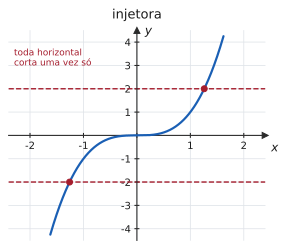
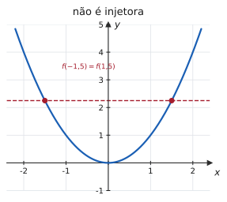
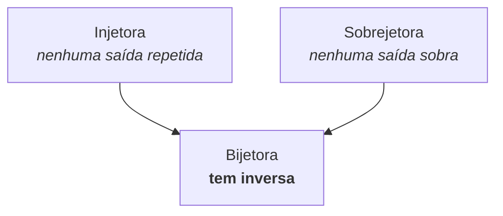
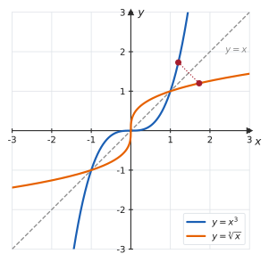
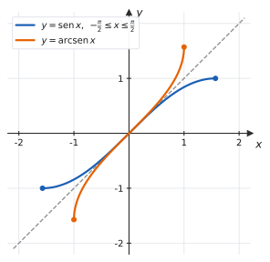

# 1.4 · Funções injetoras, sobrejetoras, bijetoras e invertíveis

| ← Anterior | 🏠 Índice | Próximo → |
| :--- | :---: | ---: |
| [1.3 · Funções elementares](1.3-funcoes-elementares-paridade-e-graficos.md) | [Unidade 1](README.md) · [Página inicial](../README.md) | [Unidade 2 · Limites](../02-limites-e-continuidade/README.md) |

---

## 🎯 O que você vai aprender

- Decidir se uma função é **injetora**, **sobrejetora** ou **bijetora** — pela definição e pelo gráfico.
- Entender por que **só funções bijetoras têm inversa**.
- Determinar $f^{-1}$ e, principalmente, o **domínio** dela.
- **Restringir o domínio** de uma função para torná-la invertível — a ideia por trás de $\sqrt{x}$, de $\ln x$ e de todas as trigonométricas inversas.

**Pré-requisitos:** [1.2](1.2-funcoes-dominio-contradominio-imagem.md) (domínio, imagem e composição) e [1.3](1.3-funcoes-elementares-paridade-e-graficos.md) (gráficos).

---

## Por que isso importa

Inverter é **desfazer**. Se $f$ transforma $2$ em $8$, a inversa transforma $8$ de volta em $2$. Toda vez que você resolve uma equação, está usando uma inversa: a raiz desfaz o quadrado, o logaritmo desfaz a exponencial, o arco-seno desfaz o seno.

E isso tem consequência direta no curso: a seção [3.3](../03-derivadas/3.3-regra-da-cadeia-e-derivada-da-funcao-inversa.md) ensina a derivar a inversa a partir da derivada da função original, e a [3.4](../03-derivadas/3.4-derivadas-das-funcoes-trigonometricas-inversas.md) depende inteiramente de entender por que $\mathrm{arcsen}$ só existe num pedaço do seno. Quem chega lá sem esta página decora fórmulas sem saber de onde vieram.

---

## 1. Função injetora

> 📐 **Definição 1.4.1 (Injetora).** Uma função $f : A \to B$ é **injetora** quando elementos distintos do domínio têm imagens distintas:
> $$x_1 \neq x_2 \ \Longrightarrow \ f(x_1) \neq f(x_2)$$
> Equivalentemente — e esta é a forma que se usa nas demonstrações:
> $$f(x_1) = f(x_2) \ \Longrightarrow \ x_1 = x_2$$

Em português: **nenhuma saída é usada duas vezes**. Ninguém "chega junto".

> 💡 **Por que a segunda forma é a útil.** Para *provar* injetividade, é muito mais fácil supor que duas imagens são iguais e concluir que as entradas também eram, do que começar supondo entradas diferentes. As duas afirmações são logicamente equivalentes (uma é a contrapositiva da outra).

### 📊 O teste da reta horizontal

> 📐 **Teste da reta horizontal.** $f$ é injetora se, e somente se, **nenhuma reta horizontal** intersecta o seu gráfico em mais de um ponto.

| | |
| :---: | :---: |
|  |  |
| $f(x) = x^3$ é injetora. | $f(x)=x^2$ **não** é: $f(-1{,}5) = f(1{,}5) = 2{,}25$. |

> [!NOTE]
> **Não confunda os dois testes.** A reta **vertical** decide se a curva é função ([1.2](1.2-funcoes-dominio-contradominio-imagem.md#2-quando-não-é-função)). A reta **horizontal** decide se a função é injetora. Vertical para existir; horizontal para inverter.

#### ✍️ Exemplo 1 — provando injetividade pela definição

Mostre que $f(x) = 3x - 5$ é injetora.

**Solução.** Suponha $f(x_1) = f(x_2)$:

$$3x_1 - 5 = 3x_2 - 5 \ \Longrightarrow \ 3x_1 = 3x_2 \ \Longrightarrow \ x_1 = x_2$$

Como a hipótese levou a $x_1 = x_2$, a função é injetora. $\blacksquare$

#### ✍️ Exemplo 2 — provando que *não* é injetora

$f(x) = x^2$, com $D(f) = \mathbb{R}$, não é injetora: basta exibir **um** par de entradas distintas com a mesma saída.

$$f(-2) = 4 = f(2), \quad \text{mas} \quad -2 \neq 2$$

> 💡 Para **negar** injetividade, um contraexemplo basta. Para **provar**, é preciso argumento geral. Essa assimetria vale para toda a matemática.

### Monótona ⟹ injetora

> 📐 **Definição 1.4.2.** $f$ é **estritamente crescente** quando $x_1 < x_2 \Rightarrow f(x_1) < f(x_2)$, e **estritamente decrescente** quando $x_1 < x_2 \Rightarrow f(x_1) > f(x_2)$. Em qualquer dos casos, diz-se que $f$ é **estritamente monótona**.

> 📐 **Teorema 1.4.1.** Toda função estritamente monótona é injetora.

A razão é imediata: se $x_1 \neq x_2$, um dos dois é menor, e a monotonicidade força $f(x_1) \neq f(x_2)$.

> [!TIP]
> Esse teorema vira uma ferramenta poderosa na Unidade 4: lá você verá que $f'(x) > 0$ em um intervalo implica $f$ crescente ali — e, portanto, **injetora** ali. É assim que se garante, com uma conta de derivada, que uma função complicada admite inversa.

---

## 2. Função sobrejetora

> 📐 **Definição 1.4.3 (Sobrejetora).** $f : A \to B$ é **sobrejetora** quando todo elemento de $B$ é imagem de algum elemento de $A$, isto é,
> $$\mathrm{Im}(f) = B$$

Em português: **nenhuma saída sobra**. Voltando à analogia do ônibus de [1.2](1.2-funcoes-dominio-contradominio-imagem.md#3-domínio-contradomínio-e-imagem): sobrejetora é o ônibus **lotado**, sem lugar vago.

> [!IMPORTANT]
> **Sobrejetividade depende do contradomínio declarado** — e, por isso, não é uma propriedade só da fórmula. A mesma regra $f(x) = x^2$:
> - $f : \mathbb{R} \to \mathbb{R}$ **não** é sobrejetora (nenhum $x$ dá $-1$);
> - $f : \mathbb{R} \to [0,+\infty)$ **é** sobrejetora.
>
> Nada mudou na fórmula; mudou o conjunto de chegada. Quando o enunciado não declara o contradomínio, **pergunte** — ou declare a sua hipótese na resposta.

#### ✍️ Exemplo 3 — a mesma fórmula, três respostas

Considere $f(x) = x^2$.

| Como função | Injetora? | Sobrejetora? | Bijetora? |
| --- | :---: | :---: | :---: |
| $\mathbb{R} \to \mathbb{R}$ | não | não | não |
| $\mathbb{R} \to [0,+\infty)$ | não | **sim** | não |
| $[0,+\infty) \to [0,+\infty)$ | **sim** | **sim** | **sim** |

Só a terceira versão tem inversa — e ela é $f^{-1}(x) = \sqrt{x}$.

---

## 3. Função bijetora

> 📐 **Definição 1.4.4 (Bijetora).** $f$ é **bijetora** quando é injetora **e** sobrejetora.

É a correspondência perfeita: cada elemento de $A$ ligado a exatamente um de $B$, e cada elemento de $B$ ligado a exatamente um de $A$.

---

## 4. Função inversa

> 📐 **Definição 1.4.5 (Função inversa).** Seja $f : A \to B$ **bijetora**. A **inversa** de $f$ é a função $f^{-1} : B \to A$ definida por
> $$f^{-1}(y) = x \ \Longleftrightarrow \ f(x) = y$$
>
> Dela decorrem as duas identidades fundamentais:
> $$f^{-1}\big(f(x)\big) = x \quad \text{para todo } x \in A$$
> $$f\big(f^{-1}(y)\big) = y \quad \text{para todo } y \in B$$

> [!CAUTION]
> **$f^{-1}$ não é $\dfrac{1}{f}$.** O expoente $-1$ aqui é **notação**, não potência. A inversa de $f(x)=x+3$ é $f^{-1}(x) = x-3$, e não $\frac{1}{x+3}$. Quando precisar do inverso multiplicativo, escreva $\big(f(x)\big)^{-1}$ ou $\frac{1}{f(x)}$ — e, em prova, deixe claro qual dos dois você quer dizer.

### Domínio e imagem trocam de lugar

$$D(f^{-1}) = \mathrm{Im}(f) \qquad\qquad \mathrm{Im}(f^{-1}) = D(f)$$

Isso não é detalhe: **responder uma inversa sem dizer o domínio é responder pela metade.**

### Como determinar a inversa — três passos

1. Escreva $y = f(x)$.
2. **Isole $x$** em função de $y$.
3. Troque os nomes: escreva $x$ onde está $y$ e vice-versa. (É só convenção — serve para a variável independente voltar a se chamar $x$.)

E, ao final, **declare o domínio**: ele é a imagem de $f$.

#### ✍️ Exemplo 4 — inversa de uma função afim

$f(x) = 3x - 5$, de $\mathbb{R}$ em $\mathbb{R}$.

$$y = 3x-5 \ \Longrightarrow \ 3x = y+5 \ \Longrightarrow \ x = \frac{y+5}{3}$$

Trocando os nomes:

$$f^{-1}(x) = \frac{x+5}{3}, \qquad D(f^{-1}) = \mathbb{R}$$

**Verificação** (sempre vale a pena, custa dez segundos):

$$f^{-1}\big(f(x)\big) = \frac{(3x-5)+5}{3} = \frac{3x}{3} = x \quad \checkmark$$

#### ✍️ Exemplo 5 — inversa de uma função racional

$f(x) = \dfrac{2x+1}{x-3}$, com $D(f) = \mathbb{R}\setminus\lbrace 3 \rbrace$.

De [1.2 · Exemplo 8](1.2-funcoes-dominio-contradominio-imagem.md), já sabemos que $\mathrm{Im}(f) = \mathbb{R}\setminus\lbrace 2 \rbrace$ — e aquela conta é exatamente o passo 2 daqui:

$$y = \frac{2x+1}{x-3} \ \Longrightarrow \ y(x-3) = 2x+1 \ \Longrightarrow \ x(y-2) = 1+3y \ \Longrightarrow \ x = \frac{1+3y}{y-2}$$

Trocando os nomes:

$$f^{-1}(x) = \frac{3x+1}{x-2}, \qquad D(f^{-1}) = \mathbb{R}\setminus\lbrace 2 \rbrace$$

> 💡 **Achar a imagem e achar a inversa são a mesma conta.** Isolar $x$ responde às duas perguntas de uma vez: a expressão obtida *é* a inversa, e os $y$ para os quais ela faz sentido formam a imagem.

### 📊 O gráfico da inversa

> 📐 **Propriedade 1.4.2.** Os gráficos de $f$ e de $f^{-1}$ são **simétricos em relação à reta $y = x$**.

> 📊 A razão é simples: se o ponto $(a,\thinspace b)$ está no gráfico de $f$, então $f(a) = b$, logo $f^{-1}(b) = a$ e o ponto $(b,\thinspace a)$ está no gráfico de $f^{-1}$. Inverter uma função é **trocar as coordenadas** de todos os seus pontos — e trocar coordenadas é exatamente refletir na reta $y=x$. Na figura, o par destacado mostra isso: $(1{,}2;\thinspace 1{,}728)$ e $(1{,}728;\thinspace 1{,}2)$.

---

## 5. Restrição de domínio: fabricando inversas

A maioria das funções úteis **não** é injetora no domínio natural. A saída é cortar o domínio até que ela fique injetora — e aí inverter o pedaço.

#### ✍️ Exemplo 6 — de $x^2$ para $\sqrt{x}$

$f(x) = x^2$ não é injetora em $\mathbb{R}$. Mas, restrita a $[0,+\infty)$, ela é estritamente crescente — logo injetora — e sua imagem é $[0,+\infty)$. Portanto

$$f : [0,+\infty) \to [0,+\infty), \quad f(x) = x^2$$

é bijetora, e sua inversa é

$$f^{-1}(x) = \sqrt{x}, \qquad D(f^{-1}) = [0,+\infty)$$

> 💡 **É por isso que $\sqrt{4} = 2$, e não $\pm 2$.** A escolha do ramo positivo não é capricho: foi ela que tornou a inversa possível. Se admitíssemos os dois sinais, $\sqrt{\cdot}$ deixaria de ser função.

#### 📊 Exemplo 7 — de $\mathrm{sen}\thinspace x$ para $\mathrm{arcsen}\thinspace x$

O seno é periódico, então está longe de ser injetor: $\mathrm{sen}\thinspace 0 = \mathrm{sen}\thinspace \pi = \mathrm{sen}\thinspace 2\pi = 0$. A convenção universal é restringi-lo ao intervalo em que ele cresce de $-1$ a $1$:

$$\mathrm{sen} : \left[-\frac{\pi}{2},\thinspace \frac{\pi}{2}\right] \longrightarrow [-1,\thinspace 1]$$

Nesse pedaço ele é bijetor, e a inversa é o **arco-seno**:

$$\mathrm{arcsen} : [-1,\thinspace 1] \longrightarrow \left[-\frac{\pi}{2},\thinspace \frac{\pi}{2}\right]$$

> 📊 Observe os domínios trocando de lugar: o seno restrito vai de $\left[-\frac\pi2,\frac\pi2\right]$ para $[-1,1]$; o arco-seno faz o caminho de volta. E os dois gráficos são, mais uma vez, reflexos na reta $y=x$.

As restrições convencionadas para as demais:

| Função | Restrição do domínio | Inversa | Domínio da inversa |
| :---: | :---: | :---: | :---: |
| $\mathrm{sen}\thinspace x$ | $\left[-\frac{\pi}{2},\thinspace \frac{\pi}{2}\right]$ | $\mathrm{arcsen}\thinspace x$ | $[-1,\thinspace 1]$ |
| $\cos x$ | $[0,\thinspace \pi]$ | $\arccos x$ | $[-1,\thinspace 1]$ |
| $\mathrm{tg}\thinspace x$ | $\left(-\frac{\pi}{2},\thinspace \frac{\pi}{2}\right)$ | $\mathrm{arctg}\thinspace x$ | $\mathbb{R}$ |
| $e^x$ | $\mathbb{R}$ (já é injetora) | $\ln x$ | $(0,\thinspace +\infty)$ |

> [!IMPORTANT]
> Decore estas restrições: elas explicam todos os resultados "estranhos" da Unidade 3. Por exemplo, $\mathrm{arcsen}\left(\mathrm{sen}\thinspace \frac{3\pi}{4}\right) = \frac{\pi}{4}$, **e não** $\frac{3\pi}{4}$ — porque $\frac{3\pi}{4}$ está fora do intervalo de chegada do arco-seno. A identidade $f^{-1}(f(x))=x$ só vale **dentro** do domínio restrito.

---

## ⚠️ Armadilhas

| O erro | Por que está errado | O certo |
| --- | --- | --- |
| $f^{-1}(x) = \dfrac{1}{f(x)}$ | o $-1$ é notação de inversa, não expoente | $f^{-1}$ desfaz $f$ |
| responder a inversa sem o domínio | a inversa é uma função nova, com domínio próprio | $D(f^{-1}) = \mathrm{Im}(f)$ |
| "$x^2$ não tem inversa" | tem, após restringir o domínio | $\sqrt{x}$, em $[0,+\infty)$ |
| usar a reta vertical para testar injetividade | essa testa se é função | injetividade → reta **horizontal** |
| dizer que $f$ é sobrejetora sem olhar o contradomínio | sobrejetividade depende de $B$ | compare $\mathrm{Im}(f)$ com $B$ |
| $\mathrm{arcsen}(\mathrm{sen}\thinspace x) = x$ sempre | só vale em $\left[-\frac\pi2,\frac\pi2\right]$ | fora disso, reduza ao intervalo |
| $\sqrt{4} = \pm 2$ | a raiz é função, devolve um valor só | $\sqrt4 = 2$ |

---

## 🧠 Exercícios resolvidos

### Exercício Resolvido 1

**Mostre que** $f(x) = \dfrac{x}{x+1}$, **com** $D(f) = \mathbb{R}\setminus\lbrace -1 \rbrace$, **é injetora.**

**Estratégia.** Supor $f(x_1) = f(x_2)$ e concluir $x_1 = x_2$.

**Solução.**

$$\frac{x_1}{x_1+1} = \frac{x_2}{x_2+1}$$

Multiplicando em cruz — **aqui é legítimo**, porque se trata de uma *igualdade*, não de uma desigualdade, e nenhum denominador é zero:

$$x_1(x_2+1) = x_2(x_1+1) \ \Longrightarrow \ x_1x_2 + x_1 = x_1x_2 + x_2 \ \Longrightarrow \ x_1 = x_2$$

Logo $f$ é injetora. $\blacksquare$

> 💡 Compare com [1.1](1.1-numeros-reais-intervalos-valor-absoluto-desigualdades.md): multiplicar cruzado é proibido em **inequação** (o sinal do denominador importa) e permitido em **equação** (desde que os denominadores não sejam nulos).

---

### Exercício Resolvido 2

**Determine a inversa de** $f(x) = \sqrt{x-2} + 3$, **indicando domínio e imagem de $f$ e de $f^{-1}$.**

**Solução.**

**Domínio e imagem de $f$:** $x - 2 \geqslant 0 \Rightarrow D(f) = [2,+\infty)$. Como $\sqrt{x-2} \geqslant 0$, temos $f(x) \geqslant 3$, e todo valor $\geqslant 3$ é atingido: $\mathrm{Im}(f) = [3,+\infty)$.

**Invertendo:**

$$y = \sqrt{x-2} + 3 \ \Longrightarrow \ y - 3 = \sqrt{x-2}$$

Elevando ao quadrado — legítimo porque $y - 3 \geqslant 0$:

$$(y-3)^2 = x - 2 \ \Longrightarrow \ x = (y-3)^2 + 2$$

Trocando os nomes:

$$f^{-1}(x) = (x-3)^2 + 2, \qquad D(f^{-1}) = [3,\thinspace +\infty), \qquad \mathrm{Im}(f^{-1}) = [2,\thinspace +\infty)$$

> ⚠️ **O domínio aqui é indispensável.** A expressão $(x-3)^2+2$ faz sentido para todo real, mas **não** é a inversa de $f$ fora de $[3,+\infty)$ — ali ela nem é injetora. Responder só a fórmula é responder errado.

---

### Exercício Resolvido 3

**A função** $f : \mathbb{R} \to \mathbb{R}$, $f(x) = x^2 - 4x + 7$, **é bijetora? Em caso negativo, restrinja domínio e contradomínio para torná-la bijetora e determine a inversa.**

**Solução.**

**Não é bijetora.** Completando o quadrado:

$$f(x) = (x-2)^2 + 3$$

- **Não é injetora:** $f(1) = 4 = f(3)$, e $1 \neq 3$. (O gráfico é uma parábola, simétrica em relação a $x=2$.)
- **Não é sobrejetora:** $\mathrm{Im}(f) = [3,+\infty) \neq \mathbb{R}$ — nenhum $x$ produz, por exemplo, o valor $0$.

**Restringindo.** Tome o ramo **direito** da parábola, onde ela é crescente, e ajuste o contradomínio à imagem:

$$f : [2,\thinspace +\infty) \longrightarrow [3,\thinspace +\infty)$$

Agora é bijetora. Invertendo:

$$y = (x-2)^2 + 3 \ \Longrightarrow \ (x-2)^2 = y - 3 \ \Longrightarrow \ x - 2 = \pm\sqrt{y-3}$$

Como restringimos a $x \geqslant 2$, tem-se $x - 2 \geqslant 0$: fica o sinal **positivo**.

$$x = 2 + \sqrt{y-3} \ \Longrightarrow \ f^{-1}(x) = 2 + \sqrt{x-3}, \qquad D(f^{-1}) = [3,\thinspace +\infty)$$

> 💡 Se tivéssemos escolhido o ramo esquerdo, $(-\infty,\thinspace 2]$, a inversa seria $f^{-1}(x) = 2 - \sqrt{x-3}$. **As duas escolhas são corretas** — mas é preciso declarar qual foi feita. É exatamente o que a convenção faz com $\mathrm{arcsen}$ e $\arccos$.

---

### Exercício Resolvido 4

**Sejam** $f(x) = 2x+1$ **e** $g(x) = \dfrac{x-1}{2}$. **Mostre que são inversas uma da outra.**

**Solução.** É preciso verificar as **duas** composições.

$$f\big(g(x)\big) = 2\left(\frac{x-1}{2}\right) + 1 = (x-1) + 1 = x \quad \checkmark$$

$$g\big(f(x)\big) = \frac{(2x+1)-1}{2} = \frac{2x}{2} = x \quad \checkmark$$

Como ambas as compostas são a identidade e os domínios são todo $\mathbb{R}$, as funções são inversas uma da outra. $\blacksquare$

> ⚠️ **Por que verificar as duas?** Com domínios iguais a $\mathbb{R}$, uma só bastaria. Mas quando há restrições — raízes, frações, logaritmos — é possível que $f(g(x)) = x$ valha e $g(f(x)) = x$ falhe em parte do domínio. Verificar as duas é o hábito seguro.

---

### Exercício Resolvido 5

**Calcule** $\mathrm{arcsen}\left(\mathrm{sen}\thinspace\dfrac{5\pi}{6}\right)$.

**Estratégia.** Não aplique $f^{-1}(f(x)) = x$ no automático: $\frac{5\pi}{6}$ **não** pertence a $\left[-\frac\pi2,\frac\pi2\right]$.

**Solução.**

1. Calcule primeiro o que está dentro: $\mathrm{sen}\thinspace\dfrac{5\pi}{6} = \dfrac{1}{2}$ (é o seno do suplementar de $\frac{\pi}{6}$).
2. Agora aplique o arco-seno, que devolve o **único** ângulo de $\left[-\frac\pi2,\frac\pi2\right]$ com esse seno:

$$\mathrm{arcsen}\thinspace\frac12 = \frac{\pi}{6}$$

**Resposta.** $\mathrm{arcsen}\left(\mathrm{sen}\thinspace\dfrac{5\pi}{6}\right) = \dfrac{\pi}{6}$

> 💡 A resposta $\frac{5\pi}{6}$ é o erro clássico — e ele revela exatamente o ponto da seção: a identidade $f^{-1}(f(x)) = x$ vale **apenas dentro do domínio restrito**. Fora dele, calcule de dentro para fora, como acima.

---

### Exercício Resolvido 6

**Mostre que, se $f$ e $g$ são bijetoras e a composta $f \circ g$ está definida, então**

$$(f \circ g)^{-1} = g^{-1} \circ f^{-1}$$

**Estratégia.** Verificar que $g^{-1} \circ f^{-1}$ desfaz $f \circ g$.

**Solução.** Para todo $x$ no domínio de $f \circ g$:

$$
\begin{aligned}
\big(g^{-1} \circ f^{-1}\big)\Big(\big(f \circ g\big)(x)\Big)
&= g^{-1}\Big(f^{-1}\big(f(g(x))\big)\Big) \\
&= g^{-1}\big(g(x)\big) \\
&= x
\end{aligned}
$$

Na segunda linha usou-se $f^{-1}(f(u)) = u$ com $u = g(x)$; na terceira, $g^{-1}(g(x)) = x$. A verificação da outra composta é inteiramente análoga. $\blacksquare$

> 💡 **A ordem inverte** — e isso tem uma leitura cotidiana: para desfazer "vestir a meia e depois o sapato", você tira o sapato e **depois** a meia. A última operação a ser feita é a primeira a ser desfeita.

---

## 📝 Agora é com você

➡️ **[Lista 1.4 — exercícios propostos](exercicios/lista-1.4-propostos.md)** · ✅ **[Gabarito](gabaritos/gabarito-1.4.md)**

E, para fechar a unidade: ➡️ **[Revisão da Unidade 1](exercicios/revisao-unidade-1.md)** — lista mista, em formato de prova.

---

## Resumo da página

> **Decore:**
> - **Injetora:** $f(x_1)=f(x_2) \Rightarrow x_1=x_2$. Teste da reta **horizontal**.
> - **Sobrejetora:** $\mathrm{Im}(f) = B$. Depende do contradomínio declarado.
> - **Bijetora** = injetora + sobrejetora ⟺ **tem inversa**.
> - $D(f^{-1}) = \mathrm{Im}(f)$ e $\mathrm{Im}(f^{-1}) = D(f)$.
> - Os gráficos de $f$ e $f^{-1}$ são simétricos em relação a $y = x$.
> - $f^{-1} \neq \dfrac{1}{f}$.
>
> **Saiba fazer:**
> - provar injetividade supondo $f(x_1)=f(x_2)$;
> - achar a inversa isolando $x$ — e **sempre** declarar o domínio dela;
> - restringir o domínio para tornar uma função invertível, escolhendo um ramo monótono;
> - calcular $\mathrm{arcsen}(\mathrm{sen}\thinspace x)$ de dentro para fora quando $x$ estiver fora da restrição.

---

## 📚 Para aprofundar

| Livro | Onde procurar |
| --- | --- |
| **LEITHOLD** | Capítulo sobre funções inversas — "Função inversa"; "Funções trigonométricas inversas" |
| **STEWART** | Capítulo 1 — "Funções inversas e logaritmos" |
| **THOMAS** | Capítulo de funções transcendentes — "Funções inversas e seus gráficos" |
| **ANTON** | Capítulo 1 — "Funções inversas" |
| **SWOKOWSKI** | Capítulo sobre funções inversas e exponenciais |
| **MUNEM & FOULIS** | Capítulo 1 — "Funções inversas" |

---

| ← Anterior | 🏠 Índice | Próximo → |
| :--- | :---: | ---: |
| [1.3 · Funções elementares](1.3-funcoes-elementares-paridade-e-graficos.md) | [Unidade 1](README.md) · [Página inicial](../README.md) | [Unidade 2 · Limites e continuidade](../02-limites-e-continuidade/README.md) |

*Sobrevivendo ao Cálculo 1 (UENF)* · por **Nicolau Prates** · [CC BY-SA 4.0](../LICENSE)
