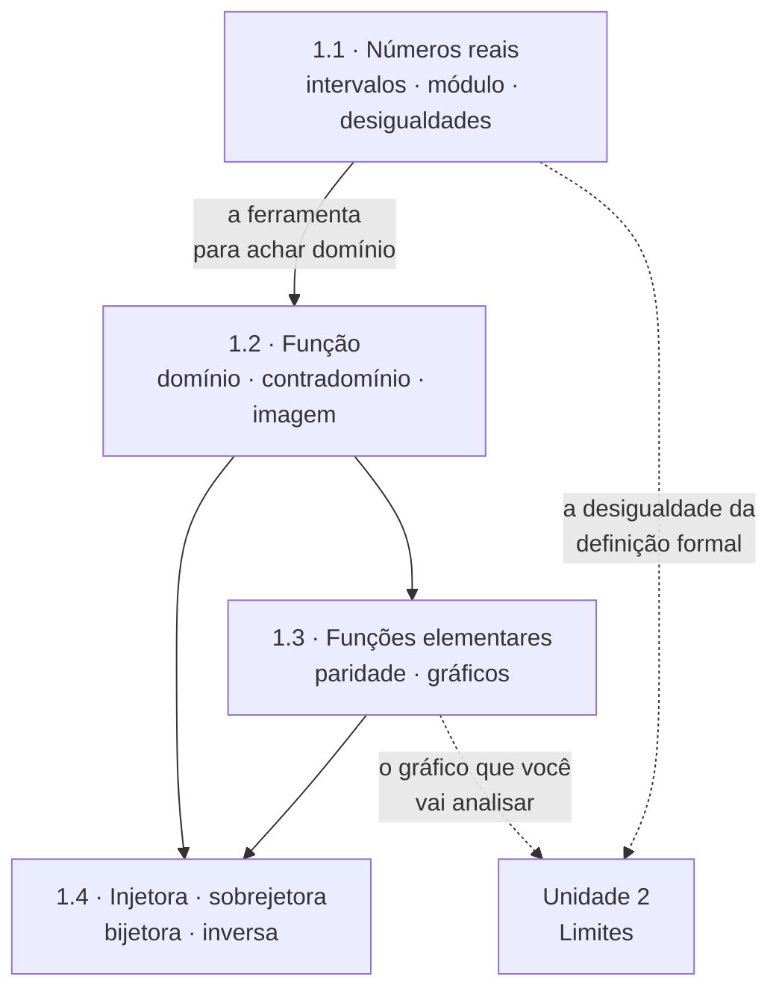

# Unidade 1 · Funções reais de uma variável real

> Cálculo é o estudo de como as funções **mudam**. Antes de estudar a mudança, é preciso saber exatamente o que é a coisa que muda. É isso que esta unidade faz.

Esta é a unidade mais subestimada do curso. Ela parece revisão do Ensino Médio — e em parte é —, mas é aqui que se decide se você vai entender limite em novembro ou apenas decorar regras. Domínio, imagem, módulo e desigualdade aparecem em **toda** questão das unidades seguintes.

---

## 🎯 Objetivos da unidade

Ao final, você deve ser capaz de:

- operar com **desigualdades** e com **valor absoluto**, e expressar conjuntos-solução em notação de intervalo;
- determinar o **domínio** e a **imagem** de uma função dada por fórmula, e decidir se uma correspondência é ou não função;
- reconhecer de imediato o **gráfico das funções elementares** e obter novos gráficos por **translação, reflexão e dilatação**;
- classificar funções quanto à **paridade** (par, ímpar ou nenhuma das duas);
- decidir se uma função é **injetora, sobrejetora ou bijetora**, e construir a **inversa** quando ela existir.

---

## 🗺️ Mapa da unidade

---

## 📚 Conteúdo

| # | Teoria | 📝 Propostos | ✅ Gabarito |
| :---: | --- | :---: | :---: |
| 1.1 | [Números reais, intervalos, valor absoluto e desigualdades](1.1-numeros-reais-intervalos-valor-absoluto-desigualdades.md) | [lista](exercicios/lista-1.1-propostos.md) | [gabarito](gabaritos/gabarito-1.1.md) |
| 1.2 | [Funções: conceito, domínio, contradomínio e imagem](1.2-funcoes-dominio-contradominio-imagem.md) | [lista](exercicios/lista-1.2-propostos.md) | [gabarito](gabaritos/gabarito-1.2.md) |
| 1.3 | [Funções elementares, paridade e gráficos](1.3-funcoes-elementares-paridade-e-graficos.md) | [lista](exercicios/lista-1.3-propostos.md) | [gabarito](gabaritos/gabarito-1.3.md) |
| 1.4 | [Injetoras, sobrejetoras, bijetoras e inversas](1.4-injetoras-sobrejetoras-bijetoras-e-inversas.md) | [lista](exercicios/lista-1.4-propostos.md) | [gabarito](gabaritos/gabarito-1.4.md) |
| 🧪 | **Revisão da unidade** — lista mista, nível de prova | [lista](exercicios/revisao-unidade-1.md) | [gabarito](gabaritos/gabarito-revisao-unidade-1.md) |

**Pré-requisito:** [⭐ Revisão de Pré-Cálculo](../00-comece-aqui/revisao-pre-calculo.md) — em especial fatoração, frações algébricas e radicais.

---

## ✅ Checklist de autoavaliação

Marque o que você consegue fazer **sem consultar nada**. O que sobrar é a sua lista de estudo.

**1.1 — Desigualdades e módulo**

- [ ] Resolver $\dfrac{x-1}{x+3} \leqslant 2$ sem multiplicar cruzado às cegas.
- [ ] Explicar por que $\lvert x \rvert = \sqrt{x^2}$, e não $x$.
- [ ] Traduzir $\lvert x - a \rvert < \delta$ em um intervalo centrado em $a$.
- [ ] Resolver uma inequação com módulo dos dois lados.

**1.2 — Função, domínio e imagem**

- [ ] Decidir, olhando um gráfico, se ele representa uma função (teste da reta vertical).
- [ ] Achar o domínio de algo como $f(x) = \dfrac{\sqrt{x+2}}{x^2-4}$.
- [ ] Determinar a imagem de uma função quadrática.
- [ ] Montar e simplificar o quociente $\dfrac{f(x+h) - f(x)}{h}$.

**1.3 — Gráficos e paridade**

- [ ] Esboçar de memória $x^2$, $x^3$, $\sqrt{x}$, $1/x$, $\lvert x \rvert$, $e^x$, $\ln x$, $\sin x$, $\cos x$.
- [ ] Obter o gráfico de $f(x) = -2\sqrt{x-1} + 3$ a partir do de $\sqrt{x}$.
- [ ] Verificar paridade **pela definição**, calculando $f(-x)$.
- [ ] Esboçar uma função definida por partes.

**1.4 — Inversas**

- [ ] Provar que uma função é injetora (e não apenas "ver" no gráfico).
- [ ] Achar a inversa de $f(x) = \dfrac{2x+1}{x-3}$ e dizer o domínio dela.
- [ ] Explicar por que o gráfico de $f^{-1}$ é o reflexo do de $f$ na reta $y = x$.
- [ ] Restringir o domínio de $f(x) = x^2$ para torná-la invertível.

---

## ⚠️ Os três erros que mais custam ponto nesta unidade

1. **Multiplicar os dois lados de uma desigualdade por algo que pode ser negativo.** Se $x+3$ pode ser negativo, multiplicar por $x+3$ sem analisar o sinal inverte a desigualdade sem você perceber. O caminho seguro é passar tudo para um lado e estudar o **sinal do quociente**.
2. **Confundir contradomínio com imagem.** O contradomínio é escolhido por quem define a função; a imagem é o que de fato sai dela. Confundir os dois faz a questão de sobrejetividade virar chute.
3. **Esquecer o domínio ao inverter.** A inversa de $f(x) = x^2$ só existe depois de restringir o domínio, e o domínio de $f^{-1}$ é a **imagem** de $f$. Resposta sem domínio é resposta incompleta.

---

| ← Anterior | 🏠 Índice | Próximo → |
| :--- | :---: | ---: |
| [⭐ Comece aqui](../00-comece-aqui/README.md) | [Página inicial](../README.md) | [1.1 · Números reais](1.1-numeros-reais-intervalos-valor-absoluto-desigualdades.md) |

*Sobrevivendo ao Cálculo 1 (UENF)* · por **Nicolau Prates** · [CC BY-SA 4.0](../LICENSE)
