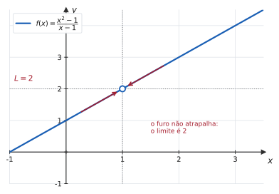
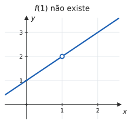
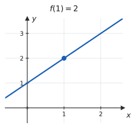
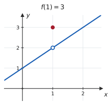
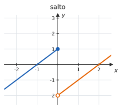
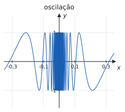
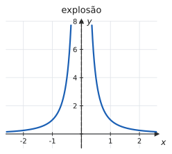
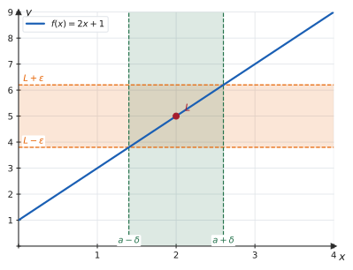
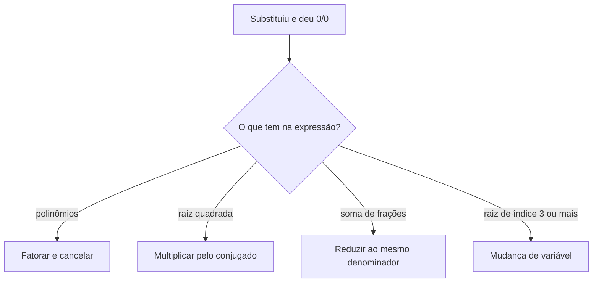

# 2.1 · Conceito e noção intuitiva de limite · Teoremas sobre limites

| ← Anterior | 🏠 Índice | Próximo → |
| :--- | :---: | ---: |
| [Unidade 1 · Funções](../01-funcoes/README.md) | [Unidade 2](README.md) · [Página inicial](../README.md) | [2.2 · Limites laterais](2.2-limites-laterais.md) |

---

## 🎯 O que você vai aprender

- Entender o que $\lim_{x \to a} f(x) = L$ significa — e por que $f(a)$ **não entra na conta**.
- Reconhecer as três maneiras pelas quais um limite pode **não existir**.
- Ler a definição formal com $\varepsilon$ e $\delta$ sem pânico.
- Usar os **teoremas operatórios** para calcular limites por substituição direta.
- Resolver a indeterminação $\frac{0}{0}$ pelas quatro técnicas padrão: fatoração, racionalização, soma de frações e mudança de variável.

**Pré-requisitos:** [1.1](../01-funcoes/1.1-numeros-reais-intervalos-valor-absoluto-desigualdades.md) (valor absoluto como distância), [1.2](../01-funcoes/1.2-funcoes-dominio-contradominio-imagem.md) (domínio e o "furo" de $\frac{x^2-1}{x-1}$) e fatoração.

---

## Por que isso importa

Duas perguntas aparentemente diferentes atormentaram os matemáticos por dois mil anos:

- **Qual é a inclinação de uma curva em um ponto?** (uma reta precisa de *dois* pontos para ter inclinação; uma tangente toca em *um*)
- **Qual é a velocidade de um corpo em um instante?** (velocidade é distância dividida por tempo; em um *instante*, o tempo decorrido é zero)

As duas esbarram no mesmo obstáculo: querem dividir por zero. O **limite** é a ferramenta que contorna isso — ele pergunta não "quanto vale em $a$", mas **"para onde a função está indo quando $x$ se aproxima de $a$"**.

Derivada é um limite. Integral é um limite. Continuidade é um limite. Esta página é a fundação do curso inteiro.

---

## 1. A ideia, com um exemplo

Considere

$$f(x) = \frac{x^2-1}{x-1}$$

Em $x = 1$ ela **não existe**: daria $\frac{0}{0}$. Mas e perto de $1$?

| $x$ | $0{,}9$ | $0{,}99$ | $0{,}999$ | $\to 1 \leftarrow$ | $1{,}001$ | $1{,}01$ | $1{,}1$ |
| --- | :---: | :---: | :---: | :---: | :---: | :---: | :---: |
| $f(x)$ | $1{,}9$ | $1{,}99$ | $1{,}999$ | $?$ | $2{,}001$ | $2{,}01$ | $2{,}1$ |

Os valores se aproximam de $2$ **pelos dois lados** — e chegam tão perto de $2$ quanto quisermos, bastando tomar $x$ perto o bastante de $1$. Dizemos então que **o limite de $f(x)$ quando $x$ tende a $1$ é $2$**:

$$\lim_{x \to 1} \frac{x^2-1}{x-1} = 2$$

> 📊 O gráfico explica a tabela: como $\frac{x^2-1}{x-1} = \frac{(x-1)(x+1)}{x-1} = x+1$ **para $x \neq 1$**, a curva é a reta $y = x+1$ com um **furo** em $(1,2)$. O furo é um ponto só; a função continua indo para $2$ dos dois lados.

> 📐 **Definição 2.1.1 (Limite — versão intuitiva).** Escrevemos
> $$\lim_{x \to a} f(x) = L$$
> quando os valores de $f(x)$ podem ser tornados **tão próximos de $L$ quanto se queira**, bastando tomar $x$ suficientemente próximo de $a$, **com $x \neq a$**.

Leia em voz alta a parte final: **com $x \neq a$**. Ela é o coração da ideia.

---

## 2. O limite não enxerga $f(a)$

Esta é a propriedade mais estranha do limite para quem o encontra pela primeira vez — e a mais importante.

| | | |
| :---: | :---: | :---: |
|  |  |  |
| $f(1)$ não existe | $f(1) = 2$ | $f(1) = 3$ |

Nos **três** casos,

$$\lim_{x \to 1} f(x) = 2$$

O limite descreve o **comportamento ao redor** de $a$, e é completamente cego ao que acontece **em** $a$. No terceiro caso, o valor da função ($3$) é diferente do limite ($2$) — e os dois estão corretos, cada um respondendo a uma pergunta diferente.

> [!IMPORTANT]
> **Limite e valor da função são perguntas distintas.**
> - $f(a)$: "quanto a função vale **em** $a$?"
> - $\lim_{x\to a} f(x)$: "para onde a função **aponta** perto de $a$?"
>
> Quando as duas respostas coincidem, a função é **contínua** em $a$ — e é exatamente isso que [2.5](2.5-continuidade-e-tipos-de-descontinuidade.md) vai formalizar.

> 💡 **Por que isso não é uma firula.** Na definição de derivada,
> $$f'(a) = \lim_{h \to 0} \frac{f(a+h)-f(a)}{h}$$
> o quociente **nunca** está definido em $h=0$ — ele dá $\frac00$ ali, sempre. Se o limite se importasse com o valor no ponto, não existiria derivada nenhuma. O Cálculo inteiro depende dessa cegueira.

---

## 3. Quando o limite não existe

Há três maneiras típicas de o limite falhar:

| | | |
| :---: | :---: | :---: |
|  |  |  |
| **Salto:** os dois lados vão para valores diferentes | **Oscilação:** a função não decide para onde ir | **Explosão:** os valores crescem sem limitação |

1. **Salto.** Pela esquerda a função tende a $1$; pela direita, a $-2$. Como os dois lados discordam, não há um único $L$. É o assunto de [2.2 · Limites laterais](2.2-limites-laterais.md).
2. **Oscilação.** Em $f(x) = \mathrm{sen}\thinspace\frac1x$, quanto mais perto de $0$, mais rápido a função varre todo o intervalo $[-1,1]$ — infinitas vezes. Ela não se aproxima de valor nenhum.
3. **Explosão.** Em $f(x) = \frac{1}{x^2}$, os valores crescem sem parar. Escreve-se $\lim_{x\to 0}\frac{1}{x^2} = +\infty$, mas essa notação **significa que o limite não existe** (como número): ela descreve *como* ele deixa de existir. É o assunto de [2.4](2.4-limites-infinitos-no-infinito-e-assintotas.md).

> 📐 **Teorema 2.1.1 (Unicidade do limite).** Se o limite existe, ele é **único**: uma função não pode tender a dois valores diferentes no mesmo ponto.

É justamente a unicidade que o caso do salto viola — e é por isso que ali o limite não existe.

---

## 4. A definição formal ($\varepsilon$–$\delta$)

"Tão próximo quanto se queira" é uma frase, não uma definição. Traduzi-la em matemática levou cerca de 150 anos, e o resultado é o seguinte.

> 📐 **Definição 2.1.2 (Cauchy–Weierstrass).** Seja $f$ definida em um intervalo aberto contendo $a$, exceto possivelmente em $a$. Diz-se que $\lim_{x \to a} f(x) = L$ quando:
>
> para todo $\varepsilon > 0$, existe $\delta > 0$ tal que
> $$0 < \lvert x - a \rvert < \delta \ \Longrightarrow \ \lvert f(x) - L \rvert < \varepsilon$$

Parece intimidante. Mas você já leu as duas desigualdades em [1.1](../01-funcoes/1.1-numeros-reais-intervalos-valor-absoluto-desigualdades.md):

| Símbolos | Em português |
| --- | --- |
| $\lvert f(x) - L \rvert < \varepsilon$ | "a distância de $f(x)$ até $L$ é menor que $\varepsilon$" |
| $0 < \lvert x-a \rvert < \delta$ | "a distância de $x$ até $a$ é menor que $\delta$, **e $x \neq a$**" |

Juntando: **para qualquer margem de erro $\varepsilon$ que alguém exija na saída, eu consigo encontrar uma vizinhança $\delta$ na entrada que garante essa margem.**

> 📊 A figura é a definição desenhada. Alguém escolhe a **faixa horizontal** de altura $2\varepsilon$ em torno de $L$ (em laranja). Você responde com a **faixa vertical** de largura $2\delta$ em torno de $a$ (em verde), estreita o bastante para que todo o pedaço de curva dentro dela caiba na faixa laranja. Se você consegue responder a **qualquer** faixa laranja, por mais fina que seja, o limite é $L$.

#### ✍️ Exemplo 1 — provando um limite pela definição

Mostre que $\lim_{x \to 2} (2x+1) = 5$.

**Estratégia.** Partir da desigualdade que se quer garantir e fazer aparecer $\lvert x - 2 \rvert$.

**Solução.** Seja $\varepsilon > 0$ dado. Queremos $\lvert (2x+1) - 5 \rvert < \varepsilon$. Simplificando:

$$\lvert 2x - 4 \rvert = \lvert 2(x-2) \rvert = 2\thinspace \lvert x-2 \rvert$$

Então a condição desejada é

$$2\thinspace \lvert x-2 \rvert < \varepsilon \ \Longleftrightarrow \ \lvert x-2 \rvert < \frac{\varepsilon}{2}$$

Basta tomar $\delta = \dfrac{\varepsilon}{2}$: se $0 < \lvert x-2 \rvert < \delta$, então $\lvert (2x+1)-5 \rvert = 2\lvert x-2\rvert < 2\delta = \varepsilon$. $\blacksquare$

> 💡 É a mesma conta do [Exercício Resolvido 6 de 1.1](../01-funcoes/1.1-numeros-reais-intervalos-valor-absoluto-desigualdades.md). Toda demonstração por $\varepsilon$–$\delta$ de uma função afim segue esse roteiro: fatorar, isolar $\lvert x-a\rvert$, ler o $\delta$.

> [!NOTE]
> **O que a sua prova vai cobrar.** Na maioria das turmas, a definição formal é apresentada para você **entender** o conceito, e os cálculos de limite são feitos pelos teoremas da próxima seção. Demonstrações por $\varepsilon$–$\delta$ costumam aparecer apenas para funções afins, como no exemplo acima. Confirme com o seu professor — mas não deixe de entender a figura: é ela que dá sentido a todo o resto.

---

## 5. Teoremas sobre limites

Calcular todo limite pela definição seria inviável. Felizmente, o limite **respeita as operações**.

> 📐 **Teorema 2.1.2 (Propriedades operatórias).** Se $\lim_{x\to a} f(x) = L$ e $\lim_{x \to a} g(x) = M$ (ambos existindo e finitos), então:
>
> | | Propriedade |
> | :---: | --- |
> | **L1** | $\lim_{x\to a}\big[f(x) \pm g(x)\big] = L \pm M$ |
> | **L2** | $\lim_{x\to a}\big[c \cdot f(x)\big] = c\thinspace L$, para toda constante $c$ |
> | **L3** | $\lim_{x\to a}\big[f(x)\thinspace g(x)\big] = L \cdot M$ |
> | **L4** | $\lim_{x\to a}\dfrac{f(x)}{g(x)} = \dfrac{L}{M}$, **desde que** $M \neq 0$ |
> | **L5** | $\lim_{x\to a}\big[f(x)\big]^n = L^n$, para $n$ inteiro positivo |
> | **L6** | $\lim_{x\to a}\sqrt[n]{f(x)} = \sqrt[n]{L}$ (com $L > 0$ se $n$ for par) |
> | **L7** | $\lim_{x\to a} c = c$ e $\lim_{x\to a} x = a$ |

De L7 e das demais sai o resultado que mais se usa no dia a dia:

> 📐 **Teorema 2.1.3 (Substituição direta).**
> - Se $p$ é um **polinômio**, então $\lim_{x\to a} p(x) = p(a)$.
> - Se $r(x) = \dfrac{p(x)}{q(x)}$ é uma **função racional** e $q(a) \neq 0$, então $\lim_{x\to a} r(x) = r(a)$.

Ou seja: **para polinômio e para racional com denominador não nulo, é só substituir.**

#### ✍️ Exemplo 2 — substituição direta

$$\lim_{x \to 2} \big(3x^2 - 5x + 4\big) = 3(2)^2 - 5(2) + 4 = 12 - 10 + 4 = 6$$

$$\lim_{x \to 1} \frac{x^2+3}{x+4} = \frac{1+3}{1+4} = \frac{4}{5}$$

No segundo caso a substituição foi legítima porque o denominador em $x=1$ vale $5 \neq 0$.

> [!TIP]
> **O primeiro movimento é sempre substituir.** Três resultados possíveis:
> - **um número** → é a resposta, acabou;
> - $\dfrac{\text{número} \neq 0}{0}$ → o limite é infinito ou não existe (assunto de [2.4](2.4-limites-infinitos-no-infinito-e-assintotas.md));
> - $\dfrac{0}{0}$ → **indeterminação**: a conta está só começando.

---

## 6. A indeterminação $\frac{0}{0}$ e as quatro técnicas

> [!CAUTION]
> $\frac{0}{0}$ **não é zero, nem um, nem infinito.** É um aviso de que a informação disponível ainda não decide o limite — ele pode dar qualquer coisa. Compare: $\lim_{x\to0}\frac{x}{x} = 1$, $\lim_{x\to0}\frac{x^2}{x} = 0$ e $\lim_{x\to0}\frac{x}{x^2}$ nem existe. Todos "dão $\frac00$" na substituição.

Quando aparece $\frac00$, o fator que zera está nos **dois** lados da fração — e precisa ser cancelado. As quatro técnicas padrão:

### 6.1 Fatoração

#### ✍️ Exemplo 3

$$\lim_{x \to 3} \frac{x^2-9}{x-3}$$

Substituindo dá $\frac00$. Fatorando o numerador:

$$\frac{x^2-9}{x-3} = \frac{(x-3)(x+3)}{x-3} = x+3 \qquad (x \neq 3)$$

$$\lim_{x\to3}\frac{x^2-9}{x-3} = \lim_{x\to3}(x+3) = 6$$

> [!IMPORTANT]
> **Por que o cancelamento é legítimo.** Dividir por $x-3$ exigiria $x \neq 3$ — e é exatamente isso que o limite garante: $x$ se aproxima de $3$ **sem nunca ser** $3$. As duas funções, $\frac{x^2-9}{x-3}$ e $x+3$, são diferentes (têm domínios diferentes), mas coincidem em toda a vizinhança que interessa. Por isso têm o mesmo limite.

#### ✍️ Exemplo 4

$$\lim_{x \to 1} \frac{x^3-1}{x^2-1}$$

Dá $\frac00$. Fatorando os dois lados — note a **diferença de cubos**:

$$\frac{x^3-1}{x^2-1} = \frac{(x-1)(x^2+x+1)}{(x-1)(x+1)} = \frac{x^2+x+1}{x+1}$$

$$\lim_{x\to1}\frac{x^3-1}{x^2-1} = \frac{1+1+1}{1+1} = \frac{3}{2}$$

### 6.2 Racionalização (conjugado)

#### ✍️ Exemplo 5

$$\lim_{x \to 0} \frac{\sqrt{x+9} - 3}{x}$$

Dá $\frac00$. Multiplique numerador e denominador pelo **conjugado** do numerador:

$$
\begin{aligned}
\frac{\sqrt{x+9}-3}{x}
&= \frac{\sqrt{x+9}-3}{x} \cdot \frac{\sqrt{x+9}+3}{\sqrt{x+9}+3} \\
&= \frac{(x+9) - 9}{x\big(\sqrt{x+9}+3\big)} \\
&= \frac{x}{x\big(\sqrt{x+9}+3\big)} \\
&= \frac{1}{\sqrt{x+9}+3}
\end{aligned}
$$

Agora a substituição funciona:

$$\lim_{x\to0}\frac{\sqrt{x+9}-3}{x} = \frac{1}{\sqrt{9}+3} = \frac{1}{6}$$

> 💡 **Por que funciona:** $(\sqrt{A}-B)(\sqrt{A}+B) = A - B^2$. A multiplicação elimina a raiz do numerador e faz surgir o fator que cancela com o denominador. É a mesma conta do quociente de Newton de $\sqrt{x}$, em [1.2](../01-funcoes/1.2-funcoes-dominio-contradominio-imagem.md#7-o-quociente-de-newton).

### 6.3 Soma de frações

#### ✍️ Exemplo 6

$$\lim_{x \to 0} \frac{\dfrac{1}{x+2} - \dfrac{1}{2}}{x}$$

Reduza o numerador ao mesmo denominador **antes** de qualquer outra coisa:

$$\frac{1}{x+2} - \frac12 = \frac{2 - (x+2)}{2(x+2)} = \frac{-x}{2(x+2)}$$

Logo

$$\frac{\frac{1}{x+2}-\frac12}{x} = \frac{-x}{2(x+2)} \cdot \frac{1}{x} = \frac{-1}{2(x+2)}$$

$$\lim_{x\to0} \frac{-1}{2(x+2)} = \frac{-1}{4}$$

### 6.4 Mudança de variável

Útil quando há raízes de índice $3$ ou mais, em que o conjugado não ajuda.

#### ✍️ Exemplo 7

$$\lim_{x \to 8} \frac{\sqrt[3]{x}-2}{x-8}$$

Faça $u = \sqrt[3]{x}$, de modo que $x = u^3$. Quando $x \to 8$, tem-se $u \to 2$. Substituindo:

$$\frac{\sqrt[3]{x}-2}{x-8} = \frac{u-2}{u^3-8} = \frac{u-2}{(u-2)(u^2+2u+4)} = \frac{1}{u^2+2u+4}$$

$$\lim_{u\to2}\frac{1}{u^2+2u+4} = \frac{1}{4+4+4} = \frac{1}{12}$$

> 💡 **A troca de variável troca também o ponto.** Esqueça-se de levar $x \to 8$ para $u \to 2$ e você resolverá o limite errado. Escreva sempre a nova tendência ao lado da substituição.

---

## ⚠️ Armadilhas

| O erro | Por que está errado | O certo |
| --- | --- | --- |
| "deu $\frac00$, logo não existe" | $\frac00$ é indeterminação, não resposta | fatore, racionalize ou mude de variável |
| $\frac00 = 1$ ou $= 0$ | o valor depende da função | só o cálculo decide |
| "$f(1)$ não existe, logo o limite não existe" | o limite ignora o ponto | veja a §2 |
| cancelar $x-3$ e não dizer nada | o cancelamento exige $x \neq 3$ | é o limite que garante isso — mencione |
| racionalizar o **denominador** quando a raiz está no numerador | não produz cancelamento | multiplique pelo conjugado de **onde está a raiz** |
| aplicar L4 com $M=0$ | a propriedade exige $M \neq 0$ | caia no $\frac{k}{0}$ e trate em [2.4](2.4-limites-infinitos-no-infinito-e-assintotas.md) |
| mudar de variável e manter $x \to a$ | o ponto também muda | $u \to$ novo valor |
| escrever $\lim$ sem o "$x \to a$" | $\lim f(x)$ não quer dizer nada | sempre indique a tendência |

> [!WARNING]
> **O "$\lim$" não some no meio da conta.** Enquanto você não calcular o limite, ele precisa aparecer em **toda** linha da resolução: $\lim_{x\to3}\frac{x^2-9}{x-3} = \lim_{x\to3}(x+3) = 6$. Escrever a cadeia sem o símbolo é erro de notação e costuma custar ponto.

---

## 🧠 Exercícios resolvidos

### Exercício Resolvido 1

$$\lim_{x \to 2} \frac{x^2-4}{x^2-3x+2}$$

**Solução.** Substituindo: $\frac{0}{0}$. Fatore **os dois** lados:

$$\frac{x^2-4}{x^2-3x+2} = \frac{(x-2)(x+2)}{(x-2)(x-1)} = \frac{x+2}{x-1} \qquad (x \neq 2)$$

$$\lim_{x\to2}\frac{x+2}{x-1} = \frac{4}{1} = 4$$

**Resposta.** $4$

---

### Exercício Resolvido 2

$$\lim_{x \to 0} \frac{\sqrt{1+x} - \sqrt{1-x}}{x}$$

**Estratégia.** Duas raízes no numerador: o conjugado é a soma delas.

**Solução.**

$$
\begin{aligned}
\frac{\sqrt{1+x}-\sqrt{1-x}}{x}
&= \frac{\sqrt{1+x}-\sqrt{1-x}}{x} \cdot \frac{\sqrt{1+x}+\sqrt{1-x}}{\sqrt{1+x}+\sqrt{1-x}} \\
&= \frac{(1+x) - (1-x)}{x\big(\sqrt{1+x}+\sqrt{1-x}\big)} \\
&= \frac{2x}{x\big(\sqrt{1+x}+\sqrt{1-x}\big)} \\
&= \frac{2}{\sqrt{1+x}+\sqrt{1-x}}
\end{aligned}
$$

$$\lim_{x\to0}\frac{2}{\sqrt{1+x}+\sqrt{1-x}} = \frac{2}{1+1} = 1$$

**Resposta.** $1$

---

### Exercício Resolvido 3

$$\lim_{h \to 0} \frac{(2+h)^3 - 8}{h}$$

**Estratégia.** Reconheça: é o quociente de Newton de $f(x)=x^3$ em $x=2$. Desenvolva o cubo.

**Solução.**

$$(2+h)^3 = 8 + 12h + 6h^2 + h^3$$

$$\frac{(2+h)^3-8}{h} = \frac{12h + 6h^2 + h^3}{h} = \frac{h\big(12 + 6h + h^2\big)}{h} = 12 + 6h + h^2$$

$$\lim_{h\to0}\big(12+6h+h^2\big) = 12$$

**Resposta.** $12$ — que é $f'(2)$ para $f(x)=x^3$, como a Unidade 3 confirmará.

---

### Exercício Resolvido 4

$$\lim_{x \to 1} \left( \frac{1}{x-1} - \frac{2}{x^2-1} \right)$$

**Estratégia.** Cada parcela explode separadamente ($\infty - \infty$), mas juntas elas se comportam. Reduza ao mesmo denominador.

**Solução.** Como $x^2-1 = (x-1)(x+1)$, o denominador comum é $(x-1)(x+1)$:

$$\frac{1}{x-1} - \frac{2}{(x-1)(x+1)} = \frac{(x+1) - 2}{(x-1)(x+1)} = \frac{x-1}{(x-1)(x+1)} = \frac{1}{x+1}$$

$$\lim_{x\to1}\frac{1}{x+1} = \frac12$$

**Resposta.** $\dfrac12$

> 💡 A indeterminação $\infty - \infty$ é tratada do mesmo jeito: **junte tudo em uma fração só** e veja o que sobra. Voltaremos a ela em [4.3](../04-aplicacoes-das-derivadas/4.3-regra-de-lhospital.md).

---

### Exercício Resolvido 5

**Demonstre, pela definição, que** $\lim_{x \to 3} (4x-5) = 7$.

**Solução.** Seja $\varepsilon > 0$ dado. Analisando a desigualdade que se quer garantir:

$$\lvert (4x-5) - 7 \rvert = \lvert 4x - 12 \rvert = 4\thinspace \lvert x - 3 \rvert$$

Queremos que isso seja $< \varepsilon$, ou seja, $\lvert x-3 \rvert < \dfrac{\varepsilon}{4}$.

**Escolha** $\delta = \dfrac{\varepsilon}{4}$. Então, sempre que $0 < \lvert x-3\rvert < \delta$:

$$\lvert (4x-5)-7 \rvert = 4\lvert x-3 \rvert < 4\delta = 4 \cdot \frac{\varepsilon}{4} = \varepsilon$$

Como $\varepsilon$ era arbitrário, o limite é $7$. $\blacksquare$

---

### Exercício Resolvido 6

$$\lim_{x \to 1} \frac{\sqrt[3]{x}-1}{x-1}$$

**Estratégia.** Raiz cúbica ⇒ mudança de variável.

**Solução.** Seja $u = \sqrt[3]{x}$, logo $x = u^3$. Quando $x \to 1$, temos $u \to 1$.

$$\frac{\sqrt[3]{x}-1}{x-1} = \frac{u-1}{u^3-1} = \frac{u-1}{(u-1)(u^2+u+1)} = \frac{1}{u^2+u+1}$$

$$\lim_{u\to1}\frac{1}{u^2+u+1} = \frac{1}{1+1+1} = \frac13$$

**Resposta.** $\dfrac13$

> 💡 **Vale notar o padrão:** $\lim_{x\to1}\frac{\sqrt[n]{x}-1}{x-1} = \frac1n$. Confira com o Exemplo 5 ($n=2$, em outro ponto) e com este exercício ($n=3$). Na Unidade 3 isso vira a regra da potência, em uma linha.

---

## 📝 Agora é com você

➡️ **[Lista 2.1 — exercícios propostos](exercicios/lista-2.1-propostos.md)** · ✅ **[Gabarito](gabaritos/gabarito-2.1.md)**

---

## Resumo da página

> **Decore:**
> - $\lim_{x\to a} f(x) = L$ fala do **comportamento perto de $a$**, não do valor **em** $a$.
> - Substituição direta vale para polinômio, e para racional com $q(a) \neq 0$.
> - $\frac00$ é **indeterminação**: o aviso de que a conta começou.
> - As quatro saídas: fatorar · racionalizar · somar frações · mudar de variável.
>
> **Saiba fazer:**
> - substituir primeiro e classificar o resultado (número, $\frac{k}{0}$ ou $\frac00$);
> - justificar o cancelamento lembrando que $x \neq a$;
> - carregar o símbolo $\lim$ em todas as linhas até calculá-lo;
> - ler a figura $\varepsilon$–$\delta$ e provar o limite de uma função afim pela definição.

---

## 📚 Para aprofundar

| Livro | Onde procurar |
| --- | --- |
| **LEITHOLD** | Capítulo 2 — "Limite de uma função"; "Teoremas sobre limites de funções" |
| **STEWART** | Capítulo 2 — "O limite de uma função"; "Cálculo de limites usando as propriedades dos limites" |
| **THOMAS** | Capítulo 2 — "Taxas de variação e limites"; "Cálculo de limites usando as leis do limite" |
| **ANTON** | Capítulo 2 — "Limites (uma abordagem intuitiva)"; "Limites (métodos de cálculo)" |
| **SWOKOWSKI** | Capítulo 2 — "Introdução ao limite"; "Teoremas sobre limites" |
| **MUNEM & FOULIS** | Capítulo 2 — "Limites de funções" |

---

| ← Anterior | 🏠 Índice | Próximo → |
| :--- | :---: | ---: |
| [Unidade 1 · Funções](../01-funcoes/README.md) | [Unidade 2](README.md) · [Página inicial](../README.md) | [2.2 · Limites laterais](2.2-limites-laterais.md) |

*Sobrevivendo ao Cálculo 1 (UENF)* · por **Nicolau Prates** · [CC BY-SA 4.0](../LICENSE)
