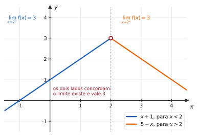
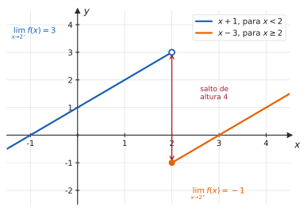
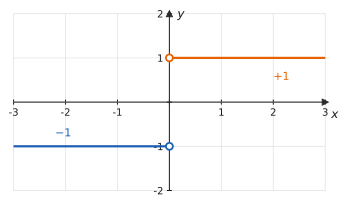
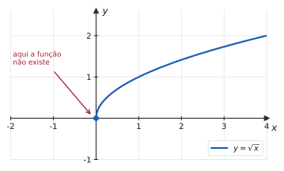
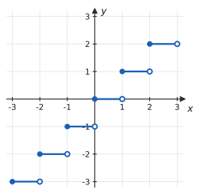

# 2.2 · Limites laterais

| ← Anterior | 🏠 Índice | Próximo → |
| :--- | :---: | ---: |
| [2.1 · Conceito de limite](2.1-conceito-e-nocao-intuitiva-de-limite.md) | [Unidade 2](README.md) · [Página inicial](../README.md) | [2.3 · Teorema do Confronto](2.3-teorema-do-sanduiche.md) |

---

## 🎯 O que você vai aprender

- Calcular o limite **pela esquerda** e **pela direita** de um ponto.
- Usar o teorema que liga os laterais ao limite comum — a ferramenta para decidir se um limite **existe**.
- Tratar funções **definidas por partes**, **com módulo** e **com raiz** no ponto de troca.
- Determinar o valor de uma constante que faz o limite existir.

**Pré-requisitos:** [2.1](2.1-conceito-e-nocao-intuitiva-de-limite.md) e as funções por partes de [1.2](../01-funcoes/1.2-funcoes-dominio-contradominio-imagem.md).

---

## Por que isso importa

Em [2.1](2.1-conceito-e-nocao-intuitiva-de-limite.md) você viu que o limite pode não existir por **salto** — os dois lados discordando. Esta página dá o instrumento para detectar isso e, mais importante, para **decidir** a existência do limite em qualquer situação de troca de regra.

É a ferramenta usada para:

- limites de funções definidas por partes (que caem em toda prova);
- qualquer coisa com **módulo**, porque o módulo é uma função por partes disfarçada;
- limites nas **bordas do domínio**, onde só existe um dos lados;
- a definição de **continuidade** ([2.5](2.5-continuidade-e-tipos-de-descontinuidade.md)) e de **derivadas laterais** (Unidade 3).

---

## 1. As duas aproximações

Até aqui, "$x$ tende a $a$" significava aproximar-se **pelos dois lados ao mesmo tempo**. Nem sempre isso faz sentido — e nem sempre os dois lados concordam.

> 📐 **Definição 2.2.1 (Limite à direita).** Escreve-se
> $$\lim_{x \to a^{+}} f(x) = L$$
> quando $f(x)$ fica tão próximo de $L$ quanto se queira, tomando-se $x$ suficientemente próximo de $a$ **com $x > a$**.

> 📐 **Definição 2.2.2 (Limite à esquerda).** Escreve-se
> $$\lim_{x \to a^{-}} f(x) = L$$
> quando o mesmo vale tomando-se $x$ suficientemente próximo de $a$ **com $x < a$**.

| Notação | Lê-se | $x$ vem... |
| :---: | --- | --- |
| $x \to a^{+}$ | "$x$ tende a $a$ pela direita" | de **valores maiores** que $a$ |
| $x \to a^{-}$ | "$x$ tende a $a$ pela esquerda" | de **valores menores** que $a$ |

> [!TIP]
> **Como não trocar os dois.** O sinal indica **de que lado da reta** o $x$ está, e não a direção do movimento. Em $x \to 2^{+}$, os valores de $x$ são $2{,}1$, $2{,}01$, $2{,}001$ — todos **maiores** que $2$, à **direita** dele no eixo. Pense no sinal como o do número $x - a$.

---

## 2. O teorema que decide tudo

> 📐 **Teorema 2.2.1.** O limite existe se, e somente se, os dois laterais existem e são **iguais**:
> $$\lim_{x \to a} f(x) = L \quad \Longleftrightarrow \quad \lim_{x \to a^{-}} f(x) = L \ \text{ e } \ \lim_{x \to a^{+}} f(x) = L$$

Em palavras: **o limite existe quando os dois lados concordam** — e vale o valor comum. Se discordarem, ou se faltar um deles, o limite bilateral **não existe**.

| | |
| :---: | :---: |
|  |  |
| Os dois lados vão para $3$: **o limite existe** e vale $3$ (mesmo com o furo). | Esquerda vai a $3$, direita a $-1$: **o limite não existe**. |

> 💡 Repare na figura da esquerda: a função **não está definida** em $x=2$, e mesmo assim o limite existe. Já na da direita, a função **está** definida em $x=2$ (vale $-1$), e o limite não existe. Mais uma vez: existência do limite e valor da função são perguntas independentes.

---

## 3. Como calcular um limite lateral

A regra prática é simples: **use a expressão que vale do lado pedido**.

#### ✍️ Exemplo 1 — função por partes

Seja

$$
f(x) = \begin{cases}
x+1, & \text{se } x < 2 \\
x-3, & \text{se } x \geqslant 2
\end{cases}
$$

Calcule os limites laterais em $x=2$ e decida se $\lim_{x\to2} f(x)$ existe.

**Solução.**

**Pela esquerda** ($x < 2$): vale a primeira linha, $f(x) = x+1$.

$$\lim_{x\to2^{-}} f(x) = \lim_{x\to2^{-}}(x+1) = 3$$

**Pela direita** ($x > 2$): vale a segunda linha, $f(x) = x-3$.

$$\lim_{x\to2^{+}} f(x) = \lim_{x\to2^{+}}(x-3) = -1$$

Como $3 \neq -1$, **o limite não existe**.

> [!IMPORTANT]
> **O valor $f(2) = -1$ não entrou na conta em momento nenhum.** Para calcular o limite à direita, usamos a segunda linha porque ela vale para $x>2$, não porque ela vale **em** $2$. Essa distinção fica crucial em [2.5](2.5-continuidade-e-tipos-de-descontinuidade.md).

---

#### ✍️ Exemplo 2 — módulo é função por partes

Calcule os limites laterais de $f(x) = \dfrac{\lvert x \rvert}{x}$ em $x=0$.

**Solução.** Primeiro, **abra o módulo** usando a definição:

$$
\frac{\lvert x \rvert}{x} = \begin{cases}
\dfrac{x}{x} = 1, & \text{se } x > 0 \\[6pt]
\dfrac{-x}{x} = -1, & \text{se } x < 0
\end{cases}
$$

$$\lim_{x\to0^{-}} \frac{\lvert x \rvert}{x} = -1 \qquad \lim_{x\to0^{+}} \frac{\lvert x \rvert}{x} = 1$$

Os laterais existem e são diferentes: **o limite não existe**.

> 💡 **O procedimento com módulo tem sempre dois passos:** (1) descubra o **sinal do que está dentro** do módulo no lado pedido; (2) troque $\lvert u \rvert$ por $u$ ou por $-u$, conforme esse sinal. Nunca "cancele" um módulo sem fazer isso.

---

#### ✍️ Exemplo 3 — módulo deslocado

Calcule $\lim_{x \to 2^{-}} \dfrac{x-2}{\lvert x-2 \rvert}$ e $\lim_{x \to 2^{+}} \dfrac{x-2}{\lvert x-2 \rvert}$.

**Solução.** A expressão dentro do módulo é $x-2$:

- **Para $x < 2$**, tem-se $x - 2 < 0$, logo $\lvert x-2 \rvert = -(x-2)$:
  $$\frac{x-2}{-(x-2)} = -1 \ \Longrightarrow \ \lim_{x\to2^{-}} = -1$$
- **Para $x > 2$**, tem-se $x-2 > 0$, logo $\lvert x-2 \rvert = x-2$:
  $$\frac{x-2}{x-2} = 1 \ \Longrightarrow \ \lim_{x\to2^{+}} = 1$$

O limite bilateral **não existe**.

---

#### 📊 Exemplo 4 — quando só um lado existe

Considere $f(x) = \sqrt{x}$ em $x = 0$.

$$\lim_{x\to0^{+}} \sqrt{x} = 0$$

Já o limite pela esquerda **não faz sentido**: à esquerda de $0$ a função nem existe ($D(f) = [0,+\infty)$). Pelo Teorema 2.2.1, o limite bilateral $\lim_{x\to0}\sqrt{x}$ **não existe** — mas o limite lateral à direita existe e vale $0$.

> [!NOTE]
> **Isso não é um defeito da função.** Em pontos de **borda do domínio**, o limite lateral é a única pergunta sensata. Por isso a continuidade em intervalos fechados, em [2.5](2.5-continuidade-e-tipos-de-descontinuidade.md), é definida com limites laterais nas extremidades.

---

#### 📊 Exemplo 5 — a função maior inteiro

A função **maior inteiro**, denotada $\lfloor x \rfloor$, devolve o maior inteiro que não ultrapassa $x$: $\lfloor 2{,}7 \rfloor = 2$, $\lfloor 3 \rfloor = 3$, $\lfloor -1{,}2 \rfloor = -2$.

Em $x = 2$:

$$\lim_{x\to2^{-}} \lfloor x \rfloor = 1 \qquad \text{(logo à esquerda de 2, o maior inteiro é 1)}$$
$$\lim_{x\to2^{+}} \lfloor x \rfloor = 2$$

O limite não existe em $x=2$ — nem em inteiro nenhum. Entre dois inteiros, porém, a função é constante e tudo funciona normalmente.

> ⚠️ O erro clássico é dizer que $\lim_{x\to2^-}\lfloor x\rfloor = 2$ "porque $\lfloor 2 \rfloor = 2$". Limite à esquerda olha para $x$ **menores** que $2$ — e ali o valor da função é $1$, por mais perto de $2$ que se chegue.

---

## 4. Determinando constantes para o limite existir

É o formato mais comum em prova: dada uma função por partes com um parâmetro, achar o valor que **cola** os dois ramos.

#### ✍️ Exemplo 6

Determine $k$ para que $\lim_{x \to 1} f(x)$ exista, onde

$$
f(x) = \begin{cases}
x^2 + k, & \text{se } x < 1 \\
3x - 2, & \text{se } x \geqslant 1
\end{cases}
$$

**Estratégia.** Calcular os dois laterais em função de $k$ e **igualá-los** — é exatamente o que o Teorema 2.2.1 exige.

**Solução.**

$$\lim_{x\to1^{-}} f(x) = \lim_{x\to1^{-}}\big(x^2+k\big) = 1 + k$$
$$\lim_{x\to1^{+}} f(x) = \lim_{x\to1^{+}}(3x-2) = 1$$

Igualando:

$$1 + k = 1 \ \Longrightarrow \ k = 0$$

**Resposta.** $k = 0$, e nesse caso $\lim_{x\to1} f(x) = 1$.

> 💡 **O mesmo roteiro serve para continuidade.** Em [2.5](2.5-continuidade-e-tipos-de-descontinuidade.md) a pergunta vira "para que valor de $k$ a função é contínua?", e aí haverá **três** quantidades a igualar: os dois laterais e o valor $f(1)$.

---

## ⚠️ Armadilhas

| O erro | Por que está errado | O certo |
| --- | --- | --- |
| trocar $a^{+}$ com $a^{-}$ | o sinal diz de que lado está o $x$ | $x \to 2^{+}$ significa $x > 2$ |
| usar $f(a)$ para calcular o lateral | o limite nunca olha o ponto | use a regra válida **ao lado** |
| cancelar $\lvert u \rvert$ sem analisar o sinal | o módulo muda de expressão | abra em dois casos |
| "os laterais existem, logo o limite existe" | faltou compará-los | precisam ser **iguais** |
| $\lim_{x\to2^-}\lfloor x\rfloor = 2$ | olhou o valor **em** $2$ | à esquerda de $2$ vale $1$ |
| dizer que $\lim_{x\to0}\sqrt x = 0$ | à esquerda a função não existe | só o lateral à direita existe |
| achar $k$ igualando ao valor $f(a)$ | o enunciado pediu **limite**, não continuidade | iguale os dois **laterais** |

---

## 🧠 Exercícios resolvidos

### Exercício Resolvido 1

**Seja**

$$
f(x) = \begin{cases}
2x+1, & \text{se } x < 3 \\
x^2 - 2, & \text{se } x \geqslant 3
\end{cases}
$$

**Calcule os limites laterais em $x=3$ e decida se o limite existe.**

**Solução.**

$$\lim_{x\to3^{-}} f(x) = \lim_{x\to3^{-}}(2x+1) = 7$$
$$\lim_{x\to3^{+}} f(x) = \lim_{x\to3^{+}}\big(x^2-2\big) = 9 - 2 = 7$$

Os dois laterais existem e **coincidem**.

**Resposta.** $\lim_{x\to3} f(x) = 7$.

---

### Exercício Resolvido 2

**Calcule** $\lim_{x\to3^{-}} \dfrac{\lvert x-3 \rvert}{x^2-9}$ **e** $\lim_{x\to3^{+}} \dfrac{\lvert x-3 \rvert}{x^2-9}$.

**Estratégia.** Fatorar o denominador e abrir o módulo conforme o lado.

**Solução.** Note que $x^2-9 = (x-3)(x+3)$.

**Pela esquerda** ($x<3$, logo $x-3<0$, logo $\lvert x-3\rvert = -(x-3)$):

$$\frac{-(x-3)}{(x-3)(x+3)} = \frac{-1}{x+3} \ \longrightarrow \ \frac{-1}{6}$$

**Pela direita** ($x>3$, logo $\lvert x-3\rvert = x-3$):

$$\frac{x-3}{(x-3)(x+3)} = \frac{1}{x+3} \ \longrightarrow \ \frac{1}{6}$$

**Resposta.** $-\dfrac16$ pela esquerda e $\dfrac16$ pela direita; o limite bilateral **não existe**.

---

### Exercício Resolvido 3

**Determine $a$ e $b$ para que o limite exista em $x = 1$ e em $x = 4$, onde**

$$
f(x) = \begin{cases}
x + a, & \text{se } x < 1 \\
ax + b, & \text{se } 1 \leqslant x < 4 \\
3x - 2b, & \text{se } x \geqslant 4
\end{cases}
$$

**Estratégia.** Duas condições — uma em cada ponto de troca — e duas incógnitas.

**Solução.**

**Em $x=1$:**

$$\lim_{x\to1^{-}} f(x) = 1 + a \qquad \lim_{x\to1^{+}} f(x) = a + b$$

Igualando: $1 + a = a + b$, ou seja, $\boxed{b = 1}$.

**Em $x=4$:**

$$\lim_{x\to4^{-}} f(x) = 4a + b \qquad \lim_{x\to4^{+}} f(x) = 12 - 2b$$

Igualando, com $b=1$: $4a + 1 = 12 - 2 = 10$, logo $4a = 9$ e $\boxed{a = \dfrac94}$.

**Resposta.** $a = \dfrac94$ e $b = 1$.

*Conferência:* em $x=1$, os dois lados dão $1 + \frac94 = \frac{13}{4}$ ✔; em $x=4$, $4 \cdot \frac94 + 1 = 10$ e $12 - 2 = 10$ ✔.

---

### Exercício Resolvido 4

**Calcule, se existirem:**

**(a)** $\lim_{x\to0^{+}} \dfrac{\lvert x \rvert}{x} + \lim_{x\to0^{-}} \dfrac{\lvert x \rvert}{x}$ &nbsp;&nbsp;&nbsp; **(b)** $\lim_{x\to0} \left( \dfrac{\lvert x \rvert}{x} \right)^2$

**Solução.**

**(a)** Pelos cálculos do Exemplo 2: $1 + (-1) = 0$. A soma **dos dois laterais** existe e vale $0$ — mas isso **não** significa que $\lim_{x\to0}\frac{\lvert x\rvert}{x}$ exista. São perguntas diferentes.

**(b)** Para $x \neq 0$, $\frac{\lvert x\rvert}{x}$ vale $1$ ou $-1$; em qualquer caso, **o quadrado vale $1$**:

$$\left(\frac{\lvert x \rvert}{x}\right)^2 = 1 \quad \text{para todo } x \neq 0 \ \Longrightarrow \ \lim_{x\to0}\left(\frac{\lvert x \rvert}{x}\right)^2 = 1$$

> 💡 **A lição:** uma função pode não ter limite, e uma combinação dela ter. Por isso as propriedades operatórias de [2.1](2.1-conceito-e-nocao-intuitiva-de-limite.md) exigem que os limites das parcelas **existam** — é uma condição suficiente, não necessária.

---

### Exercício Resolvido 5

**Esboce o gráfico e analise os limites laterais de**

$$f(x) = \frac{x^2 - x}{\lvert x - 1 \rvert} \quad \text{em } x = 1$$

**Solução.** Fatore o numerador: $x^2 - x = x(x-1)$.

**Pela direita** ($x > 1$, logo $\lvert x-1 \rvert = x-1$):

$$\frac{x(x-1)}{x-1} = x \ \longrightarrow \ 1$$

**Pela esquerda** ($x < 1$, logo $\lvert x-1 \rvert = -(x-1)$):

$$\frac{x(x-1)}{-(x-1)} = -x \ \longrightarrow \ -1$$

**Resposta.** $\lim_{x\to1^{+}} f(x) = 1$ e $\lim_{x\to1^{-}} f(x) = -1$; o limite **não existe** em $x=1$.

**O gráfico** é a reta $y=-x$ para $x<1$ e a reta $y=x$ para $x>1$, ambas com furo em $x=1$ — um salto de altura $2$.

---

### Exercício Resolvido 6

**Seja $f(x) = \lfloor x \rfloor + \lfloor -x \rfloor$. Calcule os limites laterais em $x=2$ e o valor $f(2)$.**

**Estratégia.** Avaliar cada parcela separadamente nos dois lados.

**Solução.**

**Pela esquerda** ($x$ pouco menor que $2$, digamos $1{,}99$): $\lfloor x \rfloor = 1$ e $\lfloor -x \rfloor = \lfloor -1{,}99 \rfloor = -2$. Logo

$$\lim_{x\to2^{-}} f(x) = 1 + (-2) = -1$$

**Pela direita** ($x = 2{,}01$): $\lfloor x \rfloor = 2$ e $\lfloor -x \rfloor = \lfloor -2{,}01 \rfloor = -3$. Logo

$$\lim_{x\to2^{+}} f(x) = 2 + (-3) = -1$$

**No ponto:** $f(2) = \lfloor 2 \rfloor + \lfloor -2 \rfloor = 2 + (-2) = 0$.

**Resposta.** Os dois laterais valem $-1$, logo $\lim_{x\to2} f(x) = -1$ — **diferente** de $f(2) = 0$.

> 💡 Duas funções que saltam, somadas, produziram uma função cujo limite **existe** em todo ponto. E, mesmo assim, o limite difere do valor nos inteiros: a função vale $0$ nos inteiros e $-1$ em todo o resto.

---

## 📝 Agora é com você

➡️ **[Lista 2.2 — exercícios propostos](exercicios/lista-2.2-propostos.md)** · ✅ **[Gabarito](gabaritos/gabarito-2.2.md)**

---

## Resumo da página

> **Decore:**
> - $x \to a^{+}$ significa $x > a$; $x \to a^{-}$ significa $x < a$.
> - $\lim_{x\to a} f(x) = L \iff$ os **dois** laterais existem e valem $L$.
> - Módulo é função por partes: abra conforme o sinal do que está dentro.
>
> **Saiba fazer:**
> - escolher a expressão certa de uma função por partes para cada lado;
> - abrir $\lvert u \rvert$ corretamente em cada lateral;
> - reconhecer quando só um lado faz sentido (borda do domínio);
> - achar a constante que faz os laterais coincidirem.

---

## 📚 Para aprofundar

| Livro | Onde procurar |
| --- | --- |
| **LEITHOLD** | Capítulo 2 — "Limites laterais" |
| **STEWART** | Capítulo 2 — "O limite de uma função" (seção de limites laterais) |
| **THOMAS** | Capítulo 2 — "Limites laterais" |
| **ANTON** | Capítulo 2 — "Limites (uma abordagem intuitiva)", parte de limites unilaterais |
| **SWOKOWSKI** | Capítulo 2 — "Limites unilaterais" |
| **MUNEM & FOULIS** | Capítulo 2 — "Limites laterais" |

---

| ← Anterior | 🏠 Índice | Próximo → |
| :--- | :---: | ---: |
| [2.1 · Conceito de limite](2.1-conceito-e-nocao-intuitiva-de-limite.md) | [Unidade 2](README.md) · [Página inicial](../README.md) | [2.3 · Teorema do Confronto](2.3-teorema-do-sanduiche.md) |

*Sobrevivendo ao Cálculo 1 (UENF)* · por **Nicolau Prates** · [CC BY-SA 4.0](../LICENSE)
