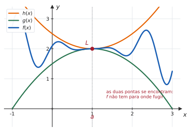
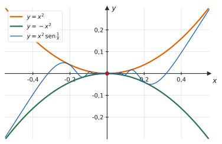
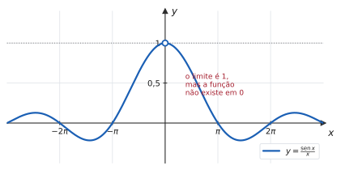
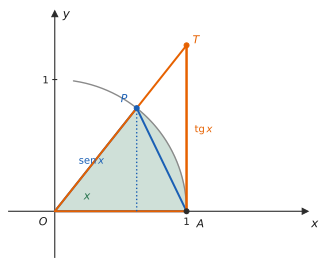

# 2.3 · Teorema do Sanduíche (Confronto)

| ← Anterior | 🏠 Índice | Próximo → |
| :--- | :---: | ---: |
| [2.2 · Limites laterais](2.2-limites-laterais.md) | [Unidade 2](README.md) · [Página inicial](../README.md) | [2.4 · Limites infinitos e assíntotas](2.4-limites-infinitos-no-infinito-e-assintotas.md) |

---

## 🎯 O que você vai aprender

- Aplicar o **Teorema do Confronto** para calcular limites que nenhuma manipulação algébrica resolve.
- Usar o **teorema do anulamento** (limitada × tende a zero).
- Demonstrar e aplicar o **limite trigonométrico fundamental**, $\lim_{x\to0}\frac{\operatorname{sen} x}{x} = 1$.
- Resolver os limites trigonométricos que caem em prova, reduzindo-os a esse.

**Pré-requisitos:** [2.1](2.1-conceito-e-nocao-intuitiva-de-limite.md), desigualdades de [1.1](../01-funcoes/1.1-numeros-reais-intervalos-valor-absoluto-desigualdades.md) e trigonometria básica.

---

## Por que isso importa

As técnicas de [2.1](2.1-conceito-e-nocao-intuitiva-de-limite.md) — fatorar, racionalizar, somar frações — resolvem indeterminações **algébricas**. Mas e

$$\lim_{x \to 0} x^2 \operatorname{sen}\frac{1}{x} \qquad \text{ou} \qquad \lim_{x\to0}\frac{\operatorname{sen} x}{x} \ ?$$

Não há o que fatorar. A primeira tem dentro de si uma função que **não tem limite** ($\operatorname{sen}\frac1x$, como você viu em [2.1](2.1-conceito-e-nocao-intuitiva-de-limite.md)); a segunda é a base de **toda a derivação trigonométrica** da Unidade 3.

O Teorema do Confronto resolve as duas. E ele é a única ferramenta desta unidade que exige **criar** algo — as desigualdades — em vez de só aplicar um procedimento.

---

## 1. O teorema

> 📐 **Teorema 2.3.1 (Confronto, ou do Sanduíche).** Sejam $f$, $g$ e $h$ funções tais que
> $$g(x) \leqslant f(x) \leqslant h(x)$$
> para todo $x$ em um intervalo aberto contendo $a$ (exceto, possivelmente, em $a$). Se
> $$\lim_{x\to a} g(x) = \lim_{x\to a} h(x) = L$$
> então
> $$\lim_{x\to a} f(x) = L$$

> 📊 A figura explica o apelido. A função $f$ está **espremida** entre $g$ e $h$ como o recheio de um sanduíche. Quando as duas fatias de pão se encontram em $L$, o recheio não tem para onde escapar: ele é obrigado a ir para $L$ também.

> [!IMPORTANT]
> **As duas hipóteses são indispensáveis.**
> 1. A desigualdade $g \leqslant f \leqslant h$ precisa valer **perto de $a$** (não necessariamente em toda parte, e nem precisa valer **em** $a$).
> 2. Os limites de $g$ e de $h$ precisam existir **e ser iguais**. Se $g \to 1$ e $h \to 3$, o teorema não diz nada: $f$ pode fazer qualquer coisa nesse intervalo.

### O corolário que mais se usa

> 📐 **Teorema 2.3.2 (Anulamento).** Se $\lim_{x\to a} g(x) = 0$ e $f$ é **limitada** perto de $a$ (isto é, $\lvert f(x) \rvert \leqslant M$ para alguma constante $M$), então
> $$\lim_{x\to a} f(x)\,g(x) = 0$$

Em palavras: **"limitada vezes tende a zero" dá zero.** A função limitada pode oscilar à vontade — ela está presa entre $-M$ e $M$, e o fator que tende a zero esmaga tudo.

> 💡 **Por que é um caso particular do confronto:** de $\lvert f(x)\rvert \leqslant M$ segue
> $$-M\,\lvert g(x)\rvert \ \leqslant \ f(x)g(x) \ \leqslant \ M\,\lvert g(x)\rvert$$
> e as duas pontas tendem a zero.

---

## 2. Aplicando o confronto

#### 📊 Exemplo 1 — o exemplo clássico

Calcule $\lim_{x\to0} x^2 \operatorname{sen}\dfrac1x$.

**Estratégia.** O fator $\operatorname{sen}\frac1x$ não tem limite, mas é **limitado**. Prenda a função entre duas que você conhece.

**Solução.** Para todo $x \neq 0$,

$$-1 \leqslant \operatorname{sen}\frac1x \leqslant 1$$

Multiplicando por $x^2$, que é **positivo** (e portanto não inverte as desigualdades):

$$-x^2 \leqslant x^2\operatorname{sen}\frac1x \leqslant x^2$$

Como $\lim_{x\to0}(-x^2) = 0$ e $\lim_{x\to0} x^2 = 0$, o Teorema do Confronto garante

$$\lim_{x\to0} x^2\operatorname{sen}\frac1x = 0$$

> 📊 A figura mostra o mecanismo: a curva azul oscila infinitas vezes perto de $0$ — mas sempre **dentro** do funil formado pelas duas parábolas. Como o funil fecha em $0$, a curva é obrigada a ir para $0$.

> ⚠️ **O passo que precisa de cuidado:** multiplicar a desigualdade por $x^2$ só preserva o sentido porque $x^2 > 0$ para $x \neq 0$. Se o fator fosse $x$, seria preciso separar os casos $x>0$ e $x<0$ — ou trabalhar com $\lvert x \rvert$ e usar o teorema do anulamento.

---

#### ✍️ Exemplo 2 — pelo anulamento

Calcule $\lim_{x\to0} x\cos\dfrac{1}{x^2}$.

**Solução.** A função $\cos\frac{1}{x^2}$ é **limitada** ($\lvert \cos u \rvert \leqslant 1$ sempre), e $x \to 0$. Pelo Teorema 2.3.2:

$$\lim_{x\to0} x\cos\frac{1}{x^2} = 0$$

**Se preferir pelo confronto**, use o módulo para não se preocupar com o sinal de $x$:

$$0 \leqslant \left\lvert x\cos\frac{1}{x^2} \right\rvert \leqslant \lvert x \rvert$$

e ambas as pontas tendem a $0$ — logo $\left\lvert x\cos\frac{1}{x^2}\right\rvert \to 0$, o que obriga a própria expressão a tender a $0$.

---

#### ✍️ Exemplo 3 — quando a desigualdade é dada

Suponha que $4x - 9 \leqslant f(x) \leqslant x^2 - 4x + 7$ para todo $x \geqslant 0$. Calcule $\lim_{x\to4} f(x)$.

**Solução.** As duas funções que prendem $f$ são polinômios; calcule os limites delas em $x=4$:

$$\lim_{x\to4}(4x-9) = 16-9 = 7$$
$$\lim_{x\to4}\big(x^2-4x+7\big) = 16-16+7 = 7$$

Como as duas pontas tendem ao **mesmo** valor $7$, o confronto dá

$$\lim_{x\to4} f(x) = 7$$

> 💡 Repare que nada se sabe sobre a fórmula de $f$ — e, ainda assim, o limite ficou determinado. É isso que torna o teorema poderoso: ele conclui sobre funções que você não conhece.

---

## 3. O limite trigonométrico fundamental

> 📐 **Teorema 2.3.3.**
> $$\lim_{x \to 0} \frac{\operatorname{sen} x}{x} = 1 \qquad (x \text{ em radianos})$$

> 📊 Em $x=0$ a expressão dá $\frac00$ — a função não existe ali. Mas os valores se aproximam de $1$ pelos dois lados, como a tabela confirma:
>
> | $x$ | $0{,}5$ | $0{,}1$ | $0{,}01$ | $0{,}001$ |
> | --- | :---: | :---: | :---: | :---: |
> | $\frac{\operatorname{sen} x}{x}$ | $0{,}95885$ | $0{,}99833$ | $0{,}99998$ | $0{,}9999998$ |

### A demonstração (pelo confronto)

Tome $0 < x < \frac{\pi}{2}$ na circunferência de raio $1$. A figura exibe três regiões encaixadas:

$$\underbrace{\text{triângulo } OAP}_{\text{dentro}} \ \subset \ \underbrace{\text{setor } OAP}_{\text{meio}} \ \subset \ \underbrace{\text{triângulo } OAT}_{\text{fora}}$$

Comparando as **áreas**:

| Região | Área |
| --- | :---: |
| triângulo $OAP$ | $\dfrac{1}{2}\cdot 1 \cdot \operatorname{sen} x = \dfrac{\operatorname{sen} x}{2}$ |
| setor circular de ângulo $x$ | $\dfrac{1}{2}\cdot 1^2 \cdot x = \dfrac{x}{2}$ |
| triângulo $OAT$ | $\dfrac{1}{2}\cdot 1 \cdot \operatorname{tg} x = \dfrac{\operatorname{tg} x}{2}$ |

Logo

$$\frac{\operatorname{sen} x}{2} \ \leqslant \ \frac{x}{2} \ \leqslant \ \frac{\operatorname{tg} x}{2} \ \Longrightarrow \ \operatorname{sen} x \leqslant x \leqslant \frac{\operatorname{sen} x}{\cos x}$$

Dividindo tudo por $\operatorname{sen} x$, que é **positivo** nesse intervalo:

$$1 \ \leqslant \ \frac{x}{\operatorname{sen} x} \ \leqslant \ \frac{1}{\cos x}$$

Invertendo (o que troca o sentido das desigualdades, pois todos os termos são positivos):

$$\cos x \ \leqslant \ \frac{\operatorname{sen} x}{x} \ \leqslant \ 1$$

Agora é só aplicar o confronto: $\lim_{x\to0^{+}}\cos x = 1$ e $\lim_{x\to0^{+}} 1 = 1$, portanto

$$\lim_{x\to0^{+}} \frac{\operatorname{sen} x}{x} = 1$$

Para o lado esquerdo, observe que $\frac{\operatorname{sen} x}{x}$ é **função par** — trocar $x$ por $-x$ troca o sinal do numerador **e** do denominador. Logo o limite pela esquerda vale o mesmo, e o limite bilateral é $1$. $\blacksquare$

> [!CAUTION]
> **A fórmula do setor, $A = \frac{1}{2}r^2 x$, só vale com $x$ em radianos.** É por isso que o Teorema 2.3.3 exige radianos — e por isso todas as derivadas trigonométricas da Unidade 3 pressupõem essa unidade. Em graus, o limite daria $\frac{\pi}{180}$, e toda a tabela de derivadas mudaria.

### As consequências que caem em prova

> 📐 **Corolários.**
> $$\lim_{x\to0}\frac{\operatorname{sen} (kx)}{x} = k \qquad\qquad \lim_{x\to0}\frac{\operatorname{tg} x}{x} = 1 \qquad\qquad \lim_{x\to0}\frac{1-\cos x}{x} = 0$$

**O terceiro merece a conta**, porque o truque é bonito — racionalizar com $1+\cos x$:

$$
\begin{aligned}
\frac{1-\cos x}{x}
&= \frac{1-\cos x}{x} \cdot \frac{1+\cos x}{1+\cos x} \\
&= \frac{1-\cos^2 x}{x\,(1+\cos x)} \\
&= \frac{\operatorname{sen}^2 x}{x\,(1+\cos x)} \\
&= \frac{\operatorname{sen} x}{x} \cdot \frac{\operatorname{sen} x}{1+\cos x}
\end{aligned}
$$

Quando $x \to 0$, o primeiro fator tende a $1$ e o segundo a $\frac{0}{2} = 0$. Logo o produto tende a $0$.

> 💡 **A técnica central dos limites trigonométricos:** manipule a expressão até fazer aparecer um $\frac{\operatorname{sen}(\text{algo})}{\text{mesmo algo}}$. Se o argumento do seno é $3x$, o denominador precisa virar $3x$ — multiplique e divida por $3$.

#### ✍️ Exemplo 4

$$\lim_{x\to0}\frac{\operatorname{sen} 5x}{x}$$

Multiplique e divida por $5$, para casar o denominador com o argumento:

$$\frac{\operatorname{sen} 5x}{x} = 5 \cdot \frac{\operatorname{sen} 5x}{5x}$$

Fazendo $u = 5x$ (com $u \to 0$ quando $x\to0$), a fração tende a $1$:

$$\lim_{x\to0}\frac{\operatorname{sen} 5x}{x} = 5 \cdot 1 = 5$$

#### ✍️ Exemplo 5

$$\lim_{x\to0}\frac{\operatorname{sen} 3x}{\operatorname{sen} 7x}$$

Prepare **as duas** frações:

$$\frac{\operatorname{sen} 3x}{\operatorname{sen} 7x} = \frac{\dfrac{\operatorname{sen} 3x}{3x} \cdot 3x}{\dfrac{\operatorname{sen} 7x}{7x} \cdot 7x} = \frac{\operatorname{sen} 3x}{3x} \cdot \frac{7x}{\operatorname{sen} 7x} \cdot \frac{3}{7}$$

No limite, os dois primeiros fatores tendem a $1$:

$$\lim_{x\to0}\frac{\operatorname{sen} 3x}{\operatorname{sen} 7x} = 1 \cdot 1 \cdot \frac37 = \frac37$$

---

## ⚠️ Armadilhas

| O erro | Por que está errado | O certo |
| --- | --- | --- |
| aplicar o confronto com $g \to 1$ e $h \to 3$ | as pontas precisam ter o **mesmo** limite | sem isso, nada se conclui |
| multiplicar a desigualdade por $x$ sem ver o sinal | para $x<0$ o sentido inverte | use $x^2$, $\lvert x\rvert$, ou separe os casos |
| $\lim \frac{\operatorname{sen} x}{x} = 1$ em qualquer ponto | só vale com $x \to 0$ | em $x\to\pi$, basta substituir: dá $0$ |
| $\lim\frac{\operatorname{sen} 3x}{x} = 1$ | o denominador tem de casar com o argumento | multiplique e divida por $3$: dá $3$ |
| usar graus | a demonstração usa a área do setor em radianos | sempre radianos |
| "$\operatorname{sen}\frac1x$ não tem limite, logo $x^2\operatorname{sen}\frac1x$ também não" | o fator $x^2$ esmaga a oscilação | limitada × tende a zero = zero |
| cancelar o $\operatorname{sen}$ com o $x$ | não existe "cancelar função" | $\frac{\operatorname{sen} x}{x} \neq \operatorname{sen}$ |

---

## 🧠 Exercícios resolvidos

### Exercício Resolvido 1

**Calcule** $\lim_{x\to0} \sqrt{x}\,\operatorname{sen}\dfrac{1}{x}$.

**Estratégia.** O domínio obriga $x \geqslant 0$: o limite é, na prática, lateral à direita.

**Solução.** Para $x>0$:

$$-1 \leqslant \operatorname{sen}\frac1x \leqslant 1 \ \Longrightarrow \ -\sqrt{x} \leqslant \sqrt{x}\operatorname{sen}\frac1x \leqslant \sqrt{x}$$

(a multiplicação por $\sqrt x > 0$ preserva o sentido). Como $\lim_{x\to0^{+}} \pm\sqrt{x} = 0$, o confronto dá

$$\lim_{x\to0^{+}} \sqrt{x}\,\operatorname{sen}\frac1x = 0$$

---

### Exercício Resolvido 2

**Sabendo que** $1 - \dfrac{x^2}{4} \leqslant u(x) \leqslant 1 + \dfrac{x^2}{2}$ **para todo $x \neq 0$, calcule** $\lim_{x\to0} u(x)$.

**Solução.**

$$\lim_{x\to0}\left(1-\frac{x^2}{4}\right) = 1 \qquad \lim_{x\to0}\left(1+\frac{x^2}{2}\right) = 1$$

As duas pontas tendem a $1$, logo

$$\lim_{x\to0} u(x) = 1$$

---

### Exercício Resolvido 3

$$\lim_{x\to0}\frac{\operatorname{tg} x}{x}$$

**Solução.** Escreva a tangente como quociente e separe os fatores:

$$\frac{\operatorname{tg} x}{x} = \frac{\operatorname{sen} x}{x\cos x} = \frac{\operatorname{sen} x}{x}\cdot\frac{1}{\cos x}$$

$$\lim_{x\to0}\frac{\operatorname{tg} x}{x} = 1 \cdot \frac{1}{1} = 1$$

---

### Exercício Resolvido 4

$$\lim_{x\to0}\frac{1-\cos x}{x^2}$$

**Estratégia.** Mesmo truque do corolário — multiplicar pelo conjugado —, mas agora sobra um $x$ no denominador.

**Solução.**

$$
\begin{aligned}
\frac{1-\cos x}{x^2}
&= \frac{1-\cos x}{x^2}\cdot\frac{1+\cos x}{1+\cos x} \\
&= \frac{\operatorname{sen}^2 x}{x^2\,(1+\cos x)} \\
&= \left(\frac{\operatorname{sen} x}{x}\right)^{2} \cdot \frac{1}{1+\cos x}
\end{aligned}
$$

No limite: $1^2 \cdot \dfrac{1}{1+1} = \dfrac12$.

**Resposta.** $\dfrac12$

> 💡 **Vale decorar este:** $\lim_{x\to0}\frac{1-\cos x}{x^2} = \frac12$ aparece com frequência, e é o motivo de $\cos x \approx 1 - \frac{x^2}{2}$ para $x$ pequeno.

---

### Exercício Resolvido 5

$$\lim_{x\to0}\frac{\operatorname{sen}(x^2)}{x\operatorname{sen} x}$$

**Estratégia.** Prepare cada seno com o seu próprio argumento no denominador.

**Solução.** Multiplique e divida por $x^2$:

$$\frac{\operatorname{sen}(x^2)}{x\operatorname{sen} x} = \frac{\operatorname{sen}(x^2)}{x^2}\cdot\frac{x^2}{x\operatorname{sen} x} = \frac{\operatorname{sen}(x^2)}{x^2}\cdot\frac{x}{\operatorname{sen} x}$$

Com $u = x^2 \to 0$, o primeiro fator tende a $1$; o segundo é o inverso do limite fundamental, e também tende a $1$.

**Resposta.** $1$

---

### Exercício Resolvido 6

$$\lim_{x\to0} \frac{\operatorname{sen}(a+x) - \operatorname{sen} a}{x}$$

**Estratégia.** É o quociente de Newton do seno em $x=a$. Abra o seno da soma.

**Solução.** De $\operatorname{sen}(a+x) = \operatorname{sen} a\cos x + \cos a \operatorname{sen} x$:

$$
\begin{aligned}
\frac{\operatorname{sen}(a+x)-\operatorname{sen} a}{x}
&= \frac{\operatorname{sen} a\cos x + \cos a\operatorname{sen} x - \operatorname{sen} a}{x} \\
&= \frac{\operatorname{sen} a\,(\cos x - 1) + \cos a\operatorname{sen} x}{x} \\
&= -\operatorname{sen} a \cdot \frac{1-\cos x}{x} + \cos a \cdot \frac{\operatorname{sen} x}{x}
\end{aligned}
$$

No limite, $\frac{1-\cos x}{x} \to 0$ e $\frac{\operatorname{sen} x}{x} \to 1$:

$$\lim_{x\to0}\frac{\operatorname{sen}(a+x)-\operatorname{sen} a}{x} = -\operatorname{sen} a \cdot 0 + \cos a \cdot 1 = \cos a$$

**Resposta.** $\cos a$

> 💡 **Você acabou de demonstrar que $(\operatorname{sen} x)' = \cos x$.** É literalmente assim que a derivada do seno é obtida na Unidade 3 — e os dois limites usados são exatamente os desta página. Guarde a conta: ela vai reaparecer em [3.2](../03-derivadas/3.2-derivadas-das-funcoes-elementares.md).

---

## 📝 Agora é com você

➡️ **[Lista 2.3 — exercícios propostos](exercicios/lista-2.3-propostos.md)** · ✅ **[Gabarito](gabaritos/gabarito-2.3.md)**

---

## Resumo da página

> **Decore:**
> - **Confronto:** $g \leqslant f \leqslant h$ perto de $a$, com $g$ e $h$ tendendo ao **mesmo** $L$ ⟹ $f \to L$.
> - **Anulamento:** limitada × (tende a zero) = zero.
> - $\lim_{x\to0}\dfrac{\operatorname{sen} x}{x} = 1$ · $\lim_{x\to0}\dfrac{\operatorname{tg} x}{x} = 1$ · $\lim_{x\to0}\dfrac{1-\cos x}{x} = 0$ · $\lim_{x\to0}\dfrac{1-\cos x}{x^2} = \dfrac12$.
>
> **Saiba fazer:**
> - montar a desigualdade a partir de $-1 \leqslant \operatorname{sen} u \leqslant 1$, cuidando do sinal ao multiplicar;
> - casar o argumento do seno com o denominador, multiplicando e dividindo pela constante;
> - racionalizar com $1+\cos x$ quando aparecer $1 - \cos x$;
> - reconhecer que a demonstração do limite fundamental exige **radianos**.

---

## 📚 Para aprofundar

| Livro | Onde procurar |
| --- | --- |
| **LEITHOLD** | Capítulo 2 — "Teorema do confronto"; "Limites trigonométricos" |
| **STEWART** | Capítulo 2 — "Cálculo de limites" (Teorema do Confronto) e "Limites trigonométricos" |
| **THOMAS** | Capítulo 2 — "O teorema do confronto"; "Limites envolvendo funções trigonométricas" |
| **ANTON** | Capítulo 2 — "Limites e continuidade de funções trigonométricas" |
| **SWOKOWSKI** | Capítulo 2 — "Limites trigonométricos" |
| **MUNEM & FOULIS** | Capítulo 2 — "O teorema do sanduíche" |

---

| ← Anterior | 🏠 Índice | Próximo → |
| :--- | :---: | ---: |
| [2.2 · Limites laterais](2.2-limites-laterais.md) | [Unidade 2](README.md) · [Página inicial](../README.md) | [2.4 · Limites infinitos e assíntotas](2.4-limites-infinitos-no-infinito-e-assintotas.md) |

*Sobrevivendo ao Cálculo 1 (UENF)* · por **Nicolau Prates** · [CC BY-SA 4.0](../LICENSE)
