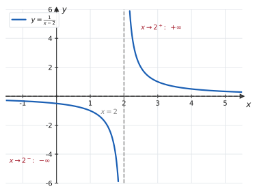
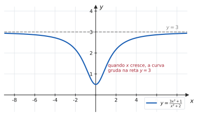
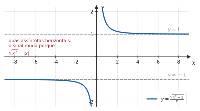
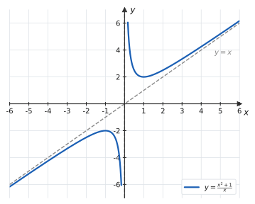

# 2.4 · Limites infinitos, limites no infinito e assíntotas

| ← Anterior | 🏠 Índice | Próximo → |
| :--- | :---: | ---: |
| [2.3 · Teorema do Confronto](2.3-teorema-do-sanduiche.md) | [Unidade 2](README.md) · [Página inicial](../README.md) | [2.5 · Continuidade](2.5-continuidade-e-tipos-de-descontinuidade.md) |

---

## 🎯 O que você vai aprender

- Distinguir **limite infinito** ($x \to a$, $f \to \pm\infty$) de **limite no infinito** ($x \to \pm\infty$).
- Determinar o **sinal** do infinito analisando $\frac{k}{0^{+}}$ e $\frac{k}{0^{-}}$.
- Calcular limites no infinito de funções racionais e com radicais — inclusive a armadilha do $\sqrt{x^2} = \lvert x \rvert$.
- Operar com o símbolo $\infty$, sabendo quais formas são **determinadas** e quais são **indeterminadas**.
- Encontrar todas as **assíntotas** de uma função: verticais, horizontais e oblíquas.

**Pré-requisitos:** [2.1](2.1-conceito-e-nocao-intuitiva-de-limite.md), [2.2](2.2-limites-laterais.md) e os gráficos de $1/x$ e $1/x^2$ de [1.3](../01-funcoes/1.3-funcoes-elementares-paridade-e-graficos.md).

---

## Por que isso importa

Até aqui o limite respondia "para qual **número** a função vai". Esta página trata dos dois casos em que a resposta não é um número:

- a função **explode** perto de um ponto → assíntota **vertical**;
- a variável **cresce sem parar** → assíntota **horizontal** (ou oblíqua).

Juntas, essas informações desenham o "esqueleto" do gráfico. Em [4.4](../04-aplicacoes-das-derivadas/4.4-crescimento-concavidade-e-esboco-de-graficos.md), esboçar uma função começa exatamente por aqui: domínio, assíntotas, e só depois derivadas. E, na Unidade 5, os **limites no infinito** definem as integrais impróprias.

---

## 1. Limites infinitos

> 📐 **Definição 2.4.1.** Escreve-se
> $$\lim_{x\to a} f(x) = +\infty$$
> quando os valores de $f(x)$ crescem **sem limitação** conforme $x$ se aproxima de $a$. Analogamente para $-\infty$, e para os limites laterais $x \to a^{+}$ e $x\to a^{-}$.

> [!CAUTION]
> **Isso não quer dizer que o limite "existe e vale infinito".** $+\infty$ **não é um número real**. Escrever $\lim f(x) = +\infty$ é uma forma abreviada de dizer: *"o limite não existe, e a razão é que a função cresce sem limitação"*. A notação informa **como** o limite falha.

### Como descobrir o sinal

Quando a substituição direta dá $\dfrac{k}{0}$ com $k \neq 0$, o limite é infinito — e o sinal depende de **como** o denominador se aproxima de zero:

| Forma | Resultado |
| :---: | :---: |
| $\dfrac{+}{0^{+}}$ | $+\infty$ |
| $\dfrac{+}{0^{-}}$ | $-\infty$ |
| $\dfrac{-}{0^{+}}$ | $-\infty$ |
| $\dfrac{-}{0^{-}}$ | $+\infty$ |

Aqui $0^{+}$ significa "tende a zero por valores **positivos**" e $0^{-}$, "por valores negativos". **É a regra de sinais de sempre** — só aplicada ao sinal com que o denominador chega a zero.

#### 📊 Exemplo 1 — os dois lados discordam

Calcule os limites laterais de $f(x) = \dfrac{1}{x-2}$ em $x=2$.

**Solução.**

- **Pela direita** ($x > 2$): $x - 2$ é um número positivo pequeno, ou seja, $0^{+}$. Logo $\dfrac{1}{0^{+}} = +\infty$.
- **Pela esquerda** ($x<2$): $x-2$ é negativo pequeno, $0^{-}$. Logo $\dfrac{1}{0^{-}} = -\infty$.

$$\lim_{x\to2^{+}}\frac{1}{x-2} = +\infty \qquad \lim_{x\to2^{-}}\frac{1}{x-2} = -\infty$$

> 📊 A reta $x=2$ é uma **assíntota vertical**: a curva se aproxima dela indefinidamente sem jamais tocá-la. E, como os dois lados vão para infinitos de **sinais opostos**, não se escreve nada para o limite bilateral — ele simplesmente não existe.

#### ✍️ Exemplo 2 — quando os dois lados concordam

$$\lim_{x\to3}\frac{5}{(x-3)^2}$$

O denominador $(x-3)^2$ é **sempre positivo** (é um quadrado), e tende a zero pelos dois lados. Logo, em ambos os lados, $\frac{5}{0^{+}} = +\infty$:

$$\lim_{x\to3}\frac{5}{(x-3)^2} = +\infty$$

> 💡 **A diferença entre os Exemplos 1 e 2 está no expoente.** Com expoente **ímpar** no fator que zera, os lados têm sinais opostos; com expoente **par**, concordam. Vale conferir isso sempre, olhando o sinal do denominador de cada lado.

> 📐 **Definição 2.4.2 (Assíntota vertical).** A reta $x = a$ é assíntota vertical do gráfico de $f$ quando **pelo menos um** dos limites laterais em $a$ for $+\infty$ ou $-\infty$.

**Onde procurar:** nos pontos que **anulam o denominador** (depois de simplificar a fração!) e nos pontos em que o logaritmando tende a zero.

> [!WARNING]
> **Simplifique antes de concluir.** Em $f(x) = \frac{x^2-4}{x-2}$, o ponto $x=2$ anula o denominador — mas **não** é assíntota: a fração simplifica para $x+2$, e o limite ali é $4$. O ponto é apenas um **furo**. Assíntota vertical exige que o denominador zere **e o numerador não**.

---

## 2. Limites no infinito

Agora a variável é que cresce.

> 📐 **Definição 2.4.3.** Escreve-se $\lim_{x\to+\infty} f(x) = L$ quando os valores de $f(x)$ ficam tão próximos de $L$ quanto se queira, bastando tomar $x$ suficientemente grande. Analogamente para $x\to-\infty$.

> 📐 **Definição 2.4.4 (Assíntota horizontal).** Se $\lim_{x\to+\infty} f(x) = L$ ou $\lim_{x\to-\infty} f(x) = L$, a reta $y = L$ é **assíntota horizontal** do gráfico de $f$.

O resultado básico, do qual todos os outros saem:

> 📐 **Teorema 2.4.1.** Para todo $n > 0$,
> $$\lim_{x\to+\infty}\frac{1}{x^n} = 0 \qquad \text{e} \qquad \lim_{x\to-\infty}\frac{1}{x^n} = 0$$

### A técnica: dividir pela maior potência

#### ✍️ Exemplo 3 — função racional

$$\lim_{x\to+\infty}\frac{3x^2+1}{x^2+2}$$

A substituição dá $\frac{\infty}{\infty}$ — **indeterminação**. Divida numerador e denominador pela maior potência que aparece, aqui $x^2$:

$$\frac{3x^2+1}{x^2+2} = \frac{\dfrac{3x^2}{x^2} + \dfrac{1}{x^2}}{\dfrac{x^2}{x^2}+\dfrac{2}{x^2}} = \frac{3 + \dfrac{1}{x^2}}{1 + \dfrac{2}{x^2}}$$

Agora todos os termos com $x$ no denominador tendem a $0$:

$$\lim_{x\to+\infty}\frac{3x^2+1}{x^2+2} = \frac{3+0}{1+0} = 3$$

> 📊 A reta $y=3$ é assíntota horizontal nos dois extremos. Note que a curva **cruza** o eixo? Não neste caso — mas nada impede que uma curva cruze a sua assíntota horizontal. "Assíntota" descreve o comportamento **no infinito**, não uma barreira.

### O atalho para funções racionais

> 📐 **Teorema 2.4.2.** Seja $r(x) = \dfrac{p(x)}{q(x)}$, com $p$ de grau $m$ e $q$ de grau $n$. Então, quando $x\to\pm\infty$:
>
> | Caso | Resultado | Assíntota horizontal |
> | :---: | :---: | --- |
> | $m < n$ | $0$ | $y=0$ |
> | $m = n$ | $\dfrac{\text{coef. líder de } p}{\text{coef. líder de } q}$ | essa razão |
> | $m > n$ | $\pm\infty$ | não há (pode haver oblíqua) |

**A razão é sempre a mesma:** no infinito, só o **termo de maior grau** importa — os demais ficam irrelevantes em comparação.

> [!TIP]
> **Use o atalho para conferir, não para substituir a conta.** Em prova, a divisão pela maior potência é o desenvolvimento esperado; o atalho serve para você saber, antes de começar, qual resultado deve aparecer.

### 📊 A armadilha do radical

#### ✍️ Exemplo 4 — $\sqrt{x^2}$ não é $x$

Calcule $\lim_{x\to+\infty}\dfrac{\sqrt{x^2+1}}{x}$ e $\lim_{x\to-\infty}\dfrac{\sqrt{x^2+1}}{x}$.

**Solução.** Dentro da raiz, a maior potência é $x^2$; para "tirá-la" da raiz, use

$$\sqrt{x^2+1} = \sqrt{x^2\left(1+\frac{1}{x^2}\right)} = \sqrt{x^2}\cdot\sqrt{1+\frac{1}{x^2}} = \lvert x \rvert\sqrt{1+\frac{1}{x^2}}$$

**Para $x\to+\infty$**, tem-se $x>0$, logo $\lvert x\rvert = x$:

$$\frac{\lvert x\rvert\sqrt{1+\frac1{x^2}}}{x} = \frac{x\sqrt{1+\frac1{x^2}}}{x} = \sqrt{1+\frac{1}{x^2}} \ \longrightarrow \ 1$$

**Para $x\to-\infty$**, tem-se $x<0$, logo $\lvert x \rvert = -x$:

$$\frac{-x\sqrt{1+\frac1{x^2}}}{x} = -\sqrt{1+\frac{1}{x^2}} \ \longrightarrow \ -1$$

> 📊 **Duas assíntotas horizontais diferentes** — uma em cada extremo. É isso que o $\lvert x \rvert$ produz, e é por isso que ele não pode ser ignorado.

> [!CAUTION]
> **Este é o erro mais caro da seção.** Escrever $\sqrt{x^2} = x$ funciona quando $x\to+\infty$ e **falha** quando $x\to-\infty$. Toda vez que houver raiz quadrada e $x\to-\infty$, pare e escreva $\sqrt{x^2} = \lvert x\rvert = -x$.

---

## 3. Operações com o símbolo do infinito

O símbolo $\infty$ **não é número**, mas obedece a regras previsíveis em algumas combinações.

### ✅ Formas determinadas

Com $k$ constante real:

| Operação | Resultado | | Operação | Resultado |
| :---: | :---: | --- | :---: | :---: |
| $\infty + \infty$ | $+\infty$ | | $\dfrac{k}{\infty}$ | $0$ |
| $\infty + k$ | $+\infty$ | | $\dfrac{\infty}{k}$ ($k>0$) | $+\infty$ |
| $\infty \cdot \infty$ | $+\infty$ | | $\dfrac{k}{0^{+}}$ ($k>0$) | $+\infty$ |
| $k\cdot\infty$ ($k>0$) | $+\infty$ | | $k^{\infty}$ ($k>1$) | $+\infty$ |
| $k \cdot \infty$ ($k<0$) | $-\infty$ | | $k^{\infty}$ ($0<k<1$) | $0$ |
| $-\infty - \infty$ | $-\infty$ | | $\infty^{k}$ ($k>0$) | $+\infty$ |

### ❌ As sete formas indeterminadas

$$\frac{0}{0} \qquad \frac{\infty}{\infty} \qquad \infty - \infty \qquad 0\cdot\infty \qquad 1^{\infty} \qquad 0^{0} \qquad \infty^{0}$$

> [!CAUTION]
> **Indeterminada não significa "impossível": significa "a informação atual não decide".** Cada uma dessas formas exige trabalho algébrico adicional, e o resultado pode ser qualquer coisa. Compare, todas na forma $\infty - \infty$:
> - $\lim_{x\to+\infty}\big[(x+1) - x\big] = 1$
> - $\lim_{x\to+\infty}\big[(x^2) - x\big] = +\infty$
> - $\lim_{x\to+\infty}\big[x - x\big] = 0$

#### ✍️ Exemplo 5 — resolvendo um $\infty - \infty$

$$\lim_{x\to+\infty}\left(\sqrt{x^2+3x} - x\right)$$

**Estratégia.** Em $\infty - \infty$ com raiz, o caminho é **multiplicar pelo conjugado**.

**Solução.**

$$
\begin{aligned}
\sqrt{x^2+3x}-x
&= \left(\sqrt{x^2+3x}-x\right)\cdot\frac{\sqrt{x^2+3x}+x}{\sqrt{x^2+3x}+x} \\
&= \frac{(x^2+3x) - x^2}{\sqrt{x^2+3x}+x} \\
&= \frac{3x}{\sqrt{x^2+3x}+x}
\end{aligned}
$$

Agora é $\frac{\infty}{\infty}$: divida tudo por $x$ (que é **positivo**, pois $x\to+\infty$):

$$\frac{3x}{\sqrt{x^2+3x}+x} = \frac{3}{\sqrt{1+\frac3x}+1} \ \longrightarrow \ \frac{3}{1+1} = \frac32$$

**Resposta.** $\dfrac32$

> 💡 No penúltimo passo, dividir $\sqrt{x^2+3x}$ por $x$ equivale a colocar $x$ para dentro da raiz como $x^2$ — e isso só vale sem sinal porque $x>0$. Para $x\to-\infty$ a conta mudaria.

---

## 4. Assíntotas: o roteiro completo

| Tipo | Como achar | Quantas podem existir |
| --- | --- | :---: |
| **Vertical** $x=a$ | pontos fora do domínio em que algum lateral é $\pm\infty$ (denominador zera e numerador não) | quantas forem |
| **Horizontal** $y=L$ | $\lim_{x\to+\infty} f(x)$ e $\lim_{x\to-\infty} f(x)$, se forem finitos | no máximo $2$ |
| **Oblíqua** $y=mx+n$ | quando não há horizontal: $m = \lim_{x\to\pm\infty}\frac{f(x)}{x}$ e $n = \lim_{x\to\pm\infty}\big[f(x)-mx\big]$ | no máximo $2$ |

> [!NOTE]
> **Horizontal e oblíqua são excludentes** em cada extremo: ou a curva se aproxima de uma reta horizontal, ou de uma inclinada, ou de nenhuma. Nunca das duas.

#### 📊 Exemplo 6 — uma assíntota oblíqua

$$f(x) = \frac{x^2+1}{x}$$

**Vertical:** o denominador zera em $x=0$, e o numerador vale $1 \neq 0$ ali. Logo $x=0$ é assíntota vertical.

**Horizontal:** o grau do numerador ($2$) é maior que o do denominador ($1$), então $f(x) \to \pm\infty$ — **não há** assíntota horizontal.

**Oblíqua:** o jeito mais rápido é **dividir**:

$$f(x) = \frac{x^2+1}{x} = x + \frac1x$$

Como $\frac1x \to 0$, a curva se aproxima da reta $y=x$.

*(Pelo roteiro formal: $m = \lim\frac{f(x)}{x} = \lim\frac{x^2+1}{x^2} = 1$ e $n = \lim\big[f(x)-x\big] = \lim\frac1x = 0$.)*

> 💡 **A divisão revela a assíntota.** Sempre que o grau do numerador for **exatamente um a mais** que o do denominador, a divisão produz "reta + resto que tende a zero" — e a reta é a assíntota oblíqua. É a mesma técnica do [Exercício Resolvido 6 de 1.3](../01-funcoes/1.3-funcoes-elementares-paridade-e-graficos.md).

---

## ⚠️ Armadilhas

| O erro | Por que está errado | O certo |
| --- | --- | --- |
| tratar $\infty$ como número | não é real; não se soma nem cancela | é notação de comportamento |
| $\infty - \infty = 0$ | é indeterminação | conjugue, fatore, divida |
| $\frac{\infty}{\infty} = 1$ | idem | divida pela maior potência |
| $\sqrt{x^2} = x$ com $x\to-\infty$ | perde o sinal | $\sqrt{x^2} = \lvert x\rvert = -x$ |
| $x=a$ anula o denominador ⟹ assíntota | pode ser só um furo | simplifique antes |
| escrever "o limite é $\infty$, logo existe" | infinito não é valor | "não existe; tende a $+\infty$" |
| procurar assíntota horizontal só em $+\infty$ | os dois lados podem diferir | calcule os **dois** limites |
| $\frac{k}{0} = \infty$ sem olhar o sinal | o sinal depende do lado | analise $0^{+}$ e $0^{-}$ |

---

## 🧠 Exercícios resolvidos

### Exercício Resolvido 1

**Calcule os limites laterais de** $f(x) = \dfrac{x+1}{x-3}$ **em $x=3$ e identifique a assíntota vertical.**

**Solução.** Em $x=3$: o numerador vale $4 \neq 0$ e o denominador zera. É $\frac{4}{0}$, logo infinito — falta o sinal.

- **Pela direita** ($x>3$): $x-3 = 0^{+}$, e o numerador é positivo. $\dfrac{+}{0^{+}} = +\infty$.
- **Pela esquerda** ($x<3$): $x-3 = 0^{-}$. $\dfrac{+}{0^{-}} = -\infty$.

$$\lim_{x\to3^{+}} f(x) = +\infty \qquad \lim_{x\to3^{-}} f(x) = -\infty$$

A reta $x=3$ é assíntota vertical.

---

### Exercício Resolvido 2

$$\lim_{x\to+\infty}\frac{2x^3 - 5x + 1}{4x^3 + x^2 - 7}$$

**Solução.** Grau igual em cima e embaixo. Dividindo tudo por $x^3$:

$$\frac{2 - \dfrac{5}{x^2} + \dfrac{1}{x^3}}{4 + \dfrac1x - \dfrac{7}{x^3}} \ \longrightarrow \ \frac{2-0+0}{4+0-0} = \frac12$$

**Resposta.** $\dfrac12$, que é a razão dos coeficientes líderes — como previa o Teorema 2.4.2.

---

### Exercício Resolvido 3

$$\lim_{x\to-\infty}\frac{\sqrt{4x^2+3}}{2x-1}$$

**Estratégia.** Há raiz e $x\to-\infty$: alerta máximo para o sinal.

**Solução.** Dentro da raiz, ponha $x^2$ em evidência:

$$\sqrt{4x^2+3} = \sqrt{x^2\left(4+\frac{3}{x^2}\right)} = \lvert x\rvert\sqrt{4+\frac{3}{x^2}}$$

Como $x\to-\infty$, tem-se $x<0$ e portanto $\lvert x\rvert = -x$:

$$\frac{\sqrt{4x^2+3}}{2x-1} = \frac{-x\sqrt{4+\frac{3}{x^2}}}{2x-1}$$

Dividindo numerador e denominador por $x$:

$$= \frac{-\sqrt{4+\frac{3}{x^2}}}{2 - \frac1x} \ \longrightarrow \ \frac{-\sqrt{4}}{2} = \frac{-2}{2} = -1$$

**Resposta.** $-1$

> ⚠️ Quem esqueceu o módulo obteve $+1$ — e perdeu a questão por um sinal. Confira sempre: para $x\to-\infty$ o numerador $\sqrt{\cdot}$ é **positivo** e o denominador $2x-1$ é **negativo**, então a resposta **tem** de ser negativa.

---

### Exercício Resolvido 4

$$\lim_{x\to+\infty}\left(\sqrt{x^2+5x} - \sqrt{x^2+2x}\right)$$

**Estratégia.** $\infty - \infty$ com duas raízes: conjugado.

**Solução.**

$$
\begin{aligned}
\sqrt{x^2+5x}-\sqrt{x^2+2x}
&= \frac{(x^2+5x)-(x^2+2x)}{\sqrt{x^2+5x}+\sqrt{x^2+2x}} \\
&= \frac{3x}{\sqrt{x^2+5x}+\sqrt{x^2+2x}}
\end{aligned}
$$

Dividindo por $x > 0$ (e, dentro das raízes, por $x^2$):

$$= \frac{3}{\sqrt{1+\frac5x}+\sqrt{1+\frac2x}} \ \longrightarrow \ \frac{3}{1+1} = \frac32$$

**Resposta.** $\dfrac32$

---

### Exercício Resolvido 5

**Determine todas as assíntotas de** $f(x) = \dfrac{2x^2-8}{x^2-x-6}$.

**Solução.**

**1. Fatore e simplifique.**

$$f(x) = \frac{2(x^2-4)}{(x-3)(x+2)} = \frac{2(x-2)(x+2)}{(x-3)(x+2)} = \frac{2(x-2)}{x-3} \qquad (x \neq -2)$$

**2. Verticais.** Depois da simplificação, o denominador zera só em $x=3$ (e ali o numerador vale $2 \neq 0$):

$$\lim_{x\to3^{+}} f(x) = \frac{2}{0^{+}} = +\infty \qquad \lim_{x\to3^{-}} f(x) = \frac{2}{0^{-}} = -\infty$$

**Assíntota vertical: $x=3$.**

Em $x=-2$ **não há assíntota**: o fator cancelou, e ali existe apenas um **furo** — o limite vale

$$\lim_{x\to-2}\frac{2(x-2)}{x-3} = \frac{2(-4)}{-5} = \frac85$$

**3. Horizontais.** Na forma simplificada, graus iguais (ambos $1$):

$$\lim_{x\to\pm\infty}\frac{2x-4}{x-3} = 2$$

**Assíntota horizontal: $y=2$**, nos dois extremos.

**4. Oblíquas.** Não há — já existe horizontal nos dois lados.

> 💡 **A simplificação foi decisiva.** Sem ela, $x=-2$ pareceria uma assíntota vertical. Lembre: assíntota exige que o denominador zere **e o numerador não**.

---

### Exercício Resolvido 6

$$\lim_{x\to+\infty}\frac{3^x + 2^x}{3^x - 1}$$

**Estratégia.** No infinito, só o termo **dominante** importa — e, entre exponenciais, domina a de maior base. Divida tudo por $3^x$.

**Solução.**

$$\frac{3^x+2^x}{3^x-1} = \frac{1 + \left(\frac23\right)^x}{1 - \left(\frac13\right)^x}$$

Como $0 < \frac23 < 1$ e $0<\frac13<1$, ambas as potências tendem a $0$:

$$\lim_{x\to+\infty}\frac{3^x+2^x}{3^x-1} = \frac{1+0}{1-0} = 1$$

**Resposta.** $1$

> 💡 **A hierarquia do infinito** (que a [Regra de L'Hôspital](../04-aplicacoes-das-derivadas/4.3-regra-de-lhospital.md) vai formalizar): para $x\to+\infty$, exponenciais crescem mais rápido que potências, que crescem mais rápido que logaritmos. Entre exponenciais, vence a de maior base.

---

## 📝 Agora é com você

➡️ **[Lista 2.4 — exercícios propostos](exercicios/lista-2.4-propostos.md)** · ✅ **[Gabarito](gabaritos/gabarito-2.4.md)**

---

## Resumo da página

> **Decore:**
> - $\dfrac{k}{0^{+}}$ e $\dfrac{k}{0^{-}}$ decidem o **sinal** do infinito pela regra de sinais.
> - $\lim_{x\to\pm\infty}\dfrac{1}{x^n} = 0$.
> - Racionais no infinito: compare os **graus** (menor → $0$; igual → razão dos líderes; maior → $\pm\infty$).
> - As sete indeterminações: $\frac00$, $\frac{\infty}{\infty}$, $\infty-\infty$, $0\cdot\infty$, $1^{\infty}$, $0^{0}$, $\infty^{0}$.
>
> **Saiba fazer:**
> - dividir pela maior potência;
> - escrever $\sqrt{x^2} = \lvert x\rvert$ e abrir o módulo conforme o sinal de $x$;
> - usar o conjugado em $\infty-\infty$ com raízes;
> - achar todas as assíntotas, **simplificando a fração antes**.

---

## 📚 Para aprofundar

| Livro | Onde procurar |
| --- | --- |
| **LEITHOLD** | Capítulo 2 — "Limites infinitos"; "Limites no infinito"; "Assíntotas" |
| **STEWART** | Capítulo 2 — "O limite de uma função" (limites infinitos) e "Limites no infinito; assíntotas horizontais" |
| **THOMAS** | Capítulo 2 — "Limites envolvendo infinito; assíntotas de gráficos" |
| **ANTON** | Capítulo 2 — "Limites no infinito; comportamento final de uma função" |
| **SWOKOWSKI** | Capítulo 2 — "Limites infinitos e limites no infinito" |
| **MUNEM & FOULIS** | Capítulo 2 — "Limites infinitos e assíntotas" |

---

| ← Anterior | 🏠 Índice | Próximo → |
| :--- | :---: | ---: |
| [2.3 · Teorema do Confronto](2.3-teorema-do-sanduiche.md) | [Unidade 2](README.md) · [Página inicial](../README.md) | [2.5 · Continuidade](2.5-continuidade-e-tipos-de-descontinuidade.md) |

*Sobrevivendo ao Cálculo 1 (UENF)* · por **Nicolau Prates** · [CC BY-SA 4.0](../LICENSE)
