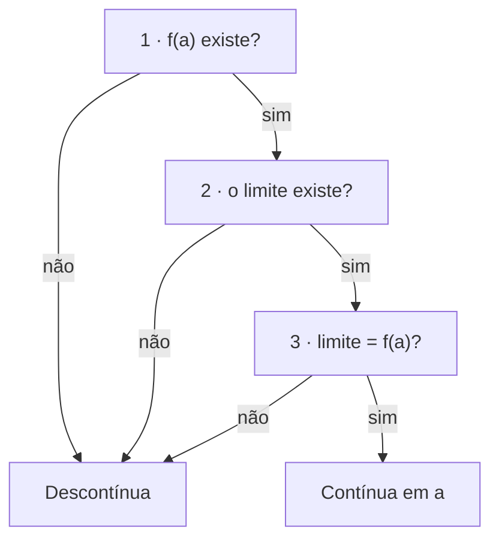
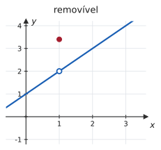
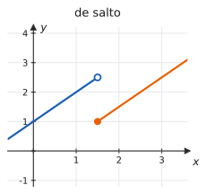
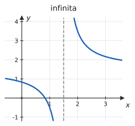

# 2.5 · Continuidade e tipos de descontinuidade

| ← Anterior | 🏠 Índice | Próximo → |
| :--- | :---: | ---: |
| [2.4 · Limites infinitos e assíntotas](2.4-limites-infinitos-no-infinito-e-assintotas.md) | [Unidade 2](README.md) · [Página inicial](../README.md) | [Unidade 3 · Derivadas](../03-derivadas/README.md) |

---

## 🎯 O que você vai aprender

- Verificar, pelos **três testes**, se uma função é contínua em um ponto.
- **Classificar** uma descontinuidade: removível, de salto ou infinita.
- Saber quais funções são contínuas sem precisar testar nada.
- Usar a continuidade para calcular limites "entrando" com o limite dentro da função.
- Aplicar o **Teorema do Valor Intermediário** para garantir que uma equação tem solução.
- Determinar constantes que tornam uma função contínua.

**Pré-requisitos:** [2.1](2.1-conceito-e-nocao-intuitiva-de-limite.md), [2.2](2.2-limites-laterais.md) e [2.4](2.4-limites-infinitos-no-infinito-e-assintotas.md).

---

## Por que isso importa

Continuidade é o nome técnico de uma ideia simples: **o gráfico não tem buraco nem salto** — dá para desenhá-lo sem tirar o lápis do papel.

Mas a importância é prática e enorme:

- Em funções contínuas, **limite vira substituição**. Boa parte dos limites que você calculou na marra em [2.1](2.1-conceito-e-nocao-intuitiva-de-limite.md) sai de graça depois desta página.
- Os **grandes teoremas** do Cálculo pedem continuidade como hipótese: Valor Intermediário (aqui), Valor Médio ([4.2](../04-aplicacoes-das-derivadas/4.2-teoremas-de-rolle-e-do-valor-medio.md)), Weierstrass ([4.1](../04-aplicacoes-das-derivadas/4.1-maximos-e-minimos.md)) e o Teorema Fundamental do Cálculo ([5.3](../05-integrais/5.3-integral-definida-e-o-teorema-fundamental-do-calculo.md)). Sem continuidade, nenhum deles vale.
- **Derivável ⟹ contínua** (Unidade 3). Quem não entende continuidade não entende por que $\lvert x\rvert$ não é derivável em $0$.

---

## 1. Continuidade em um ponto

> 📐 **Definição 2.5.1.** Uma função $f$ é **contínua em $a$** quando as três condições valem:
>
> **(i)** $f(a)$ **existe** (isto é, $a \in D(f)$);
> **(ii)** $\lim_{x\to a} f(x)$ **existe** (finito);
> **(iii)** os dois coincidem:
> $$\lim_{x\to a} f(x) = f(a)$$
>
> Se alguma delas falhar, $f$ é **descontínua** em $a$.

> 💡 **A leitura que resolve tudo.** Continuidade em $a$ é exatamente a permissão para calcular o limite **substituindo**. Quando você escreveu, em [2.1](2.1-conceito-e-nocao-intuitiva-de-limite.md), que $\lim_{x\to2}(3x^2-5x+4) = 6$ "porque é polinômio", estava usando continuidade sem saber o nome.

### O roteiro de três passos

Em prova, **escreva os três passos separadamente**. Responder "é contínua porque o limite existe" ignora as condições (i) e (iii) e costuma valer metade da nota.

#### ✍️ Exemplo 1 — os três testes

Verifique se

$$
f(x) = \begin{cases}
\dfrac{x^2-9}{x-3}, & \text{se } x \neq 3 \\[6pt]
6, & \text{se } x = 3
\end{cases}
$$

é contínua em $x=3$.

**Solução.**

**(i)** $f(3) = 6$ — existe ✔

**(ii)** Para $x \neq 3$, a fração simplifica:

$$\lim_{x\to3}\frac{x^2-9}{x-3} = \lim_{x\to3}(x+3) = 6$$

— existe ✔

**(iii)** $6 = 6$ ✔

**Resposta.** $f$ é **contínua** em $x=3$.

> 💡 Se o enunciado tivesse definido $f(3) = 5$, as condições (i) e (ii) continuariam valendo, mas (iii) falharia: a função seria descontínua, com um **ponto deslocado**.

---

## 2. Os tipos de descontinuidade

Quando a continuidade falha, **o motivo** determina o nome — e o que dá para fazer a respeito.

| | | |
| :---: | :---: | :---: |
|  |  |  |
| O limite **existe**, mas não é o valor da função (ou o valor não existe). | Os dois laterais existem e **discordam**. | Pelo menos um lateral é $\pm\infty$. |

> 📐 **Classificação.** Seja $f$ descontínua em $a$.
>
> | Tipo | Quando ocorre | Dá para consertar? |
> | --- | --- | :---: |
> | **Removível** | $\lim_{x\to a} f(x)$ existe (finito), mas $f(a)$ não existe ou é diferente do limite | **Sim** |
> | **De salto** (1ª espécie) | os dois laterais existem, finitos, mas são **diferentes** | Não |
> | **Infinita** (2ª espécie) | pelo menos um lateral é $+\infty$ ou $-\infty$ | Não |
> | **Oscilatória** | algum lateral não existe por oscilação, como $\operatorname{sen}\frac1x$ em $0$ | Não |

### Por que "removível"

Porque basta **redefinir o valor no ponto** para consertar:

#### ✍️ Exemplo 2 — removendo uma descontinuidade

A função $g(x) = \dfrac{x^2-4}{x-2}$ não está definida em $x=2$, logo é descontínua ali. Mas

$$\lim_{x\to2}\frac{x^2-4}{x-2} = \lim_{x\to2}(x+2) = 4$$

A descontinuidade é **removível**. Definindo

$$
\tilde{g}(x) = \begin{cases}
\dfrac{x^2-4}{x-2}, & \text{se } x \neq 2 \\[6pt]
4, & \text{se } x = 2
\end{cases}
$$

obtém-se uma função contínua em toda a reta — na prática, a reta $y=x+2$ com o furo tapado.

> [!NOTE]
> **Nos outros tipos, não há conserto.** Em um salto, nenhum valor que você atribua a $f(a)$ vai satisfazer os dois lados ao mesmo tempo. Em uma descontinuidade infinita, não existe sequer um número para atribuir.

#### ✍️ Exemplo 3 — classificando

Classifique as descontinuidades de cada função:

**(a)** $f(x) = \dfrac{x-1}{x^2-1}$ &nbsp;&nbsp; **(b)** $f(x) = \dfrac{\lvert x \rvert}{x}$ &nbsp;&nbsp; **(c)** $f(x) = \dfrac{1}{(x-3)^2}$

**Solução.**

**(a)** Simplificando, $\dfrac{x-1}{(x-1)(x+1)} = \dfrac{1}{x+1}$ para $x \neq 1$.

- Em $x=1$: o limite vale $\frac12$ e a função não existe → **removível**.
- Em $x=-1$: o limite é infinito → **infinita** (assíntota vertical).

**(b)** Em $x=0$: os laterais valem $-1$ e $1$ ([2.2](2.2-limites-laterais.md)) → **de salto**.

**(c)** Em $x=3$: os dois laterais valem $+\infty$ → **infinita**.

> 💡 Repare que **a mesma função pode ter descontinuidades de tipos diferentes** em pontos diferentes, como em (a). Classifique sempre ponto a ponto.

---

## 3. Continuidade em intervalos — e o atalho que você vai usar sempre

> 📐 **Definição 2.5.2.** $f$ é **contínua em um intervalo aberto** quando é contínua em cada ponto dele. Em um intervalo **fechado** $[a,b]$, exige-se continuidade em cada ponto interior e, nas extremidades, apenas os limites **laterais**:
> $$\lim_{x\to a^{+}} f(x) = f(a) \qquad \text{e} \qquad \lim_{x\to b^{-}} f(x) = f(b)$$

A exigência lateral nas pontas é a mesma ideia do Exemplo 4 de [2.2](2.2-limites-laterais.md): não faz sentido cobrar o lado de fora do domínio.

> 📐 **Teorema 2.5.1 (o atalho).** Toda **função elementar** é contínua em todo o seu domínio.

Isso cobre praticamente tudo o que aparece no curso:

| Função | Contínua em |
| --- | --- |
| polinômios | $\mathbb{R}$ |
| racionais $\frac{p(x)}{q(x)}$ | onde $q(x) \neq 0$ |
| $\sqrt[n]{x}$ ($n$ par) | $[0,+\infty)$ |
| $\sqrt[n]{x}$ ($n$ ímpar) | $\mathbb{R}$ |
| $\lvert x \rvert$ | $\mathbb{R}$ |
| $e^x$, $a^x$ | $\mathbb{R}$ |
| $\ln x$, $\log_a x$ | $(0,+\infty)$ |
| $\operatorname{sen} x$, $\cos x$ | $\mathbb{R}$ |
| $\operatorname{tg} x$ | onde $\cos x \neq 0$ |

> [!TIP]
> **Na prática:** para funções dadas por uma fórmula única, a pergunta "onde é contínua?" vira "**qual é o domínio?**". O trabalho de verdade aparece só nas funções **definidas por partes** — e é lá que as provas concentram as questões.

---

## 4. Propriedades: combinando funções contínuas

> 📐 **Teorema 2.5.2.** Se $f$ e $g$ são contínuas em $a$, então também são contínuas em $a$:
> $$f \pm g, \qquad f\cdot g, \qquad c\thinspace f, \qquad \frac{f}{g} \ \ (\text{se } g(a) \neq 0)$$

> 📐 **Teorema 2.5.3 (composta).** Se $g$ é contínua em $a$ e $f$ é contínua em $g(a)$, então $f \circ g$ é contínua em $a$. Em particular,
> $$\lim_{x\to a} f\big(g(x)\big) = f\left(\lim_{x\to a} g(x)\right)$$

A segunda forma é a mais útil: **o limite "entra" dentro de uma função contínua.**

#### ✍️ Exemplo 4 — o limite entrando na função

$$\lim_{x\to2}\sqrt{x^2+5} = \sqrt{\lim_{x\to2}\big(x^2+5\big)} = \sqrt{9} = 3$$

$$\lim_{x\to0}\cos\left(\frac{\operatorname{sen} x}{x}\right) = \cos\left(\lim_{x\to0}\frac{\operatorname{sen} x}{x}\right) = \cos 1 \approx 0{,}5403$$

No segundo caso, a passagem só é legítima porque o **cosseno é contínuo** em $1$ — e o limite de dentro é o fundamental de [2.3](2.3-teorema-do-sanduiche.md).

> [!WARNING]
> **Sem continuidade, a troca é proibida.** Com $f(x) = \lfloor x \rfloor$ e $g(x) = 1 - \frac1x$, tem-se $\lim_{x\to+\infty} g(x) = 1$, mas $\lim_{x\to+\infty} f(g(x)) = 0$, e não $f(1) = 1$. O motivo: $\lfloor\cdot\rfloor$ **não é contínua** em $1$.

---

## 5. O Teorema do Valor Intermediário

É o primeiro grande teorema do curso — e o único que fala sobre **existência** sem dizer como calcular.

> 📐 **Teorema 2.5.4 (Valor Intermediário).** Seja $f$ **contínua** em $[a,b]$ e seja $N$ um número **entre** $f(a)$ e $f(b)$. Então existe pelo menos um $c \in (a,b)$ tal que
> $$f(c) = N$$

![Função contínua em [a,b] cruzando a reta y=N em um ponto c](../assets/img/02-limites-e-continuidade/2.5-teorema-do-valor-intermediario.svg)

> 📊 Em português: **uma curva contínua que começa abaixo de uma reta horizontal e termina acima dela tem de atravessá-la.** Para pular por cima, o gráfico precisaria dar um salto — e salto é justamente o que a continuidade proíbe.

> [!IMPORTANT]
> **A hipótese de continuidade é indispensável.** A função $f(x) = \frac1x$ em $[-1,1]$ vai de $-1$ a $1$ e **nunca** assume o valor $0$ — porque não é contínua em $x=0$ (nem está definida ali). O teorema não é "óbvio": ele é verdadeiro **por causa** da hipótese.

### O corolário que cai em prova

> 📐 **Corolário (Bolzano).** Se $f$ é contínua em $[a,b]$ e $f(a)$ e $f(b)$ têm **sinais opostos** (isto é, $f(a)\cdot f(b) < 0$), então $f$ tem **pelo menos uma raiz** em $(a,b)$.

É o TVI com $N = 0$.

#### ✍️ Exemplo 5 — provando que uma equação tem solução

Mostre que a equação $x^3 - x - 1 = 0$ tem uma raiz entre $1$ e $2$.

**Estratégia.** Nomear a função, verificar a continuidade e testar os sinais nas pontas. **Esses três passos são a resposta esperada em prova.**

**Solução.**

1. Seja $f(x) = x^3-x-1$. Como $f$ é **polinomial**, é contínua em $\mathbb{R}$ — em particular, em $[1,2]$.
2. Calculando nas extremidades:
   $$f(1) = 1 - 1 - 1 = -1 < 0$$
   $$f(2) = 8 - 2 - 1 = 5 > 0$$
3. Os sinais são opostos. Pelo Corolário de Bolzano, existe $c \in (1,2)$ com $f(c) = 0$. $\blacksquare$

> 💡 **O teorema garante que existe, e não diz quem é.** Mas ele também dá o método para achar: teste o ponto médio, $f(1{,}5) = 3{,}375 - 1{,}5 - 1 = 0{,}875 > 0$; então a raiz está em $(1;\thinspace 1{,}5)$. Repetindo, o intervalo encolhe pela metade a cada passo. É o **método da bisseção**, o algoritmo mais simples do Cálculo Numérico — e ele é, literalmente, o TVI aplicado muitas vezes.

### O outro teorema que precisa de continuidade

> 📐 **Teorema 2.5.5 (Weierstrass, ou do Valor Extremo).** Se $f$ é contínua em um intervalo **fechado e limitado** $[a,b]$, então $f$ assume um valor **máximo** e um valor **mínimo** nesse intervalo.

Guarde este: ele é a razão de o método dos candidatos, em [4.1](../04-aplicacoes-das-derivadas/4.1-maximos-e-minimos.md), **funcionar**. As duas hipóteses são necessárias: $f(x) = x$ em $(0,1)$ é contínua e não tem máximo nem mínimo (o intervalo é aberto); $f(x) = \frac1x$ em $(0,1]$ também não tem máximo (a função não é limitada).

---

## 6. Determinando constantes para a continuidade

É o formato mais comum em prova — e a diferença para [2.2](2.2-limites-laterais.md) é que agora há **três** quantidades a igualar, e não duas.

#### ✍️ Exemplo 6

Determine $k$ para que $f$ seja contínua em $x=2$:

$$
f(x) = \begin{cases}
\dfrac{x^2-4}{x-2}, & \text{se } x \neq 2 \\[6pt]
k, & \text{se } x = 2
\end{cases}
$$

**Solução.** Para $x \neq 2$, $f(x) = x+2$, logo

$$\lim_{x\to2} f(x) = 4$$

A continuidade exige $\lim_{x\to2} f(x) = f(2) = k$. Portanto $k = 4$.

#### ✍️ Exemplo 7 — duas constantes

Determine $a$ e $b$ para que $f$ seja contínua em $\mathbb{R}$:

$$
f(x) = \begin{cases}
x+1, & \text{se } x \leqslant 1 \\
ax+b, & \text{se } 1 < x < 3 \\
2x-5, & \text{se } x \geqslant 3
\end{cases}
$$

**Estratégia.** Cada ramo é uma função afim — contínua em toda parte. Os únicos pontos suspeitos são as **trocas de regra**, $x=1$ e $x=3$.

**Solução.**

**Em $x=1$:** $f(1) = 2$ (primeira linha), $\lim_{x\to1^{-}} f(x) = 2$ e $\lim_{x\to1^{+}} f(x) = a+b$. Igualando:

$$a+b = 2$$

**Em $x=3$:** $f(3) = 1$ (terceira linha), $\lim_{x\to3^{+}} f(x) = 1$ e $\lim_{x\to3^{-}} f(x) = 3a+b$. Igualando:

$$3a+b = 1$$

**Resolvendo o sistema.** Subtraindo a primeira da segunda: $2a = -1$, logo $a = -\dfrac12$ e $b = 2 - a = \dfrac52$.

**Resposta.** $a = -\dfrac12$ e $b = \dfrac52$.

*Conferência:* em $x=1$, $-\frac12+\frac52 = 2$ ✔; em $x=3$, $-\frac32+\frac52 = 1$ ✔.

---

## ⚠️ Armadilhas

| O erro | Por que está errado | O certo |
| --- | --- | --- |
| "o limite existe, logo é contínua" | faltam (i) e (iii) | teste os **três** |
| "$f(a)$ existe, logo é contínua" | o limite pode não existir ou diferir | idem |
| classificar salto como removível | não há valor que conserte | removível exige **limite finito** |
| dizer que $\frac{x^2-4}{x-2}$ é descontínua em $2$ "por causa do $0/0$" | o motivo é $f(2)$ não existir | e a descontinuidade é **removível** |
| aplicar o TVI sem verificar a continuidade | é a hipótese central | diga explicitamente "é polinômio, logo contínua" |
| concluir do TVI que a raiz é **única** | ele garante existência, não unicidade | pode haver várias |
| aplicar Weierstrass em intervalo aberto | o teorema exige fechado **e** limitado | $f(x)=x$ em $(0,1)$ é contraexemplo |
| trocar $\lim f(g(x))$ por $f(\lim g(x))$ sem checar | só vale se $f$ for contínua no ponto | verifique antes |

---

## 🧠 Exercícios resolvidos

### Exercício Resolvido 1

**Analise a continuidade de**

$$
f(x) = \begin{cases}
\dfrac{x^2-x-6}{x-3}, & \text{se } x \neq 3 \\[6pt]
2, & \text{se } x = 3
\end{cases}
$$

**em $x=3$, classificando a descontinuidade, se houver.**

**Solução.**

**(i)** $f(3) = 2$ — existe ✔

**(ii)** Fatorando: $x^2-x-6 = (x-3)(x+2)$, logo

$$\lim_{x\to3}\frac{(x-3)(x+2)}{x-3} = \lim_{x\to3}(x+2) = 5$$

— existe ✔

**(iii)** $5 \neq 2$ ✘

**Resposta.** $f$ é **descontínua** em $x=3$, com descontinuidade **removível**. Para consertá-la, bastaria redefinir $f(3) = 5$.

---

### Exercício Resolvido 2

**Determine todos os pontos de descontinuidade de** $f(x) = \dfrac{x+2}{x^2-x-6}$ **e classifique cada um.**

**Solução.** Fatore o denominador: $x^2-x-6 = (x-3)(x+2)$.

$$f(x) = \frac{x+2}{(x-3)(x+2)} = \frac{1}{x-3} \qquad (x \neq -2)$$

Os pontos fora do domínio são $x=3$ e $x=-2$.

**Em $x=-2$:** o fator cancelou. O limite vale

$$\lim_{x\to-2}\frac{1}{x-3} = \frac{1}{-5} = -\frac15$$

— finito. Descontinuidade **removível**.

**Em $x=3$:** o denominador zera e o numerador (já simplificado) vale $1$:

$$\lim_{x\to3^{+}} \frac{1}{x-3} = +\infty \qquad \lim_{x\to3^{-}} \frac{1}{x-3} = -\infty$$

Descontinuidade **infinita** — e $x=3$ é assíntota vertical.

**Resposta.** Descontínua em $x=-2$ (removível) e em $x=3$ (infinita); contínua em todo o resto.

---

### Exercício Resolvido 3

**Determine $a$ e $b$ para que**

$$
f(x) = \begin{cases}
\dfrac{\operatorname{sen} 2x}{x}, & \text{se } x < 0 \\[6pt]
a, & \text{se } x = 0 \\[4pt]
b + x^2, & \text{se } x > 0
\end{cases}
$$

**seja contínua em $x=0$.**

**Solução.**

**Limite pela esquerda** — é o limite fundamental de [2.3](2.3-teorema-do-sanduiche.md):

$$\lim_{x\to0^{-}}\frac{\operatorname{sen} 2x}{x} = \lim_{x\to0^{-}} 2\cdot\frac{\operatorname{sen} 2x}{2x} = 2$$

**Limite pela direita:**

$$\lim_{x\to0^{+}}\big(b+x^2\big) = b$$

**Valor no ponto:** $f(0) = a$.

A continuidade exige que os três sejam iguais:

$$2 = b = a$$

**Resposta.** $a = 2$ e $b = 2$.

---

### Exercício Resolvido 4

**Mostre que a equação $\cos x = x$ tem solução no intervalo $\left[0,\thinspace \frac{\pi}{2}\right]$.**

**Estratégia.** Passar tudo para um lado, para transformar a equação em uma **raiz**.

**Solução.**

1. Defina $f(x) = \cos x - x$. É diferença de funções contínuas em $\mathbb{R}$, logo **contínua** em $\left[0,\frac\pi2\right]$.
2. Nas extremidades:
   $$f(0) = \cos 0 - 0 = 1 > 0$$
   $$f\left(\frac{\pi}{2}\right) = 0 - \frac{\pi}{2} = -\frac{\pi}{2} \approx -1{,}571 < 0$$
3. Sinais opostos ⟹ pelo Corolário de Bolzano, existe $c \in \left(0,\frac\pi2\right)$ com $f(c)=0$, isto é, $\cos c = c$. $\blacksquare$

> 💡 Esse número $c \approx 0{,}739$ é o chamado **número de Dottie**. Ele não se escreve com funções elementares — mas o TVI garante que ele existe, sem precisar calculá-lo. É esse o poder dos teoremas de existência.

---

### Exercício Resolvido 5

**A função**

$$
f(x) = \begin{cases}
x\operatorname{sen}\dfrac1x, & \text{se } x \neq 0 \\[6pt]
0, & \text{se } x = 0
\end{cases}
$$

**é contínua em $x=0$? E se o valor em $0$ fosse $1$?**

**Solução.**

**(i)** $f(0) = 0$ ✔

**(ii)** Pelo teorema do anulamento ([2.3](2.3-teorema-do-sanduiche.md)): $\operatorname{sen}\frac1x$ é limitado e $x\to0$, logo

$$\lim_{x\to0} x\operatorname{sen}\frac1x = 0$$

✔

**(iii)** $0 = 0$ ✔

**É contínua.**

**Se $f(0) = 1$:** as condições (i) e (ii) continuariam valendo, mas $0 \neq 1$ — seria descontínua, com descontinuidade **removível**.

> 💡 Compare com $g(x) = \operatorname{sen}\frac1x$, que não tem limite em $0$ ([2.1](2.1-conceito-e-nocao-intuitiva-de-limite.md)): **nenhum** valor atribuído a $g(0)$ a torna contínua. Ali a descontinuidade é **oscilatória**, e não há conserto. O fator $x$ é que faz toda a diferença.

---

### Exercício Resolvido 6

**Seja $f$ contínua em $[0,1]$, com $0 \leqslant f(x) \leqslant 1$ para todo $x$. Mostre que existe $c \in [0,1]$ com $f(c) = c$.**

*(Um tal $c$ chama-se **ponto fixo** de $f$.)*

**Estratégia.** O truque de sempre: transformar "$f(c)=c$" em "raiz de alguma função".

**Solução.** Defina $g(x) = f(x) - x$, contínua em $[0,1]$ por ser diferença de contínuas.

**Nas extremidades:**

$$g(0) = f(0) - 0 = f(0) \geqslant 0$$
$$g(1) = f(1) - 1 \leqslant 0 \qquad (\text{pois } f(1) \leqslant 1)$$

**Dois casos:**

- Se $g(0)=0$ ou $g(1)=0$, então $c=0$ ou $c=1$ já serve.
- Caso contrário, $g(0) > 0$ e $g(1) < 0$: sinais opostos. Pelo Corolário de Bolzano, existe $c \in (0,1)$ com $g(c)=0$, isto é, $f(c)=c$. $\blacksquare$

> 💡 **O resultado é mais forte do que parece.** Ele diz que **toda** função contínua que leva $[0,1]$ dentro de $[0,1]$ tem um ponto que fica parado. Em dimensões maiores, isso vira o Teorema do Ponto Fixo de Brouwer — e a versão popular dele é: ao mexer um copo de café, sempre há um ponto do líquido que acaba exatamente onde começou.

---

## 📝 Agora é com você

➡️ **[Lista 2.5 — exercícios propostos](exercicios/lista-2.5-propostos.md)** · ✅ **[Gabarito](gabaritos/gabarito-2.5.md)**

E, para fechar a unidade: ➡️ **[Revisão da Unidade 2](exercicios/revisao-unidade-2.md)**

---

## Resumo da página

> **Decore:**
> - Contínua em $a$ ⟺ **(i)** $f(a)$ existe, **(ii)** o limite existe, **(iii)** são iguais.
> - Removível: limite **finito** existe. Salto: laterais diferentes. Infinita: algum lateral é $\pm\infty$.
> - Funções elementares são contínuas **em seus domínios**.
> - **TVI:** contínua em $[a,b]$ assume todo valor entre $f(a)$ e $f(b)$.
> - **Bolzano:** $f(a)\cdot f(b) < 0$ ⟹ há raiz em $(a,b)$.
>
> **Saiba fazer:**
> - escrever os três testes separadamente, nessa ordem;
> - classificar a descontinuidade ponto a ponto, simplificando a fração antes;
> - achar constantes igualando **os dois laterais e o valor** no ponto;
> - aplicar o TVI em três passos: nomear $f$, afirmar a continuidade, testar os sinais.

---

## 📚 Para aprofundar

| Livro | Onde procurar |
| --- | --- |
| **LEITHOLD** | Capítulo 2 — "Continuidade de uma função"; "Teorema do valor intermediário" |
| **STEWART** | Capítulo 2 — "Continuidade" |
| **THOMAS** | Capítulo 2 — "Continuidade" |
| **ANTON** | Capítulo 1 — "Continuidade"; "Continuidade de funções trigonométricas" |
| **SWOKOWSKI** | Capítulo 2 — "Funções contínuas" |
| **MUNEM & FOULIS** | Capítulo 2 — "Continuidade" |

---

| ← Anterior | 🏠 Índice | Próximo → |
| :--- | :---: | ---: |
| [2.4 · Limites infinitos e assíntotas](2.4-limites-infinitos-no-infinito-e-assintotas.md) | [Unidade 2](README.md) · [Página inicial](../README.md) | [Unidade 3 · Derivadas](../03-derivadas/README.md) |

*Sobrevivendo ao Cálculo 1 (UENF)* · por **Nicolau Prates** · [CC BY-SA 4.0](../LICENSE)
