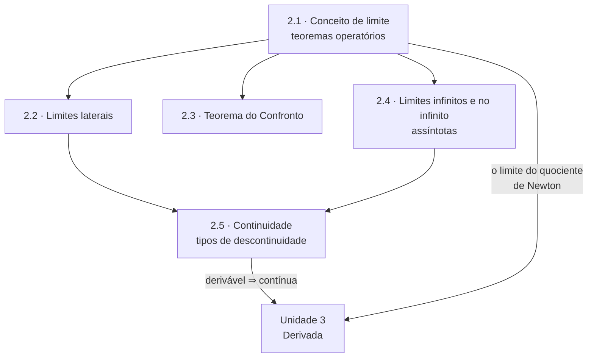

# Unidade 2 · Limites e continuidade

> [!NOTE]
> 🚧 **Unidade em construção.** As páginas abaixo estão sendo escritas e publicadas em ordem. Enquanto isso, o índice já serve de roteiro de estudo.

> O limite é a ideia que separa o Ensino Médio do Ensino Superior. Toda a matemática que vem depois — derivada, integral, série — é um limite disfarçado.

---

## 🎯 Objetivos da unidade

- Entender o que significa $\lim_{x \to a} f(x) = L$ **sem** calcular $f(a)$.
- Calcular limites por substituição, por fatoração, por racionalização e por mudança de variável.
- Usar **limites laterais** para decidir se o limite existe.
- Aplicar o **Teorema do Confronto** em limites que nenhuma manipulação algébrica resolve.
- Dominar **limites infinitos** e **no infinito**, e traduzi-los em **assíntotas** verticais e horizontais.
- Decidir se uma função é **contínua** em um ponto e classificar a descontinuidade.

---

## 🗺️ Mapa da unidade

---

## 📚 Conteúdo

| # | Teoria | 📝 Propostos | ✅ Gabarito |
| :---: | --- | :---: | :---: |
| 2.1 | [Conceito e noção intuitiva de limite · teoremas sobre limites](2.1-conceito-e-nocao-intuitiva-de-limite.md) | [lista](exercicios/lista-2.1-propostos.md) | [gabarito](gabaritos/gabarito-2.1.md) |
| 2.2 | [Limites laterais](2.2-limites-laterais.md) | [lista](exercicios/lista-2.2-propostos.md) | [gabarito](gabaritos/gabarito-2.2.md) |
| 2.3 | [Teorema do Sanduíche (Confronto)](2.3-teorema-do-sanduiche.md) | [lista](exercicios/lista-2.3-propostos.md) | [gabarito](gabaritos/gabarito-2.3.md) |
| 2.4 | [Limites infinitos, limites no infinito e assíntotas](2.4-limites-infinitos-no-infinito-e-assintotas.md) | [lista](exercicios/lista-2.4-propostos.md) | [gabarito](gabaritos/gabarito-2.4.md) |
| 2.5 | [Continuidade e tipos de descontinuidade](2.5-continuidade-e-tipos-de-descontinuidade.md) | [lista](exercicios/lista-2.5-propostos.md) | [gabarito](gabaritos/gabarito-2.5.md) |
| 🧪 | **Revisão da unidade** | [lista](exercicios/revisao-unidade-2.md) | [gabarito](gabaritos/gabarito-revisao-unidade-2.md) |

**Pré-requisito:** [Unidade 1](../01-funcoes/README.md) inteira — sobretudo domínio, fatoração e gráficos das funções elementares.

---

## ✅ Checklist de autoavaliação

- [ ] Explicar por que $\lim_{x \to 1} \frac{x^2-1}{x-1} = 2$ embora a função não exista em $x = 1$.
- [ ] Resolver uma indeterminação $\frac{0}{0}$ por fatoração e por racionalização.
- [ ] Usar limites laterais para decidir a existência do limite de uma função definida por partes.
- [ ] Calcular $\lim_{x \to 0} x^2 \sin\left(\frac{1}{x}\right)$ e justificar o método.
- [ ] Encontrar todas as assíntotas de uma função racional.
- [ ] Determinar o valor de $k$ que torna uma função contínua em um ponto.
- [ ] Classificar uma descontinuidade em removível, de salto ou infinita.

---

## ⚠️ Os erros clássicos desta unidade

1. **Escrever $\infty - \infty = 0$ ou $\frac{\infty}{\infty} = 1$.** Infinito não é número: essas expressões são **indeterminações**, e cada uma exige um trabalho algébrico próprio.
2. **Substituir antes de simplificar e concluir que "não existe".** Dar $\frac{0}{0}$ não é resposta — é o aviso de que a conta começou.
3. **Confundir "não está definida em $a$" com "não tem limite em $a$".** O limite descreve o comportamento **perto** de $a$, e ignora completamente o que acontece **em** $a$.

---

| ← Anterior | 🏠 Índice | Próximo → |
| :--- | :---: | ---: |
| [Unidade 1 · Funções](../01-funcoes/README.md) | [Página inicial](../README.md) | [Unidade 3 · Derivadas](../03-derivadas/README.md) |

*Sobrevivendo ao Cálculo 1 (UENF)* · por **Nicolau Prates** · [CC BY-SA 4.0](../LICENSE)
