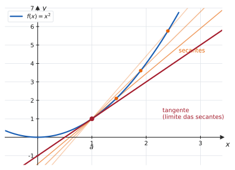
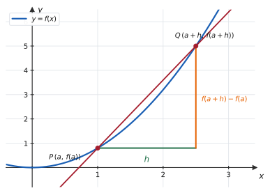
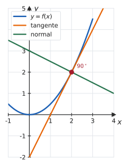
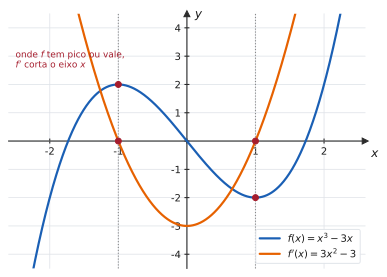
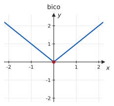
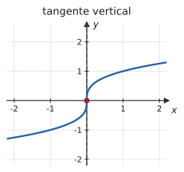
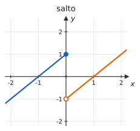

# 3.1 · Derivada: conceito, interpretação geométrica e regras básicas

| ← Anterior | 🏠 Índice | Próximo → |
| :--- | :---: | ---: |
| [Unidade 2 · Limites](../02-limites-e-continuidade/README.md) | [Unidade 3](README.md) · [Página inicial](../README.md) | [3.2 · Derivadas das funções elementares](3.2-derivadas-das-funcoes-elementares.md) |

---

## 🎯 O que você vai aprender

- Entender a derivada como **limite do quociente de Newton** — e por que ela resolve, de uma vez, o problema da tangente e o da velocidade.
- Calcular derivadas **pela definição**.
- Escrever a equação da **reta tangente** e da **reta normal**.
- Reconhecer os três casos em que a derivada **não existe**.
- Aplicar as regras da **constante, potência, soma, produto e quociente**.

**Pré-requisitos:** o [quociente de Newton de 1.2](../01-funcoes/1.2-funcoes-dominio-contradominio-imagem.md#7-o-quociente-de-newton) e toda a [Unidade 2](../02-limites-e-continuidade/README.md) — especialmente [continuidade](../02-limites-e-continuidade/2.5-continuidade-e-tipos-de-descontinuidade.md).

---

## Por que isso importa

Aqui o curso vira. Até agora você calculou limites; a partir de agora, **usa** limites para medir mudança.

E a conta já está feita: em [1.2](../01-funcoes/1.2-funcoes-dominio-contradominio-imagem.md#7-o-quociente-de-newton), você simplificou

$$\frac{f(x+h)-f(x)}{h}$$

para $x^2$, $\frac1x$ e $\sqrt{x}$, até o $h$ cancelar. Falta um passo: **fazer $h$ tender a zero**. Esse passo é a derivada — e é por isso que aquela álgebra era tão importante.

---

## 1. Os dois problemas que viraram um só

### O problema da tangente

Uma reta precisa de **dois** pontos para ter inclinação. Uma reta tangente toca a curva em **um**. Como medir a inclinação dela?

A saída é aproximar: tome um segundo ponto $Q$ próximo de $P$, calcule a inclinação da **secante** $PQ$, e depois deslize $Q$ em direção a $P$.

> 📊 Conforme $Q$ se aproxima de $P$, as secantes giram e se encostam numa reta-limite: a **tangente**. A inclinação dela é o limite das inclinações das secantes.

### A inclinação da secante é o quociente de Newton

> 📊 No triângulo, o cateto horizontal é $h$ e o vertical é $f(a+h)-f(a)$. A inclinação da secante é a razão entre eles — exatamente o quociente de Newton.

### O problema da velocidade

Um carro percorre $s(t)$ metros em $t$ segundos. A **velocidade média** entre $t=a$ e $t=a+h$ é

$$v_{\text{média}} = \frac{s(a+h)-s(a)}{h} = \frac{\text{variação da posição}}{\text{variação do tempo}}$$

A **velocidade instantânea** em $t=a$ seria a velocidade média num intervalo de duração zero — o que daria $\frac00$. A saída é a mesma: tomar o limite com $h \to 0$.

> 💡 **Os dois problemas têm a mesma resposta.** Inclinação da tangente e velocidade instantânea são o **mesmo limite**, calculado sobre funções diferentes. É essa unificação que faz a derivada ser tão útil: a mesma ferramenta mede inclinação, velocidade, taxa de crescimento populacional, corrente elétrica e custo marginal.

---

## 2. A definição

> 📐 **Definição 3.1.1 (Derivada em um ponto).** A derivada de $f$ em $a$ é
> $$f'(a) = \lim_{h\to0}\frac{f(a+h)-f(a)}{h}$$
> quando esse limite existe e é finito. Nesse caso, diz-se que $f$ é **derivável** (ou **diferenciável**) em $a$.

Há uma forma equivalente, às vezes mais prática, obtida com $x = a+h$:

> 📐 **Forma alternativa.**
> $$f'(a) = \lim_{x\to a}\frac{f(x)-f(a)}{x-a}$$

> [!NOTE]
> **As duas formas são a mesma conta.** Quando $h\to0$, tem-se $x = a+h \to a$. Use a primeira quando a função for fácil de expandir (polinômios); use a segunda quando for fácil de **fatorar** em torno de $a$.

#### ✍️ Exemplo 1 — derivada pela definição

Calcule $f'(2)$ para $f(x) = x^2 - 3x$.

**Solução.**

$$f(2+h) = (2+h)^2 - 3(2+h) = 4 + 4h + h^2 - 6 - 3h = h^2 + h - 2$$

e $f(2) = 4-6 = -2$. Então

$$\frac{f(2+h)-f(2)}{h} = \frac{\big(h^2+h-2\big) - (-2)}{h} = \frac{h^2+h}{h} = h+1$$

$$f'(2) = \lim_{h\to0}(h+1) = 1$$

**Resposta.** $f'(2) = 1$.

#### ✍️ Exemplo 2 — pela forma alternativa

Calcule $f'(4)$ para $f(x) = \sqrt{x}$.

**Solução.**

$$f'(4) = \lim_{x\to4}\frac{\sqrt{x}-2}{x-4}$$

Racionalizando (como em [2.1](../02-limites-e-continuidade/2.1-conceito-e-nocao-intuitiva-de-limite.md)):

$$\frac{\sqrt x - 2}{x-4}\cdot\frac{\sqrt x + 2}{\sqrt x + 2} = \frac{x-4}{(x-4)\big(\sqrt x + 2\big)} = \frac{1}{\sqrt x + 2}$$

$$f'(4) = \lim_{x\to4}\frac{1}{\sqrt x + 2} = \frac{1}{4}$$

**Resposta.** $f'(4) = \dfrac14$.

---

## 3. As duas interpretações

> 📐 **Interpretação geométrica.** $f'(a)$ é o **coeficiente angular da reta tangente** ao gráfico de $f$ no ponto $\big(a,\thinspace f(a)\big)$.

> 📐 **Interpretação como taxa.** $f'(a)$ é a **taxa de variação instantânea** de $f$ em relação a $x$, no ponto $a$.

| Se $f$ representa… | então $f'$ representa… |
| --- | --- |
| posição $s(t)$ | velocidade |
| velocidade $v(t)$ | aceleração |
| população $P(t)$ | taxa de crescimento |
| custo total $C(q)$ | custo marginal |
| carga elétrica $Q(t)$ | corrente |

### Reta tangente e reta normal

> 📐 **Equações.** No ponto $\big(a,\thinspace f(a)\big)$:
>
> **Tangente:** $\quad y - f(a) = f'(a)\thinspace (x-a)$
>
> **Normal** (perpendicular à tangente): $\quad y - f(a) = -\dfrac{1}{f'(a)}\thinspace (x-a)$, se $f'(a) \neq 0$

> 💡 **De onde vem o $-\frac{1}{f'(a)}$:** duas retas são perpendiculares quando o produto dos coeficientes angulares é $-1$. Se a tangente tem inclinação $m$, a normal tem $-\frac1m$.

#### ✍️ Exemplo 3 — equação da tangente

Determine a reta tangente a $y = x^2-3x$ no ponto de abscissa $2$.

**Solução.** Do Exemplo 1, $f'(2) = 1$. E $f(2) = -2$, logo o ponto é $(2,-2)$.

$$y - (-2) = 1\cdot(x-2) \ \Longrightarrow \ y = x - 4$$

**Resposta.** $y = x-4$.

*(A normal seria $y + 2 = -1(x-2)$, ou seja, $y = -x$.)*

---

## 4. A função derivada

Trocando o ponto fixo $a$ por um $x$ qualquer, a derivada deixa de ser um número e vira uma **função**:

> 📐 **Definição 3.1.2.**
> $$f'(x) = \lim_{h\to0}\frac{f(x+h)-f(x)}{h}$$
> definida em todos os $x$ em que o limite existe.

> 📊 Compare as duas curvas: onde $f$ tem um **pico ou um vale** (tangente horizontal), $f'$ **corta o eixo $x$**. Onde $f$ **cresce**, $f'$ é positiva; onde $f$ **decresce**, $f'$ é negativa. Essa leitura é a base da Unidade 4 inteira.

### Notações

Todas significam a mesma coisa:

| Notação | Lê-se | Devida a |
| :---: | --- | --- |
| $f'(x)$ | "f linha de x" | Lagrange |
| $\dfrac{dy}{dx}$ | "dê y dê x" | Leibniz |
| $\dfrac{d}{dx}\big[f(x)\big]$ | "derivada de f em relação a x" | Leibniz |
| $D_x f$ | "D de f" | Cauchy |
| $\dot{y}$ | "y ponto" (só para derivada no **tempo**) | Newton |

Para o valor **no ponto** $a$, a notação de Leibniz usa uma barra:

$$f'(a) = \left.\frac{dy}{dx}\right|_{x=a}$$

> [!TIP]
> **A notação de Leibniz carrega informação.** O símbolo $\frac{dy}{dx}$ lembra que a derivada é uma **razão entre variações** — e é por isso que ela se comporta tão bem na regra da cadeia ([3.3](3.3-regra-da-cadeia-e-derivada-da-funcao-inversa.md)) e nas integrais. Acostume-se com as duas.

---

## 5. Derivabilidade e continuidade

> 📐 **Teorema 3.1.1.** Se $f$ é derivável em $a$, então $f$ é **contínua** em $a$.

**Demonstração.** Supondo que $f'(a)$ exista, escreva, para $x \neq a$:

$$f(x) - f(a) = \frac{f(x)-f(a)}{x-a}\cdot(x-a)$$

Tomando o limite com $x\to a$, o primeiro fator tende a $f'(a)$ e o segundo a $0$:

$$\lim_{x\to a}\big[f(x)-f(a)\big] = f'(a)\cdot 0 = 0$$

Logo $\lim_{x\to a} f(x) = f(a)$, que é a definição de continuidade em $a$. $\blacksquare$

> [!CAUTION]
> **A recíproca é falsa.** Contínua **não** implica derivável. O contraexemplo que você precisa saber de cor é $f(x) = \lvert x \rvert$ em $x=0$: contínua, mas sem derivada.

### Os três modos de falhar

| | | |
| :---: | :---: | :---: |
|  |  |  |
| **Bico.** As derivadas laterais existem e **discordam**. | **Tangente vertical.** O quociente tende a $+\infty$. | **Descontinuidade.** Nem contínua — logo nem derivável. |

**No caso do bico**, use as **derivadas laterais**:

> 📐 **Definição 3.1.3.**
> $$f'_{-}(a) = \lim_{h\to0^{-}}\frac{f(a+h)-f(a)}{h} \qquad f'_{+}(a) = \lim_{h\to0^{+}}\frac{f(a+h)-f(a)}{h}$$
> A derivada $f'(a)$ existe se, e somente se, as duas laterais existem e são **iguais**.

#### ✍️ Exemplo 4 — por que $\lvert x \rvert$ não é derivável em $0$

$$\frac{f(0+h)-f(0)}{h} = \frac{\lvert h \rvert - 0}{h} = \frac{\lvert h \rvert}{h}$$

Essa é exatamente a função de [2.2](../02-limites-e-continuidade/2.2-limites-laterais.md):

$$f'_{-}(0) = \lim_{h\to0^{-}}\frac{\lvert h\rvert}{h} = -1 \qquad f'_{+}(0) = \lim_{h\to0^{+}}\frac{\lvert h\rvert}{h} = 1$$

As laterais existem e **diferem**. Logo $f'(0)$ **não existe**, embora $f$ seja contínua ali.

> 💡 Geometricamente: no bico, a curva chega com inclinação $-1$ pela esquerda e sai com $+1$ pela direita. Não há **uma** reta tangente — há duas semirretas.

---

## 6. As regras básicas de derivação

Derivar pela definição toda vez seria inviável. As regras abaixo fazem o trabalho.

> 📐 **Teorema 3.1.2 (Regras de derivação).** Sejam $f$ e $g$ deriváveis e $c$ constante.
>
> | | Regra | Fórmula |
> | :---: | --- | --- |
> | **D1** | Constante | $\dfrac{d}{dx}(c) = 0$ |
> | **D2** | Potência | $\dfrac{d}{dx}\big(x^n\big) = n\thinspace x^{n-1}$ |
> | **D3** | Múltiplo constante | $\big(c\thinspace f\big)' = c\thinspace f'$ |
> | **D4** | Soma e diferença | $\big(f \pm g\big)' = f' \pm g'$ |
> | **D5** | **Produto** | $\big(f\thinspace g\big)' = f'g + fg'$ |
> | **D6** | **Quociente** | $\left(\dfrac{f}{g}\right)' = \dfrac{f'g - fg'}{g^2}$ |

> [!IMPORTANT]
> **D2 vale para todo expoente real**, não só inteiro positivo: $\frac{d}{dx}(x^{-2}) = -2x^{-3}$, e $\frac{d}{dx}\big(x^{1/2}\big) = \frac12 x^{-1/2} = \frac{1}{2\sqrt x}$. Reescrever raízes e frações como potências é o primeiro movimento de boa parte dos exercícios.

### Por que a regra do produto não é o que parece

> [!CAUTION]
> $(f\thinspace g)' \neq f'\thinspace g'$. **Teste com números:** para $f(x)=g(x)=x$, o produto é $x^2$, cuja derivada é $2x$. Já $f'g' = 1\cdot1 = 1$. São diferentes. A regra correta dá $1\cdot x + x\cdot 1 = 2x$ ✔

**Demonstração de D5** (vale a pena ver o truque de somar e subtrair o mesmo termo):

$$
\begin{aligned}
(fg)'(x) &= \lim_{h\to0}\frac{f(x+h)g(x+h) - f(x)g(x)}{h} \\
&= \lim_{h\to0}\frac{f(x+h)g(x+h) - f(x+h)g(x) + f(x+h)g(x) - f(x)g(x)}{h} \\
&= \lim_{h\to0}\left[f(x+h)\cdot\frac{g(x+h)-g(x)}{h} + g(x)\cdot\frac{f(x+h)-f(x)}{h}\right] \\
&= f(x)\thinspace g'(x) + g(x)\thinspace f'(x)
\end{aligned}
$$

Na última passagem usou-se que $f(x+h) \to f(x)$ — ou seja, que $f$ é **contínua**, o que o Teorema 3.1.1 garante.

> 💡 **Mnemônico para D6:** *"derivada de cima vezes baixo, menos cima vezes derivada de baixo, tudo sobre baixo ao quadrado"*. A **ordem importa**: há um sinal de menos, e trocar os termos troca o sinal da resposta.

#### ✍️ Exemplo 5 — aplicando as regras

$$\frac{d}{dx}\big(5x^4 - 3x^2 + 7x - 9\big) = 20x^3 - 6x + 7$$

Termo a termo: $5\cdot4x^3 = 20x^3$; $-3\cdot2x = -6x$; $7\cdot1 = 7$; e a constante $-9$ some.

#### ✍️ Exemplo 6 — reescrevendo antes de derivar

Derive $f(x) = \dfrac{3}{x^2} + \sqrt[3]{x} - \dfrac{x^3}{4}$.

**Estratégia.** Reescreva tudo como potência de $x$ **antes** de aplicar D2.

$$f(x) = 3x^{-2} + x^{1/3} - \frac14 x^3$$

$$f'(x) = 3\cdot(-2)x^{-3} + \frac13 x^{-2/3} - \frac34 x^2 = -\frac{6}{x^3} + \frac{1}{3\sqrt[3]{x^2}} - \frac{3x^2}{4}$$

#### ✍️ Exemplo 7 — regra do produto

Derive $f(x) = \big(x^2+1\big)\big(x^3-2x\big)$.

**Pela regra do produto:**

$$f'(x) = \underbrace{2x}_{f'}\big(x^3-2x\big) + \big(x^2+1\big)\underbrace{\big(3x^2-2\big)}_{g'}$$

$$= 2x^4 - 4x^2 + 3x^4 - 2x^2 + 3x^2 - 2 = 5x^4 - 3x^2 - 2$$

*Conferência expandindo primeiro:* $f(x) = x^5 - 2x^3 + x^3 - 2x = x^5 - x^3 - 2x$, cuja derivada é $5x^4-3x^2-2$ ✔

> 💡 Quando dá para **expandir**, expandir costuma ser mais rápido. A regra do produto é indispensável quando não dá — com $x^2\operatorname{sen} x$ ou $e^x\ln x$, por exemplo.

#### ✍️ Exemplo 8 — regra do quociente

Derive $f(x) = \dfrac{2x+1}{x^2+3}$.

$$f'(x) = \frac{2\big(x^2+3\big) - (2x+1)(2x)}{\big(x^2+3\big)^2} = \frac{2x^2+6-4x^2-2x}{\big(x^2+3\big)^2} = \frac{-2x^2-2x+6}{\big(x^2+3\big)^2}$$

> ⚠️ **Não expanda o denominador.** Deixe $\big(x^2+3\big)^2$ como está: assim a resposta fica legível e, em [4.4](../04-aplicacoes-das-derivadas/4.4-crescimento-concavidade-e-esboco-de-graficos.md), o estudo de sinal fica trivial (o denominador é um quadrado, logo positivo).

---

## ⚠️ Armadilhas

| O erro | Por que está errado | O certo |
| --- | --- | --- |
| $(fg)' = f'g'$ | não é assim que o limite se distribui | $f'g + fg'$ |
| $\left(\frac fg\right)' = \frac{f'}{g'}$ | idem | $\frac{f'g-fg'}{g^2}$ |
| trocar a ordem em D6 | o sinal de menos não é simétrico | derivada **de cima** primeiro |
| confundir $f'(a)$ com $f'(x)$ | um é número, outro é função | $f'(a)$ é a inclinação **naquele** ponto |
| "contínua logo derivável" | a implicação é a outra | derivável ⟹ contínua |
| derivar $\sqrt x$ sem reescrever | D2 pede forma de potência | $x^{1/2}$, derivada $\frac12 x^{-1/2}$ |
| esquecer que a constante some | $\frac{d}{dx}(c)=0$ | o $-9$ do Exemplo 5 desaparece |
| escrever a tangente sem calcular $f(a)$ | a reta passa pelo ponto, não pela origem | use $y - f(a) = f'(a)(x-a)$ |

---

## 🧠 Exercícios resolvidos

### Exercício Resolvido 1

**Calcule $f'(x)$ pela definição, para $f(x) = \dfrac{1}{x+2}$.**

**Solução.**

$$
\begin{aligned}
f'(x) &= \lim_{h\to0}\frac{1}{h}\left(\frac{1}{x+h+2} - \frac{1}{x+2}\right) \\
&= \lim_{h\to0}\frac{1}{h}\cdot\frac{(x+2)-(x+h+2)}{(x+h+2)(x+2)} \\
&= \lim_{h\to0}\frac{-h}{h\thinspace (x+h+2)(x+2)} \\
&= \lim_{h\to0}\frac{-1}{(x+h+2)(x+2)} = \frac{-1}{(x+2)^2}
\end{aligned}
$$

**Resposta.** $f'(x) = -\dfrac{1}{(x+2)^2}$

*Conferência pela regra da potência:* $f(x) = (x+2)^{-1}$, e pela regra da cadeia ([3.3](3.3-regra-da-cadeia-e-derivada-da-funcao-inversa.md)) a derivada é $-(x+2)^{-2}$ ✔

---

### Exercício Resolvido 2

**Determine as equações da reta tangente e da reta normal a $y = x^3 - 2x$ no ponto de abscissa $x=1$.**

**Solução.**

**Ponto:** $f(1) = 1-2 = -1$, logo $P = (1,\thinspace -1)$.

**Inclinação:** $f'(x) = 3x^2-2$, logo $f'(1) = 1$.

**Tangente:**

$$y - (-1) = 1\cdot(x-1) \ \Longrightarrow \ y = x-2$$

**Normal:** inclinação $-\frac{1}{1} = -1$:

$$y + 1 = -1(x-1) \ \Longrightarrow \ y = -x$$

**Resposta.** Tangente $y = x-2$; normal $y = -x$.

---

### Exercício Resolvido 3

**Determine os pontos do gráfico de $f(x) = x^3 - 3x^2 + 1$ em que a reta tangente é horizontal.**

**Estratégia.** Tangente horizontal significa inclinação zero, isto é, $f'(x)=0$.

**Solução.**

$$f'(x) = 3x^2 - 6x = 3x(x-2)$$

$$3x(x-2) = 0 \ \Longrightarrow \ x = 0 \ \text{ ou } \ x = 2$$

Calculando as ordenadas: $f(0) = 1$ e $f(2) = 8-12+1 = -3$.

**Resposta.** Os pontos são $(0,\thinspace 1)$ e $(2,\thinspace -3)$.

> 💡 Esses pontos são exatamente o **pico** e o **vale** da curva — os candidatos a máximo e mínimo de [4.1](../04-aplicacoes-das-derivadas/4.1-maximos-e-minimos.md). A técnica "derive e iguale a zero" começa aqui.

---

### Exercício Resolvido 4

**Derive $f(x) = \dfrac{x^2-1}{x^2+1}$ e determine $f'(1)$.**

**Solução.** Pela regra do quociente, com $u = x^2-1$ e $v = x^2+1$ (logo $u' = v' = 2x$):

$$f'(x) = \frac{2x\big(x^2+1\big) - \big(x^2-1\big)2x}{\big(x^2+1\big)^2} = \frac{2x\big[\big(x^2+1\big)-\big(x^2-1\big)\big]}{\big(x^2+1\big)^2} = \frac{4x}{\big(x^2+1\big)^2}$$

$$f'(1) = \frac{4}{4} = 1$$

**Resposta.** $f'(x) = \dfrac{4x}{\big(x^2+1\big)^2}$ e $f'(1) = 1$.

> 💡 **Ponha $2x$ em evidência** antes de expandir: o colchete simplifica para $2$, e a conta encurta bastante. Procurar fatores comuns no numerador é o que separa uma resposta limpa de uma bagunça.

---

### Exercício Resolvido 5

**Mostre que a função abaixo é derivável em $x=1$ e calcule $f'(1)$.**

$$
f(x) = \begin{cases}
x^2, & \text{se } x \leqslant 1 \\
2x-1, & \text{se } x > 1
\end{cases}
$$

**Estratégia.** Em ponto de troca de regra, vá pelas **derivadas laterais** — mas verifique a continuidade antes, porque sem ela não há derivada.

**Solução.**

**Continuidade:** $\lim_{x\to1^{-}} x^2 = 1$, $\lim_{x\to1^{+}}(2x-1) = 1$ e $f(1) = 1$ ✔ contínua.

**Derivada à esquerda** (para $h<0$, vale $f(1+h) = (1+h)^2$):

$$f'_{-}(1) = \lim_{h\to0^{-}}\frac{(1+h)^2 - 1}{h} = \lim_{h\to0^{-}}\frac{2h+h^2}{h} = \lim_{h\to0^{-}}(2+h) = 2$$

**Derivada à direita** (para $h>0$, vale $f(1+h) = 2(1+h)-1 = 1+2h$):

$$f'_{+}(1) = \lim_{h\to0^{+}}\frac{(1+2h)-1}{h} = \lim_{h\to0^{+}}\frac{2h}{h} = 2$$

As laterais existem e coincidem.

**Resposta.** $f$ é derivável em $x=1$, com $f'(1) = 2$.

> ⚠️ **A verificação da continuidade não é formalidade.** Se os ramos não se encontrassem, as derivadas laterais poderiam até dar o mesmo número, e ainda assim não haveria derivada — porque não haveria sequer continuidade. Confira sempre primeiro.

---

### Exercício Resolvido 6

**Em quais pontos a reta tangente ao gráfico de $f(x) = x^3 + x$ é paralela à reta $y = 4x + 7$?**

**Estratégia.** Retas paralelas têm a **mesma inclinação**. Logo o problema é resolver $f'(x) = 4$.

**Solução.**

$$f'(x) = 3x^2+1$$

$$3x^2 + 1 = 4 \ \Longrightarrow \ 3x^2 = 3 \ \Longrightarrow \ x = \pm 1$$

As ordenadas: $f(1) = 2$ e $f(-1) = -2$.

**Resposta.** Os pontos são $(1,\thinspace 2)$ e $(-1,\thinspace -2)$.

*(As tangentes ali são $y = 4x-2$ e $y = 4x+2$ — ambas paralelas à reta dada, e nenhuma delas é ela própria.)*

---

## 📝 Agora é com você

➡️ **[Lista 3.1 — exercícios propostos](exercicios/lista-3.1-propostos.md)** · ✅ **[Gabarito](gabaritos/gabarito-3.1.md)**

---

## Resumo da página

> **Decore:**
> - $f'(a) = \lim_{h\to0}\dfrac{f(a+h)-f(a)}{h}$ — inclinação da tangente e taxa instantânea.
> - Tangente: $y - f(a) = f'(a)(x-a)$. Normal: troque $f'(a)$ por $-\frac{1}{f'(a)}$.
> - **Derivável ⟹ contínua.** A recíproca é falsa ($\lvert x\rvert$ em $0$).
> - $\big(x^n\big)' = n x^{n-1}$ · $(fg)' = f'g+fg'$ · $\left(\frac fg\right)' = \frac{f'g-fg'}{g^2}$
>
> **Saiba fazer:**
> - derivar pela definição, inclusive com fração e com raiz;
> - reescrever raízes e frações como potências antes de aplicar D2;
> - achar tangentes horizontais resolvendo $f'(x)=0$;
> - usar derivadas laterais em funções definidas por partes.

---

## 📚 Para aprofundar

| Livro | Onde procurar |
| --- | --- |
| **LEITHOLD** | Capítulo 3 — "A derivada"; "Derivabilidade e continuidade"; "Teoremas sobre diferenciação" |
| **STEWART** | Capítulo 2 — "Derivadas e taxas de variação"; Capítulo 3 — "Regras de derivação" |
| **THOMAS** | Capítulo 3 — "Tangentes e derivadas"; "Regras de derivação" |
| **ANTON** | Capítulo 3 — "A derivada"; "Técnicas de diferenciação" |
| **SWOKOWSKI** | Capítulo 3 — "A derivada de uma função"; "Regras de derivação" |
| **MUNEM & FOULIS** | Capítulo 3 — "A derivada" |

---

| ← Anterior | 🏠 Índice | Próximo → |
| :--- | :---: | ---: |
| [Unidade 2 · Limites](../02-limites-e-continuidade/README.md) | [Unidade 3](README.md) · [Página inicial](../README.md) | [3.2 · Derivadas das funções elementares](3.2-derivadas-das-funcoes-elementares.md) |

*Sobrevivendo ao Cálculo 1 (UENF)* · por **Nicolau Prates** · [CC BY-SA 4.0](../LICENSE)
