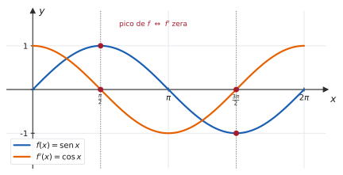
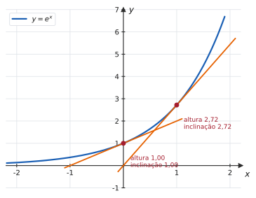

# 3.2 · Derivadas das funções elementares

| ← Anterior | 🏠 Índice | Próximo → |
| :--- | :---: | ---: |
| [3.1 · Conceito de derivada](3.1-conceito-interpretacao-geometrica-e-regras-basicas.md) | [Unidade 3](README.md) · [Página inicial](../README.md) | [3.3 · Regra da cadeia](3.3-regra-da-cadeia-e-derivada-da-funcao-inversa.md) |

---

## 🎯 O que você vai aprender

- A **tabela de derivadas** das funções elementares — e, mais importante, de onde cada linha vem.
- Demonstrar $(\operatorname{sen} x)' = \cos x$ e $(\cos x)' = -\operatorname{sen} x$ pela definição.
- Deduzir as derivadas de $\operatorname{tg}$, $\sec$, $\operatorname{cotg}$ e $\operatorname{cossec}$ pela regra do quociente.
- Entender por que $\big(e^x\big)' = e^x$ e $(\ln x)' = \dfrac1x$.
- **Decorar pouco e deduzir o resto.**

**Pré-requisitos:** [3.1](3.1-conceito-interpretacao-geometrica-e-regras-basicas.md) (regras básicas) e os [limites trigonométricos de 2.3](../02-limites-e-continuidade/2.3-teorema-do-sanduiche.md).

---

## Por que isso importa

A tabela de derivadas é o **vocabulário** do Cálculo. Sem ela, você não deriva nada além de polinômios; com ela, combinada à regra da cadeia de [3.3](3.3-regra-da-cadeia-e-derivada-da-funcao-inversa.md), você deriva qualquer expressão que apareça no curso.

Mas há um jeito certo e um jeito errado de aprendê-la. O errado é decorar quinze linhas soltas. O certo é **decorar cinco e deduzir as outras dez** — que é como se faz quando a memória falha no meio da prova.

---

## 1. A tabela

> 📐 **Teorema 3.2.1 (Derivadas elementares).**
>
> | Função | Derivada | | Função | Derivada |
> | :---: | :---: | --- | :---: | :---: |
> | $c$ | $0$ | | $\operatorname{sen} x$ | $\cos x$ |
> | $x^n$ | $n\thinspace x^{n-1}$ | | $\cos x$ | $-\operatorname{sen} x$ |
> | $e^x$ | $e^x$ | | $\operatorname{tg} x$ | $\sec^2 x$ |
> | $a^x$ | $a^x \ln a$ | | $\operatorname{cotg} x$ | $-\operatorname{cossec}^2 x$ |
> | $\ln x$ | $\dfrac1x$ | | $\sec x$ | $\sec x \operatorname{tg} x$ |
> | $\log_a x$ | $\dfrac{1}{x\ln a}$ | | $\operatorname{cossec} x$ | $-\operatorname{cossec} x \operatorname{cotg} x$ |

> [!TIP]
> **O que decorar e o que deduzir.**
> **Decore (5):** $x^n$, $e^x$, $\ln x$, $\operatorname{sen} x$, $\cos x$.
> **Deduza (o resto):** as quatro trigonométricas restantes saem da **regra do quociente**; $a^x$ e $\log_a x$ saem da **mudança de base**. As deduções estão abaixo e levam menos de um minuto cada.

> 💡 **O padrão dos sinais.** Toda função cujo nome começa com **"co"** — **cos**seno, **cot**angente, **cos**secante — tem derivada **negativa**. É o mnemônico mais útil da tabela, e evita metade dos erros de sinal.

---

## 2. De onde vêm as trigonométricas

### $(\operatorname{sen} x)' = \cos x$

Esta você já demonstrou, no [Exercício Resolvido 6 de 2.3](../02-limites-e-continuidade/2.3-teorema-do-sanduiche.md). Repetindo o essencial, pela definição:

$$
\begin{aligned}
(\operatorname{sen} x)' &= \lim_{h\to0}\frac{\operatorname{sen}(x+h)-\operatorname{sen} x}{h} \\
&= \lim_{h\to0}\frac{\operatorname{sen} x\cos h + \cos x\operatorname{sen} h - \operatorname{sen} x}{h} \\
&= \lim_{h\to0}\left[-\operatorname{sen} x\cdot\frac{1-\cos h}{h} + \cos x\cdot\frac{\operatorname{sen} h}{h}\right] \\
&= -\operatorname{sen} x\cdot 0 + \cos x\cdot 1 = \cos x
\end{aligned}
$$

Os dois limites usados são exatamente os da [seção 2.3](../02-limites-e-continuidade/2.3-teorema-do-sanduiche.md) — e é por isso que eles existiam.

> 📊 A figura é a verificação visual: nos picos e vales de $\operatorname{sen} x$ (tangente horizontal), $\cos x$ **cruza o eixo**. E onde o seno sobe, o cosseno é positivo.

### $(\cos x)' = -\operatorname{sen} x$

Mesma conta, com $\cos(x+h) = \cos x\cos h - \operatorname{sen} x\operatorname{sen} h$:

$$(\cos x)' = \lim_{h\to0}\left[-\cos x\cdot\frac{1-\cos h}{h} - \operatorname{sen} x\cdot\frac{\operatorname{sen} h}{h}\right] = -\operatorname{sen} x$$

### As outras quatro, pela regra do quociente

#### ✍️ Exemplo 1 — deduzindo $(\operatorname{tg} x)'$

$$
\begin{aligned}
(\operatorname{tg} x)' &= \left(\frac{\operatorname{sen} x}{\cos x}\right)' \\
&= \frac{(\operatorname{sen} x)'\cos x - \operatorname{sen} x\thinspace (\cos x)'}{\cos^2 x} \\
&= \frac{\cos x\cos x - \operatorname{sen} x\thinspace (-\operatorname{sen} x)}{\cos^2 x} \\
&= \frac{\cos^2 x + \operatorname{sen}^2 x}{\cos^2 x} = \frac{1}{\cos^2 x} = \sec^2 x
\end{aligned}
$$

Na última linha usou-se a identidade fundamental $\operatorname{sen}^2 x+\cos^2 x = 1$.

#### ✍️ Exemplo 2 — deduzindo $(\sec x)'$

Escreva a secante como potência: $\sec x = (\cos x)^{-1}$. Pela regra do quociente com numerador $1$:

$$(\sec x)' = \left(\frac{1}{\cos x}\right)' = \frac{0\cdot\cos x - 1\cdot(-\operatorname{sen} x)}{\cos^2 x} = \frac{\operatorname{sen} x}{\cos^2 x} = \frac{1}{\cos x}\cdot\frac{\operatorname{sen} x}{\cos x} = \sec x\operatorname{tg} x$$

> 💡 **O truque da separação** — escrever $\frac{\operatorname{sen} x}{\cos^2 x}$ como $\frac{1}{\cos x}\cdot\frac{\operatorname{sen} x}{\cos x}$ — é o que transforma um resultado feio em uma linha da tabela. Vale a pena reconhecê-lo.

As duas restantes saem igual, e ficam como exercício:

$$(\operatorname{cotg} x)' = -\operatorname{cossec}^2 x \qquad (\operatorname{cossec} x)' = -\operatorname{cossec} x\operatorname{cotg} x$$

---

## 3. De onde vem a exponencial

> 📐 **O limite que define $e$.**
> $$\lim_{h\to0}\frac{e^h-1}{h} = 1$$

Numericamente:

| $h$ | $0{,}1$ | $0{,}01$ | $0{,}001$ | $-0{,}001$ | $-0{,}01$ |
| --- | :---: | :---: | :---: | :---: | :---: |
| $\frac{e^h-1}{h}$ | $1{,}0517$ | $1{,}0050$ | $1{,}0005$ | $0{,}9995$ | $0{,}9950$ |

Com ele, a derivada sai direto da definição:

$$
\begin{aligned}
\big(e^x\big)' &= \lim_{h\to0}\frac{e^{x+h}-e^x}{h} \\
&= \lim_{h\to0}\frac{e^x\big(e^h-1\big)}{h} \\
&= e^x\cdot\lim_{h\to0}\frac{e^h-1}{h} = e^x\cdot 1 = e^x
\end{aligned}
$$

> [!IMPORTANT]
> **$e^x$ é a única função (não nula) que é a própria derivada.** É essa propriedade que define o número $e \approx 2{,}71828$ — e não o contrário. Entre todas as exponenciais $a^x$, $e^x$ é aquela cuja tangente em $(0,1)$ tem inclinação exatamente $1$.

> 📊 Em cada ponto, a **inclinação da tangente é igual à altura da curva**. Em $x=0$ a altura é $1$ e a inclinação é $1$; em $x=1$ a altura é $e \approx 2{,}72$ e a inclinação também. Nenhuma outra função elementar faz isso.

### Base qualquer

Escreva $a^x = e^{x\ln a}$ (pois $e^{\ln a} = a$). Pela regra da cadeia de [3.3](3.3-regra-da-cadeia-e-derivada-da-funcao-inversa.md):

$$\big(a^x\big)' = e^{x\ln a}\cdot\ln a = a^x\ln a$$

> ⚠️ **Não confunda $a^x$ com $x^a$.** Em $x^a$, a variável está na **base**: vale a regra da potência, $a x^{a-1}$. Em $a^x$, a variável está no **expoente**: vale $a^x\ln a$. Em $x^x$, está nos dois — e aí nenhuma das duas regras serve (veja o Exercício Resolvido 6).

---

## 4. De onde vem o logaritmo

> 📐 **Teorema.** $\dfrac{d}{dx}(\ln x) = \dfrac1x$, para $x>0$.

**Demonstração** (usando que $\ln$ é a inversa de $\exp$). Seja $y = \ln x$, de modo que $e^y = x$. Derivando os dois lados em relação a $x$, com a regra da cadeia no lado esquerdo:

$$e^y\cdot\frac{dy}{dx} = 1 \ \Longrightarrow \ \frac{dy}{dx} = \frac{1}{e^y} = \frac1x$$

$\blacksquare$

> 💡 **Esse é o método da derivada da função inversa**, formalizado em [3.3](3.3-regra-da-cadeia-e-derivada-da-funcao-inversa.md). Ele aparece aqui porque é a forma mais honesta de obter $(\ln x)'$ — e porque mostra que exponencial e logaritmo são duas faces da mesma coisa.

**Base qualquer:** pela mudança de base, $\log_a x = \dfrac{\ln x}{\ln a}$, e $\ln a$ é constante:

$$\big(\log_a x\big)' = \frac{1}{\ln a}\cdot\frac1x = \frac{1}{x\ln a}$$

---

## 5. Combinando com as regras de 3.1

#### ✍️ Exemplo 3 — soma e múltiplo

$$\frac{d}{dx}\big(3\operatorname{sen} x - 2e^x + 5\ln x\big) = 3\cos x - 2e^x + \frac5x$$

#### ✍️ Exemplo 4 — produto

$$\frac{d}{dx}\big(x^2\operatorname{sen} x\big) = 2x\operatorname{sen} x + x^2\cos x$$

#### ✍️ Exemplo 5 — quociente

$$\frac{d}{dx}\left(\frac{e^x}{x}\right) = \frac{e^x\cdot x - e^x\cdot 1}{x^2} = \frac{e^x(x-1)}{x^2}$$

#### ✍️ Exemplo 6 — simplificar antes de derivar

Derive $f(x) = \ln\big(x^3\big)$.

**Pela propriedade do logaritmo**, $\ln\big(x^3\big) = 3\ln x$, logo

$$f'(x) = \frac3x$$

> 💡 Sem a propriedade, seria preciso a regra da cadeia. **Toda vez que aparecer logaritmo de produto, quociente ou potência, quebre primeiro** — a conta encurta drasticamente. Essa ideia vira uma técnica própria, a derivação logarítmica, em [3.3](3.3-regra-da-cadeia-e-derivada-da-funcao-inversa.md).

---

## ⚠️ Armadilhas

| O erro | Por que está errado | O certo |
| --- | --- | --- |
| $(\cos x)' = \operatorname{sen} x$ | falta o sinal | $-\operatorname{sen} x$ |
| $\big(a^x\big)' = x\thinspace a^{x-1}$ | confundiu com a regra da potência | $a^x\ln a$ |
| $\big(e^x\big)' = x\thinspace e^{x-1}$ | idem | $e^x$ |
| $(\ln x)' = \dfrac{1}{x}$ para todo $x$ | o domínio é $x>0$ | vale em $(0,+\infty)$ |
| $(\operatorname{tg} x)' = \sec x$ | falta o quadrado | $\sec^2 x$ |
| derivar em **graus** | a demonstração usa radianos | sempre radianos |
| $\ln(x+3)$ derivado como $\frac1x + 0$ | o logaritmo não se distribui na soma | precisa da regra da cadeia |
| $(\operatorname{sen} x)^2$ confundido com $\operatorname{sen}\big(x^2\big)$ | são funções diferentes | cuidado com a posição do expoente |

---

## 🧠 Exercícios resolvidos

### Exercício Resolvido 1

**Deduza $(\operatorname{cotg} x)' = -\operatorname{cossec}^2 x$.**

**Solução.** Pela regra do quociente, com $\operatorname{cotg} x = \dfrac{\cos x}{\operatorname{sen} x}$:

$$
\begin{aligned}
(\operatorname{cotg} x)' &= \frac{(-\operatorname{sen} x)\operatorname{sen} x - \cos x\cos x}{\operatorname{sen}^2 x} \\
&= \frac{-\big(\operatorname{sen}^2 x + \cos^2 x\big)}{\operatorname{sen}^2 x} \\
&= \frac{-1}{\operatorname{sen}^2 x} = -\operatorname{cossec}^2 x \qquad \blacksquare
\end{aligned}
$$

---

### Exercício Resolvido 2

**Derive $f(x) = x^3 e^x$ e determine onde a tangente é horizontal.**

**Solução.** Pela regra do produto:

$$f'(x) = 3x^2 e^x + x^3 e^x = x^2 e^x(3+x)$$

Tangente horizontal exige $f'(x)=0$. Como $e^x > 0$ **sempre**, basta

$$x^2(3+x) = 0 \ \Longrightarrow \ x = 0 \ \text{ ou } \ x = -3$$

**Resposta.** $f'(x) = x^2e^x(x+3)$; tangente horizontal em $x=0$ e $x=-3$.

> 💡 **Fatorar a derivada é quase sempre o passo seguinte útil.** A forma fatorada responde de imediato onde ela zera e qual é o seu sinal — que é o que a Unidade 4 vai pedir.

---

### Exercício Resolvido 3

**Derive $f(x) = \dfrac{\operatorname{sen} x}{1+\cos x}$ e simplifique.**

**Solução.**

$$
\begin{aligned}
f'(x) &= \frac{\cos x\thinspace (1+\cos x) - \operatorname{sen} x\thinspace (-\operatorname{sen} x)}{(1+\cos x)^2} \\
&= \frac{\cos x + \cos^2 x + \operatorname{sen}^2 x}{(1+\cos x)^2} \\
&= \frac{\cos x + 1}{(1+\cos x)^2} = \frac{1}{1+\cos x}
\end{aligned}
$$

**Resposta.** $f'(x) = \dfrac{1}{1+\cos x}$

> 💡 A identidade fundamental apareceu de novo, e permitiu cancelar um fator inteiro. **Sempre que o resultado tiver $\operatorname{sen}^2$ e $\cos^2$ somados, procure a simplificação.**

---

### Exercício Resolvido 4

**Determine a reta tangente a $y = \ln x$ que é paralela à reta $y = 2x$.**

**Solução.**

A inclinação pedida é $2$. Como $y' = \dfrac1x$:

$$\frac1x = 2 \ \Longrightarrow \ x = \frac12$$

O ponto de tangência é $\left(\frac12,\thinspace \ln\frac12\right) = \left(\frac12,\thinspace -\ln 2\right)$.

$$y + \ln 2 = 2\left(x - \frac12\right) \ \Longrightarrow \ y = 2x - 1 - \ln 2$$

**Resposta.** $y = 2x - 1 - \ln 2$ (com $\ln 2 \approx 0{,}693$).

---

### Exercício Resolvido 5

**Derive $f(x) = \dfrac{2^x}{x^2}$.**

**Estratégia.** Atenção: numerador com variável no **expoente**, denominador com variável na **base**. São regras diferentes.

**Solução.** Pela regra do quociente, com $\big(2^x\big)' = 2^x\ln 2$:

$$f'(x) = \frac{2^x\ln 2\cdot x^2 - 2^x\cdot 2x}{x^4} = \frac{2^x x\thinspace (x\ln 2 - 2)}{x^4} = \frac{2^x(x\ln 2 - 2)}{x^3}$$

**Resposta.** $f'(x) = \dfrac{2^x\big(x\ln 2 - 2\big)}{x^3}$

---

### Exercício Resolvido 6

**Por que nenhuma regra da tabela deriva $f(x) = x^x$? Calcule a derivada usando uma reescrita.**

**Solução.**

Em $x^x$, a variável está **na base e no expoente** ao mesmo tempo. A regra da potência exige expoente constante; a regra da exponencial exige base constante. Nenhuma se aplica.

**A saída** é escrever tudo como exponencial de base $e$:

$$x^x = e^{\ln\left(x^x\right)} = e^{x\ln x}$$

Derivando com a regra da cadeia (antecipando [3.3](3.3-regra-da-cadeia-e-derivada-da-funcao-inversa.md)) e a regra do produto no expoente:

$$f'(x) = e^{x\ln x}\cdot\big(x\ln x\big)' = x^x\left(1\cdot\ln x + x\cdot\frac1x\right) = x^x\big(\ln x + 1\big)$$

**Resposta.** $f'(x) = x^x(\ln x + 1)$, para $x>0$.

> 💡 **A reescrita $u^v = e^{v\ln u}$ resolve qualquer potência com variável nos dois lugares.** É o mesmo raciocínio que transformou $a^x$ em $e^{x\ln a}$ na §3, e vai reaparecer como **derivação logarítmica** em [3.3](3.3-regra-da-cadeia-e-derivada-da-funcao-inversa.md).

---

## 📝 Agora é com você

➡️ **[Lista 3.2 — exercícios propostos](exercicios/lista-3.2-propostos.md)** · ✅ **[Gabarito](gabaritos/gabarito-3.2.md)**

📋 Tabela completa para consulta: **[A1 · Tabela de derivadas](../06-formulario/A1-tabela-de-derivadas.md)**

---

## Resumo da página

> **Decore (só estas cinco):**
> $$\big(x^n\big)' = nx^{n-1} \quad \big(e^x\big)' = e^x \quad (\ln x)' = \frac1x \quad (\operatorname{sen} x)' = \cos x \quad (\cos x)' = -\operatorname{sen} x$$
>
> **Deduza na hora:**
> - $\operatorname{tg}$, $\operatorname{cotg}$, $\sec$, $\operatorname{cossec}$ → regra do quociente a partir de seno e cosseno;
> - $a^x = e^{x\ln a}$ e $\log_a x = \frac{\ln x}{\ln a}$ → mudança de base;
> - quem começa com "co" tem derivada **negativa**.
>
> **Saiba fazer:**
> - demonstrar $(\operatorname{sen} x)' = \cos x$ pela definição;
> - usar a identidade $\operatorname{sen}^2+\cos^2=1$ para simplificar o resultado;
> - distinguir $x^a$, $a^x$ e $x^x$ — três regras diferentes;
> - quebrar o logaritmo com as propriedades **antes** de derivar.

---

## 📚 Para aprofundar

| Livro | Onde procurar |
| --- | --- |
| **LEITHOLD** | Capítulo 3 — "Derivada das funções trigonométricas"; Capítulo sobre funções transcendentes |
| **STEWART** | Capítulo 3 — "Derivadas das funções trigonométricas"; "Funções exponenciais e logarítmicas" |
| **THOMAS** | Capítulo 3 — "Derivadas de funções trigonométricas"; "Derivadas de exponenciais e logaritmos" |
| **ANTON** | Capítulo 3 — "Derivadas de funções trigonométricas"; "Derivadas de funções exponenciais e logarítmicas" |
| **SWOKOWSKI** | Capítulo 3 — "Derivadas das funções trigonométricas" |
| **MUNEM & FOULIS** | Capítulo 3 — "Derivadas das funções transcendentes" |

---

| ← Anterior | 🏠 Índice | Próximo → |
| :--- | :---: | ---: |
| [3.1 · Conceito de derivada](3.1-conceito-interpretacao-geometrica-e-regras-basicas.md) | [Unidade 3](README.md) · [Página inicial](../README.md) | [3.3 · Regra da cadeia](3.3-regra-da-cadeia-e-derivada-da-funcao-inversa.md) |

*Sobrevivendo ao Cálculo 1 (UENF)* · por **Nicolau Prates** · [CC BY-SA 4.0](../LICENSE)
