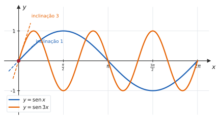
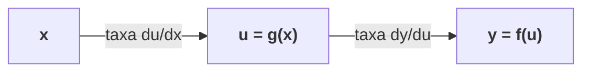
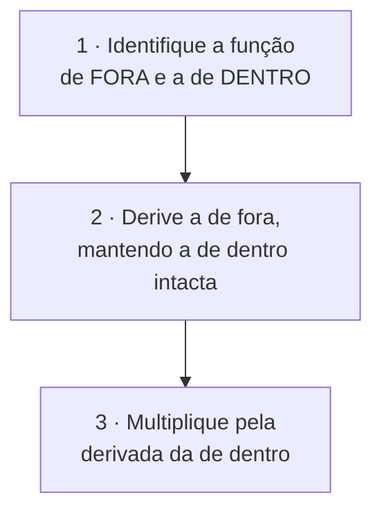
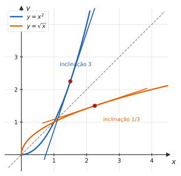

# 3.3 · Regra da cadeia e derivada da função inversa

| ← Anterior | 🏠 Índice | Próximo → |
| :--- | :---: | ---: |
| [3.2 · Funções elementares](3.2-derivadas-das-funcoes-elementares.md) | [Unidade 3](README.md) · [Página inicial](../README.md) | [3.4 · Trigonométricas inversas](3.4-derivadas-das-funcoes-trigonometricas-inversas.md) |

---

## 🎯 O que você vai aprender

- Aplicar a **regra da cadeia** — a regra mais usada do Cálculo — com uma, duas ou três camadas.
- Derivar **implicitamente**, sem precisar isolar $y$.
- Obter a derivada da **função inversa** a partir da derivada da função original.
- Usar a **derivação logarítmica** para domar produtos, quocientes e potências com variável no expoente.

**Pré-requisitos:** [3.1](3.1-conceito-interpretacao-geometrica-e-regras-basicas.md), [3.2](3.2-derivadas-das-funcoes-elementares.md) e a [composição de funções de 1.2](../01-funcoes/1.2-funcoes-dominio-contradominio-imagem.md).

---

## Por que isso importa

Quase nenhuma função real é "pura". Elas vêm compostas: $\mathrm{sen}(3x)$, $e^{-x^2}$, $\sqrt{x^2+1}$, $\ln(\cos x)$. Sem a regra da cadeia, você só deriva o catálogo de [3.2](3.2-derivadas-das-funcoes-elementares.md) e mais nada.

Com ela, você deriva **tudo** — e por isso ela é, de longe, a regra que mais aparece em prova. Também é a que mais se esquece pela metade: o erro clássico do semestre é escrever $(\mathrm{sen}\thinspace 3x)' = \cos 3x$, perdendo o fator $3$.

---

## 1. A regra da cadeia

### O problema

Qual é a derivada de $\mathrm{sen}(3x)$?

> 📊 As duas curvas passam pela origem, mas $\mathrm{sen}\thinspace 3x$ **sobe três vezes mais rápido** — ela foi comprimida horizontalmente por $3$, e comprimir horizontalmente **multiplica a inclinação**. A derivada em $0$ é $3$, e não $1$. Logo $(\mathrm{sen}\thinspace 3x)' = 3\cos 3x$.

> 📐 **Teorema 3.3.1 (Regra da cadeia).** Se $g$ é derivável em $x$ e $f$ é derivável em $g(x)$, então $f\circ g$ é derivável em $x$ e
> $$\big(f\circ g\big)'(x) = f'\big(g(x)\big)\cdot g'(x)$$
>
> Na notação de Leibniz, com $y = f(u)$ e $u = g(x)$:
> $$\frac{dy}{dx} = \frac{dy}{du}\cdot\frac{du}{dx}$$

> 💡 **A intuição das taxas.** Se $u$ varia $3$ vezes mais rápido que $x$, e $y$ varia $5$ vezes mais rápido que $u$, então $y$ varia $15$ vezes mais rápido que $x$. **As taxas se multiplicam** — é isso, e nada mais, que a regra da cadeia diz. Na forma de Leibniz, os $du$ parecem "cancelar", o que torna a fórmula fácil de lembrar.

### O procedimento

**"Derivada de fora, mantendo o de dentro, vezes a derivada do de dentro."**

#### ✍️ Exemplo 1 — uma camada

| Função | De fora | De dentro | Derivada |
| --- | --- | --- | --- |
| $\mathrm{sen}(3x)$ | $\mathrm{sen}(\square)$ | $3x$ | $\cos(3x)\cdot 3$ |
| $\big(x^2+1\big)^{10}$ | $\square^{10}$ | $x^2+1$ | $10\big(x^2+1\big)^9\cdot 2x$ |
| $e^{x^2}$ | $e^{\square}$ | $x^2$ | $e^{x^2}\cdot 2x$ |
| $\ln\big(x^2+1\big)$ | $\ln\square$ | $x^2+1$ | $\dfrac{1}{x^2+1}\cdot 2x$ |
| $\sqrt{x^3+1}$ | $\sqrt{\square}$ | $x^3+1$ | $\dfrac{1}{2\sqrt{x^3+1}}\cdot 3x^2$ |
| $\cos^3 x$ | $\square^3$ | $\cos x$ | $3\cos^2 x\cdot(-\mathrm{sen}\thinspace x)$ |

> [!WARNING]
> **Identifique a função de fora pela operação que seria feita por último.** Em $\cos^3 x$ — que significa $(\cos x)^3$ — você primeiro calcula o cosseno e **depois** eleva ao cubo: a de fora é a potência. Já em $\cos\big(x^3\big)$ é o contrário. Confundir as duas é o segundo erro mais comum da seção.

#### ✍️ Exemplo 2 — duas camadas

Derive $f(x) = \mathrm{sen}^2(3x)$.

**Camadas**, de fora para dentro: $\square^2$, depois $\mathrm{sen}\thinspace\square$, depois $3x$.

$$f'(x) = \underbrace{2\mathrm{sen}(3x)}_{\text{derivada da potência}}\cdot\underbrace{\cos(3x)}_{\text{derivada do seno}}\cdot\underbrace{3}_{\text{derivada de }3x} = 6\mathrm{sen}(3x)\cos(3x)$$

> 💡 Com três camadas, a derivada é um **produto de três fatores**. Descasque a cebola de fora para dentro, e não pare antes de chegar ao $x$ sozinho.

#### ✍️ Exemplo 3 — cadeia dentro de produto

Derive $f(x) = x^2 e^{3x}$.

Aqui a **estrutura mais externa é um produto**. Aplique a regra do produto e, dentro dela, a cadeia:

$$f'(x) = 2x\thinspace e^{3x} + x^2\cdot\underbrace{e^{3x}\cdot3}_{\text{cadeia}} = e^{3x}\big(2x + 3x^2\big) = x\thinspace e^{3x}(2+3x)$$

> [!TIP]
> **A pergunta que organiza tudo:** *qual é a operação mais externa?* Se for produto, comece pela regra do produto. Se for quociente, pela do quociente. Se for composição, pela cadeia. As regras se encaixam umas dentro das outras, mas a de fora manda.

---

## 2. Derivação implícita

Nem toda curva é o gráfico de uma função explícita $y = f(x)$. A circunferência $x^2+y^2=25$, por exemplo, não é. Mesmo assim, dá para derivar.

> 📐 **A ideia.** Trate $y$ como uma função de $x$ e derive os dois lados da equação em relação a $x$, aplicando a **regra da cadeia** toda vez que aparecer $y$. Depois, isole $\dfrac{dy}{dx}$.

**O ponto central:** como $y$ depende de $x$,

$$\frac{d}{dx}\big(y^2\big) = 2y\cdot\frac{dy}{dx} \qquad \frac{d}{dx}\big(\mathrm{sen}\thinspace y\big) = \cos y\cdot\frac{dy}{dx}$$

O fator $\frac{dy}{dx}$ é a derivada "de dentro" — e esquecê-lo é o erro padrão.

#### ✍️ Exemplo 4 — a circunferência

Determine $\dfrac{dy}{dx}$ para $x^2+y^2=25$.

**Solução.** Derivando os dois lados em relação a $x$:

$$2x + 2y\frac{dy}{dx} = 0 \ \Longrightarrow \ \frac{dy}{dx} = -\frac{x}{y}$$

**Verificação no ponto $(3,4)$:** a inclinação é $-\frac34$. Faz sentido — o raio até $(3,4)$ tem inclinação $\frac43$, e a tangente é perpendicular a ele.

#### ✍️ Exemplo 5 — com produto

Determine $\dfrac{dy}{dx}$ para $x^2 y + y^3 = 2x$.

**Solução.** Derive termo a termo; no primeiro, use a regra do **produto**:

$$\underbrace{2xy + x^2\frac{dy}{dx}}_{\text{produto}} + \underbrace{3y^2\frac{dy}{dx}}_{\text{cadeia}} = 2$$

Agrupe os termos com $\frac{dy}{dx}$:

$$\frac{dy}{dx}\big(x^2+3y^2\big) = 2 - 2xy \ \Longrightarrow \ \frac{dy}{dx} = \frac{2-2xy}{x^2+3y^2}$$

> 💡 **A resposta pode depender de $x$ e de $y$** — e isso é normal na derivação implícita. Para obter um número, substitua **as duas** coordenadas do ponto.

---

## 3. Derivada da função inversa

> 📐 **Teorema 3.3.2.** Seja $f$ invertível e derivável, com $f'(x) \neq 0$. Então $f^{-1}$ é derivável em $y = f(x)$ e
> $$\big(f^{-1}\big)'(y) = \frac{1}{f'(x)} = \frac{1}{f'\big(f^{-1}(y)\big)}$$

**De onde vem.** Por definição de inversa, $f\big(f^{-1}(y)\big) = y$. Derivando os dois lados em relação a $y$, com a regra da cadeia à esquerda:

$$f'\big(f^{-1}(y)\big)\cdot\big(f^{-1}\big)'(y) = 1 \ \Longrightarrow \ \big(f^{-1}\big)'(y) = \frac{1}{f'\big(f^{-1}(y)\big)} \qquad \blacksquare$$

> 📊 **A figura explica a fórmula.** Refletir na reta $y=x$ troca as coordenadas — e, com elas, troca "subida" por "avanço". Uma inclinação de $3$ vira uma de $\frac13$. Por isso a derivada da inversa é o **inverso multiplicativo** da derivada original, calculada no ponto correspondente.

> [!CAUTION]
> **Atenção ao ponto.** A fórmula **não** é "$1$ sobre $f'(y)$": é $1$ sobre $f'$ avaliada em $x = f^{-1}(y)$. Usar o ponto errado é o erro característico aqui.

#### ✍️ Exemplo 6 — a raiz quadrada a partir do quadrado

Seja $f(x) = x^2$ em $[0,+\infty)$, cuja inversa é $f^{-1}(y) = \sqrt{y}$.

Como $f'(x) = 2x$:

$$\big(f^{-1}\big)'(y) = \frac{1}{2x} = \frac{1}{2\sqrt{y}}$$

que é exatamente a derivada conhecida de $\sqrt{y}$ ✔

#### ✍️ Exemplo 7 — sem conhecer a fórmula da inversa

Seja $f(x) = x^5+x+1$. Sabendo que $f(1) = 3$, calcule $\big(f^{-1}\big)'(3)$.

**Estratégia.** Isolar $x$ em $y = x^5+x+1$ é impossível com fórmulas elementares — e **não é preciso**.

**Solução.**

$$f'(x) = 5x^4+1 \ \Longrightarrow \ f'(1) = 6$$

Como $f(1)=3$, tem-se $f^{-1}(3) = 1$, e portanto

$$\big(f^{-1}\big)'(3) = \frac{1}{f'(1)} = \frac16$$

**Resposta.** $\dfrac16$

> 💡 **É aqui que o teorema mostra o seu valor:** ele dá a derivada da inversa **sem exigir a fórmula da inversa**. Toda a §3.4 se apoia nisso para obter as derivadas de $\mathrm{arcsen}$, $\arccos$ e $\mathrm{arctg}$.

---

## 4. Derivação logarítmica

Quando a função é um **produto grande**, um **quociente feio** ou tem **variável no expoente**, aplicar o logaritmo **antes** de derivar simplifica tudo.

> 📐 **O procedimento.**
> 1. Escreva $y = f(x)$ e aplique $\ln$ aos dois lados.
> 2. Use as propriedades do logaritmo para **quebrar** produtos em somas e expoentes em fatores.
> 3. Derive implicitamente — o lado esquerdo vira $\dfrac{y'}{y}$.
> 4. Isole $y'$ e substitua $y$ pela expressão original.

#### ✍️ Exemplo 8 — variável no expoente

Derive $y = x^x$, para $x>0$.

**Solução.**

$$\ln y = x\ln x$$

Derivando os dois lados (à esquerda, cadeia; à direita, produto):

$$\frac{y'}{y} = 1\cdot\ln x + x\cdot\frac1x = \ln x + 1$$

$$y' = y\thinspace (\ln x + 1) = x^x(\ln x+1)$$

Mesmo resultado do [Exercício Resolvido 6 de 3.2](3.2-derivadas-das-funcoes-elementares.md), por outro caminho.

#### ✍️ Exemplo 9 — produto e quociente feios

Derive $y = \dfrac{x^3\sqrt{x+1}}{(2x-5)^4}$.

**Solução.** Aplicando $\ln$ e quebrando:

$$\ln y = 3\ln x + \frac12\ln(x+1) - 4\ln(2x-5)$$

Derivando:

$$\frac{y'}{y} = \frac3x + \frac{1}{2(x+1)} - \frac{8}{2x-5}$$

$$y' = \frac{x^3\sqrt{x+1}}{(2x-5)^4}\left[\frac3x + \frac{1}{2(x+1)} - \frac{8}{2x-5}\right]$$

> 💡 **Compare com o trabalho alternativo:** regra do quociente, com regra do produto dentro e regra da cadeia em três lugares. A derivação logarítmica transformou tudo em uma soma de três frações simples. Vale a pena reconhecer quando usá-la.

---

## ⚠️ Armadilhas

| O erro | Por que está errado | O certo |
| --- | --- | --- |
| $(\mathrm{sen}\thinspace 3x)' = \cos 3x$ | esqueceu a derivada de dentro | $3\cos 3x$ |
| $\left(e^{x^2}\right)' = e^{x^2}$ | idem | $2x\thinspace e^{x^2}$ |
| $\big(\ln(5x)\big)' = \dfrac{1}{5x}$ | a cadeia dá $\frac{1}{5x}\cdot5$ | $\dfrac1x$ |
| confundir $\cos^3 x$ com $\cos\big(x^3\big)$ | são composições diferentes | veja qual operação vem por último |
| parar a cadeia no meio | com 3 camadas, são 3 fatores | descasque até chegar ao $x$ |
| derivar $y^2$ como $2y$ na implícita | falta o $\frac{dy}{dx}$ | $2y\thinspace \frac{dy}{dx}$ |
| $\big(f^{-1}\big)'(y) = \dfrac{1}{f'(y)}$ | o ponto está errado | $\dfrac{1}{f'\big(f^{-1}(y)\big)}$ |
| esquecer de multiplicar por $y$ no fim | a derivação logarítmica dá $\frac{y'}{y}$ | isole $y'$ substituindo $y$ |

---

## 🧠 Exercícios resolvidos

### Exercício Resolvido 1

**Derive $f(x) = \sqrt{x^2+4x}$.**

**Solução.** De fora, raiz; de dentro, $x^2+4x$.

$$f'(x) = \frac{1}{2\sqrt{x^2+4x}}\cdot(2x+4) = \frac{x+2}{\sqrt{x^2+4x}}$$

*(simplificando o $2$ do numerador com o do denominador)*

---

### Exercício Resolvido 2

**Derive $f(x) = e^{\mathrm{sen}(2x)}$.**

**Solução.** Três camadas: $e^{\square}$, $\mathrm{sen}\thinspace\square$, $2x$.

$$f'(x) = e^{\mathrm{sen}(2x)}\cdot\cos(2x)\cdot 2 = 2\cos(2x)\thinspace e^{\mathrm{sen}(2x)}$$

---

### Exercício Resolvido 3

**Derive $f(x) = \ln\left(\dfrac{x^2}{x+3}\right)$.**

**Estratégia.** **Quebre o logaritmo primeiro.** Derivar direto exigiria a regra do quociente dentro da cadeia.

**Solução.**

$$f(x) = 2\ln x - \ln(x+3)$$

$$f'(x) = \frac2x - \frac{1}{x+3}$$

*(Se quiser, some: $\frac{2(x+3) - x}{x(x+3)} = \frac{x+6}{x(x+3)}$.)*

---

### Exercício Resolvido 4

**Determine a reta tangente à curva $x^2+xy+y^2 = 7$ no ponto $(1,\thinspace 2)$.**

**Solução.** Derivando implicitamente (regra do produto no termo do meio):

$$2x + \left(y + x\frac{dy}{dx}\right) + 2y\frac{dy}{dx} = 0$$

$$\frac{dy}{dx}\big(x+2y\big) = -2x - y \ \Longrightarrow \ \frac{dy}{dx} = \frac{-2x-y}{x+2y}$$

No ponto $(1,2)$:

$$\frac{dy}{dx} = \frac{-2-2}{1+4} = -\frac45$$

**Reta tangente:**

$$y - 2 = -\frac45(x-1) \ \Longrightarrow \ y = -\frac45 x + \frac{14}{5}$$

*Conferência:* o ponto satisfaz a equação original — $1 + 2 + 4 = 7$ ✔

---

### Exercício Resolvido 5

**Seja $f(x) = x^3 + 2x - 1$. Sabendo que $f(1) = 2$, calcule $\big(f^{-1}\big)'(2)$.**

**Solução.**

$$f'(x) = 3x^2+2 \ \Longrightarrow \ f'(1) = 5$$

Como $f(1) = 2$, tem-se $f^{-1}(2) = 1$, e portanto

$$\big(f^{-1}\big)'(2) = \frac{1}{f'(1)} = \frac15$$

> ⚠️ Note que **não** se calculou $f'(2) = 14$. O ponto onde se avalia $f'$ é $f^{-1}(2) = 1$, e não $2$.

---

### Exercício Resolvido 6

**Derive $y = \big(x^2+1\big)^{\mathrm{sen}\thinspace x}$.**

**Estratégia.** Base **e** expoente variáveis: derivação logarítmica.

**Solução.**

$$\ln y = \mathrm{sen}\thinspace x\cdot\ln\big(x^2+1\big)$$

Derivando (produto à direita, cadeia em cada fator):

$$\frac{y'}{y} = \cos x\cdot\ln\big(x^2+1\big) + \mathrm{sen}\thinspace x\cdot\frac{2x}{x^2+1}$$

$$y' = \big(x^2+1\big)^{\mathrm{sen}\thinspace x}\left[\cos x\ln\big(x^2+1\big) + \frac{2x\mathrm{sen}\thinspace x}{x^2+1}\right]$$

---

## 📝 Agora é com você

➡️ **[Lista 3.3 — exercícios propostos](exercicios/lista-3.3-propostos.md)** · ✅ **[Gabarito](gabaritos/gabarito-3.3.md)**

---

## Resumo da página

> **Decore:**
> - **Cadeia:** $\big(f(g(x))\big)' = f'\big(g(x)\big)\cdot g'(x)$ — *de fora vezes de dentro*.
> - $\dfrac{dy}{dx} = \dfrac{dy}{du}\cdot\dfrac{du}{dx}$ — as taxas se multiplicam.
> - **Implícita:** toda vez que derivar algo com $y$, multiplique por $\frac{dy}{dx}$.
> - **Inversa:** $\big(f^{-1}\big)'(y) = \dfrac{1}{f'(x)}$, com $x = f^{-1}(y)$.
>
> **Saiba fazer:**
> - identificar a operação **mais externa** antes de escolher a regra;
> - descascar três camadas sem parar no meio;
> - derivar implicitamente e agrupar os termos com $\frac{dy}{dx}$;
> - usar a derivação logarítmica em produtos grandes e em potências com expoente variável.

---

## 📚 Para aprofundar

| Livro | Onde procurar |
| --- | --- |
| **LEITHOLD** | Capítulo 3 — "A regra da cadeia"; "Diferenciação implícita"; "Derivada da função inversa" |
| **STEWART** | Capítulo 3 — "A Regra da Cadeia"; "Diferenciação implícita"; "Derivação logarítmica" |
| **THOMAS** | Capítulo 3 — "A regra da cadeia"; "Diferenciação implícita" |
| **ANTON** | Capítulo 3 — "A regra da cadeia"; "Diferenciação implícita" |
| **SWOKOWSKI** | Capítulo 3 — "A regra da cadeia"; "Derivação implícita" |
| **MUNEM & FOULIS** | Capítulo 3 — "Regra da cadeia e derivação implícita" |

---

| ← Anterior | 🏠 Índice | Próximo → |
| :--- | :---: | ---: |
| [3.2 · Funções elementares](3.2-derivadas-das-funcoes-elementares.md) | [Unidade 3](README.md) · [Página inicial](../README.md) | [3.4 · Trigonométricas inversas](3.4-derivadas-das-funcoes-trigonometricas-inversas.md) |

*Sobrevivendo ao Cálculo 1 (UENF)* · por **Nicolau Prates** · [CC BY-SA 4.0](../LICENSE)
