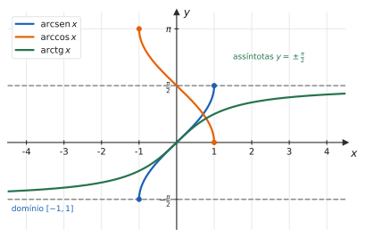
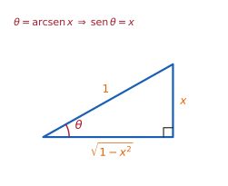

# 3.4 · Derivadas das funções trigonométricas inversas

| ← Anterior | 🏠 Índice | Próximo → |
| :--- | :---: | ---: |
| [3.3 · Regra da cadeia](3.3-regra-da-cadeia-e-derivada-da-funcao-inversa.md) | [Unidade 3](README.md) · [Página inicial](../README.md) | [3.5 · Taxas de variação](3.5-problemas-de-taxa-de-variacao.md) |

---

## 🎯 O que você vai aprender

- **Deduzir** $(\mathrm{arcsen}\thinspace x)' = \dfrac{1}{\sqrt{1-x^2}}$ — em vez de decorar.
- A tabela completa das seis derivadas inversas.
- Usar o **triângulo retângulo** para converter $\cos(\mathrm{arcsen}\thinspace x)$ em expressão algébrica.
- Combinar essas derivadas com a regra da cadeia.

**Pré-requisitos:** [1.4](../01-funcoes/1.4-injetoras-sobrejetoras-bijetoras-e-inversas.md) (as restrições de domínio) e [3.3](3.3-regra-da-cadeia-e-derivada-da-funcao-inversa.md) (derivação implícita e derivada da inversa).

---

## Por que isso importa

Estas derivadas parecem arbitrárias — **por que uma raiz quadrada apareceria ao derivar uma função trigonométrica?** A resposta está na dedução, e ela vale muito mais do que a tabela: entendendo-a, você reconstrói qualquer linha esquecida em trinta segundos.

Além disso, as fórmulas **viram de trás para frente** na Unidade 5: $\int \frac{dx}{1+x^2} = \mathrm{arctg}\thinspace x + C$ é uma das integrais mais usadas do curso, e ela existe por causa desta página.

---

## 1. Relembrando as restrições

Para terem inversa, as trigonométricas precisam de domínio restrito ([1.4](../01-funcoes/1.4-injetoras-sobrejetoras-bijetoras-e-inversas.md)):

| Inversa | Domínio | Imagem |
| :---: | :---: | :---: |
| $\mathrm{arcsen}\thinspace x$ | $[-1,\thinspace 1]$ | $\left[-\frac{\pi}{2},\thinspace \frac{\pi}{2}\right]$ |
| $\arccos x$ | $[-1,\thinspace 1]$ | $[0,\thinspace \pi]$ |
| $\mathrm{arctg}\thinspace x$ | $\mathbb{R}$ | $\left(-\frac{\pi}{2},\thinspace \frac{\pi}{2}\right)$ |

> 📊 Note três coisas que a dedução vai usar: $\mathrm{arcsen}$ e $\arccos$ **só existem em $[-1,1]$**; $\mathrm{arctg}$ existe em toda a reta, com assíntotas $y = \pm\frac\pi2$; e $\arccos$ é **decrescente** — o que já antecipa o sinal negativo da sua derivada.

---

## 2. A dedução de $(\mathrm{arcsen}\thinspace x)'$

**Estratégia:** escrever a inversa como equação e derivar implicitamente.

Seja $y = \mathrm{arcsen}\thinspace x$. Por definição de inversa, isso equivale a

$$\mathrm{sen}\thinspace y = x, \qquad \text{com } y \in \left[-\frac{\pi}{2},\thinspace \frac{\pi}{2}\right]$$

Derivando os dois lados em relação a $x$ (cadeia à esquerda):

$$\cos y\cdot\frac{dy}{dx} = 1 \ \Longrightarrow \ \frac{dy}{dx} = \frac{1}{\cos y}$$

Falta **trocar $\cos y$ por algo em $x$**. Da identidade fundamental:

$$\cos y = \pm\sqrt{1-\mathrm{sen}^2\thinspace y} = \pm\sqrt{1-x^2}$$

> [!IMPORTANT]
> **O sinal é positivo** — e aqui entra a restrição. Como $y \in \left[-\frac\pi2,\frac\pi2\right]$, o ângulo está no primeiro ou no quarto quadrante, onde o **cosseno é não negativo**. Logo vale o sinal $+$.
>
> É por isso que a restrição de domínio de [1.4](../01-funcoes/1.4-injetoras-sobrejetoras-bijetoras-e-inversas.md) não era burocracia: sem ela, a derivada ficaria ambígua.

$$\boxed{\ \big(\mathrm{arcsen}\thinspace x\big)' = \frac{1}{\sqrt{1-x^2}}, \qquad -1 < x < 1\ }$$

### 📊 O mesmo, pelo triângulo

Há um caminho visual para a troca de $\cos y$ por $\sqrt{1-x^2}$:

> 📊 Se $\theta = \mathrm{arcsen}\thinspace x$, então $\mathrm{sen}\thinspace\theta = x = \frac{x}{1}$ — desenhe o triângulo com cateto oposto $x$ e hipotenusa $1$. Por Pitágoras, o cateto adjacente é $\sqrt{1-x^2}$, e daí
> $$\cos(\mathrm{arcsen}\thinspace x) = \frac{\sqrt{1-x^2}}{1} = \sqrt{1-x^2}$$
> **Esse triângulo resolve qualquer composição** do tipo "trigonométrica de uma arco-função" — e vale decorar o método, não o resultado.

---

## 3. A tabela

> 📐 **Teorema 3.4.1.**
>
> | Função | Derivada | Válida para |
> | :---: | :---: | :---: |
> | $\mathrm{arcsen}\thinspace x$ | $\dfrac{1}{\sqrt{1-x^2}}$ | $-1<x<1$ |
> | $\arccos x$ | $-\dfrac{1}{\sqrt{1-x^2}}$ | $-1<x<1$ |
> | $\mathrm{arctg}\thinspace x$ | $\dfrac{1}{1+x^2}$ | $x \in \mathbb{R}$ |
> | $\mathrm{arccotg}\thinspace x$ | $-\dfrac{1}{1+x^2}$ | $x \in \mathbb{R}$ |
> | $\mathrm{arcsec}\thinspace x$ | $\dfrac{1}{\lvert x\rvert\sqrt{x^2-1}}$ | $\lvert x\rvert>1$ |
> | $\mathrm{arccossec}\thinspace x$ | $-\dfrac{1}{\lvert x\rvert\sqrt{x^2-1}}$ | $\lvert x\rvert>1$ |

> 💡 **Três economias de memória:**
> 1. **As "co" são as mesmas, com sinal trocado.** Decorando três linhas, você tem as seis.
> 2. **Nenhuma derivada tem função trigonométrica.** Todas são **algébricas** — é o grande fato surpreendente desta página, e o motivo de elas aparecerem em tabelas de integrais.
> 3. $\mathrm{arcsen}$ e $\arccos$ trazem $\sqrt{1-x^2}$ (o triângulo com hipotenusa $1$); $\mathrm{arctg}$ traz $1+x^2$ (o triângulo com cateto adjacente $1$).

### A dedução de $(\mathrm{arctg}\thinspace x)'$

Seja $y = \mathrm{arctg}\thinspace x$, isto é, $\mathrm{tg}\thinspace y = x$. Derivando:

$$\sec^2 y\cdot\frac{dy}{dx} = 1 \ \Longrightarrow \ \frac{dy}{dx} = \frac{1}{\sec^2 y}$$

Pela identidade $\sec^2 y = 1+\mathrm{tg}^2\thinspace y = 1+x^2$:

$$\big(\mathrm{arctg}\thinspace x\big)' = \frac{1}{1+x^2}$$

> 💡 Note que **não houve problema de sinal** aqui: $\sec^2 y$ é um quadrado, sempre positivo. E o resultado vale para **todo** $x$ real, coerente com o domínio do arco-tangente.

---

## 4. Com a regra da cadeia

Na prática, o argumento quase nunca é só $x$. Combinando com [3.3](3.3-regra-da-cadeia-e-derivada-da-funcao-inversa.md):

$$\big(\mathrm{arcsen}\thinspace u\big)' = \frac{u'}{\sqrt{1-u^2}} \qquad \big(\mathrm{arctg}\thinspace u\big)' = \frac{u'}{1+u^2}$$

#### ✍️ Exemplo 1

$$\frac{d}{dx}\mathrm{arcsen}(3x) = \frac{3}{\sqrt{1-9x^2}}$$

#### ✍️ Exemplo 2

$$\frac{d}{dx}\mathrm{arctg}\big(x^2\big) = \frac{2x}{1+x^4}$$

*(Atenção: $\big(x^2\big)^2 = x^4$, e não $x^2$.)*

#### ✍️ Exemplo 3 — com produto

$$\frac{d}{dx}\big[x\mathrm{arctg}\thinspace x\big] = 1\cdot\mathrm{arctg}\thinspace x + x\cdot\frac{1}{1+x^2} = \mathrm{arctg}\thinspace x + \frac{x}{1+x^2}$$

#### ✍️ Exemplo 4 — uma simplificação surpreendente

Derive $f(x) = \mathrm{arcsen}\thinspace x + \arccos x$.

$$f'(x) = \frac{1}{\sqrt{1-x^2}} - \frac{1}{\sqrt{1-x^2}} = 0$$

Derivada nula em todo o intervalo significa **função constante**. E de fato:

$$\mathrm{arcsen}\thinspace x + \arccos x = \frac{\pi}{2} \qquad \text{para todo } x\in[-1,1]$$

> 💡 **A derivada provou uma identidade trigonométrica.** Esse é um método legítimo e poderoso: se $f' = 0$ num intervalo, então $f$ é constante ali — basta calcular o valor em **um** ponto (aqui, $x=0$ dá $0 + \frac\pi2$) para saber qual constante é. O teorema que autoriza esse raciocínio é o do Valor Médio, em [4.2](../04-aplicacoes-das-derivadas/4.2-teoremas-de-rolle-e-do-valor-medio.md).

---

## ⚠️ Armadilhas

| O erro | Por que está errado | O certo |
| --- | --- | --- |
| $(\mathrm{arcsen}\thinspace x)' = \dfrac{1}{\cos x}$ | parou na variável errada | troque $\cos y$ por $\sqrt{1-x^2}$ |
| $(\arccos x)' = \dfrac{1}{\sqrt{1-x^2}}$ | faltou o sinal | é **negativa** |
| $\big(\mathrm{arctg}(x^2)\big)' = \dfrac{2x}{1+x^2}$ | o quadrado é do argumento inteiro | $\dfrac{2x}{1+x^4}$ |
| esquecer o $\lvert x\rvert$ em $\mathrm{arcsec}$ | a fórmula vale para $x$ positivo e negativo | $\dfrac{1}{\lvert x\rvert\sqrt{x^2-1}}$ |
| confundir $\mathrm{arcsen}\thinspace x$ com $(\mathrm{sen}\thinspace x)^{-1}$ | o expoente $-1$ aqui é notação de inversa | $(\mathrm{sen}\thinspace x)^{-1} = \mathrm{cossec}\thinspace x$ |
| usar a fórmula fora do domínio | $\sqrt{1-x^2}$ exige $\lvert x\rvert<1$ | declare o intervalo de validade |

---

## 🧠 Exercícios resolvidos

### Exercício Resolvido 1

**Deduza $(\arccos x)' = -\dfrac{1}{\sqrt{1-x^2}}$.**

**Solução.** Seja $y = \arccos x$, logo $\cos y = x$, com $y\in[0,\pi]$. Derivando:

$$-\mathrm{sen}\thinspace y\cdot\frac{dy}{dx} = 1 \ \Longrightarrow \ \frac{dy}{dx} = -\frac{1}{\mathrm{sen}\thinspace y}$$

Como $y \in [0,\pi]$, o seno é **não negativo**, logo $\mathrm{sen}\thinspace y = +\sqrt{1-\cos^2 y} = \sqrt{1-x^2}$:

$$\big(\arccos x\big)' = -\frac{1}{\sqrt{1-x^2}} \qquad \blacksquare$$

---

### Exercício Resolvido 2

**Derive $f(x) = \mathrm{arctg}\big(e^{2x}\big)$.**

**Solução.** Com $u = e^{2x}$, tem-se $u' = 2e^{2x}$:

$$f'(x) = \frac{2e^{2x}}{1+\big(e^{2x}\big)^2} = \frac{2e^{2x}}{1+e^{4x}}$$

---

### Exercício Resolvido 3

**Derive $f(x) = \mathrm{arcsen}\left(\dfrac{x}{2}\right)$ e determine o domínio de $f$ e de $f'$.**

**Solução.**

$$f'(x) = \frac{1/2}{\sqrt{1-\frac{x^2}{4}}} = \frac{1/2}{\frac{\sqrt{4-x^2}}{2}} = \frac{1}{\sqrt{4-x^2}}$$

**Domínios:** $f$ exige $\left\lvert\frac x2\right\rvert \leqslant 1$, ou seja, $D(f) = [-2,\thinspace 2]$. Já $f'$ exige $4-x^2 > 0$, logo $D(f') = (-2,\thinspace 2)$.

> 💡 **Os domínios diferem nos extremos**, e isso não é acidente: nos pontos $x = \pm2$ o gráfico de $f$ tem **tangente vertical** — a derivada "explode" ali. Compare com a figura das arco-funções, em que $\mathrm{arcsen}$ chega a $\pm1$ com inclinação cada vez maior.

---

### Exercício Resolvido 4

**Derive $f(x) = x\mathrm{arcsen}\thinspace x + \sqrt{1-x^2}$ e simplifique.**

**Solução.** Primeiro termo, regra do produto; segundo, regra da cadeia:

$$f'(x) = \underbrace{\mathrm{arcsen}\thinspace x + \frac{x}{\sqrt{1-x^2}}}_{\text{produto}} + \underbrace{\frac{-2x}{2\sqrt{1-x^2}}}_{\text{cadeia}}$$

$$= \mathrm{arcsen}\thinspace x + \frac{x}{\sqrt{1-x^2}} - \frac{x}{\sqrt{1-x^2}} = \mathrm{arcsen}\thinspace x$$

**Resposta.** $f'(x) = \mathrm{arcsen}\thinspace x$

> 💡 **Guarde este resultado:** ele diz que $x\mathrm{arcsen}\thinspace x + \sqrt{1-x^2}$ é uma **primitiva** de $\mathrm{arcsen}\thinspace x$. Na Unidade 5 você vai obtê-la por integração por partes — e poderá conferir derivando, exatamente como aqui.

---

### Exercício Resolvido 5

**Calcule a reta tangente a $y = \mathrm{arctg}\thinspace x$ na origem.**

**Solução.** $f(0) = \mathrm{arctg}\thinspace 0 = 0$, e

$$f'(x) = \frac{1}{1+x^2} \ \Longrightarrow \ f'(0) = 1$$

$$y - 0 = 1(x-0) \ \Longrightarrow \ y = x$$

**Resposta.** $y = x$ — ou seja, $\mathrm{arctg}\thinspace x \approx x$ para $x$ pequeno, assim como $\mathrm{sen}\thinspace x\approx x$.

---

### Exercício Resolvido 6

**Mostre que $g(x) = \mathrm{arctg}\thinspace x + \mathrm{arctg}\thinspace\dfrac1x$ é constante em $(0,+\infty)$ e determine a constante.**

**Solução.**

$$g'(x) = \frac{1}{1+x^2} + \frac{1}{1+\frac{1}{x^2}}\cdot\left(-\frac{1}{x^2}\right)$$

Simplificando o segundo termo (multiplicando numerador e denominador por $x^2$):

$$\frac{1}{\frac{x^2+1}{x^2}}\cdot\left(-\frac{1}{x^2}\right) = \frac{x^2}{x^2+1}\cdot\left(-\frac{1}{x^2}\right) = -\frac{1}{1+x^2}$$

Logo

$$g'(x) = \frac{1}{1+x^2} - \frac{1}{1+x^2} = 0$$

A função é constante em $(0,+\infty)$. Para achar a constante, avalie em $x=1$:

$$g(1) = \mathrm{arctg}\thinspace 1 + \mathrm{arctg}\thinspace 1 = \frac{\pi}{4}+\frac{\pi}{4} = \frac{\pi}{2}$$

**Resposta.** $g(x) = \dfrac{\pi}{2}$ para todo $x>0$.

> ⚠️ **A restrição $x>0$ é essencial.** Em $(-\infty,0)$ a derivada também é nula, mas a constante é **outra**: $-\frac\pi2$. Derivada nula garante constante em cada **intervalo** — e $(-\infty,0)\cup(0,+\infty)$ não é um intervalo.

---

## 📝 Agora é com você

➡️ **[Lista 3.4 — exercícios propostos](exercicios/lista-3.4-propostos.md)** · ✅ **[Gabarito](gabaritos/gabarito-3.4.md)**

---

## Resumo da página

> **Decore (três linhas — as "co" são as mesmas com sinal trocado):**
> $$\big(\mathrm{arcsen}\thinspace x\big)' = \frac{1}{\sqrt{1-x^2}} \qquad \big(\mathrm{arctg}\thinspace x\big)' = \frac{1}{1+x^2} \qquad \big(\mathrm{arcsec}\thinspace x\big)' = \frac{1}{\lvert x\rvert\sqrt{x^2-1}}$$
>
> **Saiba fazer:**
> - deduzir qualquer uma delas: escreva $\mathrm{sen}\thinspace y = x$, derive implicitamente, troque de volta para $x$;
> - justificar o **sinal** da raiz pela restrição de domínio;
> - usar o **triângulo retângulo** para converter $\cos(\mathrm{arcsen}\thinspace x)$ em $\sqrt{1-x^2}$;
> - combinar com a cadeia: $\big(\mathrm{arctg}\thinspace u\big)' = \frac{u'}{1+u^2}$.

---

## 📚 Para aprofundar

| Livro | Onde procurar |
| --- | --- |
| **LEITHOLD** | Capítulo sobre funções transcendentes — "Derivadas das funções trigonométricas inversas" |
| **STEWART** | Capítulo 3 — "Funções trigonométricas inversas e suas derivadas" |
| **THOMAS** | Capítulo sobre funções transcendentes — "Funções trigonométricas inversas" |
| **ANTON** | Capítulo 3 — "Derivadas de funções trigonométricas inversas" |
| **SWOKOWSKI** | Capítulo sobre funções inversas — "Derivadas das funções trigonométricas inversas" |
| **MUNEM & FOULIS** | Capítulo 3 — "Funções trigonométricas inversas" |

---

| ← Anterior | 🏠 Índice | Próximo → |
| :--- | :---: | ---: |
| [3.3 · Regra da cadeia](3.3-regra-da-cadeia-e-derivada-da-funcao-inversa.md) | [Unidade 3](README.md) · [Página inicial](../README.md) | [3.5 · Taxas de variação](3.5-problemas-de-taxa-de-variacao.md) |

*Sobrevivendo ao Cálculo 1 (UENF)* · por **Nicolau Prates** · [CC BY-SA 4.0](../LICENSE)
