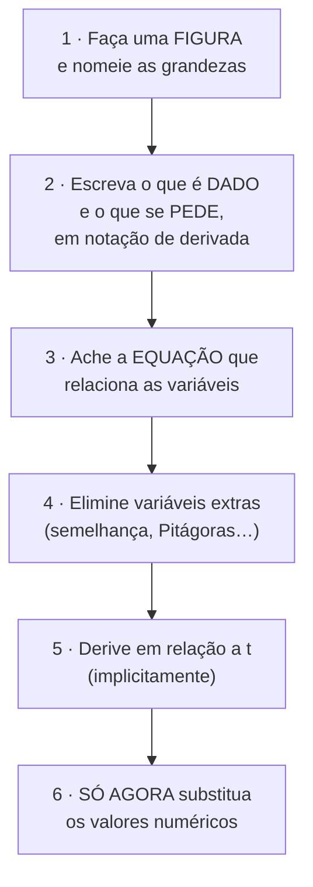
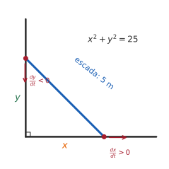
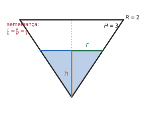

# 3.5 · Problemas de taxa de variação

| ← Anterior | 🏠 Índice | Próximo → |
| :--- | :---: | ---: |
| [3.4 · Trigonométricas inversas](3.4-derivadas-das-funcoes-trigonometricas-inversas.md) | [Unidade 3](README.md) · [Página inicial](../README.md) | [Unidade 4 · Aplicações](../04-aplicacoes-das-derivadas/README.md) |

---

## 🎯 O que você vai aprender

- Interpretar a derivada como **taxa de variação**, com as unidades corretas.
- Analisar **movimento retilíneo**: posição, velocidade e aceleração.
- Resolver problemas de **taxas relacionadas** por um roteiro de seis passos.
- Usar o **diferencial** para estimar variações pequenas.

**Pré-requisitos:** [3.3](3.3-regra-da-cadeia-e-derivada-da-funcao-inversa.md) — derivação implícita é o motor desta página inteira.

---

## Por que isso importa

Esta é a seção em que o Cálculo **sai do papel**. Até aqui você derivou expressões; agora vai responder perguntas como:

- a que velocidade o topo de uma escada desce quando o pé escorrega?
- quão rápido o nível da água sobe num tanque cônico?
- a que taxa a sombra de uma pessoa se alonga?

Todas têm a mesma estrutura: **duas ou mais grandezas variam no tempo e estão amarradas por uma equação geométrica**. Derivar essa equação em relação ao tempo transmite a taxa conhecida para a desconhecida.

É também a seção com mais erro de **montagem** do que de conta — e por isso a que mais se beneficia de um roteiro fixo.

---

## 1. Taxa de variação

> 📐 **Definição.** Se $y = f(x)$, a **taxa de variação média** de $y$ em relação a $x$ no intervalo $[a,\thinspace a+h]$ é
> $$\frac{\Delta y}{\Delta x} = \frac{f(a+h)-f(a)}{h}$$
> e a **taxa de variação instantânea** em $a$ é o limite disso, ou seja, $f'(a)$.

> [!IMPORTANT]
> **A unidade da derivada é "unidade de $y$ por unidade de $x$".** Se $V$ está em cm³ e $t$ em segundos, $\frac{dV}{dt}$ está em **cm³/s**. Escrever a unidade na resposta não é formalidade: é o jeito mais rápido de perceber que você montou a conta errada.

| Se $f$ é… | então $f'$ é… | unidade típica |
| --- | --- | --- |
| posição $s(t)$ | velocidade | m/s |
| velocidade $v(t)$ | aceleração | m/s² |
| volume $V(t)$ | vazão | m³/s |
| custo $C(q)$ | custo marginal | R\$/unidade |
| temperatura $T(t)$ | taxa de aquecimento | °C/min |

---

## 2. Movimento retilíneo

Para uma partícula que se move numa reta, com posição $s(t)$:

$$v(t) = s'(t) \qquad\qquad a(t) = v'(t) = s''(t)$$

| Pergunta | Como responder |
| --- | --- |
| Quando a partícula está **parada**? | $v(t) = 0$ |
| Quando ela **muda de sentido**? | $v$ **troca de sinal** |
| Quando se move para a **direita**? | $v(t) > 0$ |
| Quando está **acelerando** (ganhando rapidez)? | $v$ e $a$ com o **mesmo** sinal |
| Quando está **freando**? | $v$ e $a$ com sinais **opostos** |

> 💡 **Velocidade × rapidez.** A velocidade tem sinal (indica o sentido); a **rapidez** é $\lvert v(t)\rvert$. Um corpo com $v = -8$ m/s e $a = -2$ m/s² está **acelerando** — ficando mais rápido — ainda que a velocidade esteja diminuindo (ficando mais negativa). É o sinal **comum** que decide.

#### ✍️ Exemplo 1 — análise completa de um movimento

Uma partícula tem posição $s(t) = t^3 - 9t^2 + 24t$ metros, com $t \geqslant 0$ em segundos.

**Velocidade:**

$$v(t) = 3t^2 - 18t + 24 = 3\big(t^2-6t+8\big) = 3(t-2)(t-4)$$

**Aceleração:**

$$a(t) = 6t - 18 = 6(t-3)$$

**Quadro de sinais:**

| | $0<t<2$ | $2<t<3$ | $3<t<4$ | $t>4$ |
| --- | :---: | :---: | :---: | :---: |
| $v(t)$ | $+$ | $-$ | $-$ | $+$ |
| $a(t)$ | $-$ | $-$ | $+$ | $+$ |
| situação | freando | acelerando | freando | acelerando |

**Leitura:** a partícula **para** em $t=2$ s e $t=4$ s, e **muda de sentido** nos dois instantes. Entre $2$ e $4$ ela anda para trás.

---

## 3. Taxas relacionadas — o roteiro

> [!CAUTION]
> **O passo 6 é onde quase todo mundo erra.** Se você substituir $x=3$ **antes** de derivar, a variável vira constante e a sua derivada some — você obterá zero onde deveria haver uma taxa. **Primeiro derive, depois substitua.**

### 📊 Exemplo 2 — a escada que escorrega

Uma escada de $5$ m está apoiada numa parede vertical. O pé da escada é puxado horizontalmente a $1$ m/s. **A que velocidade o topo desce quando o pé está a $3$ m da parede?**

**Passos 1 e 2.** Sejam $x$ a distância do pé à parede e $y$ a altura do topo, **ambas funções do tempo**.

$$\text{Dado: } \frac{dx}{dt} = 1 \ \text{m/s} \qquad\qquad \text{Pede-se: } \frac{dy}{dt} \ \text{quando } x = 3$$

**Passo 3.** A escada é a hipotenusa, e o seu comprimento **não muda**:

$$x^2 + y^2 = 25$$

**Passo 5.** Derivando em relação a $t$ (regra da cadeia em cada termo):

$$2x\frac{dx}{dt} + 2y\frac{dy}{dt} = 0 \ \Longrightarrow \ \frac{dy}{dt} = -\frac{x}{y}\cdot\frac{dx}{dt}$$

**Passo 6.** Quando $x=3$, o Pitágoras dá $y = \sqrt{25-9} = 4$. Substituindo:

$$\frac{dy}{dt} = -\frac{3}{4}\cdot 1 = -0{,}75 \ \text{m/s}$$

**Resposta.** O topo desce a $0{,}75$ m/s.

> 💡 **O sinal negativo é informação, não erro:** ele diz que $y$ está **diminuindo**. Na resposta em português, traduza — "desce a $0{,}75$ m/s" — mas mantenha o sinal na conta.

### 📊 Exemplo 3 — o tanque cônico

Um tanque em forma de cone invertido tem raio $2$ m no topo e altura $3$ m. Água entra a $2$ m³/min. **Quão rápido o nível sobe quando a água tem $1{,}5$ m de profundidade?**

**Dados:** $\dfrac{dV}{dt} = 2$ m³/min. **Pede-se:** $\dfrac{dh}{dt}$ quando $h=1{,}5$.

**Equação:** o volume do cone de água é $V = \dfrac13\pi r^2 h$ — mas há **duas** variáveis além de $V$.

**Passo 4 — eliminar a variável extra.** Por semelhança de triângulos, a razão entre raio e altura é fixa:

$$\frac{r}{h} = \frac{2}{3} \ \Longrightarrow \ r = \frac{2h}{3}$$

Substituindo:

$$V = \frac13\pi\left(\frac{2h}{3}\right)^2 h = \frac13\pi\cdot\frac{4h^2}{9}\cdot h = \frac{4\pi}{27}h^3$$

**Passo 5 — derivar:**

$$\frac{dV}{dt} = \frac{4\pi}{27}\cdot 3h^2\frac{dh}{dt} = \frac{4\pi}{9}h^2\frac{dh}{dt}$$

**Passo 6 — substituir** $h = 1{,}5$ e $\frac{dV}{dt}=2$:

$$2 = \frac{4\pi}{9}\cdot(1{,}5)^2\cdot\frac{dh}{dt} = \frac{4\pi}{9}\cdot 2{,}25\cdot\frac{dh}{dt} = \pi\frac{dh}{dt}$$

$$\frac{dh}{dt} = \frac{2}{\pi} \approx 0{,}64 \ \text{m/min}$$

> [!IMPORTANT]
> **O passo 4 é o que decide o problema.** Sem eliminar $r$, você teria uma equação com três taxas e nenhuma informação sobre $\frac{dr}{dt}$. Procure sempre a relação geométrica — **semelhança de triângulos** e **Pitágoras** resolvem a grande maioria dos casos.

### ✍️ Exemplo 4 — o balão

Ar é bombeado para dentro de um balão esférico a $100$ cm³/s. **Quão rápido o raio cresce quando ele mede $25$ cm?**

**Equação:** $V = \dfrac43\pi r^3$.

**Derivando:**

$$\frac{dV}{dt} = 4\pi r^2\frac{dr}{dt}$$

**Substituindo** $\frac{dV}{dt} = 100$ e $r=25$:

$$100 = 4\pi(625)\frac{dr}{dt} \ \Longrightarrow \ \frac{dr}{dt} = \frac{100}{2500\pi} = \frac{1}{25\pi} \approx 0{,}0127 \ \text{cm/s}$$

> 💡 **Repare no comportamento:** quanto maior o balão, **mais devagar** o raio cresce, mesmo com vazão constante — porque o fator $4\pi r^2$ (a área da superfície) cresce. É o mesmo motivo de uma bolha grande parecer "parada" enquanto uma pequena incha visivelmente.

---

## 4. Diferencial e aproximação linear

> 📐 **Definição.** Para $y = f(x)$, o **diferencial** é
> $$dy = f'(x)\thinspace dx$$
> Ele estima a variação de $y$ provocada por uma variação pequena $dx = \Delta x$:
> $$\Delta y \approx dy = f'(x)\thinspace \Delta x$$

Geometricamente: **em vez de andar pela curva, ande pela reta tangente**. Para $\Delta x$ pequeno, a diferença é desprezível.

#### ✍️ Exemplo 5 — estimando sem calculadora

Estime $\sqrt{4{,}1}$.

**Solução.** Tome $f(x) = \sqrt x$, $x = 4$ (onde a raiz é exata) e $\Delta x = 0{,}1$.

$$f'(x) = \frac{1}{2\sqrt x} \ \Longrightarrow \ f'(4) = \frac14$$

$$\sqrt{4{,}1} \approx f(4) + f'(4)\cdot 0{,}1 = 2 + 0{,}025 = 2{,}025$$

*(O valor exato é $2{,}02485\ldots$ — erro de $0{,}0002$.)*

#### ✍️ Exemplo 6 — propagação de erro

O raio de uma esfera é medido como $10$ cm, com erro possível de $0{,}05$ cm. **Qual o erro possível no volume calculado?**

$$V = \frac43\pi r^3 \ \Longrightarrow \ dV = 4\pi r^2\thinspace dr$$

$$dV = 4\pi(100)(0{,}05) = 20\pi \approx 62{,}8 \ \text{cm}^3$$

**Erro relativo:**

$$\frac{dV}{V} = \frac{4\pi r^2\thinspace dr}{\frac43\pi r^3} = 3\cdot\frac{dr}{r} = 3\cdot\frac{0{,}05}{10} = 0{,}015$$

ou seja, **1,5%**.

> 💡 **Um erro de $0{,}5$% no raio vira $1{,}5$% no volume** — o expoente $3$ **triplica** o erro relativo. É por isso que medições de grandezas elevadas a potências altas exigem instrumentos mais precisos.

---

## ⚠️ Armadilhas

| O erro | Por que está errado | O certo |
| --- | --- | --- |
| substituir os valores antes de derivar | a variável vira constante e a taxa some | derive, **depois** substitua |
| esquecer o $\frac{dx}{dt}$ ao derivar $x^2$ | é derivação implícita no tempo | $2x\frac{dx}{dt}$ |
| usar $V = \frac13\pi r^2h$ sem eliminar $r$ | sobram duas incógnitas | use a semelhança |
| ignorar o sinal da taxa | o sinal diz se cresce ou diminui | negativo = diminuindo |
| responder sem unidade | metade da informação se perde | sempre m/s, cm³/s… |
| confundir velocidade com rapidez | rapidez é $\lvert v\rvert$ | para acelerando/freando, compare os **sinais** de $v$ e $a$ |
| achar que "escada escorregando" tem taxa constante nos dois lados | $\frac{dy}{dt} = -\frac xy\frac{dx}{dt}$ **depende** de $x$ e $y$ | recalcule em cada instante |

---

## 🧠 Exercícios resolvidos

### Exercício Resolvido 1

**Uma pessoa de $2$ m de altura afasta-se de um poste de $5$ m a $1{,}5$ m/s. (a) A que taxa cresce o comprimento da sua sombra? (b) A que velocidade move-se a ponta da sombra?**

**Solução.**

**Montagem.** Seja $x$ a distância da pessoa ao poste e $s$ o comprimento da sombra. Os triângulos (poste e pessoa) são **semelhantes**:

$$\frac{5}{x+s} = \frac{2}{s} \ \Longrightarrow \ 5s = 2x+2s \ \Longrightarrow \ 3s = 2x \ \Longrightarrow \ s = \frac{2x}{3}$$

**(a) Derivando** em relação a $t$:

$$\frac{ds}{dt} = \frac23\cdot\frac{dx}{dt} = \frac23\cdot 1{,}5 = 1 \ \text{m/s}$$

**(b) A ponta da sombra** está a uma distância $x+s$ do poste:

$$\frac{d}{dt}(x+s) = 1{,}5 + 1 = 2{,}5 \ \text{m/s}$$

> 💡 **Note que a resposta não depende de $x$:** a sombra cresce a $1$ m/s **sempre**, esteja a pessoa perto ou longe do poste. É uma consequência de a relação $s = \frac{2x}{3}$ ser **linear**.

---

### Exercício Resolvido 2

**Dois carros partem do mesmo ponto. Um vai para o norte a $60$ km/h; o outro, para o leste a $80$ km/h. A que taxa a distância entre eles cresce após $2$ horas?**

**Solução.**

**Montagem.** Sejam $x$ (leste) e $y$ (norte) as distâncias percorridas e $z$ a distância entre os carros. Como as direções são perpendiculares:

$$z^2 = x^2+y^2$$

**Derivando:**

$$2z\frac{dz}{dt} = 2x\frac{dx}{dt} + 2y\frac{dy}{dt} \ \Longrightarrow \ \frac{dz}{dt} = \frac{x\frac{dx}{dt} + y\frac{dy}{dt}}{z}$$

**Substituindo** ($t=2$ h): $x = 160$ km, $y = 120$ km e

$$z = \sqrt{160^2+120^2} = \sqrt{25600+14400} = \sqrt{40000} = 200 \ \text{km}$$

$$\frac{dz}{dt} = \frac{160\cdot80 + 120\cdot60}{200} = \frac{12800+7200}{200} = \frac{20000}{200} = 100 \ \text{km/h}$$

**Resposta.** $100$ km/h.

> 💡 **Conferência rápida:** $\sqrt{60^2+80^2} = 100$. Como as velocidades são constantes e as trajetórias retas, a taxa de afastamento é constante e igual ao módulo da velocidade relativa. O resultado podia ser previsto — mas a conta geral vale para casos em que as velocidades mudam.

---

### Exercício Resolvido 3

**Um tanque cilíndrico de raio $3$ m é esvaziado a $5$ m³/min. A que taxa o nível da água baixa?**

**Solução.** O volume de água é $V = \pi r^2 h$ com $r=3$ **constante**:

$$V = 9\pi h$$

Derivando:

$$\frac{dV}{dt} = 9\pi\frac{dh}{dt} \ \Longrightarrow \ -5 = 9\pi\frac{dh}{dt} \ \Longrightarrow \ \frac{dh}{dt} = -\frac{5}{9\pi} \approx -0{,}177 \ \text{m/min}$$

**Resposta.** O nível baixa a aproximadamente $0{,}18$ m/min — **constantemente**.

> 💡 **Compare com o cone do Exemplo 3.** No cilindro a taxa é constante; no cone, não — porque a área da superfície livre muda com a altura. A geometria do recipiente é tudo.

---

### Exercício Resolvido 4

**Uma partícula tem posição $s(t) = t^4 - 4t^3$, $t\geqslant0$, em metros. Determine quando ela está acelerando.**

**Solução.**

$$v(t) = 4t^3-12t^2 = 4t^2(t-3)$$
$$a(t) = 12t^2-24t = 12t(t-2)$$

**Sinais** (para $t>0$):

| | $0<t<2$ | $2<t<3$ | $t>3$ |
| --- | :---: | :---: | :---: |
| $v$ | $-$ | $-$ | $+$ |
| $a$ | $-$ | $+$ | $+$ |
| mesmo sinal? | **sim** | não | **sim** |

**Resposta.** A partícula está acelerando em $(0,\thinspace 2)$ e em $(3,\thinspace +\infty)$; está freando em $(2,\thinspace 3)$.

---

### Exercício Resolvido 5

**Use diferenciais para estimar $\operatorname{sen}(31°)$, sabendo que $\operatorname{sen} 30° = 0{,}5$ e $\cos 30° = \frac{\sqrt3}{2}$.**

**Solução.** **Converta para radianos** — é obrigatório, porque a derivada do seno pressupõe radianos:

$$30° = \frac{\pi}{6} \qquad \Delta x = 1° = \frac{\pi}{180} \approx 0{,}01745$$

Com $f(x) = \operatorname{sen} x$ e $f'(x) = \cos x$:

$$\operatorname{sen}(31°) \approx \operatorname{sen}\frac\pi6 + \cos\frac\pi6\cdot\frac{\pi}{180} = 0{,}5 + \frac{\sqrt3}{2}\cdot 0{,}01745 \approx 0{,}5+0{,}0151 = 0{,}5151$$

*(O valor exato é $0{,}51504$ — erro na quinta casa.)*

> ⚠️ Esquecer a conversão para radianos e usar $\Delta x = 1$ daria $0{,}5+0{,}866 = 1{,}37$ — um valor **impossível** para um seno. Conferir a plausibilidade da resposta pega esse erro na hora.

---

### Exercício Resolvido 6

**Um holofote no chão ilumina uma parede a $12$ m de distância. Um homem de $2$ m anda do holofote em direção à parede a $1{,}6$ m/s. A que taxa o comprimento da sua sombra na parede diminui quando ele está a $4$ m da parede?**

**Solução.**

**Montagem.** Seja $x$ a distância do **holofote** ao homem, e $S$ a altura da sombra na parede. Por semelhança:

$$\frac{S}{12} = \frac{2}{x} \ \Longrightarrow \ S = \frac{24}{x}$$

**Derivando** (regra da potência, com $S = 24x^{-1}$):

$$\frac{dS}{dt} = -\frac{24}{x^2}\cdot\frac{dx}{dt}$$

**Substituindo.** Se o homem está a $4$ m da **parede**, está a $x = 12-4 = 8$ m do holofote. E $\frac{dx}{dt} = 1{,}6$ m/s (ele se **afasta** do holofote):

$$\frac{dS}{dt} = -\frac{24}{64}\cdot 1{,}6 = -0{,}6 \ \text{m/s}$$

**Resposta.** A sombra encolhe a $0{,}6$ m/s.

> ⚠️ **Duas armadilhas neste problema:** (1) a distância dada é até a **parede**, mas a variável natural é até o **holofote** — leia o enunciado duas vezes; (2) o sinal negativo é esperado, porque a sombra diminui à medida que o homem se aproxima da parede.

---

## 📝 Agora é com você

➡️ **[Lista 3.5 — exercícios propostos](exercicios/lista-3.5-propostos.md)** · ✅ **[Gabarito](gabaritos/gabarito-3.5.md)**

E, para fechar a unidade: ➡️ **[Revisão da Unidade 3](exercicios/revisao-unidade-3.md)**

---

## Resumo da página

> **Decore:**
> - $v = s'$ e $a = v' = s''$; **acelerando** ⟺ $v$ e $a$ com o mesmo sinal.
> - $\Delta y \approx f'(x)\thinspace \Delta x$ — a reta tangente substitui a curva.
> - Unidade da derivada: *unidade de cima por unidade de baixo*.
>
> **Saiba fazer (o roteiro):**
> 1. figura e nomes · 2. dado e pedido em notação de derivada · 3. equação que relaciona
> 4. eliminar variáveis extras · 5. derivar em relação a $t$ · 6. **só então** substituir.
>
> **Nunca:** substituir valores antes de derivar.

---

## 📚 Para aprofundar

| Livro | Onde procurar |
| --- | --- |
| **LEITHOLD** | Capítulo 3 — "Taxas relacionadas"; "Movimento retilíneo" |
| **STEWART** | Capítulo 3 — "Taxas relacionadas"; "Aproximações lineares e diferenciais" |
| **THOMAS** | Capítulo 3 — "Taxas relacionadas"; "Linearização e diferenciais" |
| **ANTON** | Capítulo 3 — "Taxas relacionadas"; "Aproximação local linear; diferenciais" |
| **SWOKOWSKI** | Capítulo 3 — "Taxas relacionadas" |
| **MUNEM & FOULIS** | Capítulo 3 — "Taxas relacionadas e diferenciais" |

---

| ← Anterior | 🏠 Índice | Próximo → |
| :--- | :---: | ---: |
| [3.4 · Trigonométricas inversas](3.4-derivadas-das-funcoes-trigonometricas-inversas.md) | [Unidade 3](README.md) · [Página inicial](../README.md) | [Unidade 4 · Aplicações das derivadas](../04-aplicacoes-das-derivadas/README.md) |

*Sobrevivendo ao Cálculo 1 (UENF)* · por **Nicolau Prates** · [CC BY-SA 4.0](../LICENSE)
