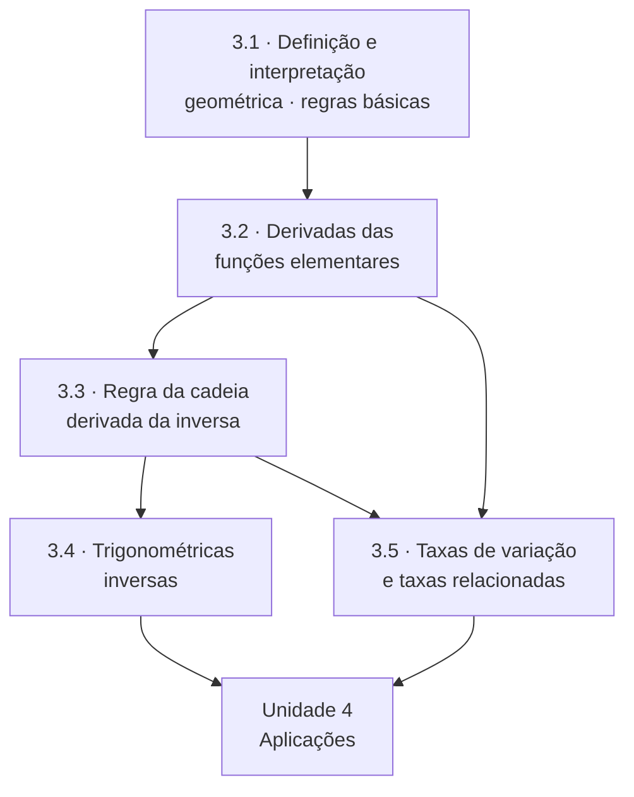

# Unidade 3 · Derivadas: conceito e regras

> [!NOTE]
> 🚧 **Unidade em construção.** As páginas abaixo estão sendo escritas e publicadas em ordem. Enquanto isso, o índice já serve de roteiro de estudo.

> Derivada é taxa de variação instantânea — e, geometricamente, a inclinação da reta tangente. Esta unidade transforma esse conceito em um conjunto de regras que você vai usar até o fim do curso de engenharia.

---

## 🎯 Objetivos da unidade

- Calcular a derivada **pela definição** (limite do quociente de Newton) e interpretar o resultado.
- Obter a equação da **reta tangente** e da **reta normal** a uma curva em um ponto.
- Aplicar com fluência as regras da soma, do produto, do quociente e da potência.
- Derivar as funções elementares: polinomiais, racionais, trigonométricas, exponenciais e logarítmicas.
- Dominar a **regra da cadeia** — a regra mais usada do Cálculo — e a derivada da **função inversa**.
- Derivar as **trigonométricas inversas**.
- Resolver problemas de **taxas relacionadas**.

---

## 🗺️ Mapa da unidade

---

## 📚 Conteúdo

| # | Teoria | 📝 Propostos | ✅ Gabarito |
| :---: | --- | :---: | :---: |
| 3.1 | [Conceito, interpretação geométrica e regras básicas](3.1-conceito-interpretacao-geometrica-e-regras-basicas.md) | [lista](exercicios/lista-3.1-propostos.md) | [gabarito](gabaritos/gabarito-3.1.md) |
| 3.2 | [Derivadas das funções elementares](3.2-derivadas-das-funcoes-elementares.md) | [lista](exercicios/lista-3.2-propostos.md) | [gabarito](gabaritos/gabarito-3.2.md) |
| 3.3 | [Regra da cadeia e derivada da função inversa](3.3-regra-da-cadeia-e-derivada-da-funcao-inversa.md) | [lista](exercicios/lista-3.3-propostos.md) | [gabarito](gabaritos/gabarito-3.3.md) |
| 3.4 | [Derivadas das funções trigonométricas inversas](3.4-derivadas-das-funcoes-trigonometricas-inversas.md) | [lista](exercicios/lista-3.4-propostos.md) | [gabarito](gabaritos/gabarito-3.4.md) |
| 3.5 | [Problemas de taxa de variação](3.5-problemas-de-taxa-de-variacao.md) | [lista](exercicios/lista-3.5-propostos.md) | [gabarito](gabaritos/gabarito-3.5.md) |
| 🧪 | **Revisão da unidade** | [lista](exercicios/revisao-unidade-3.md) | [gabarito](gabaritos/gabarito-revisao-unidade-3.md) |

**Pré-requisito:** [Unidade 2](../02-limites-e-continuidade/README.md) — a derivada **é** um limite.
**Consulte sempre:** [A1 · Tabela de derivadas](../06-formulario/A1-tabela-de-derivadas.md).

---

## ✅ Checklist de autoavaliação

- [ ] Derivar $f(x) = \sqrt{x}$ pela definição, sem usar a regra da potência.
- [ ] Escrever a equação da reta tangente a $y = x^3 - 2x$ no ponto de abscissa $1$.
- [ ] Explicar por que $\lvert x \rvert$ é contínua mas não derivável em $x = 0$.
- [ ] Derivar $f(x) = \dfrac{x^2 \sin x}{e^x}$ sem errar a ordem das regras.
- [ ] Aplicar a regra da cadeia com três camadas, como em $\sin^2(\ln(3x))$.
- [ ] Derivar implicitamente e obter $\frac{dy}{dx}$ a partir de $x^2 + y^2 = 25$.
- [ ] Resolver um problema de escada deslizando pela parede sem errar a montagem.

---

## ⚠️ Os erros clássicos desta unidade

1. **Esquecer a derivada de dentro na regra da cadeia.** Escrever $(\sin(3x))' = \cos(3x)$ custa a questão inteira — falta o fator $3$.
2. **Derivar numerador e denominador separadamente.** $\left(\frac{u}{v}\right)' \neq \frac{u'}{v'}$. A regra do quociente existe por um motivo.
3. **Confundir $f'(a)$ com $f'(x)$.** O primeiro é um **número** (a inclinação naquele ponto); o segundo é uma **função**. Em taxas relacionadas, essa confusão derruba a montagem do problema.

---

| ← Anterior | 🏠 Índice | Próximo → |
| :--- | :---: | ---: |
| [Unidade 2 · Limites](../02-limites-e-continuidade/README.md) | [Página inicial](../README.md) | [Unidade 4 · Aplicações](../04-aplicacoes-das-derivadas/README.md) |

*Sobrevivendo ao Cálculo 1 (UENF)* · por **Nicolau Prates** · [CC BY-SA 4.0](../LICENSE)
