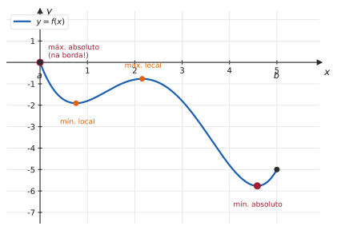
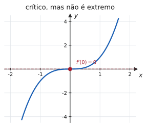
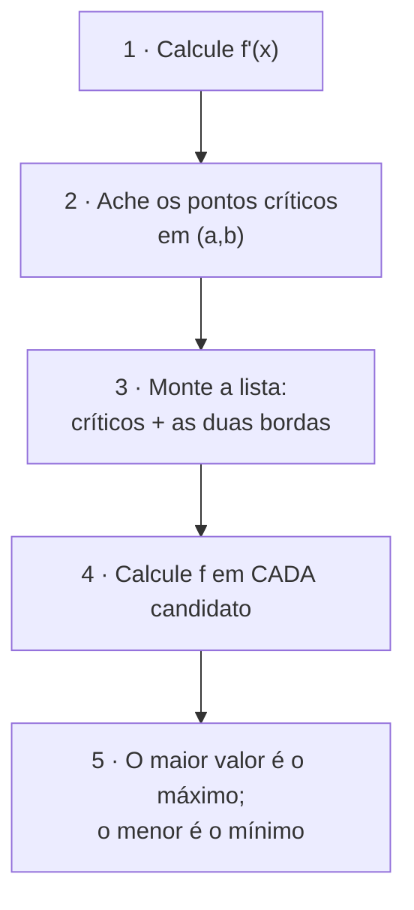
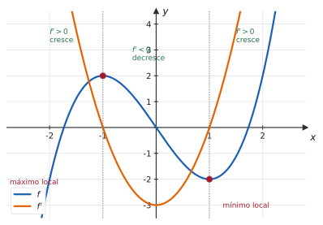
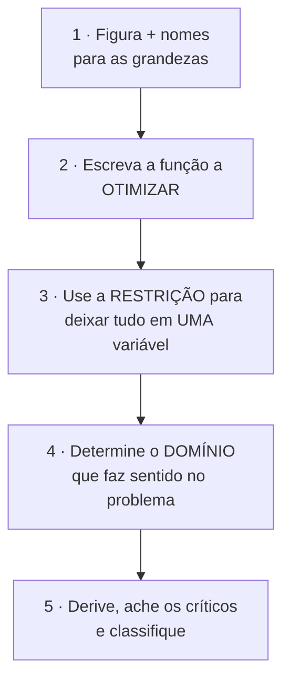
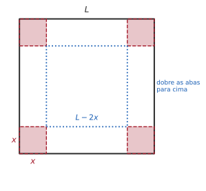

# 4.1 · Máximos e mínimos

| ← Anterior | 🏠 Índice | Próximo → |
| :--- | :---: | ---: |
| [Unidade 3 · Derivadas](../03-derivadas/README.md) | [Unidade 4](README.md) · [Página inicial](../README.md) | [4.2 · Rolle e Valor Médio](4.2-teoremas-de-rolle-e-do-valor-medio.md) |

---

## 🎯 O que você vai aprender

- Distinguir extremos **locais** de **absolutos**.
- Encontrar **pontos críticos** e entender por que eles são apenas **candidatos**.
- Aplicar o **método dos candidatos** em intervalos fechados.
- Classificar extremos pelos testes da **primeira** e da **segunda** derivada.
- Resolver **problemas de otimização** por um roteiro de cinco passos.

**Pré-requisitos:** [Unidade 3](../03-derivadas/README.md) inteira e o [Teorema de Weierstrass de 2.5](../02-limites-e-continuidade/2.5-continuidade-e-tipos-de-descontinuidade.md).

---

## Por que isso importa

"Qual é o maior lucro possível?", "qual o menor custo?", "qual o caminho mais curto?", "qual a dose que maximiza o efeito?" — otimizar é a pergunta mais frequente da engenharia, da economia e da física.

A derivada responde porque, num pico ou num vale, a **tangente é horizontal**. Transformar "encontre o máximo" em "resolva $f'(x) = 0$" é a ideia que torna o Cálculo indispensável na prática.

---

## 1. Extremos locais e absolutos

> 📐 **Definição 4.1.1.** Seja $f$ definida num conjunto $D$ e $c \in D$.
>
> - $f(c)$ é **máximo absoluto** se $f(c) \geqslant f(x)$ para **todo** $x \in D$;
> - $f(c)$ é **máximo local** se $f(c) \geqslant f(x)$ para todo $x$ **em algum intervalo aberto** contendo $c$.
>
> As definições de mínimo são análogas, trocando $\geqslant$ por $\leqslant$.

> 📊 **Leia a figura com atenção**, porque ela contém as quatro situações:
> - um **mínimo local** em $x \approx 0{,}85$ — é o menor valor **da vizinhança**, não da função toda;
> - um **máximo local** em $x\approx 2{,}2$;
> - o **mínimo absoluto** em $x \approx 4{,}6$, que também é local;
> - o **máximo absoluto** em $x = a$, **na borda** do intervalo — e esse **não** é local, porque não existe intervalo aberto em torno de $a$ dentro do domínio.

> [!IMPORTANT]
> **Todo extremo absoluto no interior também é local; o contrário é falso.** E extremos absolutos podem ocorrer **na borda**, onde a derivada não precisa ser zero. Esquecer as bordas é o erro número um desta seção.

### Quando a existência é garantida

> 📐 **Teorema 4.1.1 (Weierstrass).** Se $f$ é **contínua** num intervalo **fechado e limitado** $[a,b]$, então $f$ assume máximo e mínimo absolutos em $[a,b]$.

É o teorema de [2.5](../02-limites-e-continuidade/2.5-continuidade-e-tipos-de-descontinuidade.md), e é ele que **autoriza** o método dos candidatos: sabendo que os extremos existem, basta procurá-los numa lista finita de lugares.

---

## 2. Pontos críticos e o Teorema de Fermat

> 📐 **Teorema 4.1.2 (Fermat).** Se $f$ tem um extremo **local** em $c$, e se $f'(c)$ **existe**, então
> $$f'(c) = 0$$

**Por quê.** Num máximo local, a função sobe antes de $c$ e desce depois. A derivada à esquerda é $\geqslant 0$ e à direita é $\leqslant 0$; se ela existe, as duas têm de coincidir — e o único número que é ao mesmo tempo $\geqslant 0$ e $\leqslant 0$ é zero.

> 📐 **Definição 4.1.2 (Ponto crítico).** $c$ é **ponto crítico** de $f$ quando $c$ está no domínio de $f$ e
> $$f'(c) = 0 \qquad \text{ou} \qquad f'(c) \text{ não existe}$$

> [!CAUTION]
> **Fermat é uma via de mão única.** Ele diz "extremo local interior ⟹ ponto crítico". A recíproca é **falsa**: ponto crítico pode não ser extremo nenhum.

> 📊 Em $f(x)=x^3$, tem-se $f'(0)=0$ — a tangente é horizontal na origem. Mas a função **continua subindo**: não há pico nem vale. O ponto crítico era apenas **candidato**, e foi reprovado.

> 💡 **Os dois tipos de ponto crítico.** Em $f(x) = x^2$, o crítico vem de $f'=0$ (tangente horizontal). Em $f(x) = \lvert x\rvert$, vem de $f'$ **não existir** (bico) — e ali há um mínimo de verdade. Procure os dois tipos.

---

## 3. O método dos candidatos

Para achar os extremos **absolutos** de $f$ contínua em $[a,b]$:

> [!TIP]
> **Não é preciso classificar os críticos.** Como Weierstrass garante que os extremos existem e Fermat garante que eles estão na lista, basta **comparar os valores**. Aqui, nenhum teste de derivada é necessário — o que torna o método rápido e seguro.

#### ✍️ Exemplo 1 — método dos candidatos

Determine os extremos absolutos de $f(x) = x^3-3x^2+1$ em $[-1,\thinspace 3]$.

**Solução.**

**Passo 1–2.** $f'(x) = 3x^2-6x = 3x(x-2)$, que zera em $x=0$ e $x=2$. Ambos pertencem a $(-1,3)$ ✔

**Passo 3.** Candidatos: $-1$, $0$, $2$, $3$.

**Passo 4.**

| $x$ | $-1$ | $0$ | $2$ | $3$ |
| :---: | :---: | :---: | :---: | :---: |
| $f(x)$ | $-3$ | $1$ | $-3$ | $1$ |

**Passo 5.**

- **Máximo absoluto:** $1$, atingido em $x=0$ **e** em $x=3$.
- **Mínimo absoluto:** $-3$, atingido em $x=-1$ **e** em $x=2$.

> 💡 **Extremos podem ocorrer em mais de um ponto** — o que é único é o **valor**, não o local.

---

## 4. Classificando os extremos locais

Quando o intervalo **não** é fechado, ou quando a pergunta é sobre extremos **locais**, é preciso classificar os pontos críticos.

### Teste da primeira derivada

> 📐 **Teorema 4.1.3.** Seja $c$ ponto crítico de $f$, contínua em $c$.
>
> | Sinal de $f'$ antes de $c$ | Sinal depois | Conclusão |
> | :---: | :---: | --- |
> | $+$ | $-$ | **máximo local** |
> | $-$ | $+$ | **mínimo local** |
> | mesmo sinal | mesmo sinal | **nem máximo nem mínimo** |

> 📊 A leitura é a mesma do [quadro de sinais de 1.1](../01-funcoes/1.1-numeros-reais-intervalos-valor-absoluto-desigualdades.md): **monte o quadro de sinais de $f'$** e veja onde ele troca. De $+$ para $-$, pico; de $-$ para $+$, vale.

#### ✍️ Exemplo 2 — teste da primeira derivada

Classifique os pontos críticos de $f(x) = x^3-3x$.

**Solução.** $f'(x) = 3x^2-3 = 3(x-1)(x+1)$, com críticos em $x=\pm1$.

| | $x<-1$ | $-1<x<1$ | $x>1$ |
| --- | :---: | :---: | :---: |
| $f'(x)$ | $+$ | $-$ | $+$ |
| $f$ | cresce | decresce | cresce |

- Em $x=-1$: $+$ para $-$ → **máximo local**, de valor $f(-1) = 2$.
- Em $x=1$: $-$ para $+$ → **mínimo local**, de valor $f(1) = -2$.

> [!NOTE]
> **Esta função não tem extremos absolutos** em $\mathbb{R}$: $f(x)\to+\infty$ quando $x\to+\infty$ e $\to-\infty$ quando $x\to-\infty$. Weierstrass não se aplica, porque $\mathbb{R}$ não é limitado — e, de fato, não há máximo nem mínimo globais.

### Teste da segunda derivada

> 📐 **Teorema 4.1.4.** Seja $f'(c) = 0$ e $f''$ contínua perto de $c$.
> - Se $f''(c) > 0$, então $c$ é **mínimo local** (concavidade para cima — "cara feliz").
> - Se $f''(c) < 0$, então $c$ é **máximo local** (concavidade para baixo).
> - Se $f''(c) = 0$, **o teste falha** — use o da primeira derivada.

#### ✍️ Exemplo 3 — o mesmo exemplo, pela segunda derivada

Com $f(x)=x^3-3x$: $f''(x) = 6x$.

- $f''(-1) = -6 < 0$ → **máximo local** ✔
- $f''(1) = 6 > 0$ → **mínimo local** ✔

Mesma conclusão, com menos trabalho.

> [!WARNING]
> **Quando $f''(c)=0$, o teste não decide — e não significa que não haja extremo.** Compare: em $f(x)=x^4$, tem-se $f''(0)=0$ e há um **mínimo**; em $f(x)=x^3$, também $f''(0)=0$ e **não há extremo**. Nesses casos, volte ao teste da primeira derivada, que nunca falha.

| | Teste da 1ª derivada | Teste da 2ª derivada |
| --- | --- | --- |
| **Vantagem** | nunca falha; serve para críticos sem derivada | costuma ser mais rápido |
| **Desvantagem** | exige montar quadro de sinais | falha quando $f''(c)=0$ |

---

## 5. Problemas de otimização

É a aplicação mais cobrada em prova. O roteiro:

> [!IMPORTANT]
> **O passo 4 é o mais esquecido.** Em [1.2](../01-funcoes/1.2-funcoes-dominio-contradominio-imagem.md#exercício-resolvido-21) você já viu a diferença entre o domínio da **fórmula** e o domínio do **problema**: uma caixa não tem lado negativo. É esse domínio que diz se você deve usar o método dos candidatos (intervalo fechado) ou um teste de derivada (intervalo aberto).

### 📊 Exemplo 4 — a caixa de volume máximo

De uma folha quadrada de cartolina de $30$ cm de lado, recortam-se quadrados de lado $x$ nos quatro cantos; dobrando as abas, obtém-se uma caixa sem tampa. **Qual $x$ maximiza o volume?**

**Passos 1–3.** A caixa tem altura $x$ e base quadrada de lado $30-2x$:

$$V(x) = x\thinspace (30-2x)^2$$

**Passo 4 — domínio do problema:** $x>0$ (tem de haver altura) e $30-2x>0$ (tem de sobrar base), logo

$$0 < x < 15$$

**Passo 5.** Expanda antes de derivar:

$$V(x) = x\big(900 - 120x + 4x^2\big) = 4x^3 - 120x^2 + 900x$$

$$V'(x) = 12x^2 - 240x + 900 = 12\big(x^2-20x+75\big) = 12(x-5)(x-15)$$

Os críticos são $x=5$ e $x=15$ — mas $15$ está **fora** do domínio do problema. Resta $x=5$.

**Classificando:** $V''(x) = 24x-240$, logo $V''(5) = -120 < 0$ → **máximo**.

$$V(5) = 5(30-10)^2 = 5\cdot400 = 2000 \ \text{cm}^3$$

**Resposta.** Recortando quadrados de $5$ cm, o volume máximo é $2000$ cm³.

> 💡 Note como o passo 4 fez trabalho real: **ele eliminou um dos dois candidatos**, sem precisar de teste nenhum.

### ✍️ Exemplo 5 — a lata de menor custo

Uma lata cilíndrica deve ter volume $500$ cm³. **Quais as dimensões que minimizam a área de material?**

**Função a otimizar:** área total (fundo + tampa + lateral):

$$A = 2\pi r^2 + 2\pi r h$$

**Restrição:** $V = \pi r^2 h = 500$, logo $h = \dfrac{500}{\pi r^2}$.

**Substituindo:**

$$A(r) = 2\pi r^2 + 2\pi r\cdot\frac{500}{\pi r^2} = 2\pi r^2 + \frac{1000}{r}, \qquad r>0$$

**Derivando:**

$$A'(r) = 4\pi r - \frac{1000}{r^2} = 0 \ \Longrightarrow \ 4\pi r^3 = 1000 \ \Longrightarrow \ r = \sqrt[3]{\frac{250}{\pi}} \approx 4{,}30 \ \text{cm}$$

**Classificando:** $A''(r) = 4\pi + \dfrac{2000}{r^3} > 0$ para todo $r>0$ → **mínimo** ✔

**Altura correspondente:**

$$h = \frac{500}{\pi r^2} \approx \frac{500}{\pi(18{,}5)} \approx 8{,}60 \ \text{cm}$$

**Resposta.** $r \approx 4{,}3$ cm e $h \approx 8{,}6$ cm — ou seja, $h = 2r$: **a lata ótima tem altura igual ao diâmetro.**

> 💡 **E por que as latas reais não são assim?** Porque o modelo ignora a solda da lateral, a espessura diferente da tampa e o empilhamento nas prateleiras. Otimização dá a resposta do **modelo** — avaliar se o modelo descreve a realidade continua sendo trabalho do engenheiro.

---

## ⚠️ Armadilhas

| O erro | Por que está errado | O certo |
| --- | --- | --- |
| esquecer as **bordas** do intervalo | o máximo pode estar lá | inclua $a$ e $b$ na lista |
| "crítico, logo é extremo" | $x^3$ é contraexemplo | classifique ou compare valores |
| procurar críticos só onde $f'=0$ | há também onde $f'$ **não existe** | bicos contam |
| usar o teste da 2ª derivada com $f''(c)=0$ | o teste falha | volte à 1ª derivada |
| esquecer o domínio do problema | $x=15$ não dá caixa | determine o intervalo real |
| aplicar Weierstrass em intervalo aberto | o teorema exige fechado e limitado | em aberto, pode não haver extremo |
| responder só o $x$ | o enunciado pede o **valor ótimo** | dê também $V$, $A$, o lucro… |
| confundir máximo local com absoluto | local é só na vizinhança | compare com os outros candidatos |

---

## 🧠 Exercícios resolvidos

### Exercício Resolvido 1

**Determine os extremos absolutos de $f(x) = x^4-8x^2+3$ em $[-3,\thinspace 1]$.**

**Solução.**

$$f'(x) = 4x^3-16x = 4x\big(x^2-4\big) = 4x(x-2)(x+2)$$

**Críticos:** $x=0$, $x=2$, $x=-2$. Dentro de $(-3,1)$ estão apenas $x=0$ e $x=-2$ (o ponto $2$ fica fora).

**Candidatos:** $-3$, $-2$, $0$, $1$.

| $x$ | $-3$ | $-2$ | $0$ | $1$ |
| :---: | :---: | :---: | :---: | :---: |
| $f(x)$ | $81-72+3 = 12$ | $16-32+3 = -13$ | $3$ | $1-8+3=-4$ |

**Resposta.** Máximo absoluto $12$, em $x=-3$ (borda); mínimo absoluto $-13$, em $x=-2$.

---

### Exercício Resolvido 2

**Classifique os pontos críticos de $f(x) = x e^{-x}$.**

**Solução.** Do [gabarito da revisão da Unidade 3](../03-derivadas/gabaritos/gabarito-revisao-unidade-3.md): $f'(x) = e^{-x}(1-x)$, que zera só em $x=1$.

**Teste da segunda derivada:** $f''(x) = e^{-x}(x-2)$, logo

$$f''(1) = e^{-1}(-1) < 0 \ \Longrightarrow \ \textbf{máximo local}$$

O valor é $f(1) = \dfrac1e \approx 0{,}368$.

> 💡 Esse também é o **máximo absoluto**: para $x<0$ a função é negativa, e para $x\to+\infty$ ela tende a $0$ por valores positivos. Mas note que Weierstrass **não** foi usado aqui — o domínio é $\mathbb{R}$, e a conclusão veio da análise do comportamento nos extremos.

---

### Exercício Resolvido 3

**Um fazendeiro tem $200$ m de cerca e quer cercar um terreno retangular, usando um rio reto como um dos lados (que não precisa de cerca). Qual a área máxima?**

**Solução.**

**Montagem.** Sejam $x$ os dois lados perpendiculares ao rio e $y$ o lado paralelo. A cerca cobre três lados:

$$2x + y = 200 \ \Longrightarrow \ y = 200-2x$$

**Função a otimizar:**

$$A(x) = x\thinspace y = x(200-2x) = 200x - 2x^2$$

**Domínio do problema:** $x>0$ e $y = 200-2x>0$, logo $0<x<100$.

**Derivando:**

$$A'(x) = 200-4x = 0 \ \Longrightarrow \ x = 50$$

**Classificando:** $A''(x) = -4 < 0$ → **máximo**.

$$y = 200-100 = 100 \qquad A = 50\cdot100 = 5000 \ \text{m}^2$$

**Resposta.** O terreno de $50$ m por $100$ m, com área máxima de $5000$ m².

> 💡 **O padrão vale sempre nesse tipo de problema:** o lado paralelo ao rio é **o dobro** de cada lado perpendicular, e metade da cerca vai para cada direção. Reconhecer isso serve de conferência — mas em prova, mostre a conta.

---

### Exercício Resolvido 4

**Determine o ponto da parábola $y = x^2$ mais próximo do ponto $(0,\thinspace 3)$.**

**Estratégia.** Minimizar a distância é o mesmo que minimizar o **quadrado** da distância — e isso evita a raiz, simplificando a derivada.

**Solução.** Um ponto genérico da parábola é $\big(x,\thinspace x^2\big)$. O quadrado da distância até $(0,3)$:

$$D(x) = x^2 + \big(x^2-3\big)^2 = x^2 + x^4 - 6x^2 + 9 = x^4 - 5x^2 + 9$$

**Derivando:**

$$D'(x) = 4x^3-10x = 2x\big(2x^2-5\big) = 0 \ \Longrightarrow \ x = 0 \ \text{ ou } \ x = \pm\sqrt{\frac52}$$

**Comparando os valores:**

| $x$ | $0$ | $\pm\sqrt{5/2} \approx \pm1{,}58$ |
| :---: | :---: | :---: |
| $D(x)$ | $9$ | $6{,}25 - 12{,}5 + 9 = 2{,}75$ |

**Resposta.** Os pontos mais próximos são $\left(\pm\sqrt{\dfrac52},\thinspace \dfrac52\right)$, a uma distância $\sqrt{2{,}75} \approx 1{,}66$.

> ⚠️ **Note que $x=0$ — o "óbvio" vértice — não é a resposta.** A intuição falha aqui, e só a conta decide. Esse é exatamente o tipo de problema em que a otimização ganha do chute.

---

### Exercício Resolvido 5

**Mostre que, entre todos os retângulos de perímetro fixo $P$, o de maior área é o quadrado.**

**Solução.**

**Montagem.** Com lados $x$ e $y$: $2x+2y = P$, logo $y = \dfrac P2 - x$.

$$A(x) = x\left(\frac P2 - x\right) = \frac{Px}{2} - x^2, \qquad 0<x<\frac P2$$

**Derivando:**

$$A'(x) = \frac P2 - 2x = 0 \ \Longrightarrow \ x = \frac P4$$

**Classificando:** $A''(x) = -2 < 0$ → máximo.

E então $y = \dfrac P2 - \dfrac P4 = \dfrac P4 = x$ — os lados são **iguais**. $\blacksquare$

**Área máxima:** $A = \left(\dfrac P4\right)^2 = \dfrac{P^2}{16}$.

---

### Exercício Resolvido 6

**Determine os extremos absolutos de $f(x) = \lvert x^2-4\rvert$ em $[-3,\thinspace 3]$.**

**Estratégia.** A função tem **bicos** — pontos críticos em que a derivada não existe. Eles precisam entrar na lista.

**Solução.**

**Pontos onde $f'$ não existe:** $x=\pm2$, onde $x^2-4$ troca de sinal (os bicos de [2.5](../02-limites-e-continuidade/2.5-continuidade-e-tipos-de-descontinuidade.md)).

**Pontos onde $f'=0$:** nos trechos em que $f(x) = x^2-4$ (fora de $[-2,2]$), $f' = 2x$ zera em $x=0$ — mas $0$ não está nesses trechos. No trecho $-2<x<2$, $f(x) = 4-x^2$ e $f' = -2x$, que zera em $x=0$ ✔

**Candidatos:** $-3$, $-2$, $0$, $2$, $3$.

| $x$ | $-3$ | $-2$ | $0$ | $2$ | $3$ |
| :---: | :---: | :---: | :---: | :---: | :---: |
| $f(x)$ | $5$ | $0$ | $4$ | $0$ | $5$ |

**Resposta.** Máximo absoluto $5$, em $x=\pm3$; mínimo absoluto $0$, em $x=\pm2$.

> ⚠️ **Quem só procurou $f'=0$ perdeu o mínimo**, que está exatamente nos bicos. Pontos críticos são os dois tipos.

---

## 📝 Agora é com você

➡️ **[Lista 4.1 — exercícios propostos](exercicios/lista-4.1-propostos.md)** · ✅ **[Gabarito](gabaritos/gabarito-4.1.md)**

---

## Resumo da página

> **Decore:**
> - **Fermat:** extremo local interior com derivada ⟹ $f'(c)=0$. A recíproca é **falsa**.
> - **Crítico** = $f'(c)=0$ **ou** $f'(c)$ não existe.
> - **Candidatos** (em $[a,b]$): críticos **+ as duas bordas**. Compare os valores.
> - **1ª derivada:** $+$ para $-$ é máximo; $-$ para $+$ é mínimo.
> - **2ª derivada:** $f''(c)>0$ mínimo; $f''(c)<0$ máximo; $f''(c)=0$ não decide.
>
> **Saiba fazer (otimização):**
> 1. figura e nomes · 2. função a otimizar · 3. usar a restrição para ficar com **uma** variável
> 4. **domínio do problema** · 5. derivar, achar críticos e classificar — e responder o **valor** pedido.

---

## 📚 Para aprofundar

| Livro | Onde procurar |
| --- | --- |
| **LEITHOLD** | Capítulo 4 — "Máximos e mínimos de funções"; "Aplicações envolvendo extremos absolutos" |
| **STEWART** | Capítulo 4 — "Valores máximo e mínimo"; "Problemas de otimização" |
| **THOMAS** | Capítulo 4 — "Valores extremos de funções"; "Otimização aplicada" |
| **ANTON** | Capítulo 4 — "Máximos e mínimos absolutos"; "Problemas aplicados de máximos e mínimos" |
| **SWOKOWSKI** | Capítulo 4 — "Valores extremos"; "Aplicações de máximos e mínimos" |
| **MUNEM & FOULIS** | Capítulo 4 — "Extremos de funções" |

---

| ← Anterior | 🏠 Índice | Próximo → |
| :--- | :---: | ---: |
| [Unidade 3 · Derivadas](../03-derivadas/README.md) | [Unidade 4](README.md) · [Página inicial](../README.md) | [4.2 · Rolle e Valor Médio](4.2-teoremas-de-rolle-e-do-valor-medio.md) |

*Sobrevivendo ao Cálculo 1 (UENF)* · por **Nicolau Prates** · [CC BY-SA 4.0](../LICENSE)
