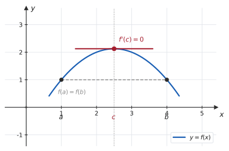
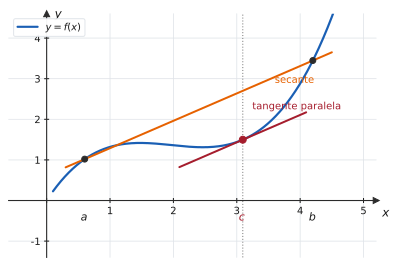

# 4.2 · Teoremas de Rolle e do Valor Médio

| ← Anterior | 🏠 Índice | Próximo → |
| :--- | :---: | ---: |
| [4.1 · Máximos e mínimos](4.1-maximos-e-minimos.md) | [Unidade 4](README.md) · [Página inicial](../README.md) | [4.3 · Regra de L&#39;Hôspital](4.3-regra-de-lhospital.md) |

---

## 🎯 O que você vai aprender

- Enunciar e aplicar o **Teorema de Rolle**, verificando as hipóteses antes.
- Enunciar e aplicar o **Teorema do Valor Médio** (TVM), e entender o seu significado físico.
- Usar o TVM para demonstrar os fatos que você vem usando desde [4.1](4.1-maximos-e-minimos.md): derivada nula implica constante, derivada positiva implica crescente.
- Provar **desigualdades** e a **unicidade de raízes** com o TVM.

**Pré-requisitos:** [4.1](4.1-maximos-e-minimos.md) (Fermat e pontos críticos) e [2.5](../02-limites-e-continuidade/2.5-continuidade-e-tipos-de-descontinuidade.md) (continuidade e Weierstrass).

---

## Por que isso importa

Esta é a seção **teórica** da unidade — e a mais fácil de subestimar.

Você já usou, em [4.1](4.1-maximos-e-minimos.md), que "$f' > 0$ implica $f$ crescente". Mas **por quê**? A derivada diz o que acontece em cada ponto, isoladamente; crescimento é uma afirmação sobre **intervalos inteiros**. O que permite saltar de um para o outro é exatamente o **Teorema do Valor Médio**.

Sem ele, a Unidade 4 inteira seria um conjunto de receitas sem justificativa — e a Unidade 5 nem existiria, porque o Teorema Fundamental do Cálculo se apoia nele.

---

## 1. Teorema de Rolle

> 📐 **Teorema 4.2.1 (Rolle).** Seja $f$ tal que:
> 1. $f$ é **contínua** em $[a,b]$;
> 2. $f$ é **derivável** em $(a,b)$;
> 3. $f(a) = f(b)$.
>
> Então existe pelo menos um $c \in (a,b)$ tal que
> $$f'(c) = 0$$

> 📊 **A ideia em uma frase:** se você sai de um ponto e volta à mesma altura, em algum momento precisou **parar de subir e começar a descer** (ou vice-versa) — e nesse instante a tangente é horizontal.

**Por que é verdade.** Por Weierstrass, $f$ atinge máximo e mínimo em $[a,b]$. Se ambos estiverem nas bordas, então $f$ é **constante** (pois $f(a)=f(b)$) e $f'=0$ em todo o interior. Caso contrário, algum extremo está no interior — e ali, por **Fermat** ([4.1](4.1-maximos-e-minimos.md)), a derivada é zero. $\blacksquare$

> [!IMPORTANT]
> **As três hipóteses são indispensáveis**, e a prova pode cobrar exatamente isso:
> - sem **continuidade**: $f(x)=\frac1x$ em $[-1,1]$ não tem derivada nula em lugar nenhum;
> - sem **derivabilidade**: $f(x) = \lvert x\rvert$ em $[-1,1]$ satisfaz $f(-1)=f(1)$, e $f'$ nunca é zero — o "ponto de retorno" é um bico;
> - sem $f(a)=f(b)$: $f(x)=x$ em $[0,1]$ tem $f' = 1 \neq 0$ sempre.

#### ✍️ Exemplo 1 — verificando as hipóteses

Verifique que $f(x) = x^2-4x+3$ satisfaz Rolle em $[1,3]$ e encontre o $c$.

**Solução.**

1. **Contínua** em $[1,3]$: é polinômio ✔
2. **Derivável** em $(1,3)$: é polinômio ✔
3. $f(1) = 1-4+3 = 0$ e $f(3) = 9-12+3 = 0$ ✔

As hipóteses valem, então existe $c$. Achando-o:

$$f'(x) = 2x-4 = 0 \ \Longrightarrow \ c = 2 \in (1,3) \quad \checkmark$$

> 💡 **Em prova, verifique as três hipóteses explicitamente.** Boa parte da nota dessas questões está na verificação, não no cálculo do $c$.

---

## 2. Teorema do Valor Médio

Rolle é o caso particular em que as pontas estão na mesma altura. O TVM é a versão geral — **com o gráfico inclinado**.

> 📐 **Teorema 4.2.2 (Valor Médio, ou de Lagrange).** Seja $f$:
> 1. **contínua** em $[a,b]$;
> 2. **derivável** em $(a,b)$.
>
> Então existe pelo menos um $c \in (a,b)$ tal que
> $$f'(c) = \frac{f(b)-f(a)}{b-a}$$

> 📊 **Geometricamente:** existe pelo menos um ponto em que a **tangente é paralela à secante** que liga as extremidades. A taxa instantânea, em algum instante, iguala a taxa média de todo o percurso.

### A leitura física

Se $s(t)$ é a posição de um carro:

$$\underbrace{\frac{s(b)-s(a)}{b-a}}_{\text{velocidade média}} = \underbrace{s'(c)}_{\text{velocidade instantânea em } c}$$

> 💡 **O radar da estrada usa isso.** Se você percorre $120$ km em $1$ hora, sua velocidade **média** foi $120$ km/h — e o TVM garante que, em **algum** instante, o velocímetro marcou exatamente $120$ km/h. É o princípio do chamado "radar de trecho": ele não precisa flagrar o instante da infração, basta medir a média.

### Rolle é um caso particular

Quando $f(a)=f(b)$, o lado direito do TVM vira $\frac{0}{b-a} = 0$ — e o TVM se reduz a Rolle. Na direção contrária, o TVM se **demonstra** a partir de Rolle:

> 💡 **Esboço da demonstração.** Defina $g(x) = f(x) - \big[\text{reta secante}\big]$. Essa $g$ é contínua, derivável e satisfaz $g(a)=g(b)=0$ (pois a secante encosta na curva nas duas pontas). Por Rolle, existe $c$ com $g'(c)=0$ — e isso é exatamente $f'(c) = \frac{f(b)-f(a)}{b-a}$. $\blacksquare$

#### ✍️ Exemplo 2 — aplicando o TVM

Verifique o TVM para $f(x) = x^3$ em $[0,\thinspace 2]$ e encontre o $c$.

**Solução.** $f$ é polinômio: contínua e derivável ✔

**Taxa média:**

$$\frac{f(2)-f(0)}{2-0} = \frac{8-0}{2} = 4$$

**Encontrando $c$:** $f'(x) = 3x^2 = 4 \Rightarrow x^2 = \frac43 \Rightarrow x = \pm\frac{2}{\sqrt3}$.

Só a raiz positiva está em $(0,2)$:

$$c = \frac{2}{\sqrt3} = \frac{2\sqrt3}{3} \approx 1{,}155 \quad \checkmark$$

---

## 3. As consequências — e por que elas importam

Aqui está o verdadeiro valor do TVM: ele **justifica** tudo o que se faz com derivadas.

> 📐 **Corolário 1.** Se $f'(x) = 0$ para todo $x$ num **intervalo** $I$, então $f$ é **constante** em $I$.

**Demonstração.** Tome $x_1 < x_2$ em $I$. Pelo TVM aplicado a $[x_1,x_2]$, existe $c$ entre eles com

$$f(x_2)-f(x_1) = f'(c)\thinspace (x_2-x_1) = 0\cdot(x_2-x_1) = 0$$

Logo $f(x_2) = f(x_1)$ para quaisquer dois pontos: $f$ é constante. $\blacksquare$

> [!WARNING]
> **A palavra "intervalo" é essencial.** A função $f(x) = \frac{\lvert x\rvert}{x}$ tem derivada nula em todo o seu domínio $\mathbb{R}\setminus\lbrace 0\rbrace$, e **não** é constante — vale $-1$ de um lado e $1$ do outro. O domínio não é um intervalo. Foi exatamente essa a ressalva do [Exercício Resolvido 6 de 3.4](../03-derivadas/3.4-derivadas-das-funcoes-trigonometricas-inversas.md).

> 📐 **Corolário 2.** Se $f'(x) = g'(x)$ para todo $x$ num intervalo $I$, então
> $$f(x) = g(x) + C$$
> para alguma constante $C$.

*(Basta aplicar o Corolário 1 a $h = f-g$.)*

> [!IMPORTANT]
> **O Corolário 2 é a base de toda a Unidade 5.** Ele diz que duas funções com a mesma derivada diferem apenas por uma constante — e é por isso que a integral indefinida carrega o famoso "$+\thinspace C$". Sem este corolário, não haveria como garantir que a primitiva encontrada é *a* primitiva.

> 📐 **Corolário 3 (o teste de crescimento).** Em um intervalo $I$:
> - se $f'(x) > 0$ para todo $x \in I$, então $f$ é **estritamente crescente** em $I$;
> - se $f'(x) < 0$ para todo $x \in I$, então $f$ é **estritamente decrescente** em $I$.

**Demonstração.** Sejam $x_1<x_2$ em $I$. Pelo TVM, existe $c$ entre eles com

$$f(x_2)-f(x_1) = f'(c)\thinspace (x_2-x_1)$$

Como $x_2-x_1>0$, o sinal da diferença é **o sinal de $f'(c)$**. Se $f'>0$, então $f(x_2)>f(x_1)$. $\blacksquare$

> 💡 **Era isso que faltava.** Desde [4.1](4.1-maximos-e-minimos.md) você monta quadros de sinais de $f'$ e conclui onde a função cresce. O Corolário 3 é a demonstração de que esse procedimento é legítimo — e ele é consequência direta do TVM.

---

## 4. Aplicações: desigualdades e unicidade de raiz

#### ✍️ Exemplo 3 — provando uma desigualdade

Mostre que $e^x \geqslant 1+x$ para todo $x \geqslant 0$.

**Solução.** Seja $g(x) = e^x - 1 - x$, com $g(0) = 0$.

$$g'(x) = e^x - 1$$

Para $x>0$: $e^x > 1$, logo $g'(x) > 0$ e $g$ é **crescente** (Corolário 3). Como $g(0)=0$ e $g$ cresce,

$$g(x) > 0 \ \text{ para } x>0 \ \Longrightarrow \ e^x > 1+x$$

Juntando com a igualdade em $x=0$: $e^x \geqslant 1+x$ para $x \geqslant 0$. $\blacksquare$

> 💡 **O roteiro é sempre o mesmo:** passe tudo para um lado, mostre que a função vale zero num extremo e que a derivada tem sinal constante depois dele. Foi assim no [Exercício 19 de 3.4](../03-derivadas/exercicios/lista-3.4-propostos.md), com $\operatorname{arctg} x < x$.

#### ✍️ Exemplo 4 — estimando com o TVM

Sabendo que $f(1) = 10$ e que $2 \leqslant f'(x) \leqslant 4$ para todo $x$, **entre quais valores está $f(5)$?**

**Solução.** Pelo TVM em $[1,5]$, existe $c$ com

$$f(5)-f(1) = f'(c)\thinspace (5-1) = 4f'(c)$$

Como $2 \leqslant f'(c) \leqslant 4$:

$$8 \leqslant f(5)-10 \leqslant 16 \ \Longrightarrow \ 18 \leqslant f(5) \leqslant 26$$

**Resposta.** $f(5)$ está entre $18$ e $26$.

> 💡 **O TVM transforma informação sobre a derivada em informação sobre a função** — mesmo sem conhecer a fórmula de $f$. É esse tipo de estimativa que sustenta a análise de erro em métodos numéricos.

#### ✍️ Exemplo 5 — unicidade de raiz

Mostre que $x^3+x-1=0$ tem **exatamente uma** raiz real.

**Solução — duas partes.**

**Existência** (por Bolzano, [2.5](../02-limites-e-continuidade/2.5-continuidade-e-tipos-de-descontinuidade.md)): $f(0) = -1 < 0$ e $f(1) = 1 > 0$, logo há raiz em $(0,1)$.

**Unicidade** (por Rolle): suponha, por absurdo, que houvesse **duas** raízes $r_1 < r_2$. Como $f(r_1)=f(r_2)=0$ e $f$ é polinomial, o Teorema de Rolle garantiria um $c \in (r_1,r_2)$ com $f'(c)=0$. Mas

$$f'(x) = 3x^2+1 \geqslant 1 > 0 \quad \text{para todo } x$$

— a derivada **nunca** se anula. Contradição. Logo a raiz é única. $\blacksquare$

> 💡 **Esse argumento em duas partes é um clássico de prova:** Bolzano dá a existência, Rolle dá a unicidade. Guarde o par.

---

## ⚠️ Armadilhas

| O erro | Por que está errado | O certo |
| --- | --- | --- |
| aplicar Rolle sem checar $f(a)=f(b)$ | é a terceira hipótese | verifique as **três** |
| aplicar o TVM a função com bico no intervalo | falta derivabilidade | $\lvert x\rvert$ em $[-1,1]$ não serve |
| "derivada nula logo constante" sem intervalo | o domínio precisa ser um intervalo | veja $\frac{\lvert x\rvert}{x}$ |
| achar que o $c$ é único | o teorema diz "existe pelo menos um" | pode haver vários |
| exigir derivabilidade em $[a,b]$ fechado | basta em $(a,b)$ aberto | nas bordas, só continuidade |
| confundir $f'(c)$ com a média de $f$ | o TVM iguala $f'(c)$ à **taxa** média | $\frac{f(b)-f(a)}{b-a}$ |
| usar o TVM para **achar** o $c$ em geral | ele garante existência | só às vezes dá para resolver |

---

## 🧠 Exercícios resolvidos

### Exercício Resolvido 1

**Verifique se $f(x) = x^3-x$ satisfaz as hipóteses de Rolle em $[-1,\thinspace 1]$ e, em caso afirmativo, encontre todos os $c$.**

**Solução.**

1. Contínua em $[-1,1]$: polinômio ✔
2. Derivável em $(-1,1)$: polinômio ✔
3. $f(-1) = -1+1 = 0$ e $f(1) = 1-1 = 0$ ✔

$$f'(x) = 3x^2-1 = 0 \ \Longrightarrow \ x = \pm\frac{1}{\sqrt3} \approx \pm0{,}577$$

**Ambos** estão em $(-1,1)$.

**Resposta.** $c = \pm\dfrac{\sqrt3}{3}$ — há **dois** valores, e o teorema continua satisfeito (ele garante "pelo menos um").

---

### Exercício Resolvido 2

**Mostre que $f(x) = \lvert x\rvert$ em $[-1,\thinspace 1]$ satisfaz $f(-1)=f(1)$, mas não existe $c$ com $f'(c)=0$. Qual hipótese falha?**

**Solução.**

De fato, $f(-1) = f(1) = 1$. E a derivada é

$$
f'(x) = \begin{cases}
-1, & \text{se } x<0 \\
1, & \text{se } x>0
\end{cases}
$$

que **nunca** vale zero. Em $x=0$, a derivada **não existe** ([3.1](../03-derivadas/3.1-conceito-interpretacao-geometrica-e-regras-basicas.md)).

**A hipótese que falha é a 2**: $f$ não é derivável em todo $(-1,1)$ — falha exatamente no ponto onde a função "vira".

> 💡 **O contraexemplo mostra que a hipótese não é decorativa.** O ponto de retorno existe; o que não existe é a **tangente horizontal** nele.

---

### Exercício Resolvido 3

**Aplique o TVM a $f(x) = \sqrt x$ em $[1,\thinspace 4]$ e encontre o $c$.**

**Solução.** Contínua em $[1,4]$ e derivável em $(1,4)$ ✔

$$\frac{f(4)-f(1)}{4-1} = \frac{2-1}{3} = \frac13$$

$$f'(x) = \frac{1}{2\sqrt x} = \frac13 \ \Longrightarrow \ 2\sqrt x = 3 \ \Longrightarrow \ \sqrt x = \frac32 \ \Longrightarrow \ c = \frac94 = 2{,}25$$

E $2{,}25 \in (1,4)$ ✔

---

### Exercício Resolvido 4

**Um carro percorre $200$ km em $2$ horas. Prove que, em algum instante, o velocímetro marcou exatamente $100$ km/h.**

**Solução.** Seja $s(t)$ a posição, com $t$ em horas. Supondo o movimento **contínuo e suave** (hipóteses razoáveis: a posição não salta e a velocidade existe a cada instante), vale o TVM em $[0,2]$:

$$\exists\thinspace c \in (0,2) \ : \ s'(c) = \frac{s(2)-s(0)}{2-0} = \frac{200}{2} = 100 \ \text{km/h}$$

Como $s'(c)$ é a velocidade instantânea em $t=c$, em **algum** momento o velocímetro marcou $100$ km/h. $\blacksquare$

> 💡 **Note o que o teorema não diz:** ele não informa **quando** isso aconteceu, nem se aconteceu mais de uma vez. Teoremas de existência são assim — e ainda assim resolvem a questão.

---

### Exercício Resolvido 5

**Mostre que $\operatorname{sen} x \leqslant x$ para todo $x \geqslant 0$.**

**Solução.** Seja $g(x) = x - \operatorname{sen} x$, com $g(0) = 0$.

$$g'(x) = 1 - \cos x \geqslant 0 \quad \text{para todo } x$$

(porque $\cos x \leqslant 1$ sempre). Logo $g$ é **não decrescente** em $[0,+\infty)$.

Como $g(0)=0$ e $g$ não decresce, tem-se $g(x) \geqslant 0$ para $x\geqslant0$, ou seja,

$$x - \operatorname{sen} x \geqslant 0 \ \Longrightarrow \ \operatorname{sen} x \leqslant x \qquad \blacksquare$$

> 💡 **Essa desigualdade apareceu antes, sem nome.** Ela é um dos lados do sanduíche usado em [2.3](../02-limites-e-continuidade/2.3-teorema-do-sanduiche.md) para demonstrar $\lim_{x\to0}\frac{\operatorname{sen} x}{x} = 1$. Lá ela veio da geometria do círculo; aqui, do Cálculo.

---

### Exercício Resolvido 6

**Suponha que $f(0)=3$ e $\lvert f'(x)\rvert \leqslant 2$ para todo $x$. Qual o maior valor possível de $f(4)$? E o menor?**

**Solução.** Pelo TVM em $[0,4]$, existe $c$ com

$$f(4) - f(0) = f'(c)\cdot 4$$

Como $-2 \leqslant f'(c) \leqslant 2$:

$$-8 \leqslant f(4) - 3 \leqslant 8 \ \Longrightarrow \ -5 \leqslant f(4) \leqslant 11$$

**Resposta.** O maior valor possível é $11$; o menor é $-5$.

> 💡 **E esses limites são atingíveis:** $f(x) = 3+2x$ dá $f(4)=11$, e $f(x)=3-2x$ dá $f(4)=-5$. Quando uma estimativa é atingida por algum exemplo, dizemos que ela é **justa** — não dá para melhorá-la.

---

## 📝 Agora é com você

➡️ **[Lista 4.2 — exercícios propostos](exercicios/lista-4.2-propostos.md)** · ✅ **[Gabarito](gabaritos/gabarito-4.2.md)**

---

## Resumo da página

> **Decore:**
> - **Rolle:** contínua em $[a,b]$, derivável em $(a,b)$, $f(a)=f(b)$ ⟹ existe $c$ com $f'(c)=0$.
> - **TVM:** contínua e derivável ⟹ existe $c$ com $f'(c) = \dfrac{f(b)-f(a)}{b-a}$.
> - $f'=0$ em um **intervalo** ⟹ constante. $f'=g'$ ⟹ diferem por constante.
> - $f'>0$ ⟹ crescente; $f'<0$ ⟹ decrescente.
>
> **Saiba fazer:**
> - **verificar as hipóteses** antes de aplicar (vale metade da nota);
> - provar desigualdades: zere num extremo e estude o sinal da derivada;
> - provar unicidade de raiz combinando **Bolzano** (existe) com **Rolle** (não há duas);
> - estimar $f(b)$ a partir de limites para $f'$.

---

## 📚 Para aprofundar

| Livro | Onde procurar |
| --- | --- |
| **LEITHOLD** | Capítulo 4 — "Teorema de Rolle e teorema do valor médio" |
| **STEWART** | Capítulo 4 — "O Teorema do Valor Médio" |
| **THOMAS** | Capítulo 4 — "O Teorema do Valor Médio" |
| **ANTON** | Capítulo 4 — "Teorema do valor médio" |
| **SWOKOWSKI** | Capítulo 4 — "Teorema do valor médio" |
| **MUNEM & FOULIS** | Capítulo 4 — "Teoremas do valor médio" |

---

| ← Anterior | 🏠 Índice | Próximo → |
| :--- | :---: | ---: |
| [4.1 · Máximos e mínimos](4.1-maximos-e-minimos.md) | [Unidade 4](README.md) · [Página inicial](../README.md) | [4.3 · Regra de L&#39;Hôspital](4.3-regra-de-lhospital.md) |

*Sobrevivendo ao Cálculo 1 (UENF)* · por **Nicolau Prates** · [CC BY-SA 4.0](../LICENSE)
