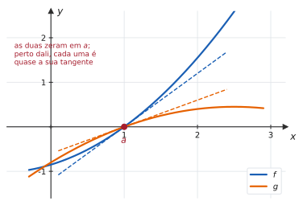
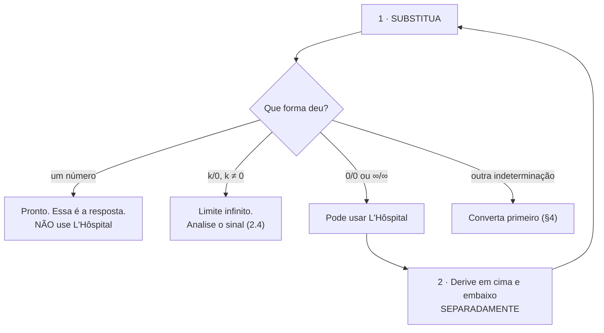
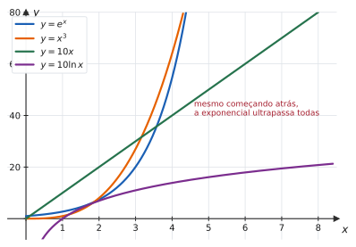

# 4.3 · Regra de L&#39;Hôspital no cálculo de limites

| ← Anterior | 🏠 Índice | Próximo → |
| :--- | :---: | ---: |
| [4.2 · Rolle e Valor Médio](4.2-teoremas-de-rolle-e-do-valor-medio.md) | [Unidade 4](README.md) · [Página inicial](../README.md) | [4.4 · Esboço de gráficos](4.4-crescimento-concavidade-e-esboco-de-graficos.md) |

---

## 🎯 O que você vai aprender

- Aplicar a **Regra de L&#39;Hôspital** nas indeterminações $\frac00$ e $\frac{\infty}{\infty}$.
- Reconhecer **quando a regra não se aplica** — e por que aplicá-la fora de hora produz resposta errada.
- Converter as outras cinco indeterminações ($0\cdot\infty$, $\infty-\infty$, $1^\infty$, $0^0$, $\infty^0$) para uma das duas formas.
- Usar a **hierarquia do infinito** para prever o resultado antes de calcular.

**Pré-requisitos:** as [sete indeterminações de 2.4](../02-limites-e-continuidade/2.4-limites-infinitos-no-infinito-e-assintotas.md) e toda a [Unidade 3](../03-derivadas/README.md).

---

## Por que isso importa

Na [Unidade 2](../02-limites-e-continuidade/README.md), resolver $\frac00$ exigia criatividade: fatorar, racionalizar, achar o conjugado certo. E havia limites que **nenhuma** dessas técnicas alcançava — como $\lim_{x\to0}\frac{e^x-1}{x}$ ou $\lim_{x\to+\infty}\frac{\ln x}{x}$.

L&#39;Hôspital resolve quase todos eles com um procedimento **mecânico**: derive em cima, derive embaixo, tente de novo. É a ferramenta mais poderosa — e a mais mal usada — do cálculo de limites.

---

## 1. O enunciado

> 📐 **Teorema 4.3.1 (Regra de L&#39;Hôspital).** Sejam $f$ e $g$ deriváveis perto de $a$ (exceto, possivelmente, em $a$), com $g'(x)\neq0$. Suponha que
> $$\lim_{x\to a} \frac{f(x)}{g(x)} \quad \text{seja da forma } \ \frac{0}{0} \ \text{ ou } \ \frac{\infty}{\infty}$$
> Então
> $$\lim_{x\to a}\frac{f(x)}{g(x)} = \lim_{x\to a}\frac{f'(x)}{g'(x)}$$
> **desde que o limite da direita exista** (finito ou infinito).
>
> O teorema vale também para $x\to a^{+}$, $x\to a^{-}$, $x\to+\infty$ e $x\to-\infty$.

> 📊 **Por que funciona, em uma imagem.** Se $f(a)=g(a)=0$, então perto de $a$ cada função é **aproximadamente a sua reta tangente**: $f(x)\approx f'(a)(x-a)$ e $g(x)\approx g'(a)(x-a)$. A razão entre elas é
> $$\frac{f(x)}{g(x)} \approx \frac{f'(a)(x-a)}{g'(a)(x-a)} = \frac{f'(a)}{g'(a)}$$
> O fator $(x-a)$ cancela — e sobra a razão das **inclinações**. A demonstração rigorosa usa o Teorema do Valor Médio de Cauchy, visto no [Exercício 20 de 4.2](exercicios/lista-4.2-propostos.md).

---

## 2. Aplicando — e o teste que vem antes

> [!CAUTION]
> **Verifique a indeterminação ANTES de derivar.** Essa é a regra de ouro da seção. Aplicar L&#39;Hôspital a um limite que **não** é indeterminado produz uma resposta **errada**, e o erro passa despercebido porque a conta "parece" certa.
>
> **Exemplo do desastre:**
> $$\lim_{x\to1}\frac{x+3}{2x} = \frac{4}{2} = 2 \quad \text{(correto, por substituição)}$$
> $$\lim_{x\to1}\frac{x+3}{2x} \ \xrightarrow{\text{L'H errada}} \ \lim_{x\to1}\frac{1}{2} = \frac12 \quad \text{✘}$$

> [!WARNING]
> **L&#39;Hôspital não é a regra do quociente.** Você deriva o numerador e o denominador **separadamente** — não aplique $\frac{f'g-fg'}{g^2}$. Confundir as duas é o segundo erro mais comum.

#### ✍️ Exemplo 1 — o caso básico

$$\lim_{x\to0}\frac{e^x-1}{x}$$

**Teste:** substituindo, $\frac{1-1}{0} = \frac00$ ✔ indeterminado.

$$\lim_{x\to0}\frac{e^x-1}{x} \overset{\text{L'H}}{=} \lim_{x\to0}\frac{e^x}{1} = 1$$

> 💡 **É o limite que definiu $e$**, em [3.2](../03-derivadas/3.2-derivadas-das-funcoes-elementares.md). Mas cuidado com a circularidade: aquele limite foi usado para **provar** que $(e^x)' = e^x$, então usá-lo aqui é elegante, não rigoroso. Como verificação, porém, funciona.

#### ✍️ Exemplo 2 — aplicando duas vezes

$$\lim_{x\to0}\frac{1-\cos x}{x^2}$$

**Teste:** $\frac{1-1}{0} = \frac00$ ✔

$$\overset{\text{L'H}}{=} \lim_{x\to0}\frac{\mathrm{sen}\thinspace x}{2x}$$

**Teste de novo:** $\frac{0}{0}$ ✔ — ainda indeterminado, aplique outra vez:

$$\overset{\text{L'H}}{=} \lim_{x\to0}\frac{\cos x}{2} = \frac12$$

Mesmo resultado obtido em [2.3](../02-limites-e-continuidade/2.3-teorema-do-sanduiche.md) com o conjugado — mas em duas linhas.

> 💡 **Reaplique quantas vezes forem necessárias**, testando a cada passo. O que não se pode é aplicar "no automático" sem verificar.

#### ✍️ Exemplo 3 — forma $\frac{\infty}{\infty}$

$$\lim_{x\to+\infty}\frac{\ln x}{x}$$

**Teste:** $\frac{\infty}{\infty}$ ✔

$$\overset{\text{L'H}}{=} \lim_{x\to+\infty}\frac{1/x}{1} = \lim_{x\to+\infty}\frac1x = 0$$

**Interpretação:** o logaritmo cresce **mais devagar** que $x$ — tão mais devagar que a razão vai a zero.

---

## 3. A hierarquia do infinito

> 📊 Perto da origem, $10x$ e $10\ln x$ estão **à frente**. Mas por volta de $x \approx 4$ a exponencial ultrapassa todas — e a partir dali a distância só cresce.

> 📐 **Hierarquia (para $x\to+\infty$).** Cada classe cresce infinitamente mais rápido que a anterior:
> $$\ln x \ \prec \ x^{p}\ (p>0) \ \prec \ a^{x}\ (a>1) \ \prec \ x! \ \prec \ x^{x}$$
> Em termos de limite, se $f \prec g$, então $\lim_{x\to+\infty}\frac{f(x)}{g(x)} = 0$.

> [!TIP]
> **Use a hierarquia para prever a resposta antes de calcular.** Em $\lim_{x\to+\infty}\frac{x^{100}}{e^x}$, a exponencial ganha de qualquer potência: o limite é $0$. (Provar por L&#39;Hôspital exigiria **cem** aplicações — mas saber a resposta antes torna a conta uma formalidade.)

---

## 4. As outras cinco indeterminações

L&#39;Hôspital só trata $\frac00$ e $\frac\infty\infty$. As demais precisam ser **convertidas** primeiro.

| Forma | Como converter |
| :---: | --- |
| $0\cdot\infty$ | escreva um dos fatores como denominador: $f\cdot g = \dfrac{f}{1/g}$ |
| $\infty-\infty$ | some as frações, racionalize ou ponha em evidência |
| $1^{\infty}$, $0^{0}$, $\infty^{0}$ | aplique $\ln$, calcule o limite, e **volte com a exponencial** |

#### ✍️ Exemplo 4 — forma $0\cdot\infty$

$$\lim_{x\to0^{+}} x\ln x$$

**Teste:** $0\cdot(-\infty)$ — indeterminado, e L&#39;Hôspital não se aplica diretamente.

**Converta:** passe o $x$ para o denominador como $\frac{1}{1/x}$:

$$x\ln x = \frac{\ln x}{1/x} \ \longrightarrow \ \frac{-\infty}{+\infty} \quad \checkmark$$

$$\overset{\text{L'H}}{=} \lim_{x\to0^{+}}\frac{1/x}{-1/x^2} = \lim_{x\to0^{+}}\left(-x\right) = 0$$

> 💡 **Escolha bem qual fator vai para baixo.** Se tivéssemos escrito $\frac{x}{1/\ln x}$, a derivada do denominador ficaria horrível. A regra prática: **mande para baixo o fator mais simples de derivar** — aqui, o $x$.

#### ✍️ Exemplo 5 — forma $\infty-\infty$

$$\lim_{x\to0^{+}}\left(\frac1x - \frac{1}{\mathrm{sen}\thinspace x}\right)$$

**Converta:** some as frações.

$$\frac{\mathrm{sen}\thinspace x - x}{x\mathrm{sen}\thinspace x} \ \longrightarrow \ \frac00 \quad \checkmark$$

$$\overset{\text{L'H}}{=} \lim_{x\to0^{+}}\frac{\cos x - 1}{\mathrm{sen}\thinspace x + x\cos x} \ \longrightarrow \ \frac00 \quad \checkmark$$

$$\overset{\text{L'H}}{=} \lim_{x\to0^{+}}\frac{-\mathrm{sen}\thinspace x}{2\cos x - x\mathrm{sen}\thinspace x} = \frac{0}{2} = 0$$

#### ✍️ Exemplo 6 — forma $1^{\infty}$

$$\lim_{x\to+\infty}\left(1+\frac1x\right)^{x}$$

**Teste:** a base tende a $1$ e o expoente a $\infty$ — forma $1^\infty$, indeterminada.

**Converta pelo logaritmo.** Seja $y = \left(1+\frac1x\right)^x$. Então

$$\ln y = x\ln\left(1+\frac1x\right) \ \longrightarrow \ \infty\cdot0 \quad \text{(já é progresso)}$$

Reescrevendo como quociente:

$$\ln y = \frac{\ln\left(1+\frac1x\right)}{1/x} \ \longrightarrow \ \frac00 \quad \checkmark$$

Derivando em cima e embaixo (cadeia no numerador):

$$\overset{\text{L'H}}{=} \lim_{x\to+\infty}\frac{\dfrac{1}{1+\frac1x}\cdot\left(-\dfrac{1}{x^2}\right)}{-\dfrac{1}{x^2}} = \lim_{x\to+\infty}\frac{1}{1+\frac1x} = 1$$

**Volte com a exponencial.** Como $\ln y \to 1$ e a exponencial é contínua:

$$y = e^{\ln y} \ \longrightarrow \ e^1 = e$$

$$\boxed{\lim_{x\to+\infty}\left(1+\frac1x\right)^x = e}$$

> [!IMPORTANT]
> **O passo final não é opcional.** O que você calculou foi o limite de $\ln y$, não de $y$. Parar em $1$ e responder "$1$" é o erro clássico das formas exponenciais — **sempre volte com $e^{(\thinspace )}$**.

---

## ⚠️ Armadilhas

| O erro | Por que está errado | O certo |
| --- | --- | --- |
| aplicar sem verificar a forma | fora da indeterminação, a regra é falsa | substitua **primeiro** |
| usar a regra do quociente | L&#39;Hôspital deriva cima e baixo **separadamente** | $\dfrac{f'}{g'}$, não $\dfrac{f'g-fg'}{g^2}$ |
| aplicar a $0\cdot\infty$ direto | a regra só trata $\frac00$ e $\frac\infty\infty$ | converta antes |
| parar no limite de $\ln y$ | você queria $y$ | volte com $e^{(\thinspace )}$ |
| insistir quando não melhora | $\lim\frac{\sqrt{x^2+1}}{x}$ entra em loop | use álgebra |
| concluir que o limite não existe porque $\frac{f'}{g'}$ não existe | a regra é condicional | tente outro método |
| derivar mais vezes sem retestar | pode já ter saído da indeterminação | teste a cada passo |

> [!NOTE]
> **Quando L&#39;Hôspital entra em loop.** Em $\lim_{x\to+\infty}\frac{\sqrt{x^2+1}}{x}$, derivar dá $\frac{x/\sqrt{x^2+1}}{1}$; derivar de novo volta ao início. A regra não é obrigatória — aqui, dividir pela maior potência ([2.4](../02-limites-e-continuidade/2.4-limites-infinitos-no-infinito-e-assintotas.md)) resolve em uma linha, dando $1$.

---

## 🧠 Exercícios resolvidos

### Exercício Resolvido 1

$$\lim_{x\to0}\frac{\mathrm{sen}\thinspace 3x}{\mathrm{tg}\thinspace 5x}$$

**Teste:** $\frac00$ ✔

$$\overset{\text{L'H}}{=} \lim_{x\to0}\frac{3\cos 3x}{5\sec^2 5x} = \frac{3\cdot1}{5\cdot1} = \frac35$$

*(Compare com [2.3](../02-limites-e-continuidade/2.3-teorema-do-sanduiche.md), em que o mesmo tipo de limite exigia preparar as frações.)*

---

### Exercício Resolvido 2

$$\lim_{x\to+\infty}\frac{x^2}{e^x}$$

**Teste:** $\frac{\infty}{\infty}$ ✔

$$\overset{\text{L'H}}{=} \lim_{x\to+\infty}\frac{2x}{e^x} \ \longrightarrow \ \frac{\infty}{\infty} \ \overset{\text{L'H}}{=} \ \lim_{x\to+\infty}\frac{2}{e^x} = 0$$

**Resposta.** $0$ — como a hierarquia previa: a exponencial vence a potência.

---

### Exercício Resolvido 3

$$\lim_{x\to0^{+}} x^x$$

**Teste:** forma $0^0$ ✔ indeterminada.

**Pelo logaritmo.** Seja $y = x^x$, logo $\ln y = x\ln x$. Pelo Exemplo 4:

$$\lim_{x\to0^{+}} x\ln x = 0$$

**Voltando:**

$$y = e^{\ln y} \ \longrightarrow \ e^0 = 1$$

**Resposta.** $\lim_{x\to0^{+}} x^x = 1$.

> 💡 Um resultado contraintuitivo: a base vai a zero, o expoente vai a zero, e a resposta é $1$. É por isso que $0^0$ é **indeterminado** — e não "obviamente zero" nem "obviamente um".

---

### Exercício Resolvido 4

$$\lim_{x\to1}\frac{x^{10}-1}{x-1}$$

**Teste:** $\frac00$ ✔

$$\overset{\text{L'H}}{=} \lim_{x\to1}\frac{10x^9}{1} = 10$$

**Resposta.** $10$ — exatamente o que o [Exercício 20 da Lista 2.1](../02-limites-e-continuidade/exercicios/lista-2.1-propostos.md) demonstrou no caso geral, com fatoração. L&#39;Hôspital dá o mesmo em uma linha.

---

### Exercício Resolvido 5

$$\lim_{x\to\frac{\pi}{2}^{-}}\big(\sec x - \mathrm{tg}\thinspace x\big)$$

**Teste:** $\infty-\infty$ ✔ indeterminada.

**Converta** escrevendo tudo com denominador comum:

$$\sec x - \mathrm{tg}\thinspace x = \frac{1}{\cos x} - \frac{\mathrm{sen}\thinspace x}{\cos x} = \frac{1-\mathrm{sen}\thinspace x}{\cos x} \ \longrightarrow \ \frac00 \quad \checkmark$$

$$\overset{\text{L'H}}{=} \lim_{x\to\frac\pi2^{-}}\frac{-\cos x}{-\mathrm{sen}\thinspace x} = \frac{0}{1} = 0$$

**Resposta.** $0$.

---

### Exercício Resolvido 6

**Determine todos os valores de $k$ para os quais** $\lim_{x\to0}\dfrac{e^{kx}-1-2x}{x^2}$ **é finito, e calcule o limite nesse caso.**

**Estratégia.** Aplicar L&#39;Hôspital e observar o que precisa acontecer para a indeterminação se manter — se ela sumir cedo demais, o limite explode.

**Solução.**

**Primeira aplicação** (a forma é $\frac00$ ✔):

$$\lim_{x\to0}\frac{k\thinspace e^{kx}-2}{2x}$$

Agora o **denominador vai a zero**. Para o limite ser finito, o numerador também precisa ir a zero:

$$k\thinspace e^{0} - 2 = 0 \ \Longrightarrow \ k = 2$$

**Com $k=2$**, a forma volta a ser $\frac00$ e pode-se aplicar de novo:

$$\lim_{x\to0}\frac{2e^{2x}-2}{2x} \ \overset{\text{L'H}}{=} \ \lim_{x\to0}\frac{4e^{2x}}{2} = 2$$

**Resposta.** Apenas $k=2$, e o limite vale $2$.

> 💡 **O raciocínio "para ser finito, o numerador precisa zerar" é uma técnica própria**, e aparece bastante em prova. Se $k\neq2$, o numerador tende a $k-2 \neq 0$ e a forma vira $\frac{k-2}{0}$: o limite é infinito.

---

## 📝 Agora é com você

➡️ **[Lista 4.3 — exercícios propostos](exercicios/lista-4.3-propostos.md)** · ✅ **[Gabarito](gabaritos/gabarito-4.3.md)**

---

## Resumo da página

> **Decore:**
> - A regra vale **só** para $\frac00$ e $\frac{\infty}{\infty}$ — **teste antes**.
> - Deriva-se cima e baixo **separadamente**.
> - $0\cdot\infty$ → vire quociente. $\infty-\infty$ → junte numa fração. $1^\infty$, $0^0$, $\infty^0$ → logaritmo, e **volte com $e$**.
> - Hierarquia: $\ln x \prec x^p \prec a^x \prec x! \prec x^x$.
>
> **Saiba fazer:**
> - substituir primeiro e classificar a forma;
> - reaplicar a regra testando a cada passo;
> - escolher qual fator mandar para o denominador em $0\cdot\infty$;
> - reconhecer quando a regra entra em loop e trocar de estratégia.

---

## 📚 Para aprofundar

| Livro | Onde procurar |
| --- | --- |
| **LEITHOLD** | Capítulo sobre formas indeterminadas — "A regra de L&#39;Hôpital" |
| **STEWART** | Capítulo 4 — "Formas indeterminadas e a Regra de L&#39;Hôspital" |
| **THOMAS** | Capítulo 4 — "Formas indeterminadas e a Regra de L&#39;Hôpital" |
| **ANTON** | Capítulo 4 — "Formas indeterminadas; regra de L&#39;Hôpital" |
| **SWOKOWSKI** | Capítulo sobre formas indeterminadas |
| **MUNEM & FOULIS** | Capítulo 4 — "Formas indeterminadas" |

---

| ← Anterior | 🏠 Índice | Próximo → |
| :--- | :---: | ---: |
| [4.2 · Rolle e Valor Médio](4.2-teoremas-de-rolle-e-do-valor-medio.md) | [Unidade 4](README.md) · [Página inicial](../README.md) | [4.4 · Esboço de gráficos](4.4-crescimento-concavidade-e-esboco-de-graficos.md) |

*Sobrevivendo ao Cálculo 1 (UENF)* · por **Nicolau Prates** · [CC BY-SA 4.0](../LICENSE)
