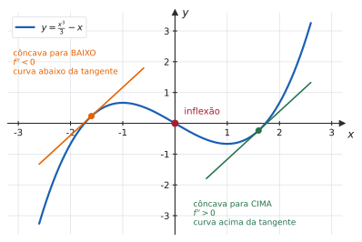
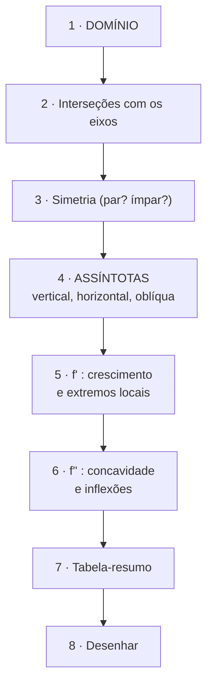
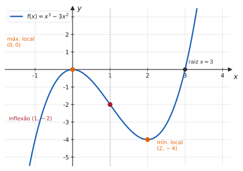
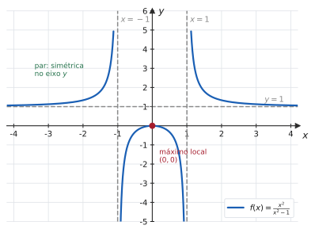

# 4.4 · Crescimento, concavidade e esboço de gráficos

| ← Anterior | 🏠 Índice | Próximo → |
| :--- | :---: | ---: |
| [4.3 · Regra de L&#39;Hôspital](4.3-regra-de-lhospital.md) | [Unidade 4](README.md) · [Página inicial](../README.md) | [Unidade 5 · Integral](../05-integrais/README.md) |

---

## 🎯 O que você vai aprender

- Determinar os intervalos de **crescimento** e **decrescimento** pelo sinal de $f'$.
- Determinar a **concavidade** pelo sinal de $f''$ e localizar **pontos de inflexão**.
- Executar o **roteiro completo de esboço** em oito passos.
- Desenhar o gráfico de polinômios e de funções racionais **sem plotar ponto nenhum**.

**Pré-requisitos:** toda a Unidade 4 até aqui, mais [assíntotas (2.4)](../02-limites-e-continuidade/2.4-limites-infinitos-no-infinito-e-assintotas.md) e [paridade (1.3)](../01-funcoes/1.3-funcoes-elementares-paridade-e-graficos.md).

---

## Por que isso importa

Esta é a seção que **junta tudo**. Esboçar um gráfico completo exige domínio (Unidade 1), assíntotas (Unidade 2), derivadas (Unidade 3) e extremos (Unidade 4) — numa única questão.

Por isso ela é tão comum em prova: uma só pergunta mede o semestre inteiro. E, depois dela, você olha para uma fórmula e **vê** a curva — habilidade que nenhum software substitui, porque é ela que permite perceber quando o software está errado.

---

## 1. Crescimento e decrescimento

> 📐 **Teste da derivada primeira** (Corolário 3 de [4.2](4.2-teoremas-de-rolle-e-do-valor-medio.md)). Num intervalo $I$:
> - $f'(x) > 0$ para todo $x \in I$ ⟹ $f$ é **crescente** em $I$;
> - $f'(x) < 0$ para todo $x \in I$ ⟹ $f$ é **decrescente** em $I$.

Na prática: **monte o quadro de sinais de $f'$**, exatamente como em [1.1](../01-funcoes/1.1-numeros-reais-intervalos-valor-absoluto-desigualdades.md). Os pontos de divisão são os **críticos** e os **pontos fora do domínio**.

> [!TIP]
> **Fatore $f'$ antes de estudar o sinal.** Uma derivada fatorada como $3x(x-2)$ entrega os pontos de divisão de imediato; a mesma derivada escrita como $3x^2-6x$ ainda exige trabalho.

---

## 2. Concavidade

Crescimento diz se a curva **sobe ou desce**. Concavidade diz **como** ela sobe ou desce — encurvando para cima ou para baixo.

> 📐 **Definição 4.4.1.** Num intervalo $I$, o gráfico de $f$ é
> - **côncavo para cima** se fica **acima** de todas as suas retas tangentes;
> - **côncavo para baixo** se fica **abaixo** de todas as suas tangentes.

> 📐 **Teorema 4.4.1 (Teste da concavidade).** Num intervalo $I$:
> - $f''(x) > 0$ ⟹ concavidade para **cima**;
> - $f''(x) < 0$ ⟹ concavidade para **baixo**.

> 📊 Na parte esquerda, a curva passa **abaixo** da sua tangente; na direita, **acima**. O ponto em que a concavidade vira é a **inflexão**.

> 💡 **Por que o teste funciona.** $f''$ é a derivada de $f'$. Se $f''>0$, então $f'$ é **crescente** — ou seja, a inclinação vai aumentando, e a curva "abre para cima". Concavidade é a taxa de variação da inclinação.

> [!NOTE]
> **Cuidado com a confusão entre as duas.** Crescimento e concavidade são **independentes**: existem os quatro casos.
>
> | | $f''>0$ (cima) | $f''<0$ (baixo) |
> | --- | --- | --- |
> | $f'>0$ (cresce) | sobe **acelerando** | sobe **desacelerando** |
> | $f'<0$ (desce) | desce **desacelerando** | desce **acelerando** |

### Pontos de inflexão

> 📐 **Definição 4.4.2.** Um ponto $\big(c,\thinspace f(c)\big)$ do gráfico é **ponto de inflexão** se $f$ é contínua em $c$ e a **concavidade muda** de sentido ao passar por $c$.

**Como achar:** resolva $f''(x)=0$ (ou procure onde $f''$ não existe) e **confirme que o sinal de $f''$ muda** ali.

> [!CAUTION]
> **$f''(c)=0$ não garante inflexão** — é a mesma armadilha de $f'(c)=0$ não garantir extremo. Em $f(x)=x^4$, tem-se $f''(0)=0$, mas $f'' = 12x^2 \geqslant 0$ **nunca muda de sinal**: a concavidade é para cima dos dois lados, e não há inflexão. Sempre **teste o sinal dos dois lados**.

---

## 3. O roteiro completo de esboço

> [!TIP]
> **Siga a ordem.** Cada passo usa informação do anterior, e pular um deles costuma produzir um desenho que "não fecha" — uma curva que teria de atravessar a própria assíntota, por exemplo.

---

## 4. Exemplo completo 1 — um polinômio

**Esboce** $f(x) = x^3-3x^2$.

**1. Domínio.** Polinômio: $D = \mathbb{R}$.

**2. Interseções.**
- Com o eixo $x$: $x^3-3x^2 = x^2(x-3) = 0 \Rightarrow x=0$ (raiz dupla) e $x=3$.
- Com o eixo $y$: $f(0) = 0$.

**3. Simetria.** $f(-x) = -x^3-3x^2$, que não é $f(x)$ nem $-f(x)$: **nem par nem ímpar**.

**4. Assíntotas.** Polinômio não tem nenhuma. Mas vale registrar o comportamento no infinito:

$$\lim_{x\to+\infty} f(x) = +\infty \qquad \lim_{x\to-\infty} f(x) = -\infty$$

**5. Crescimento.** $f'(x) = 3x^2-6x = 3x(x-2)$, com críticos em $x=0$ e $x=2$.

| | $x<0$ | $0<x<2$ | $x>2$ |
| --- | :---: | :---: | :---: |
| $f'$ | $+$ | $-$ | $+$ |
| $f$ | cresce | decresce | cresce |

Máximo local em $(0,\thinspace 0)$; mínimo local em $(2,\thinspace -4)$.

**6. Concavidade.** $f''(x) = 6x-6 = 6(x-1)$.

| | $x<1$ | $x>1$ |
| --- | :---: | :---: |
| $f''$ | $-$ | $+$ |
| concavidade | para **baixo** | para **cima** |

O sinal muda em $x=1$: **ponto de inflexão** em $(1,\thinspace -2)$.

**7. Tabela-resumo.**

| Intervalo | $f'$ | $f''$ | Comportamento |
| :---: | :---: | :---: | --- |
| $(-\infty,0)$ | $+$ | $-$ | sobe, concavidade para baixo |
| $(0,1)$ | $-$ | $-$ | desce, concavidade para baixo |
| $(1,2)$ | $-$ | $+$ | desce, concavidade para cima |
| $(2,+\infty)$ | $+$ | $+$ | sobe, concavidade para cima |

**8. O desenho.**

> 📊 Note como a tabela "dita" o desenho: sobe curvando para baixo até $(0,0)$, desce (ainda para baixo) até a inflexão em $(1,-2)$, continua descendo (já para cima) até $(2,-4)$, e sobe cortando o eixo em $x=3$.

---

## 5. Exemplo completo 2 — uma função racional

**Esboce** $f(x) = \dfrac{x^2}{x^2-1}$.

**1. Domínio.** $x^2-1 \neq 0 \Rightarrow D = \mathbb{R}\setminus\lbrace -1,\thinspace 1\rbrace$.

**2. Interseções.** Numerador zera só em $x=0$: o único corte é $(0,\thinspace 0)$.

**3. Simetria.** $f(-x) = \dfrac{x^2}{x^2-1} = f(x)$: **função par**, simétrica em relação ao eixo $y$.

> 💡 **A simetria economiza metade do trabalho.** Estude $x \geqslant 0$ e espelhe.

**4. Assíntotas.**
- **Verticais:** $x=-1$ e $x=1$ (denominador zera, numerador não).
  $$\lim_{x\to1^{+}} f(x) = \frac{1}{0^{+}} = +\infty \qquad \lim_{x\to1^{-}} f(x) = \frac{1}{0^{-}} = -\infty$$
- **Horizontal:** graus iguais, razão dos líderes $=1$:
  $$\lim_{x\to\pm\infty}\frac{x^2}{x^2-1} = 1 \ \Longrightarrow \ y=1$$

**5. Crescimento.**

$$f'(x) = \frac{2x\big(x^2-1\big) - x^2(2x)}{\big(x^2-1\big)^2} = \frac{-2x}{\big(x^2-1\big)^2}$$

O denominador é **sempre positivo**, então o sinal é o de $-2x$:

| | $x<-1$ | $-1<x<0$ | $0<x<1$ | $x>1$ |
| --- | :---: | :---: | :---: | :---: |
| $f'$ | $+$ | $+$ | $-$ | $-$ |
| $f$ | cresce | cresce | decresce | decresce |

Único crítico: $x=0$, com $f'$ passando de $+$ para $-$ → **máximo local** em $(0,\thinspace 0)$.

**6. Concavidade.**

$$f''(x) = \frac{6x^2+2}{\big(x^2-1\big)^3}$$

O numerador é sempre positivo, então o sinal é o de $\big(x^2-1\big)^3$ — ou seja, o de $x^2-1$:

| | $\lvert x\rvert<1$ | $\lvert x\rvert>1$ |
| --- | :---: | :---: |
| $f''$ | $-$ | $+$ |
| concavidade | para **baixo** | para **cima** |

**Não há ponto de inflexão:** a concavidade muda em $x=\pm1$, mas esses pontos **não pertencem ao domínio**.

**7–8. O desenho.**

> 📊 Os três ramos são ditados pelas assíntotas. No ramo central, a curva sobe até $(0,0)$ e desce, sempre com concavidade para baixo, mergulhando para $-\infty$ dos dois lados. Nos ramos externos, ela desce de $+\infty$ e se achata contra $y=1$.

---

## ⚠️ Armadilhas

| O erro | Por que está errado | O certo |
| --- | --- | --- |
| "$f''(c)=0$ logo é inflexão" | $x^4$ em $0$ é contraexemplo | teste o **sinal dos dois lados** |
| marcar inflexão onde a função não existe | inflexão exige continuidade em $c$ | $x=\pm1$ no Exemplo 2 não conta |
| confundir crescer com concavidade | são independentes | veja a tabela dos quatro casos |
| esquecer os pontos **fora do domínio** no quadro de sinais | eles também dividem a reta | inclua-os como divisores |
| achar que a curva nunca cruza a assíntota horizontal | ela pode cruzar | a assíntota descreve o **infinito** |
| desenhar antes de montar a tabela | o desenho sai inconsistente | tabela primeiro, lápis depois |
| não calcular $f$ nos pontos notáveis | o gráfico fica sem escala | dê as **coordenadas** de cada ponto |

---

## 🧠 Exercícios resolvidos

### Exercício Resolvido 1

**Determine os intervalos de crescimento e a concavidade de $f(x) = x^4-4x^3$.**

**Solução.**

$$f'(x) = 4x^3-12x^2 = 4x^2(x-3)$$

| | $x<0$ | $0<x<3$ | $x>3$ |
| --- | :---: | :---: | :---: |
| $4x^2$ | $+$ | $+$ | $+$ |
| $x-3$ | $-$ | $-$ | $+$ |
| $f'$ | $-$ | $-$ | $+$ |

**Decrescente** em $(-\infty,3)$ e **crescente** em $(3,+\infty)$. Mínimo local em $x=3$, com $f(3) = 81-108 = -27$.

> ⚠️ Em $x=0$ há um **ponto crítico que não é extremo**: o fator $x^2$ não troca de sinal. A derivada apenas "encosta" em zero.

$$f''(x) = 12x^2-24x = 12x(x-2)$$

| | $x<0$ | $0<x<2$ | $x>2$ |
| --- | :---: | :---: | :---: |
| $f''$ | $+$ | $-$ | $+$ |

Concavidade **para cima** em $(-\infty,0)$ e $(2,+\infty)$; **para baixo** em $(0,2)$. Há **dois** pontos de inflexão: $(0,\thinspace 0)$ e $(2,\thinspace -16)$.

---

### Exercício Resolvido 2

**Mostre que $f(x) = x^4$ tem $f''(0)=0$ mas não tem inflexão em $x=0$.**

**Solução.** $f'(x) = 4x^3$ e $f''(x) = 12x^2$, logo $f''(0) = 0$ ✔

Mas $12x^2 \geqslant 0$ para **todo** $x$: o sinal de $f''$ é positivo dos dois lados de zero, e a concavidade é **para cima** em toda parte.

Como a concavidade **não muda**, não há ponto de inflexão. $\blacksquare$

> 💡 O paralelo é exato: assim como $f'(c)=0$ torna $c$ apenas **candidato** a extremo, $f''(c)=0$ o torna apenas **candidato** a inflexão. Em ambos os casos, quem decide é a **troca de sinal**.

---

### Exercício Resolvido 3

**Faça o esboço completo de $f(x) = \dfrac{x}{x^2+1}$.**

**Solução.**

**1. Domínio.** $x^2+1$ nunca zera: $D = \mathbb{R}$.

**2. Interseções.** Só $(0,\thinspace 0)$.

**3. Simetria.** $f(-x) = \dfrac{-x}{x^2+1} = -f(x)$: **função ímpar** (simétrica em relação à origem).

**4. Assíntotas.** Não há verticais. Grau de cima menor que o de baixo:

$$\lim_{x\to\pm\infty}\frac{x}{x^2+1} = 0 \ \Longrightarrow \ y=0 \text{ é assíntota horizontal}$$

**5. Crescimento.**

$$f'(x) = \frac{1\cdot\big(x^2+1\big) - x(2x)}{\big(x^2+1\big)^2} = \frac{1-x^2}{\big(x^2+1\big)^2}$$

Denominador positivo; o sinal é o de $1-x^2 = (1-x)(1+x)$:

| | $x<-1$ | $-1<x<1$ | $x>1$ |
| --- | :---: | :---: | :---: |
| $f'$ | $-$ | $+$ | $-$ |

**Mínimo local** em $\left(-1,\thinspace -\frac12\right)$ e **máximo local** em $\left(1,\thinspace \frac12\right)$.

**6. Concavidade.** Derivando de novo (e simplificando):

$$f''(x) = \frac{2x\big(x^2-3\big)}{\big(x^2+1\big)^3}$$

O sinal é o de $2x\big(x^2-3\big) = 2x\big(x-\sqrt3\big)\big(x+\sqrt3\big)$:

| | $x<-\sqrt3$ | $-\sqrt3<x<0$ | $0<x<\sqrt3$ | $x>\sqrt3$ |
| --- | :---: | :---: | :---: | :---: |
| $f''$ | $-$ | $+$ | $-$ | $+$ |

**Três inflexões:** em $x=-\sqrt3$, $x=0$ e $x=\sqrt3$, com $f(\pm\sqrt3) = \pm\frac{\sqrt3}{4}$.

**7. O desenho.** A curva sobe de $0^{-}$ (vindo da esquerda), atinge o mínimo $-\frac12$ em $x=-1$, cruza a origem, sobe ao máximo $\frac12$ em $x=1$ e decai de volta a $0$ — sempre simétrica em relação à origem.

> 💡 **Os valores máximo e mínimo são $\pm\frac12$** — ou seja, $\left\lvert\frac{x}{x^2+1}\right\rvert \leqslant \frac12$ para todo $x$. É uma desigualdade útil, e o esboço a entregou de graça.

---

### Exercício Resolvido 4

**A função $f$ é contínua, com $f'(x) > 0$ para $x<2$, $f'(x)<0$ para $x>2$, $f''(x)<0$ para $x\neq2$, e $f(2)=5$. Descreva o gráfico.**

**Solução.**

- $f'>0$ antes de $2$ e $f'<0$ depois ⟹ **máximo local** (e, nesse caso, absoluto) em $(2,\thinspace 5)$.
- $f''<0$ em toda parte ⟹ concavidade **sempre para baixo**, sem pontos de inflexão.

**O gráfico** é uma curva em forma de "montanha" com um único pico em $(2,5)$, abrindo para baixo nos dois lados — qualitativamente parecida com uma parábola de concavidade para baixo e vértice ali.

> 💡 **Esse tipo de questão — descrever o gráfico a partir dos sinais das derivadas — mede exatamente o que a seção ensina:** traduzir informação analítica em forma geométrica, sem fórmula nenhuma.

---

### Exercício Resolvido 5

**Determine $a$ e $b$ para que $f(x) = x^3+ax^2+bx$ tenha ponto de inflexão em $(1,\thinspace 2)$.**

**Solução.**

**Condição 1 — o ponto pertence à curva:**

$$f(1) = 1+a+b = 2 \ \Longrightarrow \ a+b = 1$$

**Condição 2 — inflexão exige $f''(1)=0$:**

$$f''(x) = 6x+2a \ \Longrightarrow \ f''(1) = 6+2a = 0 \ \Longrightarrow \ a = -3$$

Então $b = 1-a = 4$.

**Verificando que é mesmo inflexão:** com $a=-3$, tem-se $f''(x) = 6x-6$, que **troca de sinal** em $x=1$ ✔

**Resposta.** $a=-3$ e $b=4$.

---

### Exercício Resolvido 6

**Esboce $f(x) = x\thinspace e^{-x}$, reunindo o que já foi calculado em [3.5](../03-derivadas/3.5-problemas-de-taxa-de-variacao.md) e [4.1](4.1-maximos-e-minimos.md).**

**Solução.**

**1. Domínio.** $D = \mathbb{R}$.

**2. Interseções.** $xe^{-x} = 0$ só se $x=0$ (pois $e^{-x} \neq 0$ sempre): o único corte é a origem.

**3. Simetria.** Nenhuma.

**4. Assíntotas.** Pela hierarquia do infinito de [4.3](4.3-regra-de-lhospital.md):

$$\lim_{x\to+\infty} \frac{x}{e^x} = 0 \ \Longrightarrow \ y=0 \text{ é assíntota horizontal à direita}$$

À esquerda, $x\to-\infty$ dá $(-\infty)\cdot(+\infty) = -\infty$: **não** há assíntota desse lado.

**5. Crescimento.** $f'(x) = e^{-x}(1-x)$. Como $e^{-x}>0$, o sinal é o de $1-x$:

| | $x<1$ | $x>1$ |
| --- | :---: | :---: |
| $f'$ | $+$ | $-$ |

**Máximo local (e absoluto)** em $\left(1,\thinspace \frac1e\right) \approx (1;\thinspace 0{,}37)$.

**6. Concavidade.** $f''(x) = e^{-x}(x-2)$, com sinal de $x-2$:

| | $x<2$ | $x>2$ |
| --- | :---: | :---: |
| $f''$ | $-$ | $+$ |

**Inflexão** em $\left(2,\thinspace \frac{2}{e^2}\right) \approx (2;\thinspace 0{,}27)$.

**7. O desenho.** Vindo de $-\infty$, a curva sobe cruzando a origem, atinge o pico em $x=1$, começa a cair, muda de concavidade em $x=2$ e se aproxima do eixo $x$ por cima, sem nunca tocá-lo.

> 💡 **Essa curva descreve um sistema criticamente amortecido** — ou a concentração de um medicamento no sangue após uma dose: sobe rápido, atinge o pico, e decai lentamente. Todo o comportamento qualitativo saiu de duas derivadas e dois quadros de sinais.

---

## 📝 Agora é com você

➡️ **[Lista 4.4 — exercícios propostos](exercicios/lista-4.4-propostos.md)** · ✅ **[Gabarito](gabaritos/gabarito-4.4.md)**

E, para fechar a unidade: ➡️ **[Revisão da Unidade 4](exercicios/revisao-unidade-4.md)**

---

## Resumo da página

> **Decore:**
> - $f'>0$ cresce · $f'<0$ decresce.
> - $f''>0$ concavidade para cima · $f''<0$ para baixo.
> - **Inflexão** = onde $f''$ **troca de sinal** (e $f$ é contínua ali).
> - $f''(c)=0$ é só **candidato** a inflexão.
>
> **Saiba fazer — o roteiro de oito passos:**
> 1. domínio · 2. interseções · 3. simetria · 4. assíntotas
> 5. quadro de sinais de $f'$ · 6. quadro de sinais de $f''$ · 7. tabela-resumo · 8. desenhar.
>
> E sempre: **fatore as derivadas** antes de estudar o sinal, e dê as **coordenadas** de cada ponto notável.

---

## 📚 Para aprofundar

| Livro | Onde procurar |
| --- | --- |
| **LEITHOLD** | Capítulo 4 — "Funções crescentes e decrescentes"; "Concavidade e pontos de inflexão"; "Esboço de gráficos" |
| **STEWART** | Capítulo 4 — "Como as derivadas afetam a forma de um gráfico"; "Esboço de curvas" |
| **THOMAS** | Capítulo 4 — "Funções monótonas"; "Concavidade e esboço de curvas" |
| **ANTON** | Capítulo 4 — "Análise de funções: crescimento, concavidade, extremos" |
| **SWOKOWSKI** | Capítulo 4 — "Concavidade e o teste da derivada segunda" |
| **MUNEM & FOULIS** | Capítulo 4 — "Esboço de curvas" |

---

| ← Anterior | 🏠 Índice | Próximo → |
| :--- | :---: | ---: |
| [4.3 · Regra de L&#39;Hôspital](4.3-regra-de-lhospital.md) | [Unidade 4](README.md) · [Página inicial](../README.md) | [Unidade 5 · Integral](../05-integrais/README.md) |

*Sobrevivendo ao Cálculo 1 (UENF)* · por **Nicolau Prates** · [CC BY-SA 4.0](../LICENSE)
