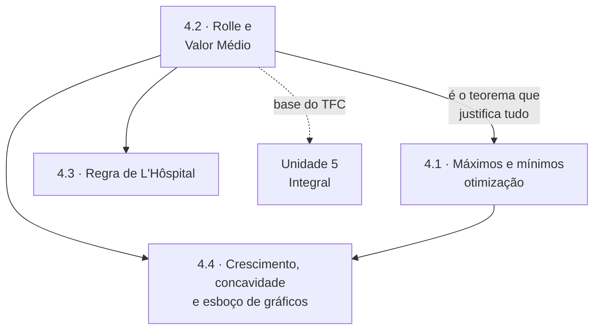

# Unidade 4 · Derivadas: aplicações

> [!NOTE]
> 🚧 **Unidade em construção.** As páginas abaixo estão sendo escritas e publicadas em ordem. Enquanto isso, o índice já serve de roteiro de estudo.

> Nesta unidade a derivada deixa de ser conta e vira ferramenta: ela responde "qual é o maior valor possível?", "onde a curva muda de comportamento?" e "quanto vale esse limite que parece impossível?".

---

## 🎯 Objetivos da unidade

- Localizar **máximos e mínimos** locais e absolutos, e aplicar o teste da primeira e da segunda derivada.
- Resolver **problemas de otimização** — a aplicação mais cobrada em prova e a mais usada na engenharia.
- Enunciar e aplicar os **Teoremas de Rolle e do Valor Médio**, verificando hipóteses antes de usar.
- Usar a **Regra de L&#39;Hôspital** nas indeterminações $\frac{0}{0}$ e $\frac{\infty}{\infty}$, e converter as outras sete a essas duas.
- Determinar **crescimento, concavidade e pontos de inflexão**, e **esboçar o gráfico** de uma função com todos os elementos.

---

## 🗺️ Mapa da unidade

---

## 📚 Conteúdo

| # | Teoria | 📝 Propostos | ✅ Gabarito |
| :---: | --- | :---: | :---: |
| 4.1 | [Máximos e mínimos](4.1-maximos-e-minimos.md) | [lista](exercicios/lista-4.1-propostos.md) | [gabarito](gabaritos/gabarito-4.1.md) |
| 4.2 | [Teoremas de Rolle e do Valor Médio](4.2-teoremas-de-rolle-e-do-valor-medio.md) | [lista](exercicios/lista-4.2-propostos.md) | [gabarito](gabaritos/gabarito-4.2.md) |
| 4.3 | [Regra de L&#39;Hôspital no cálculo de limites](4.3-regra-de-lhospital.md) | [lista](exercicios/lista-4.3-propostos.md) | [gabarito](gabaritos/gabarito-4.3.md) |
| 4.4 | [Crescimento, concavidade e esboço de gráficos](4.4-crescimento-concavidade-e-esboco-de-graficos.md) | [lista](exercicios/lista-4.4-propostos.md) | [gabarito](gabaritos/gabarito-4.4.md) |
| 🧪 | **Revisão da unidade** | [lista](exercicios/revisao-unidade-4.md) | [gabarito](gabaritos/gabarito-revisao-unidade-4.md) |

**Pré-requisito:** [Unidade 3](../03-derivadas/README.md) com fluência — aqui você deriva sem pensar e usa o resultado para decidir.

---

## ✅ Checklist de autoavaliação

- [ ] Achar os extremos absolutos de uma função contínua em um intervalo fechado (método dos candidatos).
- [ ] Montar e resolver um problema de otimização a partir do enunciado em português.
- [ ] Verificar as hipóteses de Rolle **antes** de aplicar o teorema.
- [ ] Reconhecer quando L&#39;Hôspital **não** se aplica — e por que aplicá-lo mesmo assim pode dar resposta errada.
- [ ] Transformar $0 \cdot \infty$, $\infty - \infty$ e $1^{\infty}$ em $\frac{0}{0}$ ou $\frac{\infty}{\infty}$.
- [ ] Esboçar o gráfico de uma função racional com domínio, assíntotas, crescimento, concavidade e inflexão.

---

## ⚠️ Os erros clássicos desta unidade

1. **Aplicar L&#39;Hôspital sem indeterminação.** Se a substituição dá $\frac{2}{5}$, a resposta é $\frac{2}{5}$. Derivar numerador e denominador nesse caso **inventa** um resultado errado.
2. **Confundir ponto crítico com extremo.** Em $f(x) = x^3$, o ponto $x = 0$ é crítico e não é nem máximo nem mínimo. O ponto crítico é **candidato**, não resposta.
3. **Esquecer os extremos do intervalo.** Em intervalo fechado, o máximo absoluto pode estar na borda, onde a derivada não se anula.

---

| ← Anterior | 🏠 Índice | Próximo → |
| :--- | :---: | ---: |
| [Unidade 3 · Derivadas](../03-derivadas/README.md) | [Página inicial](../README.md) | [Unidade 5 · Integral](../05-integrais/README.md) |

*Sobrevivendo ao Cálculo 1 (UENF)* · por **Nicolau Prates** · [CC BY-SA 4.0](../LICENSE)
