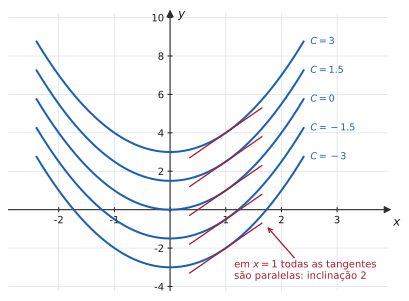
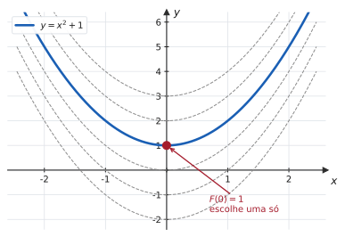

# 5.1 · Primitivas e o conceito de integral

| ← Anterior | 🏠 Índice | Próximo → |
| :--- | :---: | ---: |
| [Unidade 4 · Aplicações](../04-aplicacoes-das-derivadas/README.md) | [Unidade 5](README.md) · [Página inicial](../README.md) | [5.2 · Técnicas de integração](5.2-tecnicas-de-integracao.md) |

---

## 🎯 O que você vai aprender

- O que é uma **primitiva** (ou antiderivada) e por que ela nunca é única.
- O significado da **constante $C$** — geométrico, não burocrático.
- A notação $\int f(x)\thinspace dx$ e a tabela das **integrais imediatas**.
- Resolver um **problema de valor inicial**: achar a primitiva que passa por um ponto dado.

**Pré-requisitos:** toda a [Unidade 3](../03-derivadas/README.md) (você precisa derivar sem pensar) e o [Corolário do TVM](../04-aplicacoes-das-derivadas/4.2-teoremas-de-rolle-e-do-valor-medio.md).

---

## Por que isso importa

Até aqui o Cálculo respondeu a uma pergunta: **dada a função, qual é a taxa de variação?**

Agora a pergunta se inverte: **dada a taxa de variação, qual é a função?**

Essa inversão é o que transforma o Cálculo em ferramenta de engenharia. Um sensor mede **velocidade** e você quer a **posição**. Um modelo dá a **taxa de crescimento** de uma população e você quer a **população**. Um projeto dá a **densidade de carga** e você quer a **carga total**. Em todos esses casos, o dado é a derivada e a incógnita é a função.

> [!TIP]
> **Integrar é mais difícil que derivar, e há um motivo estrutural.** Derivar é seguir um algoritmo: toda expressão tem uma regra que se aplica a ela. Integrar é **reconhecer**: você olha a expressão e decide qual técnica tentar. É mais parecido com resolver um quebra-cabeça do que com executar uma receita — e por isso só se aprende fazendo muitos exercícios.

---

## 1. Primitiva

> 📐 **Definição 5.1.1.** Uma função $F$ é uma **primitiva** (ou **antiderivada**) de $f$ num intervalo $I$ se
>
> $$F'(x) = f(x) \qquad \text{para todo } x \in I$$

**Exemplo.** $F(x)=x^2$ é primitiva de $f(x)=2x$, porque $\big(x^2\big)' = 2x$ ✔

Mas $x^2+1$ também é. E $x^2-7$. E $x^2+\sqrt{2}$. **Toda** função da forma $x^2+C$ tem derivada $2x$, porque a derivada de uma constante é zero.

> 📊 As curvas são **a mesma curva**, deslizada verticalmente. Deslizar não muda inclinação nenhuma: é por isso que todas têm a mesma derivada.

### Quantas primitivas existem?

A pergunta natural é se há **outras** primitivas de $2x$ além das do tipo $x^2+C$. A resposta é não — e quem garante isso é um teorema da Unidade 4.

> 📐 **Teorema 5.1.1.** Se $F$ e $G$ são primitivas da **mesma** função $f$ num intervalo $I$, então existe uma constante $C$ tal que
>
> $$G(x) = F(x) + C \qquad \text{para todo } x \in I$$

> 💡 **A demonstração cabe em três linhas.** Seja $H = G-F$. Então
>
> $$H'(x) = G'(x)-F'(x) = f(x)-f(x) = 0 \quad \text{para todo } x\in I$$
>
> Pelo [Corolário 1 do Teorema do Valor Médio](../04-aplicacoes-das-derivadas/4.2-teoremas-de-rolle-e-do-valor-medio.md), uma função com derivada nula **num intervalo** é constante. Logo $H(x)=C$, ou seja, $G = F+C$ $\blacksquare$
>
> Repare no que acabou de acontecer: o TVM, que parecia um teorema abstrato sem aplicação, é exatamente o que garante que a **constante de integração** dá conta de **todas** as primitivas. Sem ele, não haveria como saber se faltou alguma.

> [!CAUTION]
> **A hipótese "num intervalo" é essencial.** Em $\mathbb{R}\setminus\lbrace0\rbrace$ — que **não** é um intervalo — considere a função $H$ que vale $1$ para $x>0$ e $2$ para $x<0$.
>
> Em **todo** ponto do domínio ela tem derivada nula (é localmente constante), e mesmo assim **não** é constante. É por isso que, mais adiante, $\int \frac{dx}{x} = \ln\lvert x\rvert + C$ exige cuidado: em cada lado do zero, a constante pode ser diferente.

---

## 2. A integral indefinida

Como as primitivas de $f$ formam uma família de funções que diferem por constante, dá-se um nome e uma notação à família inteira.

> 📐 **Definição 5.1.2.** A **integral indefinida** de $f$ é o conjunto de todas as suas primitivas:
>
> $$\int f(x)\thinspace dx = F(x) + C \qquad \text{onde } F'=f$$
>
> O símbolo $\int$ é o **sinal de integral**, $f(x)$ é o **integrando**, $dx$ indica a **variável de integração** e $C$ é a **constante de integração**.

**Leitura em voz alta:** "a integral de $f$ de $x$, $de$ $x$".

> [!NOTE]
> **O $dx$ não é enfeite.** Ele diz **em relação a qual variável** você está integrando — exatamente como o $dx$ em $\frac{dy}{dx}$. Compare:
>
> $$\int 2xt\thinspace dx = x^2 t + C \qquad \text{mas} \qquad \int 2xt\thinspace dt = x\thinspace t^2 + C$$
>
> Mesmo integrando, resultados diferentes. Na primeira, $t$ é tratado como constante; na segunda, $x$ é.

### A propriedade que você vai usar o tempo todo

> 📐 **Teorema 5.1.2 (Linearidade).** Se $f$ e $g$ têm primitivas e $k$ é constante:
>
> $$\int \big[f(x) \pm g(x)\big]\thinspace dx = \int f(x)\thinspace dx \pm \int g(x)\thinspace dx$$
>
> $$\int k\thinspace f(x)\thinspace dx = k\int f(x)\thinspace dx$$

Em palavras: **a integral respeita soma, subtração e multiplicação por constante** — exatamente como a derivada.

> [!CAUTION]
> **E não respeita mais nada.** Em particular:
>
> $$\int f(x)\thinspace g(x)\thinspace dx \ \neq\ \int f(x)\thinspace dx \cdot \int g(x)\thinspace dx \qquad\qquad \int \frac{f(x)}{g(x)}\thinspace dx \ \neq\ \frac{\int f(x)\thinspace dx}{\int g(x)\thinspace dx}$$
>
> **Teste rápido** com $f=g=x$: o lado esquerdo é $\int x^2 dx = \frac{x^3}{3}+C$; o direito é $\frac{x^2}{2}\cdot\frac{x^2}{2} = \frac{x^4}{4}$. Não são a mesma função.
>
> Não existe "regra do produto" para integrais — existe **integração por partes**, que é outra coisa e vem em [5.2](5.2-tecnicas-de-integracao.md).

---

## 3. A tabela das integrais imediatas

Cada linha da tabela abaixo é uma linha da tabela de **derivadas** lida de trás para frente. Você não precisa decorar as duas: precisa decorar uma e saber virar.

| Integral | Resultado | Vem de |
| --- | --- | --- |
| $\displaystyle\int k\thinspace dx$ | $kx + C$ | $(kx)' = k$ |
| $\displaystyle\int x^{n}\thinspace dx$ &nbsp;($n\neq-1$) | $\dfrac{x^{n+1}}{n+1} + C$ | regra da potência |
| $\displaystyle\int \frac{1}{x}\thinspace dx$ | $\ln\lvert x\rvert + C$ | $(\ln\lvert x\rvert)' = \frac1x$ |
| $\displaystyle\int e^{x}\thinspace dx$ | $e^{x} + C$ | $(e^x)' = e^x$ |
| $\displaystyle\int a^{x}\thinspace dx$ &nbsp;($a>0$, $a\neq1$) | $\dfrac{a^{x}}{\ln a} + C$ | $(a^x)' = a^x\ln a$ |
| $\displaystyle\int \operatorname{sen} x\thinspace dx$ | $-\cos x + C$ | $(\cos x)' = -\operatorname{sen} x$ |
| $\displaystyle\int \cos x\thinspace dx$ | $\operatorname{sen} x + C$ | $(\operatorname{sen} x)' = \cos x$ |
| $\displaystyle\int \operatorname{sec}^2 x\thinspace dx$ | $\operatorname{tg} x + C$ | $(\operatorname{tg} x)' = \operatorname{sec}^2 x$ |
| $\displaystyle\int \operatorname{cossec}^2 x\thinspace dx$ | $-\operatorname{cotg} x + C$ | $(\operatorname{cotg} x)' = -\operatorname{cossec}^2 x$ |
| $\displaystyle\int \operatorname{sec} x\operatorname{tg} x\thinspace dx$ | $\operatorname{sec} x + C$ | $(\operatorname{sec} x)' = \operatorname{sec} x\operatorname{tg} x$ |
| $\displaystyle\int \operatorname{cossec} x\operatorname{cotg} x\thinspace dx$ | $-\operatorname{cossec} x + C$ | $(\operatorname{cossec} x)' = -\operatorname{cossec} x\operatorname{cotg} x$ |
| $\displaystyle\int \frac{dx}{\sqrt{1-x^2}}$ | $\operatorname{arcsen} x + C$ | [seção 3.4](../03-derivadas/3.4-derivadas-das-funcoes-trigonometricas-inversas.md) |
| $\displaystyle\int \frac{dx}{1+x^2}$ | $\operatorname{arctg} x + C$ | [seção 3.4](../03-derivadas/3.4-derivadas-das-funcoes-trigonometricas-inversas.md) |

> ⚠️ **Por que $n\neq-1$ na regra da potência?** Porque a fórmula $\frac{x^{n+1}}{n+1}$ teria denominador zero. O caso $n=-1$ é justamente o **único** que foge do padrão, e sua resposta é o logaritmo — uma função de natureza completamente diferente. É o buraco mais importante da tabela: $\int x^{-1}dx$ **não** é $\frac{x^0}{0}$.

> 💡 **A tabela completa, pronta para consulta, está no [A2 · Tabela de integrais](../06-formulario/A2-tabela-de-integrais.md).**

---

## 4. A superpotência da integração: conferir sozinho

Esta é a vantagem que a integral tem sobre qualquer outro tópico do Cálculo 1:

> [!TIP]
> **Toda resposta de integral pode ser verificada: basta derivá-la.** Se a derivada do seu resultado devolve o integrando, a resposta está **certa** — não "provavelmente certa", certa.
>
> $$\int \big(3x^2-4x\big)dx = x^3-2x^2+C \quad \xrightarrow{\ \text{derive}\ } \quad 3x^2-4x \ \checkmark$$
>
> Use isso **em toda prova**. Numa questão de integral, não existe desculpa para entregar uma resposta errada por distração: a conferência leva dez segundos e não depende do gabarito.

---

## 5. Problemas de valor inicial

A integral indefinida devolve uma **família** de funções. Na prática, quase sempre se quer **uma** delas — e o que seleciona o membro certo é uma informação extra, chamada **condição inicial**.

> 📊 Infinitas curvas resolvem $F' = 2x$. Exigir que a curva **passe por $(0,1)$** deixa exatamente uma.

**O procedimento, em dois passos:**

1. Integre, mantendo o $C$.
2. Substitua a condição dada e **resolva para $C$**.

**Exemplo.** Encontre $f$ sabendo que $f'(x) = 6x-2$ e $f(1)=5$.

**Passo 1.** $f(x) = \displaystyle\int (6x-2)\thinspace dx = 3x^2-2x+C$

**Passo 2.** $f(1) = 3-2+C = 5 \Rightarrow C = 4$

**Resposta.** $f(x) = 3x^2-2x+4$.

---

## ⚠️ Armadilhas

| O erro | Por que está errado | O certo |
| --- | --- | --- |
| esquecer o $+\thinspace C$ | a resposta descreve **uma** primitiva, não todas | escreva o $C$ sempre |
| $\int x^{-1}dx = \frac{x^0}{0}$ | divisão por zero; a regra exclui $n=-1$ | $\ln\lvert x\rvert + C$ |
| $\int \frac1x dx = \ln x + C$ | perde todo o lado negativo do domínio | o **módulo** é obrigatório |
| $\int f\cdot g = \int f\cdot\int g$ | não existe tal regra | reescreva, ou use partes ([5.2](5.2-tecnicas-de-integracao.md)) |
| $\int \operatorname{sen} x\thinspace dx = \cos x + C$ | **sinal trocado** — o erro mais comum da tabela | $-\cos x + C$ |
| integrar sem simplificar antes | a tabela só reconhece formas simples | reescreva raízes e frações como **potências** |
| trocar a variável no $dx$ | $\int 2xt\thinspace dx \neq \int 2xt\thinspace dt$ | leia o $dx$ antes de começar |

---

## 🧠 Exercícios resolvidos

### Exercício Resolvido 1

**Calcule** $\displaystyle\int \big(3x^2-4x+5\big)\thinspace dx$.

**Solução.** Pela linearidade, integra-se termo a termo:

$$\int 3x^2\thinspace dx - \int 4x\thinspace dx + \int 5\thinspace dx = 3\cdot\frac{x^3}{3} - 4\cdot\frac{x^2}{2} + 5x + C$$

$$= x^3-2x^2+5x+C$$

**Conferindo:** $\big(x^3-2x^2+5x+C\big)' = 3x^2-4x+5$ ✔

> 💡 **Um só $C$ no fim.** Cada integral geraria sua própria constante, mas a soma de três constantes ainda é uma constante. Escrever $C_1+C_2+C_3$ é correto e desnecessário.

---

### Exercício Resolvido 2

**Calcule** $\displaystyle\int \left(\sqrt{x} + \frac{1}{x^2} - \frac{3}{x}\right)dx$.

**Solução.** **Primeiro reescreva tudo como potência** — a tabela não reconhece raízes nem frações:

$$\sqrt{x} = x^{1/2} \qquad \frac{1}{x^2} = x^{-2} \qquad \frac{3}{x} = 3\cdot\frac1x$$

Agora cada parcela é imediata:

$$\int x^{1/2}dx = \frac{x^{3/2}}{3/2} = \frac23 x^{3/2} \qquad \int x^{-2}dx = \frac{x^{-1}}{-1} = -\frac1x \qquad \int \frac{3}{x}dx = 3\ln\lvert x\rvert$$

**Resposta.**

$$\int \left(\sqrt{x} + \frac{1}{x^2} - \frac{3}{x}\right)dx = \frac23 x^{3/2} - \frac1x - 3\ln\lvert x\rvert + C$$

> ⚠️ **Note os dois expoentes $-1$ e o tratamento diferente.** Em $x^{-2}$, a regra da potência se aplica normalmente ($n=-2\neq-1$). Em $\frac3x = 3x^{-1}$, ela **não** se aplica, e a resposta é logarítmica. A diferença entre as duas parcelas é uma unidade no expoente e uma função inteira no resultado.

---

### Exercício Resolvido 3

**Calcule** $\displaystyle\int \frac{2x^3-5}{x^2}\thinspace dx$.

**Solução.** Não existe regra para integrar quociente. Mas aqui o denominador é um **monômio**, e aí a fração se **divide termo a termo**:

$$\frac{2x^3-5}{x^2} = \frac{2x^3}{x^2} - \frac{5}{x^2} = 2x - 5x^{-2}$$

Agora é soma de potências:

$$\int \big(2x-5x^{-2}\big)dx = 2\cdot\frac{x^2}{2} - 5\cdot\frac{x^{-1}}{-1} + C = x^2 + \frac{5}{x} + C$$

**Conferindo:** $\left(x^2+5x^{-1}\right)' = 2x-5x^{-2} = \dfrac{2x^3-5}{x^2}$ ✔

> 💡 **Dividir por monômio sempre funciona; dividir por polinômio, não.** $\frac{a+b}{c} = \frac ac + \frac bc$ é legítimo. Já $\frac{c}{a+b} \neq \frac ca + \frac cb$ — e é por isso que $\int\frac{dx}{x^2-1}$ exige uma técnica própria (frações parciais, em [5.2](5.2-tecnicas-de-integracao.md)).

---

### Exercício Resolvido 4

**Calcule** $\displaystyle\int \operatorname{tg}^2 x\thinspace dx$.

**Solução.** A tabela não tem $\operatorname{tg}^2$. Mas tem $\operatorname{sec}^2$ — e a identidade pitagórica liga as duas:

$$\operatorname{sec}^2 x = 1 + \operatorname{tg}^2 x \ \Longrightarrow \ \operatorname{tg}^2 x = \operatorname{sec}^2 x - 1$$

Substituindo:

$$\int \operatorname{tg}^2 x\thinspace dx = \int \big(\operatorname{sec}^2 x - 1\big)dx = \operatorname{tg} x - x + C$$

**Conferindo:** $(\operatorname{tg} x - x)' = \operatorname{sec}^2 x - 1 = \operatorname{tg}^2 x$ ✔

> 💡 **Esse é o padrão de boa parte das integrais trigonométricas:** o integrando não está na tabela, mas uma **identidade** o leva até lá. Vale ter à mão o [A3 · Identidades trigonométricas](../06-formulario/A3-identidades-trigonometricas.md) — em integral, identidade é ferramenta de trabalho, não decoração.

---

### Exercício Resolvido 5

**Determine $f$ sabendo que $f''(x) = 12x - 6$, $f'(1) = 2$ e $f(1) = 0$.**

**Solução.** Com a **segunda** derivada, integra-se **duas** vezes — e cada integração traz sua própria constante, que é determinada por sua própria condição.

**Primeira integração.**

$$f'(x) = \int (12x-6)\thinspace dx = 6x^2-6x+C_1$$

Usando $f'(1)=2$:

$$6-6+C_1 = 2 \ \Longrightarrow \ C_1 = 2 \qquad\text{logo}\qquad f'(x) = 6x^2-6x+2$$

**Segunda integração.**

$$f(x) = \int \big(6x^2-6x+2\big)dx = 2x^3-3x^2+2x+C_2$$

Usando $f(1)=0$:

$$2-3+2+C_2 = 0 \ \Longrightarrow \ C_2 = -1$$

**Resposta.** $f(x) = 2x^3-3x^2+2x-1$.

> ⚠️ **Resolva $C_1$ antes de integrar de novo.** Quem carrega o $C_1$ para a segunda integração acaba com um termo $C_1x$ e um sistema de duas equações — mais trabalho e mais chance de erro. Cada condição inicial resolve a constante **da sua etapa**.

---

### Exercício Resolvido 6

**Uma pedra é lançada verticalmente para cima a $20 \text{ m/s}$, de uma altura de $25$ metros. Considerando $g = 10 \text{ m/s}^2$:**

**(a) Determine a altura $s(t)$.**
**(b) Qual é a altura máxima atingida?**
**(c) Quando a pedra atinge o solo?**

**Solução.**

**(a)** O dado é a **aceleração** — a derivada segunda da posição. A única força é a gravidade, apontando para baixo:

$$a(t) = -10$$

**Integrando uma vez** (obtém-se a velocidade), com $v(0)=20$:

$$v(t) = \int (-10)\thinspace dt = -10t + C_1 \qquad v(0) = C_1 = 20$$

$$v(t) = -10t+20$$

**Integrando de novo** (obtém-se a posição), com $s(0)=25$:

$$s(t) = \int (-10t+20)\thinspace dt = -5t^2+20t+C_2 \qquad s(0) = C_2 = 25$$

$$\boxed{\ s(t) = -5t^2+20t+25\ }$$

**(b)** A pedra está no ponto mais alto quando **para de subir**, ou seja, quando $v(t)=0$ — que é exatamente a condição de ponto crítico de $s$:

$$-10t+20 = 0 \ \Longrightarrow \ t = 2\text{ s}$$

$$s(2) = -20+40+25 = \mathbf{45\text{ metros}}$$

**(c)** Atingir o solo significa $s(t)=0$:

$$-5t^2+20t+25 = 0 \ \Longrightarrow \ t^2-4t-5 = 0 \ \Longrightarrow \ (t-5)(t+1) = 0$$

As raízes são $t=5$ e $t=-1$. Como o tempo não é negativo, a pedra atinge o solo em $\mathbf{t=5}$ **segundos**.

> 💡 **Repare no que esta questão realmente é:** toda a Unidade 4 (ponto crítico, máximo) aplicada a uma função que a Unidade 5 acabou de construir. A integral forneceu $s(t)$; a derivada encontrou o pico. É o mesmo par de ferramentas trabalhando nos dois sentidos — e é assim que praticamente toda aplicação de Cálculo funciona.

---

## 📝 Agora é com você

➡️ **[Lista 5.1 — exercícios propostos](exercicios/lista-5.1-propostos.md)** · ✅ **[Gabarito](gabaritos/gabarito-5.1.md)**

---

## Resumo da página

> **Decore:**
> - **Primitiva:** $F'=f$. Duas primitivas no mesmo **intervalo** diferem por constante.
> - $\displaystyle\int x^n dx = \frac{x^{n+1}}{n+1}+C$ para $n\neq-1$, e $\displaystyle\int\frac{dx}{x} = \ln\lvert x\rvert+C$.
> - $\displaystyle\int \operatorname{sen} x\thinspace dx = -\cos x + C$ — o **sinal negativo** é o erro mais comum da unidade.
> - A integral é **linear**, e nada além disso: não há regra para produto nem para quociente.
>
> **Saiba fazer:**
> 1. Reescrever raízes e frações como **potências** antes de integrar.
> 2. Dividir fração por monômio termo a termo.
> 3. Usar identidade trigonométrica para cair na tabela.
> 4. Resolver um PVI: integre, substitua, determine $C$ — uma condição para cada integração.
>
> **E sempre:** **confira derivando**. É a única parte do Cálculo 1 em que você pode garantir a própria nota.

---

## 📚 Para aprofundar

| Livro | Onde procurar |
| --- | --- |
| **LEITHOLD** | Capítulo 5 — "Antidiferenciação"; "Equações diferenciais com variáveis separáveis" |
| **STEWART** | Capítulo 4 — "Primitivas" (antes do capítulo de integrais) |
| **THOMAS** | Capítulo 4 — "Antiderivadas"; Capítulo 5 — "Integrais indefinidas" |
| **ANTON** | Capítulo 5 — "A integral indefinida" |
| **SWOKOWSKI** | Capítulo 5 — "Antiderivadas e integração indefinida" |
| **MUNEM & FOULIS** | Capítulo 5 — "A antiderivada" |

---

| ← Anterior | 🏠 Índice | Próximo → |
| :--- | :---: | ---: |
| [Unidade 4 · Aplicações](../04-aplicacoes-das-derivadas/README.md) | [Unidade 5](README.md) · [Página inicial](../README.md) | [5.2 · Técnicas de integração](5.2-tecnicas-de-integracao.md) |

*Sobrevivendo ao Cálculo 1 (UENF)* · por **Nicolau Prates** · [CC BY-SA 4.0](../LICENSE)
