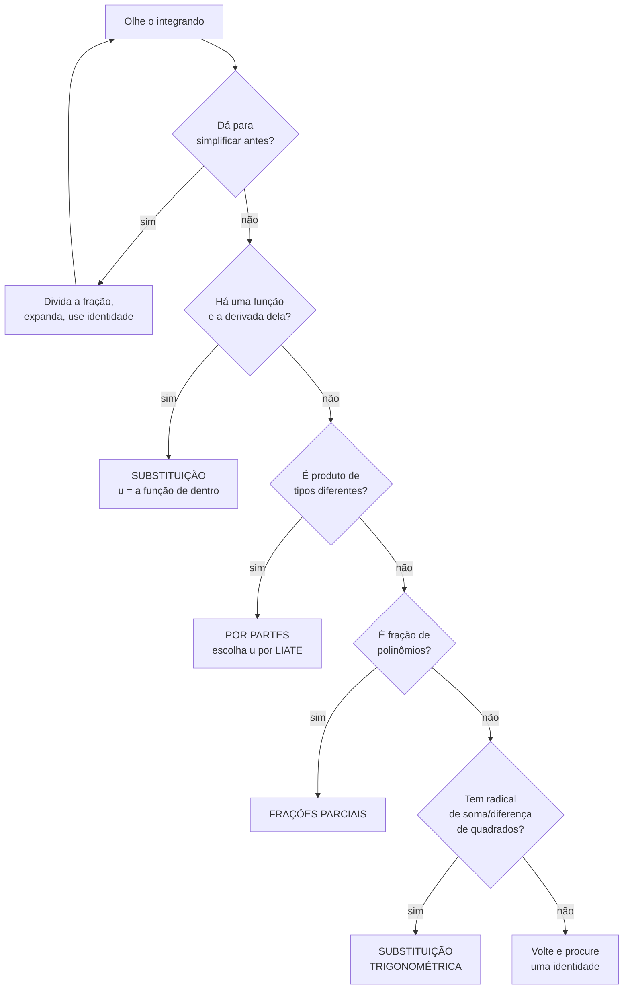
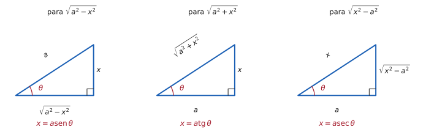

# 5.2 · Técnicas de integração

| ← Anterior | 🏠 Índice | Próximo → |
| :--- | :---: | ---: |
| [5.1 · Primitivas](5.1-primitivas-e-o-conceito-de-integral.md) | [Unidade 5](README.md) · [Página inicial](../README.md) | [5.3 · Integral definida e o TFC](5.3-integral-definida-e-o-teorema-fundamental-do-calculo.md) |

---

## 🎯 O que você vai aprender

- **Substituição**: a regra da cadeia ao contrário — a técnica mais usada de todas.
- **Integração por partes**: a regra do produto ao contrário.
- **Frações parciais**: quebrar uma fração racional em pedaços integráveis.
- **Substituição trigonométrica**: eliminar radicais do tipo $\sqrt{a^2-x^2}$.
- E, acima de tudo: **decidir qual técnica usar** olhando para o integrando.

**Pré-requisitos:** [5.1](5.1-primitivas-e-o-conceito-de-integral.md) com a tabela na ponta da língua, mais a [regra da cadeia (3.3)](../03-derivadas/3.3-regra-da-cadeia-e-derivada-da-funcao-inversa.md) e as [identidades trigonométricas](../06-formulario/A3-identidades-trigonometricas.md).

---

## Por que isso importa

Esta é a seção mais longa da unidade, e é onde se ganha ou se perde a nota da P3.

A razão é que integrar **não tem algoritmo**. Em derivadas, toda expressão cai em alguma regra, e basta aplicá-la. Aqui, você olha para $\int x\sqrt{x^2+1}\thinspace dx$ e precisa **decidir** o que tentar. A decisão certa resolve em três linhas; a errada consome dez minutos e não chega a lugar nenhum.

A boa notícia é que a decisão é aprendível: existem padrões, e eles se repetem. A má notícia é que só se aprende **vendo muitos casos**.

---

## O mapa da decisão

> [!TIP]
> **O primeiro losango é o mais ignorado e o mais rentável.** Antes de escolher técnica, pergunte se dá para **simplificar**. Muita integral que parece exigir substituição cede a uma divisão de frações, a uma expansão ou a uma identidade — e vira integral de tabela.

---

## 1. Substituição

É a **regra da cadeia lida de trás para frente**.

Derivando $F\big(g(x)\big)$, a cadeia produz $F'\big(g(x)\big)\thinspace g'(x)$. Logo, integrar uma expressão **desse formato** devolve $F\big(g(x)\big)$:

> 📐 **Teorema 5.2.1 (Substituição).** Se $u = g(x)$ é derivável e $F' = f$, então
>
> $$\int f\big(g(x)\big)\thinspace g'(x)\thinspace dx = \int f(u)\thinspace du = F(u) + C = F\big(g(x)\big) + C$$

**O que procurar no integrando:** uma **função de dentro** e, multiplicando, a **derivada dela** (podendo faltar ou sobrar uma constante, que se ajusta).

### O procedimento

| Passo | O que fazer |
| :---: | --- |
| **1** | Escolha $u = $ a função "de dentro" (o que está sob a raiz, no expoente, no denominador, dentro do seno…) |
| **2** | Calcule $du = g'(x)\thinspace dx$ |
| **3** | Reescreva a integral **inteira** em $u$ — não pode sobrar nenhum $x$ |
| **4** | Integre em $u$ |
| **5** | **Volte para $x$** substituindo $u = g(x)$ |

> [!CAUTION]
> **Se sobrou um $x$ depois do passo 3, a substituição foi a errada.** Não tente "chutar" o que fazer com ele: volte e escolha outro $u$. A integral em $u$ tem de estar **completamente** em $u$.

**Exemplo comentado.** $\displaystyle\int 2x\thinspace e^{x^2}dx$

A função de dentro é $x^2$ (está no expoente), e a derivada dela, $2x$, está ali multiplicando. Perfeito:

$$u = x^2 \ \Longrightarrow \ du = 2x\thinspace dx$$

$$\int 2x\thinspace e^{x^2}dx = \int e^{u}\thinspace du = e^{u}+C = e^{x^2}+C$$

### Ajustando constantes

Raramente a derivada aparece com o coeficiente exato. Quando falta ou sobra **uma constante**, basta compensar:

$$\int x\thinspace e^{x^2}dx \qquad u = x^2,\quad du = 2x\thinspace dx \ \Longrightarrow \ x\thinspace dx = \frac{du}{2}$$

$$= \int e^u\cdot\frac{du}{2} = \frac12 e^u + C = \frac12 e^{x^2}+C$$

> [!CAUTION]
> **Constante pode sair da integral; variável não.** Isto é legítimo:
>
> $$\int x\thinspace e^{x^2}dx = \frac12\int e^{u}du$$
>
> Isto **não** é:
>
> $$\int x\thinspace e^{x^2}dx \ \neq\ x\int e^{x^2}dx$$
>
> O $x$ depende da variável de integração e não atravessa o sinal de integral.

---

## 2. Integração por partes

É a **regra do produto lida de trás para frente**.

Derivando $u\thinspace v$:

$$(uv)' = u'v + uv'$$

Integrando os dois lados e isolando:

$$uv = \int u'v\thinspace dx + \int uv'\thinspace dx \ \Longrightarrow \ \int uv'\thinspace dx = uv - \int u'v\thinspace dx$$

> 📐 **Teorema 5.2.2 (Integração por partes).**
>
> $$\int u\thinspace dv = uv - \int v\thinspace du$$

**O que a fórmula faz:** troca a integral $\int u\thinspace dv$ por outra, $\int v\thinspace du$. Ela só ajuda se a **nova for mais fácil** — e é aí que mora a escolha.

### Como escolher $u$: a regra LIATE

Escolha para $u$ a função que aparecer **primeiro** nesta lista:

| Letra | Tipo | Exemplo |
| :---: | --- | --- |
| **L** | **L**ogarítmica | $\ln x$ |
| **I** | **I**nversa trigonométrica | $\mathrm{arctg}\thinspace x$ |
| **A** | **A**lgébrica (polinômio) | $x^2$ |
| **T** | **T**rigonométrica | $\mathrm{sen}\thinspace x$ |
| **E** | **E**xponencial | $e^x$ |

O que sobrar vira $dv$.

> 💡 **Por que a ordem é essa.** As primeiras da lista **simplificam ao derivar** (o $\ln x$ vira $\frac1x$, uma função algébrica); as últimas **não pioram ao integrar** ($e^x$ integra em $e^x$). Colocar no $u$ quem melhora ao derivar e no $dv$ quem não piora ao integrar é exatamente o que faz a nova integral ficar mais fácil.

**Exemplo.** $\displaystyle\int x\cos x\thinspace dx$

Entre **A**lgébrica ($x$) e **T**rigonométrica ($\cos x$), o **A** vem primeiro:

$$u = x \qquad dv = \cos x\thinspace dx$$
$$du = dx \qquad v = \mathrm{sen}\thinspace x$$

$$\int x\cos x\thinspace dx = x\mathrm{sen}\thinspace x - \int \mathrm{sen}\thinspace x\thinspace dx = x\mathrm{sen}\thinspace x + \cos x + C$$

> ⚠️ **A escolha errada piora.** Se tivesse escolhido $u=\cos x$ e $dv = x\thinspace dx$, a nova integral seria $\int \frac{x^2}{2}\mathrm{sen}\thinspace x\thinspace dx$ — com grau **maior** que a original. Quando a nova integral fica pior, **volte e inverta a escolha**.

### O truque do $dv = dx$

Algumas funções não parecem produto, mas são — multiplicadas por $1$:

$$\int \ln x\thinspace dx = \int \underbrace{\ln x}_{u}\cdot\underbrace{1\thinspace dx}_{dv}$$

É assim que se integra $\ln x$, $\mathrm{arctg}\thinspace x$ e $\mathrm{arcsen}\thinspace x$ — funções que **não têm** primitiva na tabela.

---

## 3. Frações parciais

Serve para integrar **funções racionais**: quocientes de polinômios.

A ideia é desmontar a fração em parcelas simples, cada uma integrável pela tabela.

### Antes de tudo: dois pré-requisitos

> [!CAUTION]
> **1. O grau do numerador tem de ser MENOR que o do denominador.** Se não for, **divida os polinômios primeiro**:
>
> $$\frac{x^2}{x-1} = x+1+\frac{1}{x-1}$$
>
> **2. O denominador precisa estar FATORADO.** Toda a técnica consiste em separar por fator.

### Os três casos

Fatorado o denominador, cada fator contribui com parcelas segundo a tabela:

| Fator no denominador | Parcelas que ele gera |
| --- | --- |
| **linear distinto** $(x-a)$ | $\dfrac{A}{x-a}$ |
| **linear repetido** $(x-a)^n$ | $\dfrac{A_1}{x-a} + \dfrac{A_2}{(x-a)^2} + \cdots + \dfrac{A_n}{(x-a)^n}$ |
| **quadrático irredutível** $(x^2+bx+c)$ | $\dfrac{Ax+B}{x^2+bx+c}$ |

> 💡 **"Irredutível" significa discriminante negativo** — sem raízes reais, logo não fatorável em lineares. Exemplo: $x^2+1$. Se $\Delta \geqslant 0$, fatore e use a primeira linha.

### O procedimento

**1.** Fatore o denominador.
**2.** Escreva a soma de parcelas com coeficientes a determinar.
**3.** Multiplique tudo pelo denominador original.
**4.** Determine os coeficientes (substituindo as **raízes** é o caminho mais rápido).
**5.** Integre cada parcela — tipicamente dá logaritmo ou arco-tangente.

---

## 4. Substituição trigonométrica

Serve para integrandos com radicais de **soma ou diferença de quadrados**, que nenhuma das técnicas anteriores resolve.

A ideia: trocar $x$ por uma função trigonométrica escolhida para que a **identidade pitagórica mate o radical**.

| Se aparece | Substitua | O radical vira | Porque |
| --- | --- | --- | --- |
| $\sqrt{a^2-x^2}$ | $x = a\mathrm{sen}\thinspace\theta$ | $a\cos\theta$ | $1-\mathrm{sen}^2 = \cos^2$ |
| $\sqrt{a^2+x^2}$ | $x = a\mathrm{tg}\thinspace\theta$ | $a\mathrm{sec}\thinspace\theta$ | $1+\mathrm{tg}^2 = \mathrm{sec}^2$ |
| $\sqrt{x^2-a^2}$ | $x = a\mathrm{sec}\thinspace\theta$ | $a\mathrm{tg}\thinspace\theta$ | $\mathrm{sec}^2-1 = \mathrm{tg}^2$ |

> [!TIP]
> **Não decore a tabela — desenhe o triângulo.** Monte o triângulo retângulo em que o radical é um dos lados, marque $\theta$ e leia as razões direto dele. O triângulo também é o que você vai usar no fim, para **voltar de $\theta$ para $x$**: todas as razões trigonométricas de $\theta$ se leem nele.

> [!CAUTION]
> **Voltar para $x$ é parte da resposta.** Uma resposta em $\theta$ está incompleta: o problema foi dado em $x$. Use o triângulo para traduzir cada $\mathrm{sen}\thinspace\theta$, $\cos\theta$ e $\mathrm{tg}\thinspace\theta$, e o $\theta$ sozinho vira o arco correspondente.

---

## ⚠️ Armadilhas

| O erro | Por que está errado | O certo |
| --- | --- | --- |
| sobrar $x$ depois de substituir | a integral precisa ficar só em $u$ | escolha outro $u$ |
| tirar variável da integral | só **constante** atravessa o $\int$ | $\int xf \neq x\int f$ |
| esquecer de voltar para $x$ | a resposta tem de estar na variável original | substitua $u=g(x)$ no fim |
| frações parciais com grau errado | a decomposição não existe assim | **divida** os polinômios antes |
| por partes com $u$ mal escolhido | a nova integral fica pior | siga LIATE; se piorou, inverta |
| aplicar partes onde cabia substituição | caminho muito mais longo | procure a derivada **primeiro** |
| responder em $\theta$ | o problema estava em $x$ | leia o triângulo |
| esquecer o $+\thinspace C$ | resposta incompleta | sempre |

---

## 🧠 Exercícios resolvidos

### Exercício Resolvido 1 — substituição

**Calcule** $\displaystyle\int x\sqrt{x^2+1}\thinspace dx$.

**Solução.** A função "de dentro" é $x^2+1$ (está sob a raiz), e sua derivada é $2x$ — que está ali, a menos do fator $2$:

$$u = x^2+1 \ \Longrightarrow \ du = 2x\thinspace dx \ \Longrightarrow \ x\thinspace dx = \frac{du}{2}$$

Reescrevendo **toda** a integral em $u$:

$$\int \sqrt{x^2+1}\cdot x\thinspace dx = \int \sqrt{u}\cdot\frac{du}{2} = \frac12\int u^{1/2}du = \frac12\cdot\frac{u^{3/2}}{3/2} = \frac13 u^{3/2}$$

**Voltando para $x$:**

$$\int x\sqrt{x^2+1}\thinspace dx = \frac13\big(x^2+1\big)^{3/2} + C$$

**Conferindo:** $\dfrac{d}{dx}\left[\dfrac13\big(x^2+1\big)^{3/2}\right] = \dfrac13\cdot\dfrac32\big(x^2+1\big)^{1/2}\cdot 2x = x\sqrt{x^2+1}$ ✔

---

### Exercício Resolvido 2 — substituição com logaritmo

**Calcule** $\displaystyle\int \mathrm{tg}\thinspace x\thinspace dx$.

**Solução.** A tangente não está na tabela. Mas, escrita como quociente, revela um padrão de substituição:

$$\int \mathrm{tg}\thinspace x\thinspace dx = \int\frac{\mathrm{sen}\thinspace x}{\cos x}\thinspace dx$$

O denominador é $\cos x$, e sua derivada, $-\mathrm{sen}\thinspace x$, está no numerador (a menos do sinal):

$$u = \cos x \ \Longrightarrow \ du = -\mathrm{sen}\thinspace x\thinspace dx \ \Longrightarrow \ \mathrm{sen}\thinspace x\thinspace dx = -du$$

$$\int\frac{\mathrm{sen}\thinspace x}{\cos x}dx = \int\frac{-du}{u} = -\ln\lvert u\rvert + C = -\ln\lvert\cos x\rvert + C$$

**Forma equivalente.** Como $-\ln\lvert\cos x\rvert = \ln\left\lvert\frac{1}{\cos x}\right\rvert$:

$$\int \mathrm{tg}\thinspace x\thinspace dx = \ln\lvert\mathrm{sec}\thinspace x\rvert + C$$

> 💡 **Guarde o padrão, não o resultado.** Sempre que o numerador for (múltiplo de) a **derivada do denominador**, a integral é logarítmica:
>
> $$\int\frac{g'(x)}{g(x)}dx = \ln\lvert g(x)\rvert + C$$
>
> Esse é, de longe, o caso de substituição mais frequente em prova. Reconhecê-lo de olho economiza minutos.

---

### Exercício Resolvido 3 — por partes

**Calcule (a)** $\displaystyle\int x\thinspace e^{x}dx$ **e (b)** $\displaystyle\int \ln x\thinspace dx$.

**Solução (a).** Produto de **A**lgébrica e **E**xponencial; por LIATE, o $u$ é a algébrica:

$$u = x \qquad dv = e^x dx$$
$$du = dx \qquad v = e^x$$

$$\int x\thinspace e^x dx = x e^x - \int e^x dx = xe^x - e^x + C = (x-1)e^x + C$$

**Conferindo:** $\big[(x-1)e^x\big]' = e^x + (x-1)e^x = e^x\big(1+x-1\big) = x e^x$ ✔

**Solução (b).** Não parece produto — mas é, multiplicado por $1$:

$$u = \ln x \qquad dv = dx$$
$$du = \frac{dx}{x} \qquad v = x$$

$$\int \ln x\thinspace dx = x\ln x - \int x\cdot\frac{1}{x}dx = x\ln x - \int dx = x\ln x - x + C$$

**Conferindo:** $(x\ln x - x)' = \ln x + x\cdot\frac1x - 1 = \ln x + 1 - 1 = \ln x$ ✔

> 💡 **Este é o item que mais cai de integração por partes**, e o truque ($dv = dx$) é o mesmo para $\mathrm{arcsen}\thinspace x$ e $\mathrm{arctg}\thinspace x$. Três funções importantes que não têm primitiva de tabela, todas resolvidas pelo mesmo movimento.

---

### Exercício Resolvido 4 — por partes circular

**Calcule** $\displaystyle\int e^{x}\mathrm{sen}\thinspace x\thinspace dx$.

**Solução.** Aqui LIATE indica $u = \mathrm{sen}\thinspace x$ (**T** antes de **E**), mas nenhum dos fatores simplifica ao derivar — nem seno nem exponencial. A integral parece não ir a lugar nenhum. **E não vai — ela volta**, e é exatamente isso que a resolve.

Chame a integral de $I$.

**Primeira aplicação.** $u = \mathrm{sen}\thinspace x$, $dv = e^x dx$, logo $du = \cos x\thinspace dx$ e $v = e^x$:

$$I = e^x\mathrm{sen}\thinspace x - \int e^x\cos x\thinspace dx$$

**Segunda aplicação**, na integral que sobrou. $u = \cos x$, $dv = e^x dx$, logo $du = -\mathrm{sen}\thinspace x\thinspace dx$ e $v=e^x$:

$$\int e^x\cos x\thinspace dx = e^x\cos x + \int e^x\mathrm{sen}\thinspace x\thinspace dx = e^x\cos x + I$$

**Substituindo de volta:**

$$I = e^x\mathrm{sen}\thinspace x - \big(e^x\cos x + I\big) = e^x\mathrm{sen}\thinspace x - e^x\cos x - I$$

A integral original reapareceu. Agora é **álgebra**: passe o $I$ para a esquerda.

$$2I = e^x\big(\mathrm{sen}\thinspace x - \cos x\big) \ \Longrightarrow \ I = \frac{e^x}{2}\big(\mathrm{sen}\thinspace x - \cos x\big) + C$$

**Conferindo:**

$$\left[\frac{e^x}{2}(\mathrm{sen}\thinspace x-\cos x)\right]' = \frac{e^x}{2}(\mathrm{sen}\thinspace x-\cos x) + \frac{e^x}{2}(\cos x+\mathrm{sen}\thinspace x) = \frac{e^x}{2}\cdot 2\mathrm{sen}\thinspace x = e^x\mathrm{sen}\thinspace x \ \checkmark$$

> ⚠️ **Duas regras de ouro para a integral circular:**
> 1. **Mantenha o mesmo tipo de escolha nas duas aplicações.** Se na primeira o $u$ foi a trigonométrica, na segunda também tem de ser. Trocar faz tudo se cancelar e devolve a identidade inútil $I = I$.
> 2. **O $+\thinspace C$ entra só no fim**, depois de dividir por $2$.

---

### Exercício Resolvido 5 — frações parciais

**Calcule** $\displaystyle\int \frac{3x+1}{x^2-x-2}\thinspace dx$.

**Solução.**

**Passo 1 — confira o grau.** Numerador grau $1$, denominador grau $2$. Está certo: $1<2$ ✔

**Passo 2 — fatore o denominador.**

$$x^2-x-2 = (x-2)(x+1)$$

**Passo 3 — monte a decomposição.** Dois fatores lineares distintos, duas parcelas:

$$\frac{3x+1}{(x-2)(x+1)} = \frac{A}{x-2} + \frac{B}{x+1}$$

**Passo 4 — determine $A$ e $B$.** Multiplicando tudo por $(x-2)(x+1)$:

$$3x+1 = A(x+1) + B(x-2)$$

Essa igualdade vale para **todo** $x$ — então pode-se escolher os valores mais convenientes, que são as **raízes**:

- **$x=2$:** $\ 7 = A(3) + B(0) \Rightarrow A = \dfrac73$
- **$x=-1$:** $\ -2 = A(0) + B(-3) \Rightarrow B = \dfrac23$

**Passo 5 — integre cada parcela.**

$$\int\frac{3x+1}{x^2-x-2}dx = \frac73\int\frac{dx}{x-2} + \frac23\int\frac{dx}{x+1} = \frac73\ln\lvert x-2\rvert + \frac23\ln\lvert x+1\rvert + C$$

> 💡 **Substituir as raízes é o atalho.** Cada raiz **zera** um dos termos e entrega o outro coeficiente de imediato, sem sistema linear. Expandir e igualar coeficientes também funciona, mas dá três vezes mais trabalho — reserve esse caminho para quando houver fator quadrático irredutível, que não tem raiz real para substituir.

---

### Exercício Resolvido 6 — substituição trigonométrica

**Calcule** $\displaystyle\int \sqrt{9-x^2}\thinspace dx$.

**Solução.** Radical da forma $\sqrt{a^2-x^2}$ com $a=3$. Pela tabela (ou pelo triângulo):

$$x = 3\mathrm{sen}\thinspace\theta \ \Longrightarrow \ dx = 3\cos\theta\thinspace d\theta$$

**O radical some:**

$$\sqrt{9-x^2} = \sqrt{9-9\mathrm{sen}^2\thinspace\theta} = 3\sqrt{1-\mathrm{sen}^2\thinspace\theta} = 3\sqrt{\cos^2\theta} = 3\cos\theta$$

**Substituindo:**

$$\int\sqrt{9-x^2}\thinspace dx = \int 3\cos\theta\cdot3\cos\theta\thinspace d\theta = 9\int\cos^2\theta\thinspace d\theta$$

**A integral de $\cos^2$** pede a identidade do arco duplo, $\cos^2\theta = \dfrac{1+\cos 2\theta}{2}$:

$$9\int\frac{1+\cos2\theta}{2}d\theta = \frac92\left(\theta + \frac{\mathrm{sen}\thinspace 2\theta}{2}\right) = \frac92\theta + \frac94\mathrm{sen}\thinspace 2\theta$$

Usando $\mathrm{sen}\thinspace 2\theta = 2\mathrm{sen}\thinspace\theta\cos\theta$:

$$= \frac92\theta + \frac92\mathrm{sen}\thinspace\theta\cos\theta$$

**Passo final — voltar para $x$.** Do triângulo com hipotenusa $3$, cateto oposto $x$ e cateto adjacente $\sqrt{9-x^2}$:

$$\mathrm{sen}\thinspace\theta = \frac{x}{3} \qquad \cos\theta = \frac{\sqrt{9-x^2}}{3} \qquad \theta = \mathrm{arcsen}\thinspace\frac{x}{3}$$

$$\int\sqrt{9-x^2}\thinspace dx = \frac92\mathrm{arcsen}\thinspace\frac{x}{3} + \frac92\cdot\frac{x}{3}\cdot\frac{\sqrt{9-x^2}}{3} + C$$

$$\boxed{\ \int\sqrt{9-x^2}\thinspace dx = \frac92\mathrm{arcsen}\thinspace\frac{x}{3} + \frac{x\sqrt{9-x^2}}{2} + C\ }$$

> 💡 **O que essa integral significa geometricamente.** O gráfico de $y=\sqrt{9-x^2}$ é a **semicircunferência superior** de raio $3$. Integrá-la de $-3$ a $3$ tem de dar a área do semicírculo, $\frac{9\pi}{2}$ — e dá:
>
> $$\frac92\mathrm{arcsen}(1) - \frac92\mathrm{arcsen}(-1) = \frac92\cdot\frac{\pi}{2} + \frac92\cdot\frac{\pi}{2} = \frac{9\pi}{2} \ \checkmark$$
>
> É uma conferência que vale ouro: quando a resposta de uma substituição trigonométrica tem interpretação geométrica, **use-a para testar**.

---

### Exercício Resolvido 7 — escolher a técnica

**Para cada integral, diga qual técnica usar e por quê. Não calcule.**

**(a)** $\displaystyle\int x\cos\big(x^2\big)dx$ &nbsp;&nbsp; **(b)** $\displaystyle\int x\cos x\thinspace dx$ &nbsp;&nbsp; **(c)** $\displaystyle\int\frac{dx}{x^2-9}$ &nbsp;&nbsp; **(d)** $\displaystyle\int\frac{dx}{\sqrt{x^2-9}}$ &nbsp;&nbsp; **(e)** $\displaystyle\int\frac{x\thinspace dx}{x^2-9}$

**Solução.**

| | Técnica | Por quê |
| :---: | --- | --- |
| **(a)** | **substituição**, $u=x^2$ | a função de dentro é $x^2$, e sua derivada $2x$ está multiplicando |
| **(b)** | **por partes**, $u=x$ | produto de tipos diferentes, e $\cos x$ **não** é derivada de $x$ |
| **(c)** | **frações parciais** | racional, denominador fatora em $(x-3)(x+3)$ |
| **(d)** | **substituição trigonométrica**, $x=3\mathrm{sec}\thinspace\theta$ | radical da forma $\sqrt{x^2-a^2}$ |
| **(e)** | **substituição**, $u=x^2-9$ | o numerador é a derivada do denominador (a menos de $2$) |

> 💡 **Compare (a) com (b), e (c) com (e).** Em cada par, os integrandos são quase idênticos e as técnicas são **completamente diferentes**.
>
> - (a) e (b): o que muda é se a função trigonométrica tem $x^2$ **dentro** dela. Com $x^2$ dentro, há cadeia a desfazer — substituição. Sem, é produto genuíno — partes.
> - (c) e (e): o que muda é um único $x$ no numerador. Esse $x$ é metade da derivada de $x^2-9$, e transforma uma questão de frações parciais numa substituição de duas linhas.
>
> **É exatamente esse olhar que a seção treina.** Antes de calcular qualquer coisa, pergunte: *tem aqui uma função e a derivada dela?* Se tem, é substituição — e é quase sempre o caminho mais curto.

---

## 📝 Agora é com você

➡️ **[Lista 5.2 — exercícios propostos](exercicios/lista-5.2-propostos.md)** · ✅ **[Gabarito](gabaritos/gabarito-5.2.md)**

---

## Resumo da página

> **As quatro técnicas, em uma linha cada:**
>
> | Técnica | Quando | Fórmula |
> | --- | --- | --- |
> | **Substituição** | há uma função **e a derivada dela** | $\int f(g)g'dx = \int f(u)du$ |
> | **Por partes** | produto de tipos diferentes | $\int u\thinspace dv = uv - \int v\thinspace du$ |
> | **Frações parciais** | quociente de polinômios | some $\frac{A}{x-a}$, uma por fator |
> | **Trigonométrica** | radical de soma/diferença de quadrados | desenhe o triângulo |
>
> **Decore:**
> - $\displaystyle\int\frac{g'}{g}dx = \ln\lvert g\rvert + C$ — o padrão mais frequente de todos.
> - $\displaystyle\int\ln x\thinspace dx = x\ln x - x + C$, por partes com $dv=dx$.
> - **LIATE**: Logarítmica, Inversa, Algébrica, Trigonométrica, Exponencial.
>
> **E sempre:** simplifique antes de escolher a técnica, não deixe $x$ sobrando na substituição, volte para a variável original — e **confira derivando**.

---

## 📚 Para aprofundar

| Livro | Onde procurar |
| --- | --- |
| **LEITHOLD** | Capítulos 7 e 9 — "Técnicas de integração"; "Integração por partes"; "Frações parciais" |
| **STEWART** | Capítulo 7 — o capítulo inteiro, com a seção "Estratégia de integração" |
| **THOMAS** | Capítulo 8 — "Técnicas de integração" |
| **ANTON** | Capítulo 7 — "Princípios do cálculo de integrais" |
| **SWOKOWSKI** | Capítulo 8 — "Métodos de integração" |
| **MUNEM & FOULIS** | Capítulo 7 — "Técnicas de integração" |

> 💡 **A seção "Estratégia de integração" do STEWART é a melhor página já escrita sobre como decidir a técnica.** Se puder ler uma única página de livro nesta unidade, leia essa.

---

| ← Anterior | 🏠 Índice | Próximo → |
| :--- | :---: | ---: |
| [5.1 · Primitivas](5.1-primitivas-e-o-conceito-de-integral.md) | [Unidade 5](README.md) · [Página inicial](../README.md) | [5.3 · Integral definida e o TFC](5.3-integral-definida-e-o-teorema-fundamental-do-calculo.md) |

*Sobrevivendo ao Cálculo 1 (UENF)* · por **Nicolau Prates** · [CC BY-SA 4.0](../LICENSE)
