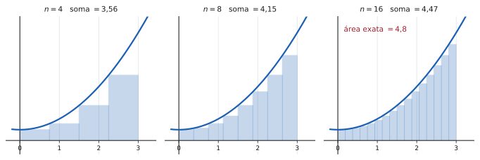
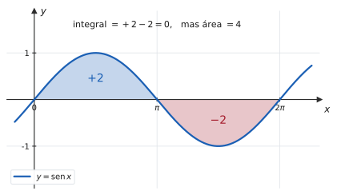
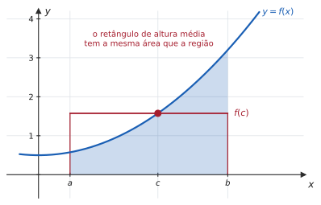
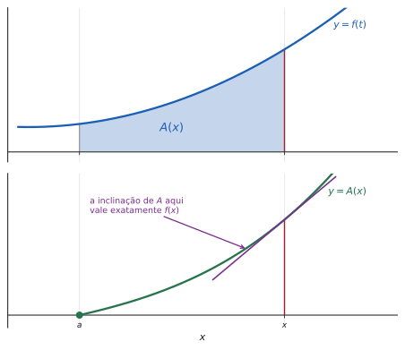

# 5.3 · Integral definida e o Teorema Fundamental do Cálculo

| ← Anterior | 🏠 Índice | Próximo → |
| :--- | :---: | ---: |
| [5.2 · Técnicas de integração](5.2-tecnicas-de-integracao.md) | [Unidade 5](README.md) · [Página inicial](../README.md) | [5.4 · Aplicações](5.4-aplicacoes-da-integral-definida.md) |

---

## 🎯 O que você vai aprender

- A **integral definida** como limite de somas de Riemann — a área sob a curva.
- Por que a integral conta área **com sinal**, e qual é a diferença entre integral e área.
- As **propriedades** da integral definida, e o **Teorema do Valor Médio** para integrais.
- As **duas partes** do Teorema Fundamental do Cálculo — e por que ele é o teorema mais importante que você vai ver.
- Como fazer **substituição numa integral definida** sem errar os limites.

**Pré-requisitos:** [5.1](5.1-primitivas-e-o-conceito-de-integral.md), [5.2](5.2-tecnicas-de-integracao.md) e a noção de [limite](../02-limites-e-continuidade/2.1-conceito-e-nocao-intuitiva-de-limite.md).

---

## Por que isso importa

Até aqui, derivada e integral eram dois assuntos. Nesta seção eles viram **um só**.

O Teorema Fundamental do Cálculo afirma que **derivar e integrar são operações inversas** — e, com isso, transforma o problema de calcular áreas (que exigiria somar infinitos retângulos) no problema de achar uma primitiva (que exige uma tabela e quatro técnicas).

É a razão de o Cálculo existir como disciplina unificada, em vez de dois capítulos separados de geometria e de física. Newton e Leibniz são lembrados exatamente por isso.

---

## 1. O problema da área

Calcular a área de um retângulo é trivial. De um triângulo, de um trapézio, de um polígono: também. **De uma região com lado curvo, não** — e é esse o problema que a integral resolve.

A ideia, que remonta a Arquimedes, é **aproximar por retângulos**:

> 📊 Com $4$ retângulos, a soma vale $3{,}56$. Com $8$, $4{,}15$. Com $16$, $4{,}47$. O valor exato é $4{,}8$ — e a soma **se aproxima dele** à medida que os retângulos ficam mais finos.

### Formalizando: a soma de Riemann

Divida $[a,b]$ em $n$ subintervalos de largura $\Delta x = \dfrac{b-a}{n}$ e escolha um ponto $x_i^{*}$ em cada um. A soma das áreas dos retângulos é a **soma de Riemann**:

$$S_n = \sum_{i=1}^{n} f\big(x_i^{*}\big)\thinspace\Delta x$$

> 📐 **Definição 5.3.1 (Integral definida).** Se o limite existir e não depender da escolha dos $x_i^{*}$, define-se
>
> $$\int_a^b f(x)\thinspace dx = \lim_{n\to\infty}\sum_{i=1}^{n} f\big(x_i^{*}\big)\thinspace\Delta x$$
>
> e diz-se que $f$ é **integrável** em $[a,b]$. Os números $a$ e $b$ são os **limites de integração**.

> 💡 **O símbolo $\int$ é um "S" esticado**, de *soma*, escolhido por Leibniz. E o $dx$ é o que restou do $\Delta x$ quando ele ficou infinitamente pequeno. A notação é literalmente um desenho da definição.

> 📐 **Teorema 5.3.1.** Toda função **contínua** em $[a,b]$ é integrável em $[a,b]$.

Na prática de Cálculo 1, isso resolve a questão da existência: as funções com que você trabalha são contínuas, logo integráveis.

> [!NOTE]
> **Integral definida é um NÚMERO; integral indefinida é uma FAMÍLIA de funções.**
>
> | | $\displaystyle\int f(x)\thinspace dx$ | $\displaystyle\int_a^b f(x)\thinspace dx$ |
> | --- | --- | --- |
> | **o que é** | conjunto de primitivas | um número real |
> | **tem $+\thinspace C$?** | **sim** | **não** |
> | **depende de $x$?** | sim | **não** — $x$ é variável muda |
>
> Da última linha vem uma consequência útil: $\displaystyle\int_a^b f(x)\thinspace dx = \int_a^b f(t)\thinspace dt$. A letra da variável de integração não importa, porque ela desaparece no resultado.

---

## 2. Integral e área não são a mesma coisa

A soma de Riemann usa $f(x_i^{*})$ como **altura** do retângulo. Se $f$ é negativa ali, a "altura" é negativa — e a parcela entra na soma com **sinal negativo**.

> 📊 A integral de $\mathrm{sen}\thinspace x$ em $[0,2\pi]$ vale **zero**: os dois lobos se cancelam. Mas a **área** entre a curva e o eixo é $4$.

> [!CAUTION]
> **"Calcule a integral" e "calcule a área" são perguntas diferentes.**
>
> $$\text{integral} = \int_a^b f(x)\thinspace dx \qquad\qquad \text{área} = \int_a^b \big\lvert f(x)\big\rvert\thinspace dx$$
>
> Para a **área**, ache onde $f$ troca de sinal, quebre a integral nesses pontos e **some os valores absolutos** de cada pedaço. Responder "$0$" a uma pergunta sobre área é um dos erros mais caros da unidade.

---

## 3. Propriedades da integral definida

| Propriedade | Enunciado | O que significa |
| --- | --- | --- |
| **Intervalo nulo** | $\displaystyle\int_a^a f = 0$ | largura zero, área zero |
| **Inversão** | $\displaystyle\int_b^a f = -\int_a^b f$ | percorrer ao contrário troca o sinal |
| **Linearidade** | $\displaystyle\int_a^b (f\pm g) = \int_a^b f \pm \int_a^b g$ | igual à indefinida |
| **Constante** | $\displaystyle\int_a^b k\thinspace f = k\int_a^b f$ | constante sai |
| **Aditividade** | $\displaystyle\int_a^c f = \int_a^b f + \int_b^c f$ | quebrar o intervalo |
| **Comparação** | se $f\leqslant g$ em $[a,b]$, então $\displaystyle\int_a^b f \leqslant \int_a^b g$ | curva maior, área maior |
| **Constante pura** | $\displaystyle\int_a^b k\thinspace dx = k(b-a)$ | área do retângulo |

> 💡 **A aditividade vale mesmo com $b$ fora de $[a,c]$**, graças à regra da inversão. É ela que permite quebrar uma integral nos pontos onde $f$ troca de sinal — exatamente o que o cálculo de área exige.

---

## 4. O Teorema do Valor Médio para integrais

> 📐 **Teorema 5.3.2.** Se $f$ é contínua em $[a,b]$, existe $c\in[a,b]$ tal que
>
> $$\int_a^b f(x)\thinspace dx = f(c)\thinspace(b-a)$$
>
> O número $\displaystyle f(c) = \frac{1}{b-a}\int_a^b f(x)\thinspace dx$ é o **valor médio de $f$** em $[a,b]$.

> 📊 Existe um retângulo com a **mesma área** da região — e sua altura é um valor que a função **de fato atinge**, em algum $c$ entre $a$ e $b$.

> 💡 **O "médio" é literal.** Se $f(t)$ é a velocidade de um carro, o valor médio é a velocidade constante que percorreria a mesma distância no mesmo tempo. É a definição de média de uma função contínua — e a generalização natural da média aritmética.

---

## 5. O Teorema Fundamental — primeira parte

Fixe $a$ e deixe o **limite superior variar**. Isso define uma nova função:

$$A(x) = \int_a^x f(t)\thinspace dt$$

que a cada $x$ associa a área acumulada de $a$ até ali.

> 📊 Embaixo, a inclinação da tangente a $A$ no ponto $x$ é **exatamente** o valor de $f(x)$ lá em cima.

> 📐 **Teorema 5.3.3 (TFC, parte 1).** Se $f$ é contínua em $[a,b]$, então
>
> $$A(x) = \int_a^x f(t)\thinspace dt$$
>
> é derivável em $(a,b)$ e
>
> $$A'(x) = f(x)$$

Em palavras: **derivar desfaz integrar.**

> 💡 **A intuição em uma frase.** Avançar $x$ um tiquinho $h$ acrescenta à área uma faixa estreita, de largura $h$ e altura aproximadamente $f(x)$ — área $\approx f(x)\thinspace h$. A taxa de crescimento da área é, portanto, $\frac{f(x)h}{h} = f(x)$. A demonstração formal é essa conta, feita com o Teorema do Valor Médio para integrais e um limite.

> 💡 **Consequência que já apareceu antes:** toda função contínua **tem primitiva** — basta tomar $A(x) = \int_a^x f$. Era a afirmação (c) do exercício 9 da [Lista 5.1](exercicios/lista-5.1-propostos.md), e aqui está a prova.

### Com limite variável composto

Quando o limite superior é uma **função** de $x$, entra a regra da cadeia:

> 📐 **Corolário.** $\displaystyle\frac{d}{dx}\int_a^{g(x)} f(t)\thinspace dt = f\big(g(x)\big)\thinspace g'(x)$

E, se **os dois** limites variam, quebre no meio com a aditividade:

$$\frac{d}{dx}\int_{h(x)}^{g(x)} f(t)\thinspace dt = f\big(g(x)\big)g'(x) - f\big(h(x)\big)h'(x)$$

---

## 6. O Teorema Fundamental — segunda parte

Esta é a fórmula que você vai usar em **toda** integral definida do resto do curso.

> 📐 **Teorema 5.3.4 (TFC, parte 2).** Se $f$ é contínua em $[a,b]$ e $F$ é **qualquer** primitiva de $f$, então
>
> $$\int_a^b f(x)\thinspace dx = F(b)-F(a)$$

Escreve-se $F(b)-F(a)$ de forma abreviada como $\Big[F(x)\Big]_a^b$.

**Exemplo.**

$$\int_1^3 x^2 dx = \left[\frac{x^3}{3}\right]_1^3 = \frac{27}{3}-\frac13 = 9-\frac13 = \frac{26}{3}$$

> 💡 **Por que "qualquer" primitiva serve.** Se trocar $F$ por $F+C$, a constante aparece duas vezes e se cancela:
>
> $$\big[F(b)+C\big]-\big[F(a)+C\big] = F(b)-F(a)$$
>
> É por isso que **integral definida não leva $+\thinspace C$** — não que a constante tenha sido esquecida, é que ela genuinamente não interfere.

> [!TIP]
> **Entenda a dimensão do que esse teorema faz.** Pela definição, calcular $\int_1^3 x^2 dx$ exigiria montar uma soma de $n$ retângulos, simplificar o somatório e tomar o limite — meia página de conta.
>
> Pelo TFC, exige **achar uma primitiva e subtrair dois números**.
>
> O teorema converte um problema de limite num problema de álgebra. É por isso que ele é chamado de *fundamental*, e não de "útil".

---

## 7. Substituição em integral definida

Há **dois** caminhos corretos, e misturá-los é o erro mais comum da seção.

### Caminho 1 — trocar os limites (recomendado)

Ao substituir $u = g(x)$, **converta também os limites** para a nova variável:

$$\int_a^b f\big(g(x)\big)g'(x)\thinspace dx = \int_{g(a)}^{g(b)} f(u)\thinspace du$$

**Exemplo.** $\displaystyle\int_0^1 x\thinspace e^{x^2}dx$ com $u = x^2$, $x\thinspace dx = \frac{du}{2}$:

- quando $x=0$, $u = 0$
- quando $x=1$, $u = 1$

$$\int_0^1 x\thinspace e^{x^2}dx = \frac12\int_0^1 e^u du = \frac12\Big[e^u\Big]_0^1 = \frac{e-1}{2}$$

### Caminho 2 — voltar para $x$ antes de avaliar

Resolva como integral **indefinida**, volte para $x$, e só então aplique os limites originais:

$$\int x\thinspace e^{x^2}dx = \frac{e^{x^2}}{2} \ \Longrightarrow \ \left[\frac{e^{x^2}}{2}\right]_0^1 = \frac{e}{2}-\frac12 = \frac{e-1}{2} \ \checkmark$$

> [!CAUTION]
> **O erro fatal é misturar os dois:** trocar a variável para $u$ e **manter** os limites de $x$.
>
> $$\int_0^1 x\thinspace e^{x^2}dx \ \neq\ \frac12\int_0^1 e^u du \quad\text{...a menos que } g(0)=0 \text{ e } g(1)=1$$
>
> No exemplo acima deu certo **por coincidência** ($u=x^2$ leva $0\mapsto0$ e $1\mapsto1$). Com $u = x^2+3$, os limites seriam $3$ e $4$, e manter $0$ e $1$ daria resposta errada.
>
> **Regra prática:** escreva o $u$ nos limites assim que trocar a variável — `\int_{u=\ldots}`. Quem anota, não esquece.

---

## ⚠️ Armadilhas

| O erro | Por que está errado | O certo |
| --- | --- | --- |
| responder área quando a integral deu zero | integral tem **sinal** | área $=\int\lvert f\rvert$ |
| trocar a variável e não os limites | os limites eram em $x$ | converta, ou volte para $x$ |
| pôr $+\thinspace C$ em integral definida | a constante se cancela | o resultado é um **número** |
| $F(a)-F(b)$ | ordem invertida troca o sinal | sempre $F(b)-F(a)$ |
| esquecer o sinal em $F(a)$ negativo | $-(-5) = +5$ | parênteses na subtração |
| aplicar o TFC com descontinuidade dentro | o teorema exige continuidade em $[a,b]$ | é integral **imprópria** ([5.5](5.5-integrais-improprias.md)) |
| derivar $\int_a^{g(x)}$ sem a cadeia | falta o fator $g'(x)$ | $f\big(g(x)\big)g'(x)$ |

---

## 🧠 Exercícios resolvidos

### Exercício Resolvido 1 — pela definição

**Calcule** $\displaystyle\int_0^2 x^2 dx$ **pela definição**, como limite de somas de Riemann.

**Solução.** Divida $[0,2]$ em $n$ partes iguais e tome os extremos **direitos**:

$$\Delta x = \frac{2}{n} \qquad x_i = \frac{2i}{n} \quad (i=1,\ldots,n)$$

**A soma de Riemann:**

$$S_n = \sum_{i=1}^{n} f(x_i)\Delta x = \sum_{i=1}^{n}\left(\frac{2i}{n}\right)^2\cdot\frac2n = \sum_{i=1}^{n}\frac{4i^2}{n^2}\cdot\frac{2}{n} = \frac{8}{n^3}\sum_{i=1}^{n} i^2$$

**Usando a fórmula** $\displaystyle\sum_{i=1}^{n}i^2 = \frac{n(n+1)(2n+1)}{6}$:

$$S_n = \frac{8}{n^3}\cdot\frac{n(n+1)(2n+1)}{6} = \frac{8(n+1)(2n+1)}{6n^2} = \frac43\cdot\frac{2n^2+3n+1}{n^2}$$

**O limite:**

$$\int_0^2 x^2 dx = \lim_{n\to\infty}\frac43\left(2+\frac3n+\frac{1}{n^2}\right) = \frac43\cdot 2 = \frac83$$

**Conferindo pelo TFC:**

$$\int_0^2 x^2 dx = \left[\frac{x^3}{3}\right]_0^2 = \frac83 - 0 = \frac83 \ \checkmark$$

> 💡 **Compare o tamanho das duas resoluções.** Meia página contra uma linha — e os dois caminhos dão o mesmo número. **Isso é o Teorema Fundamental em ação**, e é por isso que ninguém mais calcula integral por somas de Riemann depois de aprendê-lo.
>
> Vale fazer **uma vez** pela definição, para entender o que a integral é. Depois, nunca mais.

---

### Exercício Resolvido 2 — TFC parte 2

**Calcule:** **(a)** $\displaystyle\int_1^4\big(x^2-2x\big)dx$ &nbsp;&nbsp; **(b)** $\displaystyle\int_0^{\pi/2}\cos x\thinspace dx$ &nbsp;&nbsp; **(c)** $\displaystyle\int_1^{e}\frac{dx}{x}$

**Solução.**

**(a)**

$$\int_1^4\big(x^2-2x\big)dx = \left[\frac{x^3}{3}-x^2\right]_1^4 = \left(\frac{64}{3}-16\right) - \left(\frac13-1\right)$$

$$= \frac{64}{3}-16-\frac13+1 = \frac{63}{3}-15 = 21-15 = 6$$

**(b)** $\displaystyle\int_0^{\pi/2}\cos x\thinspace dx = \Big[\mathrm{sen}\thinspace x\Big]_0^{\pi/2} = 1-0 = 1$

**(c)** $\displaystyle\int_1^{e}\frac{dx}{x} = \Big[\ln\lvert x\rvert\Big]_1^{e} = \ln e - \ln 1 = 1-0 = 1$

> ⚠️ **Em (a), os parênteses em $F(1)$ são obrigatórios.** Quem escreve $\frac{64}{3}-16-\frac13-1$ (sem distribuir o sinal) erra por $2$. É o erro de distração número um das integrais definidas — e some se você **sempre** escrever $F(b)$ e $F(a)$ entre parênteses antes de subtrair.

---

### Exercício Resolvido 3 — integral versus área

**(a) Calcule** $\displaystyle\int_0^{2\pi}\mathrm{sen}\thinspace x\thinspace dx$. **(b) Calcule a ÁREA** entre $y=\mathrm{sen}\thinspace x$ e o eixo $x$ em $[0,2\pi]$.

**Solução.**

**(a)**

$$\int_0^{2\pi}\mathrm{sen}\thinspace x\thinspace dx = \Big[-\cos x\Big]_0^{2\pi} = -\cos(2\pi) + \cos 0 = -1+1 = \mathbf{0}$$

**(b)** A função **troca de sinal** em $x=\pi$. Quebre ali:

$$\int_0^{\pi}\mathrm{sen}\thinspace x\thinspace dx = \Big[-\cos x\Big]_0^{\pi} = -(-1)+1 = 2$$

$$\int_{\pi}^{2\pi}\mathrm{sen}\thinspace x\thinspace dx = \Big[-\cos x\Big]_{\pi}^{2\pi} = -1+(-1) = -2$$

A área é a soma dos **valores absolutos**:

$$\text{Área} = \lvert 2\rvert + \lvert -2\rvert = \mathbf{4}$$

> 💡 **Os dois resultados estão certos, e respondem perguntas diferentes.** A integral $0$ diz que o saldo líquido é nulo; a área $4$ diz quanto espaço a curva ocupa. Em física: se $\mathrm{sen}\thinspace t$ fosse velocidade, o **deslocamento** seria $0$ (voltou ao ponto de partida) e a **distância percorrida** seria $4$.

---

### Exercício Resolvido 4 — TFC parte 1 com cadeia

**Derive:** **(a)** $\displaystyle F(x) = \int_1^{x}\sqrt{1+t^3}\thinspace dt$ &nbsp;&nbsp; **(b)** $\displaystyle G(x) = \int_1^{x^2}\mathrm{sen}\thinspace t\thinspace dt$ &nbsp;&nbsp; **(c)** $\displaystyle H(x) = \int_{x}^{x^3} e^{t^2}dt$

**Solução.**

**(a)** Aplicação direta do TFC parte 1 — basta **trocar $t$ por $x$** no integrando:

$$F'(x) = \sqrt{1+x^3}$$

> 💡 Note que **não é preciso calcular a integral** — o que é ótimo, porque $\int\sqrt{1+t^3}\thinspace dt$ não tem primitiva elementar.

**(b)** O limite superior é $g(x)=x^2$, então entra a regra da cadeia:

$$G'(x) = \mathrm{sen}\big(x^2\big)\cdot\underbrace{2x}_{g'(x)} = 2x\mathrm{sen}\big(x^2\big)$$

**(c)** Os **dois** limites variam. Quebre num ponto qualquer, digamos $0$:

$$H(x) = \int_{x}^{0} e^{t^2}dt + \int_{0}^{x^3} e^{t^2}dt = -\int_{0}^{x} e^{t^2}dt + \int_{0}^{x^3} e^{t^2}dt$$

Derivando cada parcela:

$$H'(x) = -e^{x^2} + e^{\left(x^3\right)^2}\cdot 3x^2 = 3x^2 e^{x^6} - e^{x^2}$$

> ⚠️ **O limite inferior entra com sinal NEGATIVO.** É consequência direta da regra da inversão: trocar os limites de lugar troca o sinal da integral. A fórmula geral,
>
> $$\frac{d}{dx}\int_{h(x)}^{g(x)} f = f\big(g(x)\big)g'(x) - f\big(h(x)\big)h'(x)$$
>
> é "em cima menos embaixo", cada um com sua cadeia.

---

### Exercício Resolvido 5 — substituição com limites

**Calcule** $\displaystyle\int_0^{2}\frac{x\thinspace dx}{\sqrt{x^2+5}}$.

**Solução pelo Caminho 1 (trocando os limites).**

$$u = x^2+5 \ \Longrightarrow \ du = 2x\thinspace dx \ \Longrightarrow \ x\thinspace dx = \frac{du}{2}$$

**Convertendo os limites:**

| $x$ | $u = x^2+5$ |
| :---: | :---: |
| $0$ | $5$ |
| $2$ | $9$ |

$$\int_0^2\frac{x\thinspace dx}{\sqrt{x^2+5}} = \frac12\int_5^{9} u^{-1/2}du = \frac12\Big[2\sqrt{u}\Big]_5^{9} = \Big[\sqrt{u}\Big]_5^9 = 3-\sqrt5$$

**Conferindo pelo Caminho 2.** A indefinida é $\sqrt{x^2+5}$, logo

$$\Big[\sqrt{x^2+5}\Big]_0^2 = \sqrt{9}-\sqrt{5} = 3-\sqrt5 \ \checkmark$$

> ⚠️ **Se você tivesse mantido os limites $0$ e $2$ depois de trocar para $u$**, obteria $\big[\sqrt u\big]_0^2 = \sqrt2$ — resposta errada, sem nenhum aviso de que algo deu errado. É um erro silencioso, e por isso perigoso.

---

### Exercício Resolvido 6 — valor médio

**Determine o valor médio de $f(x)=x^2$ em $[0,2]$ e o ponto $c$ garantido pelo teorema.**

**Solução.**

**O valor médio:**

$$f_{\text{méd}} = \frac{1}{b-a}\int_a^b f = \frac{1}{2-0}\int_0^2 x^2 dx = \frac12\cdot\frac83 = \frac43$$

**O ponto $c$.** O teorema garante um $c\in[0,2]$ com $f(c) = \frac43$:

$$c^2 = \frac43 \ \Longrightarrow \ c = \frac{2}{\sqrt3} = \frac{2\sqrt3}{3} \approx 1{,}15$$

(a raiz negativa é descartada por estar fora de $[0,2]$).

**Verificando:** $c \approx 1{,}15$ pertence a $[0,2]$ ✔

> 💡 **O valor médio $\frac43 \approx 1{,}33$ não é $f$ do ponto médio.** No ponto médio $x=1$, tem-se $f(1)=1$. A média de uma função **não** é o valor no meio do intervalo: é a altura do retângulo de mesma área, e ela pende para onde a função é maior. Como $x^2$ cresce, a média cai à direita do centro — exatamente como $c\approx1{,}15 > 1$.

---

## 📝 Agora é com você

➡️ **[Lista 5.3 — exercícios propostos](exercicios/lista-5.3-propostos.md)** · ✅ **[Gabarito](gabaritos/gabarito-5.3.md)**

---

## Resumo da página

> **Decore:**
> - **TFC parte 1:** $\displaystyle\frac{d}{dx}\int_a^x f(t)\thinspace dt = f(x)$ — derivar desfaz integrar.
> - **TFC parte 2:** $\displaystyle\int_a^b f = F(b)-F(a)$ — a fórmula que você usa sempre.
> - Com limite composto: $\displaystyle\frac{d}{dx}\int_a^{g(x)} f = f\big(g(x)\big)g'(x)$.
> - **Valor médio:** $\displaystyle f_{\text{méd}} = \frac{1}{b-a}\int_a^b f$.
>
> **Nunca confunda:**
> - integral **tem sinal**; área é $\int\lvert f\rvert$;
> - integral definida é **número**, sem $+\thinspace C$;
> - ao substituir, **troque os limites** — ou volte para $x$ antes de avaliar.
>
> **Saiba fazer:** calcular pela definição ao menos uma vez (para entender), e pelo TFC sempre (para resolver).

---

## 📚 Para aprofundar

| Livro | Onde procurar |
| --- | --- |
| **LEITHOLD** | Capítulo 5 — "A integral definida"; "O Teorema Fundamental do Cálculo" |
| **STEWART** | Capítulo 5 — "A integral definida"; "O Teorema Fundamental do Cálculo" |
| **THOMAS** | Capítulo 5 — "Somas de Riemann"; "O Teorema Fundamental" |
| **ANTON** | Capítulo 5 — "A integral definida"; "A relação entre integral definida e indefinida" |
| **SWOKOWSKI** | Capítulo 5 — "A integral definida" |
| **MUNEM & FOULIS** | Capítulo 5 — "O Teorema Fundamental do Cálculo" |

---

| ← Anterior | 🏠 Índice | Próximo → |
| :--- | :---: | ---: |
| [5.2 · Técnicas de integração](5.2-tecnicas-de-integracao.md) | [Unidade 5](README.md) · [Página inicial](../README.md) | [5.4 · Aplicações](5.4-aplicacoes-da-integral-definida.md) |

*Sobrevivendo ao Cálculo 1 (UENF)* · por **Nicolau Prates** · [CC BY-SA 4.0](../LICENSE)
