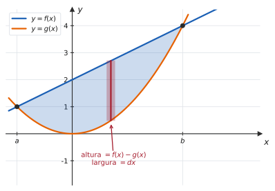
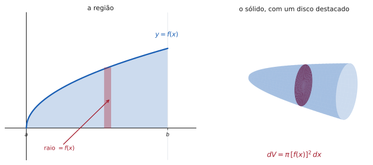
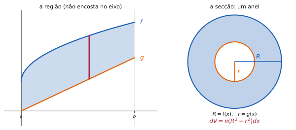
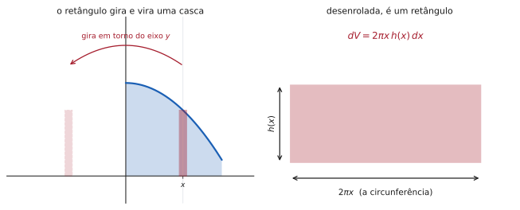
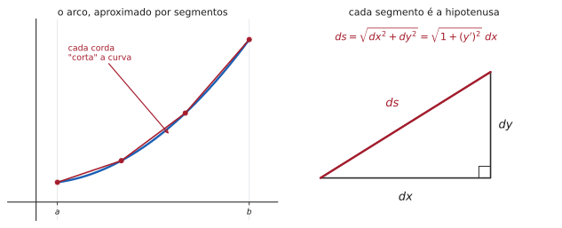

# 5.4 · Aplicações: áreas, volumes, superfícies e comprimento de arco

| ← Anterior | 🏠 Índice | Próximo → |
| :--- | :---: | ---: |
| [5.3 · Integral definida e o TFC](5.3-integral-definida-e-o-teorema-fundamental-do-calculo.md) | [Unidade 5](README.md) · [Página inicial](../README.md) | [5.5 · Integrais impróprias](5.5-integrais-improprias.md) |

---

## 🎯 O que você vai aprender

- Calcular a **área entre duas curvas**, integrando em $x$ ou em $y$.
- Calcular **volumes de sólidos de revolução** por **discos**, **anéis** e **cascas cilíndricas** — e escolher o método certo.
- Calcular o **comprimento de arco** de uma curva.
- Calcular a **área de uma superfície de revolução**.

**Pré-requisitos:** [5.3](5.3-integral-definida-e-o-teorema-fundamental-do-calculo.md) e fluência nas técnicas de [5.2](5.2-tecnicas-de-integracao.md).

---

## Por que isso importa

Esta seção responde à pergunta que todo aluno faz na Unidade 5: **para que serve integral?**

Serve para medir **qualquer coisa que seja uma soma de infinitas partes infinitesimais**. Área, volume, comprimento, massa, trabalho, centro de massa, probabilidade — todos seguem a mesma receita. Aprender a montar essas integrais é aprender a transformar um problema físico ou geométrico em uma conta.

> [!TIP]
> **Em toda esta seção, o método é um só:**
> 1. Desenhe a região.
> 2. Escolha o **elemento representativo** (uma fatia fininha).
> 3. Escreva a contribuição **dele** — $dA$, $dV$, $ds$.
> 4. Some tudo, integrando entre os limites certos.
>
> **A fórmula nunca é o difícil; o desenho é.** Quem desenha corretamente monta a integral; quem decora fórmulas erra os limites.

---

## 1. Área entre duas curvas

> 📊 O retângulo representativo tem altura $f(x)-g(x)$ e largura $dx$. Sua área é $dA = \big[f(x)-g(x)\big]dx$ — e a integral soma todos eles.

> 📐 **Fórmula.** Se $f(x)\geqslant g(x)$ em $[a,b]$:
>
> $$A = \int_a^b \big[f(x)-g(x)\big]\thinspace dx$$

**O procedimento:**

| Passo | O que fazer |
| :---: | --- |
| **1** | Esboce as duas curvas |
| **2** | Ache as **interseções** — elas são os limites $a$ e $b$ |
| **3** | Identifique quem é a de **cima** no intervalo |
| **4** | Integre "de cima menos de baixo" |

> [!CAUTION]
> **Se as curvas se cruzam dentro do intervalo, quebre a integral.** Qual delas está por cima **muda** no ponto de cruzamento, e manter a mesma diferença produz área negativa num dos pedaços — que então se cancela com o outro, dando resposta errada.

### Integrando em $y$

Às vezes a região é mais simples descrita **por fatias horizontais**. Aí o retângulo representativo é deitado, de altura $dy$ e largura "a da direita menos a da esquerda":

$$A = \int_c^d \big[x_{\text{dir}}(y) - x_{\text{esq}}(y)\big]\thinspace dy$$

> 💡 **Quando trocar para $y$.** Se fatiar verticalmente exige **quebrar** a região em duas (porque a curva de baixo muda no meio), e fatiar horizontalmente não exige, integre em $y$. Uma integral sempre vale mais que duas.

---

## 2. Volumes: o método do disco

Gire a região sob $y=f(x)$ em torno do **eixo $x$**. Cada retângulo vertical varre um **disco** de raio $f(x)$ e espessura $dx$.

Como o volume de um cilindro é $\pi r^2 h$, o disco contribui com

$$dV = \pi\big[f(x)\big]^2 dx$$

> 📐 **Método do disco.** Girando em torno do eixo $x$:
>
> $$V = \pi\int_a^b \big[f(x)\big]^2 dx$$
>
> Girando em torno do eixo $y$ (com a região descrita por $x=g(y)$):
>
> $$V = \pi\int_c^d \big[g(y)\big]^2 dy$$

> [!CAUTION]
> **O quadrado está dentro da integral, e não fora.**
>
> $$\pi\int_a^b \big[f(x)\big]^2 dx \ \neq\ \pi\left(\int_a^b f(x)\thinspace dx\right)^2$$
>
> É o erro mais frequente da seção. O volume **não** é "π vezes a área ao quadrado": cada disco é quadrado **individualmente**, antes de somar.

---

## 3. Volumes: o método do anel

Se a região girada **não encosta** no eixo, o sólido tem um **furo** — e cada secção é um **anel**, não um disco.

A área do anel é a do círculo grande menos a do pequeno:

> 📐 **Método do anel.**
>
> $$V = \pi\int_a^b \left(\big[R(x)\big]^2 - \big[r(x)\big]^2\right)dx$$
>
> onde $R$ é a distância do eixo à borda **externa** e $r$, à borda **interna**.

> [!CAUTION]
> **$R^2-r^2$, nunca $(R-r)^2$.** Essas expressões são diferentes, e a segunda está errada: subtraem-se as **áreas**, não os raios.

> 💡 **$R$ e $r$ são distâncias AO EIXO, não valores da função.** Se a rotação for em torno de $y=-1$, por exemplo, então $R(x) = f(x)+1$. Desenhar o eixo de rotação antes de escrever a fórmula evita o erro.

---

## 4. Volumes: o método da casca cilíndrica

Girar uma região em torno do eixo $y$ usando fatias **verticais** produz não discos, mas **cascas cilíndricas** — tubos finos, encaixados uns nos outros.

> 📊 A sacada: **desenrole a casca**. Ela vira um retângulo de altura $h(x)$, largura igual à circunferência $2\pi x$ e espessura $dx$.

> 📐 **Método da casca.** Girando em torno do eixo $y$:
>
> $$V = 2\pi\int_a^b x\thinspace h(x)\thinspace dx$$
>
> onde $x$ é a **distância da fatia ao eixo** e $h(x)$, a **altura** da fatia.

### Disco ou casca?

| | **Disco / anel** | **Casca** |
| --- | --- | --- |
| a fatia é | **perpendicular** ao eixo | **paralela** ao eixo |
| girando em torno de $x$ | fatie em $x$ (vertical) | fatie em $y$ (horizontal) |
| girando em torno de $y$ | fatie em $y$ (horizontal) | fatie em $x$ (vertical) |
| integra em | a variável do eixo | a outra variável |

> [!TIP]
> **Os dois métodos sempre dão a mesma resposta** — quando ambos são aplicáveis. Escolha pelo que der **menos trabalho**:
> - se resolver $y=f(x)$ para $x$ é difícil, use **casca**;
> - se a região tem furo e os raios saem fáceis, use **anel**.
>
> Na dúvida, desenhe a fatia dos dois jeitos e veja qual integral você sabe calcular.

---

## 5. Comprimento de arco

Quanto mede uma curva, se você a esticasse?

Aproxime o arco por segmentos. Cada um é a **hipotenusa** de um triângulo de catetos $dx$ e $dy$:

$$ds = \sqrt{dx^2+dy^2} = \sqrt{1+\left(\frac{dy}{dx}\right)^2}\thinspace dx$$

> 📐 **Comprimento de arco.** Se $f'$ é contínua em $[a,b]$:
>
> $$L = \int_a^b \sqrt{1+\big[f'(x)\big]^2}\thinspace dx$$

> [!NOTE]
> **Quase nenhum comprimento de arco é calculável à mão.** O radical $\sqrt{1+(f')^2}$ raramente tem primitiva elementar — até para a parábola $y=x^2$ a conta exige substituição trigonométrica e a integral da secante.
>
> Por isso os exercícios de prova usam funções **escolhidas a dedo** para que o radical vire um quadrado perfeito. Se o seu radical simplificou de forma milagrosa, você está no caminho certo; se não simplificou, provavelmente errou a derivada.

---

## 6. Área de superfície de revolução

Girando a curva (não a região) em torno de um eixo, obtém-se uma **superfície**. Cada pedacinho $ds$ varre uma faixa de circunferência $2\pi\thinspace(\text{raio})$:

> 📐 **Área de superfície.** Girando $y=f(x)$, com $f(x)\geqslant0$, em torno do eixo $x$:
>
> $$S = 2\pi\int_a^b f(x)\sqrt{1+\big[f'(x)\big]^2}\thinspace dx$$
>
> Em torno do eixo $y$: troque o raio $f(x)$ por $x$.

> 💡 **Note a estrutura comum.** Todas as fórmulas desta seção são "$\int(\text{medida do elemento})$":
>
> | | elemento | fórmula |
> | --- | --- | --- |
> | área | retângulo | $\int (\text{altura})\thinspace dx$ |
> | volume (disco) | cilindro | $\int \pi r^2\thinspace dx$ |
> | volume (casca) | tubo desenrolado | $\int 2\pi r\thinspace h\thinspace dx$ |
> | comprimento | hipotenusa | $\int ds$ |
> | superfície | faixa cilíndrica | $\int 2\pi r\thinspace ds$ |
>
> **Decore a lógica, não as cinco linhas.** Cada fórmula é a área ou o volume de uma figura elementar, multiplicada pela espessura e somada.

---

## ⚠️ Armadilhas

| O erro | Por que está errado | O certo |
| --- | --- | --- |
| não achar as interseções | os limites saem delas | resolva $f(x)=g(x)$ |
| não quebrar quando as curvas se cruzam | a diferença troca de sinal | integre pedaço por pedaço |
| $\left(\int f\right)^2$ no lugar de $\int f^2$ | cada disco é elevado ao quadrado | o quadrado fica **dentro** |
| $(R-r)^2$ no lugar de $R^2-r^2$ | subtraem-se **áreas** | $\pi\big(R^2-r^2\big)$ |
| usar $f(x)$ como raio girando em torno de $y=k$ | o raio é a **distância ao eixo** | $\lvert f(x)-k\rvert$ |
| esquecer o $2\pi$ na casca | a circunferência é $2\pi r$ | $V = 2\pi\int x\thinspace h\thinspace dx$ |
| misturar $dx$ com limites em $y$ | a variável tem de ser uma só | fatia vertical → $dx$ e limites em $x$ |
| responder volume com unidade de área | confusão de dimensão | confira a dimensão no fim |

---

## 🧠 Exercícios resolvidos

### Exercício Resolvido 1 — área entre curvas

**Calcule a área da região limitada por $y = x+2$ e $y = x^2$.**

**Solução.**

**Passo 1 — as interseções.** Igualando:

$$x+2 = x^2 \ \Longrightarrow \ x^2-x-2 = 0 \ \Longrightarrow \ (x-2)(x+1) = 0$$

Logo $a=-1$ e $b=2$.

**Passo 2 — quem está por cima.** Teste um ponto interior, digamos $x=0$:

$$f(0) = 2 \qquad g(0) = 0$$

A reta está acima em todo o intervalo (as curvas só se cruzam nos extremos).

**Passo 3 — integre.**

$$A = \int_{-1}^{2}\Big[(x+2)-x^2\Big]dx = \left[\frac{x^2}{2}+2x-\frac{x^3}{3}\right]_{-1}^{2}$$

$$= \left(2+4-\frac83\right) - \left(\frac12-2+\frac13\right) = \frac{10}{3} - \left(-\frac76\right) = \frac{20}{6}+\frac76 = \frac{27}{6} = \frac92$$

**Resposta.** $A = \dfrac92$.

> 💡 **Testar um ponto interior é obrigatório.** "A reta está acima da parábola" é verdade **aqui**, mas falso fora de $[-1,2]$. Um único teste numérico resolve, e evita o erro de assumir pelo desenho mental.

---

### Exercício Resolvido 2 — integrando em $y$

**Calcule a área entre $y^2 = x$ e $y = x-2$.**

**Solução.** As curvas são uma **parábola deitada** e uma reta.

**Em $x$, seria preciso quebrar:** para $x<1$, a região é limitada **por baixo e por cima** pelos dois ramos da parábola; para $x>1$, por baixo pela reta. Duas integrais.

**Em $y$, é uma só.** Reescreva tudo em função de $y$:

$$x = y^2 \quad\text{(a da esquerda)} \qquad x = y+2 \quad\text{(a da direita)}$$

**Interseções:** $y^2 = y+2 \Rightarrow y^2-y-2 = 0 \Rightarrow (y-2)(y+1)=0$, logo $y=-1$ e $y=2$.

**Qual é a da direita?** Em $y=0$: $x_{\text{dir}} = 2$ e $x_{\text{esq}} = 0$ ✔

$$A = \int_{-1}^{2}\Big[(y+2)-y^2\Big]dy$$

que é **a mesma integral** do exercício anterior, com outra letra:

$$A = \frac92$$

> 💡 **Trocar a variável de integração transformou duas integrais em uma.** Sempre que a região for mais simples descrita por fatias horizontais — regiões limitadas por parábolas deitadas são o caso típico —, integre em $y$. O custo é reescrever as curvas; o ganho é não quebrar.

---

### Exercício Resolvido 3 — método do disco

**A região sob $y=\sqrt{x}$, de $x=0$ a $x=4$, gira em torno do eixo $x$. Calcule o volume.**

**Solução.** A fatia é perpendicular ao eixo de rotação, então é **disco**, com raio $f(x)=\sqrt{x}$:

$$V = \pi\int_0^4\big(\sqrt{x}\big)^2 dx = \pi\int_0^4 x\thinspace dx = \pi\left[\frac{x^2}{2}\right]_0^4 = \pi\cdot 8 = 8\pi$$

**Resposta.** $V = 8\pi$ unidades de volume.

> 💡 **O quadrado matou a raiz.** No método do disco, o integrando é $[f(x)]^2$ — então raízes quadradas somem e as contas costumam ficar **mais fáceis** que a área da mesma região. (A área, aliás, seria $\int_0^4\sqrt x\thinspace dx = \frac{16}{3}$, que exige a regra da potência fracionária.)

---

### Exercício Resolvido 4 — método do anel

**A região entre $y = x$ e $y = x^2$ gira em torno do eixo $x$. Calcule o volume.**

**Solução.**

**As interseções:** $x = x^2 \Rightarrow x(x-1)=0$, logo $x=0$ e $x=1$.

**Quem está por cima?** Em $x = \frac12$: a reta dá $0{,}5$ e a parábola dá $0{,}25$. A **reta** está acima.

Como a região não toca o eixo (exceto nos extremos), a secção é um **anel**:

$$R(x) = x \quad\text{(externo)} \qquad r(x) = x^2 \quad\text{(interno)}$$

$$V = \pi\int_0^1\left(x^2 - x^4\right)dx = \pi\left[\frac{x^3}{3}-\frac{x^5}{5}\right]_0^1 = \pi\left(\frac13-\frac15\right) = \pi\cdot\frac{2}{15} = \frac{2\pi}{15}$$

**Resposta.** $V = \dfrac{2\pi}{15}$.

> ⚠️ **Observe a ordem:** o raio **externo** é $x$ (a reta, que está mais longe do eixo) e o **interno** é $x^2$. Trocá-los daria volume negativo — e um volume negativo é sempre sinal de que $R$ e $r$ foram invertidos.

---

### Exercício Resolvido 5 — método da casca

**A região sob $y = 2x-x^2$, acima do eixo $x$, gira em torno do eixo $y$. Calcule o volume.**

**Solução.** A parábola corta o eixo em $x(2-x)=0$, isto é, $x=0$ e $x=2$.

**Por que casca.** A rotação é em torno de $y$, e a fatia **vertical** (paralela ao eixo) gera uma casca. O caminho alternativo — discos horizontais — exigiria resolver $y = 2x-x^2$ para $x$, o que dá dois ramos e duas integrais.

Com raio $x$ e altura $h(x) = 2x-x^2$:

$$V = 2\pi\int_0^2 x\big(2x-x^2\big)dx = 2\pi\int_0^2\big(2x^2-x^3\big)dx$$

$$= 2\pi\left[\frac{2x^3}{3}-\frac{x^4}{4}\right]_0^2 = 2\pi\left(\frac{16}{3}-4\right) = 2\pi\cdot\frac43 = \frac{8\pi}{3}$$

**Resposta.** $V = \dfrac{8\pi}{3}$.

> 💡 **Esta é a situação em que a casca brilha:** girar em torno de $y$ uma região descrita por $y=f(x)$. A casca integra **na variável em que a função já está escrita**, e por isso dispensa inverter a função. Sempre que inverter for feio, use casca.

---

### Exercício Resolvido 6 — comprimento de arco

**Calcule o comprimento do arco de $y = \dfrac{2}{3}x^{3/2}$, de $x=0$ a $x=3$.**

**Solução.**

$$y' = \frac23\cdot\frac32 x^{1/2} = \sqrt{x} \ \Longrightarrow \ \big(y'\big)^2 = x$$

$$L = \int_0^3\sqrt{1+x}\thinspace dx$$

**O radical virou um binômio simples** — é o sinal de que a função foi escolhida para dar certo. Com $u = 1+x$ (limites: $1$ e $4$):

$$L = \int_1^4 u^{1/2}du = \left[\frac23 u^{3/2}\right]_1^4 = \frac23\big(8-1\big) = \frac{14}{3}$$

**Resposta.** $L = \dfrac{14}{3}$.

**Conferindo a ordem de grandeza:** a distância em linha reta entre os extremos $(0,0)$ e $\left(3,\thinspace 2\sqrt3\right)\approx(3;\thinspace 3{,}46)$ é $\sqrt{9+12}\approx4{,}58$. O arco deu $\frac{14}{3}\approx4{,}67$ — **um pouco maior** que a reta, como tem de ser ✔

> 💡 **Esse teste vale para todo comprimento de arco:** o resultado tem de ser **maior** que a distância em linha reta entre os extremos, e tipicamente não muito maior. É uma verificação de dez segundos que pega erro de sinal e de conta.

---

### Exercício Resolvido 7 — área de superfície

**O arco de $y=\sqrt{x}$, de $x=0$ a $x=\dfrac34$, gira em torno do eixo $x$. Calcule a área da superfície.**

**Solução.**

$$y' = \frac{1}{2\sqrt{x}} \ \Longrightarrow \ 1+\big(y'\big)^2 = 1+\frac{1}{4x} = \frac{4x+1}{4x}$$

$$\sqrt{1+\big(y'\big)^2} = \frac{\sqrt{4x+1}}{2\sqrt{x}}$$

Substituindo na fórmula, **o $\sqrt x$ do raio cancela o do radical** — e é esse cancelamento que torna a conta viável:

$$S = 2\pi\int_0^{3/4}\sqrt{x}\cdot\frac{\sqrt{4x+1}}{2\sqrt{x}}dx = \pi\int_0^{3/4}\sqrt{4x+1}\thinspace dx$$

Com $u = 4x+1$, $du = 4\thinspace dx$ (limites: $1$ e $4$):

$$S = \frac{\pi}{4}\int_1^{4}u^{1/2}du = \frac{\pi}{4}\left[\frac23 u^{3/2}\right]_1^4 = \frac{\pi}{6}\big(8-1\big) = \frac{7\pi}{6}$$

**Resposta.** $S = \dfrac{7\pi}{6}$.

---

## 📝 Agora é com você

➡️ **[Lista 5.4 — exercícios propostos](exercicios/lista-5.4-propostos.md)** · ✅ **[Gabarito](gabaritos/gabarito-5.4.md)**

---

## Resumo da página

> **As cinco fórmulas:**
>
> | | Fórmula |
> | --- | --- |
> | **Área entre curvas** | $\displaystyle A = \int_a^b\big[f-g\big]dx$ |
> | **Volume (disco)** | $\displaystyle V = \pi\int_a^b \big[f(x)\big]^2 dx$ |
> | **Volume (anel)** | $\displaystyle V = \pi\int_a^b\big(R^2-r^2\big)dx$ |
> | **Volume (casca)** | $\displaystyle V = 2\pi\int_a^b x\thinspace h(x)\thinspace dx$ |
> | **Comprimento** | $\displaystyle L = \int_a^b\sqrt{1+\big(f'\big)^2}\thinspace dx$ |
> | **Superfície** | $\displaystyle S = 2\pi\int_a^b f\sqrt{1+\big(f'\big)^2}\thinspace dx$ |
>
> **Decore o método, não as fórmulas:** desenhe · escolha o elemento · escreva a contribuição dele · integre.
>
> **Os dois erros caros:** o quadrado vai **dentro** da integral, e $R$ e $r$ são distâncias **ao eixo de rotação**, não valores da função.
>
> **Confira sempre:** área positiva, volume positivo, arco maior que a reta entre os extremos.

---

## 📚 Para aprofundar

| Livro | Onde procurar |
| --- | --- |
| **LEITHOLD** | Capítulo 6 — "Aplicações da integral definida" (o capítulo inteiro) |
| **STEWART** | Capítulos 6 e 8 — "Aplicações de integração"; "Comprimento de arco"; "Área de superfície" |
| **THOMAS** | Capítulo 6 — "Aplicações das integrais definidas" |
| **ANTON** | Capítulo 6 — "Aplicações da integral definida em geometria" |
| **SWOKOWSKI** | Capítulo 6 — "Aplicações da integral definida" |
| **MUNEM & FOULIS** | Capítulo 6 — "Aplicações da integral" |

---

| ← Anterior | 🏠 Índice | Próximo → |
| :--- | :---: | ---: |
| [5.3 · Integral definida e o TFC](5.3-integral-definida-e-o-teorema-fundamental-do-calculo.md) | [Unidade 5](README.md) · [Página inicial](../README.md) | [5.5 · Integrais impróprias](5.5-integrais-improprias.md) |

*Sobrevivendo ao Cálculo 1 (UENF)* · por **Nicolau Prates** · [CC BY-SA 4.0](../LICENSE)
