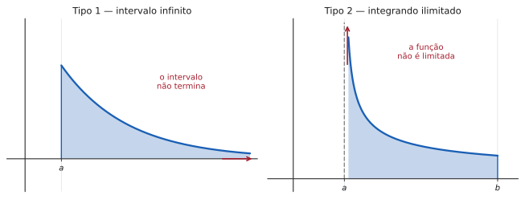
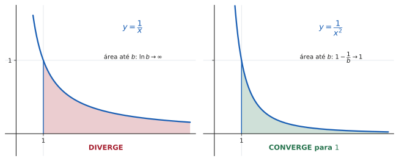

# 5.5 · Integrais impróprias

| ← Anterior | 🏠 Índice | Próximo → |
| :--- | :---: | ---: |
| [5.4 · Aplicações](5.4-aplicacoes-da-integral-definida.md) | [Unidade 5](README.md) · [Página inicial](../README.md) | [Revisão da Unidade 5](exercicios/revisao-unidade-5.md) |

---

## 🎯 O que você vai aprender

- O que torna uma integral **imprópria**, e os **dois tipos** que existem.
- Definir a integral imprópria como **limite** — e decidir se ela **converge** ou **diverge**.
- O **teste da $p$-integral**, que resolve a maioria dos casos de olho.
- O **teste da comparação**, para quando a primitiva não existe.

**Pré-requisitos:** [5.3](5.3-integral-definida-e-o-teorema-fundamental-do-calculo.md) e os [limites no infinito (2.4)](../02-limites-e-continuidade/2.4-limites-infinitos-no-infinito-e-assintotas.md).

---

## Por que isso importa

O Teorema Fundamental tem **duas hipóteses escondidas**: o intervalo $[a,b]$ é limitado, e $f$ é contínua nele.

Esta seção trata do que acontece quando uma delas falha — e a resposta não é "a integral não existe". Muitas vezes ela existe, vale um número perfeitamente finito, e é indispensável.

> 💡 **Onde isso aparece de verdade.** Em probabilidade, a distribuição normal exige $\int_{-\infty}^{\infty}e^{-x^2/2}dx$. Em física, a energia de um campo e o trabalho para escapar da gravidade são integrais até o infinito. Em engenharia, a transformada de Laplace — a ferramenta padrão para resolver circuitos e sistemas de controle — é **definida** como uma integral imprópria. Nada disso faz sentido sem esta seção.

---

## 1. Os dois tipos

> 📐 **Definição 5.5.1.** Uma integral é **imprópria** quando
>
> - **Tipo 1:** um dos limites de integração é $+\infty$ ou $-\infty$; **ou**
> - **Tipo 2:** o integrando é **ilimitado** em algum ponto de $[a,b]$ (tem assíntota vertical ali).

Em ambos os casos, a definição por somas de Riemann **não se aplica** — e por isso é preciso uma definição nova.

---

## 2. Tipo 1 — intervalo infinito

A ideia: integre até um $b$ finito, e depois **empurre $b$ para o infinito**.

> 📐 **Definição 5.5.2.**
>
> $$\int_a^{\infty} f(x)\thinspace dx = \lim_{b\to\infty}\int_a^{b} f(x)\thinspace dx$$
>
> $$\int_{-\infty}^{b} f(x)\thinspace dx = \lim_{a\to-\infty}\int_a^{b} f(x)\thinspace dx$$
>
> Se o limite existe e é **finito**, a integral **converge** e vale esse número. Caso contrário, **diverge**.

### Os dois limites infinitos

$$\int_{-\infty}^{\infty} f(x)\thinspace dx = \int_{-\infty}^{c} f(x)\thinspace dx + \int_{c}^{\infty} f(x)\thinspace dx$$

para um $c$ qualquer (em geral, $c=0$).

> [!CAUTION]
> **As duas metades têm de convergir SEPARADAMENTE.** Não vale tomar $\displaystyle\lim_{b\to\infty}\int_{-b}^{b}$, com o mesmo $b$ dos dois lados.
>
> **Por que não:** em $\displaystyle\int_{-\infty}^{\infty}x\thinspace dx$, o limite simétrico daria
>
> $$\lim_{b\to\infty}\int_{-b}^{b}x\thinspace dx = \lim_{b\to\infty} 0 = 0$$
>
> mas cada metade diverge, e a integral **diverge**. A simetria mascarou dois infinitos se cancelando — o mesmo $\infty-\infty$ proibido de [4.3](../04-aplicacoes-das-derivadas/4.3-regra-de-lhospital.md).

---

## 3. Tipo 2 — integrando ilimitado

Mesma ideia: **pare antes da descontinuidade** e tome o limite.

> 📐 **Definição 5.5.3.** Se $f$ é contínua em $[a,b)$ e **ilimitada** quando $x\to b^{-}$:
>
> $$\int_a^{b} f(x)\thinspace dx = \lim_{t\to b^{-}}\int_a^{t} f(x)\thinspace dx$$
>
> Analogamente, se a explosão é em $a$:
>
> $$\int_a^{b} f(x)\thinspace dx = \lim_{t\to a^{+}}\int_t^{b} f(x)\thinspace dx$$

### Descontinuidade no MEIO do intervalo

Este é o caso que mais derruba gente em prova.

> [!CAUTION]
> **Se a descontinuidade está DENTRO de $(a,b)$, QUEBRE a integral nela:**
>
> $$\int_a^{b} f = \int_a^{c} f + \int_c^{b} f \qquad\text{com } c \text{ o ponto ruim}$$
>
> e **as duas partes têm de convergir**. Se uma só diverge, a integral toda diverge.
>
> **Aplicar o TFC direto por cima da descontinuidade produz resultados absurdos:**
>
> $$\int_{-1}^{1}\frac{dx}{x^2} \ \overset{\textbf{errado}}{=}\ \left[-\frac1x\right]_{-1}^{1} = -1-1 = -2$$
>
> Um integrando **positivo** não pode dar área negativa. A conta está errada porque $\frac{1}{x^2}$ explode em $x=0$, que está no meio do caminho. (A resposta certa: a integral **diverge**.)

> [!TIP]
> **O hábito que evita o erro:** antes de aplicar o TFC, olhe o integrando e pergunte **onde ele deixa de existir**. Denominador que zera, logaritmo de zero, raiz de negativo. Se algum desses pontos cai dentro do intervalo, a integral é imprópria — e exige limite.

---

## 4. O teste da $p$-integral

Essas duas famílias resolvem a maioria dos exercícios, e valem a pena ser decoradas.

> 📐 **Teorema 5.5.1 (no infinito).** A integral $\displaystyle\int_1^{\infty}\frac{dx}{x^{p}}$
>
> | | se | e então vale |
> | --- | :---: | :---: |
> | **converge** | $p>1$ | $\dfrac{1}{p-1}$ |
> | **diverge** | $p\leqslant1$ | — |

> 📐 **Teorema 5.5.2 (no zero).** A integral $\displaystyle\int_0^{1}\frac{dx}{x^{p}}$
>
> | | se | e então vale |
> | --- | :---: | :---: |
> | **converge** | $p<1$ | $\dfrac{1}{1-p}$ |
> | **diverge** | $p\geqslant1$ | — |

> 📊 As duas curvas parecem a mesma coisa. A diferença está na **cauda**: $\frac1x$ decai devagar demais e acumula área infinita; $\frac{1}{x^2}$ decai rápido o bastante e para em $1$.

> [!NOTE]
> **As condições são OPOSTAS, e não é coincidência.**
>
> | | converge se | o que importa |
> | --- | :---: | --- |
> | $\displaystyle\int_1^{\infty}\frac{dx}{x^p}$ | $p>1$ | a função tem de decair **rápido** no infinito |
> | $\displaystyle\int_0^{1}\frac{dx}{x^p}$ | $p<1$ | a função tem de explodir **devagar** perto de zero |
>
> Expoente grande ajuda longe da origem e atrapalha perto dela. O caso $p=1$ — o logaritmo — **diverge nos dois**: é exatamente a fronteira.

---

## 5. O teste da comparação

Serve quando o integrando **não tem primitiva elementar** — e aí não há como calcular, só como decidir.

> 📐 **Teorema 5.5.3.** Sejam $f$ e $g$ contínuas com $0 \leqslant f(x) \leqslant g(x)$ para $x \geqslant a$. Então:
>
> - se $\displaystyle\int_a^{\infty} g$ **converge**, então $\displaystyle\int_a^{\infty} f$ **converge**;
> - se $\displaystyle\int_a^{\infty} f$ **diverge**, então $\displaystyle\int_a^{\infty} g$ **diverge**.

> 💡 **Em uma frase:** *a menor que converge, converge; a maior que diverge, diverge.* Ou, mais informalmente: **o teto segura; o piso empurra.**
>
> Note que as duas implicações **não** se invertem. Saber que a maior diverge não diz nada sobre a menor, e saber que a menor converge não diz nada sobre a maior.

**Como usar na prática:** compare com uma $p$-integral.

$$\frac{1}{x^2+1} < \frac{1}{x^2} \quad\text{e}\quad \int_1^{\infty}\frac{dx}{x^2} \text{ converge} \quad\Longrightarrow\quad \int_1^{\infty}\frac{dx}{x^2+1} \text{ converge}$$

---

## ⚠️ Armadilhas

| O erro | Por que está errado | O certo |
| --- | --- | --- |
| aplicar o TFC por cima de uma assíntota | o teorema exige continuidade | quebre e tome limites |
| não perceber que a integral é imprópria | o enunciado não avisa | **olhe o integrando** antes |
| usar $\lim_{b\to\infty}\int_{-b}^{b}$ | mascara $\infty-\infty$ | separe as duas metades |
| "o limite deu $\infty$, então vale $\infty$" | $\infty$ não é valor | a integral **diverge** |
| concluir convergência porque $f\to0$ | $\frac1x\to0$ e diverge | o que importa é a **velocidade** |
| comparar com a desigualdade ao contrário | o teste é direcional | teto segura, piso empurra |
| esquecer uma metade | as duas precisam convergir | some só depois de verificar |

> 💡 **A quinta linha merece atenção.** É tentador raciocinar "a função tende a zero, logo a área para de crescer". Falso: $\frac1x$ tende a zero e sua integral diverge. **Tender a zero é necessário, mas longe de suficiente** — é preciso tender rápido o bastante, e a fronteira é exatamente $p=1$.

---

## 🧠 Exercícios resolvidos

### Exercício Resolvido 1 — as duas que definem a seção

**Decida a convergência de (a)** $\displaystyle\int_1^{\infty}\frac{dx}{x}$ **e (b)** $\displaystyle\int_1^{\infty}\frac{dx}{x^2}$.

**Solução (a).** Pela definição:

$$\int_1^{\infty}\frac{dx}{x} = \lim_{b\to\infty}\int_1^{b}\frac{dx}{x} = \lim_{b\to\infty}\Big[\ln x\Big]_1^{b} = \lim_{b\to\infty}\ln b = +\infty$$

**DIVERGE.**

**Solução (b).**

$$\int_1^{\infty}\frac{dx}{x^2} = \lim_{b\to\infty}\int_1^{b}x^{-2}dx = \lim_{b\to\infty}\left[-\frac1x\right]_1^{b} = \lim_{b\to\infty}\left(1-\frac1b\right) = 1$$

**CONVERGE**, e vale $1$.

> 💡 **Essas duas integrais são o par mais importante da seção.** Elas têm gráficos quase idênticos, ambas tendem a zero, e mesmo assim uma acumula área infinita e a outra para em $1$.
>
> A diferença de comportamento é toda da **velocidade de decaimento** — e é ela que o expoente $p$ mede. Guarde o par como referência: ao comparar qualquer integral, você vai perguntar "parece mais com $\frac1x$ ou com $\frac{1}{x^2}$?".

---

### Exercício Resolvido 2 — tipo 2

**Decida a convergência de (a)** $\displaystyle\int_0^{1}\frac{dx}{\sqrt{x}}$ **e (b)** $\displaystyle\int_0^{1}\frac{dx}{x}$.

**Solução.** Em ambas, o integrando explode em $x=0$ — a descontinuidade está no **extremo inferior**.

**(a)** Com $p=\frac12<1$, o teorema prevê convergência. Verificando:

$$\int_0^{1}x^{-1/2}dx = \lim_{t\to0^{+}}\int_t^{1}x^{-1/2}dx = \lim_{t\to0^{+}}\Big[2\sqrt x\Big]_t^{1} = \lim_{t\to0^{+}}\big(2-2\sqrt t\big) = 2$$

**CONVERGE**, e vale $2$.

**(b)** Com $p=1$:

$$\int_0^{1}\frac{dx}{x} = \lim_{t\to0^{+}}\Big[\ln x\Big]_t^{1} = \lim_{t\to0^{+}}\big(0-\ln t\big) = +\infty$$

**DIVERGE.**

> 💡 **Uma região infinitamente alta com área finita.** Em (a), a curva sobe até $+\infty$ quando $x\to0^{+}$ — e mesmo assim a área sob ela é apenas $2$. Isso é tão contraintuitivo quanto a trombeta de Gabriel do exercício 21 da [Lista 5.4](exercicios/lista-5.4-propostos.md), e pela mesma razão: **"ilimitado" não é o mesmo que "infinito em área".**

---

### Exercício Resolvido 3 — a armadilha da descontinuidade interna

**Calcule** $\displaystyle\int_{-1}^{1}\frac{dx}{x^2}$, **se existir.**

**Solução.**

**Primeiro, o diagnóstico.** O integrando explode em $x=0$, que está **dentro** de $[-1,1]$. A integral é **imprópria do tipo 2**, com a singularidade no meio — logo tem de ser **quebrada**:

$$\int_{-1}^{1}\frac{dx}{x^2} = \int_{-1}^{0}\frac{dx}{x^2} + \int_{0}^{1}\frac{dx}{x^2}$$

**A segunda metade:**

$$\int_0^{1}\frac{dx}{x^2} = \lim_{t\to0^{+}}\left[-\frac1x\right]_t^{1} = \lim_{t\to0^{+}}\left(-1+\frac1t\right) = +\infty$$

**Diverge.** Como uma das metades já diverge, não é preciso calcular a outra:

$$\int_{-1}^{1}\frac{dx}{x^2} \quad\textbf{DIVERGE}$$

> ⚠️ **A resposta errada que quase todo mundo dá.** Aplicando o TFC sem pensar:
>
> $$\left[-\frac1x\right]_{-1}^{1} = (-1)-(1) = -2$$
>
> Esse $-2$ é **absurdo por dois motivos independentes**: o integrando é positivo em toda parte (área não pode ser negativa), e a integral nem existe.
>
> **O teste de sanidade que salva:** se o integrando é positivo e a conta deu negativo, você passou por cima de uma descontinuidade. Volte e procure onde o denominador zera.

---

### Exercício Resolvido 4 — integral por partes imprópria

**Calcule** $\displaystyle\int_0^{\infty} x\thinspace e^{-x}dx$.

**Solução.** Primeiro a primitiva, por partes (exercício resolvido 3 de [5.2](5.2-tecnicas-de-integracao.md), adaptado):

$$\int x\thinspace e^{-x}dx = -x e^{-x} - \int\big(-e^{-x}\big)dx = -xe^{-x} - e^{-x} = -(x+1)e^{-x}$$

Agora o limite:

$$\int_0^{\infty}x\thinspace e^{-x}dx = \lim_{b\to\infty}\Big[-(x+1)e^{-x}\Big]_0^{b} = \lim_{b\to\infty}\left(-\frac{b+1}{e^{b}} + 1\right)$$

Pela **hierarquia do infinito** de [4.3](../04-aplicacoes-das-derivadas/4.3-regra-de-lhospital.md), a exponencial vence o polinômio:

$$\lim_{b\to\infty}\frac{b+1}{e^{b}} = 0 \qquad\Longrightarrow\qquad \int_0^{\infty}x\thinspace e^{-x}dx = 1$$

**CONVERGE**, e vale $1$.

> 💡 **Essa integral tem nome:** é $\Gamma(2)$, um caso da **função Gama**, que generaliza o fatorial para números não inteiros. Em geral $\int_0^\infty x^{n}e^{-x}dx = n!$, o que você pode verificar para $n=1$ aqui mesmo: $1! = 1$ ✔
>
> É também a média da distribuição exponencial, usada para modelar tempo até falha em confiabilidade — mais uma integral imprópria com emprego fixo.

---

### Exercício Resolvido 5 — comparação

**Decida se** $\displaystyle\int_1^{\infty}\frac{e^{-x}}{x}\thinspace dx$ **converge.**

**Solução.** Este integrando **não tem primitiva elementar** — não adianta tentar calcular. A única saída é **comparar**.

**Procurando um teto.** Para $x\geqslant1$, tem-se $\frac1x\leqslant 1$, logo

$$0 \leqslant \frac{e^{-x}}{x} \leqslant e^{-x}$$

**A integral do teto converge:**

$$\int_1^{\infty}e^{-x}dx = \lim_{b\to\infty}\Big[-e^{-x}\Big]_1^{b} = \lim_{b\to\infty}\left(\frac1e - \frac{1}{e^{b}}\right) = \frac1e$$

Pelo **teste da comparação**, a integral menor também converge:

$$\int_1^{\infty}\frac{e^{-x}}{x}dx \quad\textbf{CONVERGE}$$

> ⚠️ **O teste decide, mas não calcula.** Sabemos que o valor existe e é no máximo $\frac1e \approx 0{,}368$ — e é tudo o que dá para saber sem métodos numéricos. Em prova, "converge" **é** a resposta completa quando a pergunta é sobre convergência.

---

### Exercício Resolvido 6 — comparação pelo outro lado

**Decida se** $\displaystyle\int_1^{\infty}\frac{dx}{\sqrt{x^2+1}}$ **converge.**

**Solução.** Aqui a intuição diz divergência: para $x$ grande, $\sqrt{x^2+1}\approx x$, e $\int\frac{dx}{x}$ diverge. Para **provar**, é preciso um **piso** que divirja.

**Procurando o piso.** Para $x\geqslant1$:

$$x^2+1 \leqslant x^2+x^2 = 2x^2 \ \Longrightarrow \ \sqrt{x^2+1} \leqslant x\sqrt2$$

Invertendo (o que troca o sentido):

$$\frac{1}{\sqrt{x^2+1}} \geqslant \frac{1}{x\sqrt2}$$

**A integral do piso diverge:**

$$\int_1^{\infty}\frac{dx}{x\sqrt2} = \frac{1}{\sqrt2}\int_1^{\infty}\frac{dx}{x} = +\infty$$

Pelo teste da comparação, a integral maior também diverge:

$$\int_1^{\infty}\frac{dx}{\sqrt{x^2+1}} \quad\textbf{DIVERGE}$$

> 💡 **Note a direção da desigualdade em cada caso.**
>
> - Para provar **convergência** (ER 5), é preciso um **teto** que convirja: $f \leqslant g$ com $\int g$ convergente.
> - Para provar **divergência** (ER 6), é preciso um **piso** que divirja: $f \geqslant g$ com $\int g$ divergente.
>
> Montar a desigualdade ao contrário não prova nada — e é o erro mais comum do teste. **Decida primeiro o que você quer provar**, e só então escolha a função de comparação.

---

## 📝 Agora é com você

➡️ **[Lista 5.5 — exercícios propostos](exercicios/lista-5.5-propostos.md)** · ✅ **[Gabarito](gabaritos/gabarito-5.5.md)**

E, para fechar a unidade e o curso: ➡️ **[Revisão da Unidade 5](exercicios/revisao-unidade-5.md)**

---

## Resumo da página

> **Decore:**
> - $\displaystyle\int_1^{\infty}\frac{dx}{x^p}$ converge $\iff p>1$.
> - $\displaystyle\int_0^{1}\frac{dx}{x^p}$ converge $\iff p<1$.
> - O caso $p=1$ (o logaritmo) **diverge nos dois** — é a fronteira.
> - **Comparação:** teto que converge segura; piso que diverge empurra.
>
> **O procedimento, sempre:**
> 1. **Identifique** por que é imprópria (intervalo infinito? onde o integrando explode?).
> 2. **Quebre**, se a singularidade estiver no meio, ou se os dois limites forem infinitos.
> 3. **Substitua** o ponto ruim por uma letra e integre normalmente.
> 4. **Tome o limite.** Finito ⟹ converge; infinito ou inexistente ⟹ diverge.
>
> **Nunca:** aplicar o TFC por cima de uma descontinuidade, nem concluir convergência só porque $f\to0$.

---

## 📚 Para aprofundar

| Livro | Onde procurar |
| --- | --- |
| **LEITHOLD** | Capítulo 11 — "Integrais impróprias" |
| **STEWART** | Capítulo 7 — "Integrais impróprias" (seção 7.8) |
| **THOMAS** | Capítulo 8 — "Integrais impróprias" |
| **ANTON** | Capítulo 7 — "Integrais impróprias" |
| **SWOKOWSKI** | Capítulo 9 — "Integrais impróprias" |
| **MUNEM & FOULIS** | Capítulo 9 — "Formas indeterminadas e integrais impróprias" |

---

| ← Anterior | 🏠 Índice | Próximo → |
| :--- | :---: | ---: |
| [5.4 · Aplicações](5.4-aplicacoes-da-integral-definida.md) | [Unidade 5](README.md) · [Página inicial](../README.md) | [Revisão da Unidade 5](exercicios/revisao-unidade-5.md) |

*Sobrevivendo ao Cálculo 1 (UENF)* · por **Nicolau Prates** · [CC BY-SA 4.0](../LICENSE)
