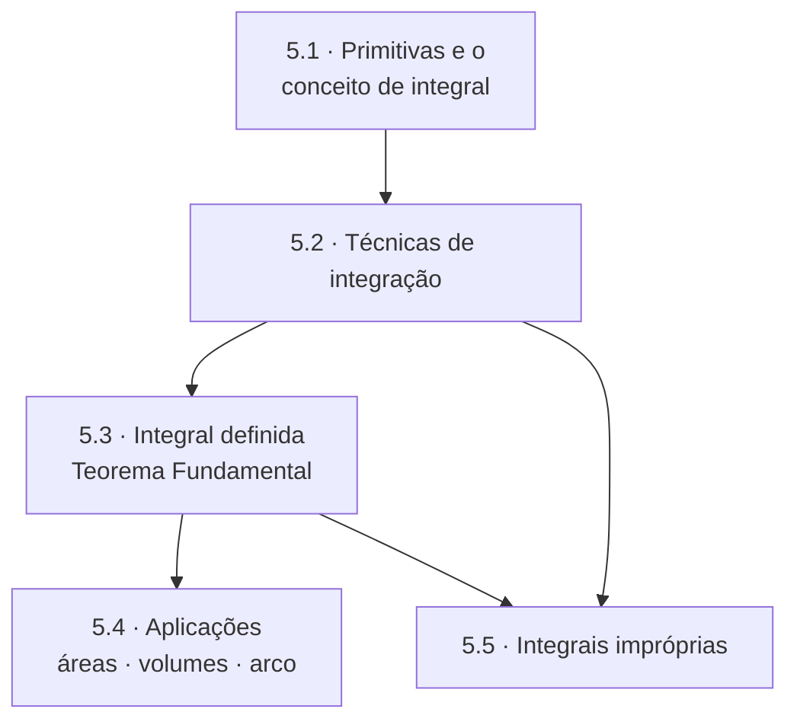

# Unidade 5 · Integral

> Derivar é um procedimento: existe uma regra para cada caso. Integrar é um reconhecimento de padrão: você olha a expressão e decide qual técnica tentar. Por isso integral não se aprende lendo — se aprende fazendo muitos exercícios.

---

## 🎯 Objetivos da unidade

- Entender **primitiva** e integral indefinida, e por que a constante $C$ não é detalhe.
- Dominar as técnicas: **substituição**, **integração por partes**, **frações parciais**, **substituição trigonométrica**.
- Compreender a **integral definida** como limite de somas de Riemann (a área sob a curva).
- Enunciar, entender e aplicar o **Teorema Fundamental do Cálculo** — as duas partes.
- Calcular **áreas entre curvas**, **volumes de sólidos de revolução** (discos, anéis e cascas), **área de superfície** e **comprimento de arco**.
- Avaliar **integrais impróprias** e decidir sobre convergência.

---

## 🗺️ Mapa da unidade

---

## 📚 Conteúdo

| # | Teoria | 📝 Propostos | ✅ Gabarito |
| :---: | --- | :---: | :---: |
| 5.1 | [Primitivas e o conceito de integral](5.1-primitivas-e-o-conceito-de-integral.md) | [lista](exercicios/lista-5.1-propostos.md) | [gabarito](gabaritos/gabarito-5.1.md) |
| 5.2 | [Técnicas de integração](5.2-tecnicas-de-integracao.md) | [lista](exercicios/lista-5.2-propostos.md) | [gabarito](gabaritos/gabarito-5.2.md) |
| 5.3 | [Integral definida e o Teorema Fundamental do Cálculo](5.3-integral-definida-e-o-teorema-fundamental-do-calculo.md) | [lista](exercicios/lista-5.3-propostos.md) | [gabarito](gabaritos/gabarito-5.3.md) |
| 5.4 | [Aplicações: áreas, volumes, superfícies e comprimento de arco](5.4-aplicacoes-da-integral-definida.md) | [lista](exercicios/lista-5.4-propostos.md) | [gabarito](gabaritos/gabarito-5.4.md) |
| 5.5 | [Integrais impróprias](5.5-integrais-improprias.md) | [lista](exercicios/lista-5.5-propostos.md) | [gabarito](gabaritos/gabarito-5.5.md) |
| 🧪 | **Revisão da unidade** | [lista](exercicios/revisao-unidade-5.md) | [gabarito](gabaritos/gabarito-revisao-unidade-5.md) |

**Pré-requisito:** [Unidade 3](../03-derivadas/README.md) — toda integral é uma derivada lida de trás para frente.
**Consulte sempre:** [A2 · Tabela de integrais](../06-formulario/A2-tabela-de-integrais.md) e [A3 · Identidades trigonométricas](../06-formulario/A3-identidades-trigonometricas.md).

---

## ✅ Checklist de autoavaliação

- [ ] Explicar por que $\int 2x\thinspace dx = x^2 + C$ e o que a constante significa geometricamente.
- [ ] Escolher a substituição certa em $\int x\sqrt{x^2+1}\thinspace dx$ e saber **por que** ela funciona.
- [ ] Decidir quem é $u$ e quem é $dv$ na integração por partes.
- [ ] Decompor $\dfrac{3x+1}{x^2-x-2}$ em frações parciais.
- [ ] Usar o TFC para derivar $F(x) = \int_{1}^{x^2} \operatorname{sen}(t)\thinspace dt$.
- [ ] Montar a integral da área entre duas curvas achando os limites corretos.
- [ ] Escolher entre discos, anéis e cascas cilíndricas conforme o eixo de revolução.
- [ ] Decidir se $\int_{1}^{\infty} \frac{1}{x^p}\thinspace dx$ converge, em função de $p$.

---

## ⚠️ Os erros clássicos desta unidade

1. **Esquecer o $+\thinspace C$.** Em integral indefinida, a resposta sem a constante está incompleta — e vale desconto em qualquer prova.
2. **Trocar a variável e não trocar os limites.** Na integral definida com substituição, ou você converte os limites para a nova variável, ou volta à variável original antes de substituir. Misturar os dois é o erro mais comum da unidade.
3. **Integrar produto como produto de integrais.** $\int f \cdot g \neq \int f \cdot \int g$. Não existe "regra do produto" para integrais — existe integração por partes.

---

| ← Anterior | 🏠 Índice | Próximo → |
| :--- | :---: | ---: |
| [Unidade 4 · Aplicações](../04-aplicacoes-das-derivadas/README.md) | [Página inicial](../README.md) | [Formulário](../06-formulario/README.md) |

*Sobrevivendo ao Cálculo 1 (UENF)* · por **Nicolau Prates** · [CC BY-SA 4.0](../LICENSE)
