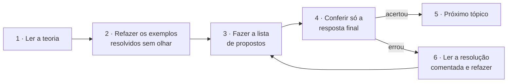
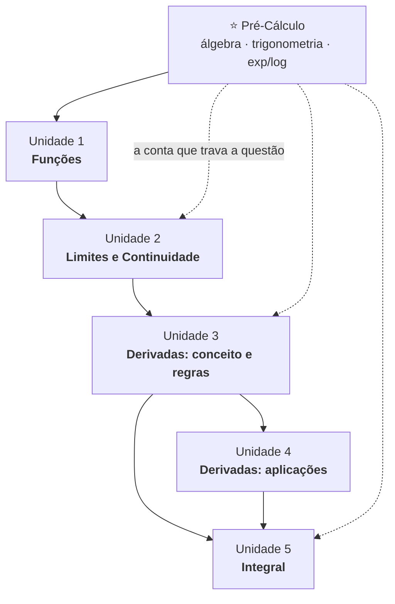

# Sobrevivendo ao Cálculo 1 (UENF)

> **Um guia completo feito de aluno para aluno para te ajudar a passar nessa matéria sem desespero.**

Material de estudo completo da disciplina **Cálculo 1** da **UENF** (Universidade Estadual do Norte Fluminense Darcy Ribeiro): teoria, exemplos resolvidos passo a passo, gráficos, listas de exercícios e gabaritos — tudo em páginas que abrem direto aqui no navegador, **sem instalar nada**.

---

## Por que este repositório existe

Cálculo 1 não é difícil porque o conteúdo seja inacessível. É difícil porque:

1. **O ritmo é alto.** Uma aula cobre o que o livro gasta um capítulo inteiro para explicar.
2. **A conta trava antes do conceito.** O aluno entende a ideia de derivada e perde a questão numa fatoração do Ensino Médio.
3. **Falta um caminho.** Existe material excelente espalhado por seis livros de mil páginas, e nenhum deles diz *por onde começar na terça à noite com a prova na quinta*.

Este material ataca os três problemas: segue **exatamente a ementa da disciplina**, na ordem dela, com o rigor dos livros de referência, mas escrito para quem está vendo o assunto pela primeira vez.

> [!NOTE]
> **Material não oficial.** Projeto independente de apoio ao estudo. Ele complementa — não substitui — as aulas, as listas e as notas de aula do seu professor. A ementa seguida é a de Cálculo 1 da UENF; a divisão das provas (P1/P2/P3) e os pesos variam por turma, então confirme sempre o cronograma oficial da sua disciplina.

---

## 🚀 Como usar este material

**Começando o semestre?** Siga a ordem natural, da Unidade 1 à 5, usando o [plano de estudos](00-comece-aqui/plano-de-estudos.md) como calendário.

**A prova é amanhã?** Vá direto ao [formulário](06-formulario/README.md), depois ao [simulado](07-simulados/README.md) correspondente, e volte à teoria só dos pontos em que errar.

**Travou numa conta, e não no conceito?** O problema quase sempre está na [Revisão de Pré-Cálculo](00-comece-aqui/revisao-pre-calculo.md). Não é vergonha nenhuma — é a página mais útil deste repositório.

Em qualquer caso, estude com **papel e lápis ao lado**. Ler Cálculo sem escrever produz a sensação de ter entendido, não o entendimento.

### Fluxo recomendado para cada tópico

### Legenda dos ícones

| Ícone | Significa |
| :---: | --- |
| 🎯 | Objetivos de aprendizagem da página |
| 📐 | Definição ou teorema formal — o que vale em prova |
| 💡 | Intuição: a tradução do formalismo para o português |
| 📊 | Gráfico ou visualização |
| ✍️ | Exemplo resolvido passo a passo |
| ⚠️ | Armadilha clássica — erro que custa ponto |
| 🧠 | Exercício resolvido, mais difícil que o exemplo |
| 📝 | Lista de exercícios propostos |
| ✅ | Gabarito: resposta final primeiro, resolução completa depois |
| 📚 | Onde ler mais, nos livros da bibliografia |

> [!TIP]
> **Fórmulas no celular.** As equações são escritas em LaTeX e renderizadas pelo próprio GitHub. No aplicativo do GitHub para celular a renderização às vezes falha; se isso acontecer, abra a página pelo navegador em vez do app.

---

## 🗺️ Mapa de dependências

Cada unidade se apoia na anterior. Pular etapa é a causa número um de reprovação na disciplina.

---

## 📖 Sumário geral

> [!NOTE]
> 🚧 **Material em construção.** As unidades são escritas e publicadas em ordem. As seções marcadas com 🚧 ainda estão sendo redigidas — o índice delas já existe e serve de roteiro, mas alguns links ainda não abrem. [Acompanhe o andamento](../../commits/main).

### ⭐ 00 · Comece aqui

| Página | O que você encontra |
| --- | --- |
| [Como usar este material](00-comece-aqui/como-usar-este-material.md) | Fluxo de estudo, legenda dos ícones, LaTeX no celular |
| [Revisão de Pré-Cálculo](00-comece-aqui/revisao-pre-calculo.md) | Fatoração, produtos notáveis, frações, potências, radicais, trigonometria, exponencial e logaritmo, inequações |
| [Plano de estudos](00-comece-aqui/plano-de-estudos.md) | Cronograma semanal ancorado em P1 / P2 / P3 |
| [Como não reprovar](00-comece-aqui/como-nao-reprovar.md) | Estratégia de prova, gestão de tempo, erros que custam ponto |
| [Bibliografia e recursos](00-comece-aqui/bibliografia-e-recursos.md) | O perfil de cada um dos seis livros de referência e como usá-los |

### 1 · Funções reais de uma variável real ✅ · [índice da unidade](01-funcoes/README.md)

| # | Teoria | 📝 Propostos | ✅ Gabarito |
| :---: | --- | :---: | :---: |
| 1.1 | [Números reais, intervalos, valor absoluto e desigualdades](01-funcoes/1.1-numeros-reais-intervalos-valor-absoluto-desigualdades.md) | [lista](01-funcoes/exercicios/lista-1.1-propostos.md) | [gabarito](01-funcoes/gabaritos/gabarito-1.1.md) |
| 1.2 | [Funções: conceito, domínio, contradomínio e imagem](01-funcoes/1.2-funcoes-dominio-contradominio-imagem.md) | [lista](01-funcoes/exercicios/lista-1.2-propostos.md) | [gabarito](01-funcoes/gabaritos/gabarito-1.2.md) |
| 1.3 | [Funções elementares, paridade e gráficos](01-funcoes/1.3-funcoes-elementares-paridade-e-graficos.md) | [lista](01-funcoes/exercicios/lista-1.3-propostos.md) | [gabarito](01-funcoes/gabaritos/gabarito-1.3.md) |
| 1.4 | [Injetoras, sobrejetoras, bijetoras e inversas](01-funcoes/1.4-injetoras-sobrejetoras-bijetoras-e-inversas.md) | [lista](01-funcoes/exercicios/lista-1.4-propostos.md) | [gabarito](01-funcoes/gabaritos/gabarito-1.4.md) |
| — | **Revisão da unidade** — lista mista, nível de prova | [lista](01-funcoes/exercicios/revisao-unidade-1.md) | [gabarito](01-funcoes/gabaritos/gabarito-revisao-unidade-1.md) |

### 2 · Limites e continuidade ✅ · [índice da unidade](02-limites-e-continuidade/README.md)

| # | Teoria | 📝 Propostos | ✅ Gabarito |
| :---: | --- | :---: | :---: |
| 2.1 | [Conceito e noção intuitiva de limite · teoremas sobre limites](02-limites-e-continuidade/2.1-conceito-e-nocao-intuitiva-de-limite.md) | [lista](02-limites-e-continuidade/exercicios/lista-2.1-propostos.md) | [gabarito](02-limites-e-continuidade/gabaritos/gabarito-2.1.md) |
| 2.2 | [Limites laterais](02-limites-e-continuidade/2.2-limites-laterais.md) | [lista](02-limites-e-continuidade/exercicios/lista-2.2-propostos.md) | [gabarito](02-limites-e-continuidade/gabaritos/gabarito-2.2.md) |
| 2.3 | [Teorema do Sanduíche (Confronto)](02-limites-e-continuidade/2.3-teorema-do-sanduiche.md) | [lista](02-limites-e-continuidade/exercicios/lista-2.3-propostos.md) | [gabarito](02-limites-e-continuidade/gabaritos/gabarito-2.3.md) |
| 2.4 | [Limites infinitos, limites no infinito e assíntotas](02-limites-e-continuidade/2.4-limites-infinitos-no-infinito-e-assintotas.md) | [lista](02-limites-e-continuidade/exercicios/lista-2.4-propostos.md) | [gabarito](02-limites-e-continuidade/gabaritos/gabarito-2.4.md) |
| 2.5 | [Continuidade e tipos de descontinuidade](02-limites-e-continuidade/2.5-continuidade-e-tipos-de-descontinuidade.md) | [lista](02-limites-e-continuidade/exercicios/lista-2.5-propostos.md) | [gabarito](02-limites-e-continuidade/gabaritos/gabarito-2.5.md) |
| — | **Revisão da unidade** | [lista](02-limites-e-continuidade/exercicios/revisao-unidade-2.md) | [gabarito](02-limites-e-continuidade/gabaritos/gabarito-revisao-unidade-2.md) |

### 3 · Derivadas: conceito e regras 🚧 · [índice da unidade](03-derivadas/README.md)

| # | Teoria | 📝 Propostos | ✅ Gabarito |
| :---: | --- | :---: | :---: |
| 3.1 | [Conceito, interpretação geométrica e regras básicas](03-derivadas/3.1-conceito-interpretacao-geometrica-e-regras-basicas.md) | [lista](03-derivadas/exercicios/lista-3.1-propostos.md) | [gabarito](03-derivadas/gabaritos/gabarito-3.1.md) |
| 3.2 | [Derivadas das funções elementares](03-derivadas/3.2-derivadas-das-funcoes-elementares.md) | [lista](03-derivadas/exercicios/lista-3.2-propostos.md) | [gabarito](03-derivadas/gabaritos/gabarito-3.2.md) |
| 3.3 | [Regra da cadeia e derivada da função inversa](03-derivadas/3.3-regra-da-cadeia-e-derivada-da-funcao-inversa.md) | [lista](03-derivadas/exercicios/lista-3.3-propostos.md) | [gabarito](03-derivadas/gabaritos/gabarito-3.3.md) |
| 3.4 | [Derivadas das funções trigonométricas inversas](03-derivadas/3.4-derivadas-das-funcoes-trigonometricas-inversas.md) | [lista](03-derivadas/exercicios/lista-3.4-propostos.md) | [gabarito](03-derivadas/gabaritos/gabarito-3.4.md) |
| 3.5 | [Problemas de taxa de variação](03-derivadas/3.5-problemas-de-taxa-de-variacao.md) | [lista](03-derivadas/exercicios/lista-3.5-propostos.md) | [gabarito](03-derivadas/gabaritos/gabarito-3.5.md) |
| — | **Revisão da unidade** | [lista](03-derivadas/exercicios/revisao-unidade-3.md) | [gabarito](03-derivadas/gabaritos/gabarito-revisao-unidade-3.md) |

### 4 · Derivadas: aplicações 🚧 · [índice da unidade](04-aplicacoes-das-derivadas/README.md)

| # | Teoria | 📝 Propostos | ✅ Gabarito |
| :---: | --- | :---: | :---: |
| 4.1 | [Máximos e mínimos](04-aplicacoes-das-derivadas/4.1-maximos-e-minimos.md) | [lista](04-aplicacoes-das-derivadas/exercicios/lista-4.1-propostos.md) | [gabarito](04-aplicacoes-das-derivadas/gabaritos/gabarito-4.1.md) |
| 4.2 | [Teoremas de Rolle e do Valor Médio](04-aplicacoes-das-derivadas/4.2-teoremas-de-rolle-e-do-valor-medio.md) | [lista](04-aplicacoes-das-derivadas/exercicios/lista-4.2-propostos.md) | [gabarito](04-aplicacoes-das-derivadas/gabaritos/gabarito-4.2.md) |
| 4.3 | [Regra de L&#39;Hôspital no cálculo de limites](04-aplicacoes-das-derivadas/4.3-regra-de-lhospital.md) | [lista](04-aplicacoes-das-derivadas/exercicios/lista-4.3-propostos.md) | [gabarito](04-aplicacoes-das-derivadas/gabaritos/gabarito-4.3.md) |
| 4.4 | [Crescimento, concavidade e esboço de gráficos](04-aplicacoes-das-derivadas/4.4-crescimento-concavidade-e-esboco-de-graficos.md) | [lista](04-aplicacoes-das-derivadas/exercicios/lista-4.4-propostos.md) | [gabarito](04-aplicacoes-das-derivadas/gabaritos/gabarito-4.4.md) |
| — | **Revisão da unidade** | [lista](04-aplicacoes-das-derivadas/exercicios/revisao-unidade-4.md) | [gabarito](04-aplicacoes-das-derivadas/gabaritos/gabarito-revisao-unidade-4.md) |

### 5 · Integral 🚧 · [índice da unidade](05-integrais/README.md)

| # | Teoria | 📝 Propostos | ✅ Gabarito |
| :---: | --- | :---: | :---: |
| 5.1 | [Primitivas e o conceito de integral](05-integrais/5.1-primitivas-e-o-conceito-de-integral.md) | [lista](05-integrais/exercicios/lista-5.1-propostos.md) | [gabarito](05-integrais/gabaritos/gabarito-5.1.md) |
| 5.2 | [Técnicas de integração](05-integrais/5.2-tecnicas-de-integracao.md) | [lista](05-integrais/exercicios/lista-5.2-propostos.md) | [gabarito](05-integrais/gabaritos/gabarito-5.2.md) |
| 5.3 | [Integral definida e o Teorema Fundamental do Cálculo](05-integrais/5.3-integral-definida-e-o-teorema-fundamental-do-calculo.md) | [lista](05-integrais/exercicios/lista-5.3-propostos.md) | [gabarito](05-integrais/gabaritos/gabarito-5.3.md) |
| 5.4 | [Aplicações: áreas, volumes, superfícies e comprimento de arco](05-integrais/5.4-aplicacoes-da-integral-definida.md) | [lista](05-integrais/exercicios/lista-5.4-propostos.md) | [gabarito](05-integrais/gabaritos/gabarito-5.4.md) |
| 5.5 | [Integrais impróprias](05-integrais/5.5-integrais-improprias.md) | [lista](05-integrais/exercicios/lista-5.5-propostos.md) | [gabarito](05-integrais/gabaritos/gabarito-5.5.md) |
| — | **Revisão da unidade** | [lista](05-integrais/exercicios/revisao-unidade-5.md) | [gabarito](05-integrais/gabaritos/gabarito-revisao-unidade-5.md) |

---

## 🧾 06 · Formulário — a cola legal 🚧

O que abrir na véspera. [Índice completo](06-formulario/README.md).

| | | |
| --- | --- | --- |
| [A1 · Tabela de derivadas](06-formulario/A1-tabela-de-derivadas.md) | [A2 · Tabela de integrais](06-formulario/A2-tabela-de-integrais.md) | [A3 · Identidades trigonométricas](06-formulario/A3-identidades-trigonometricas.md) |
| [A4 · Limites notáveis](06-formulario/A4-limites-notaveis.md) | [A5 · Símbolos e alfabeto grego](06-formulario/A5-simbolos-e-alfabeto-grego.md) | [A6 · Glossário](06-formulario/A6-glossario.md) |

## 🧪 07 · Simulados 🚧

Provas completas, com resolução comentada questão por questão. [Índice](07-simulados/README.md).

| Simulado | Conteúdo | Resolução |
| --- | --- | :---: |
| [Simulado P1](07-simulados/simulado-p1-funcoes-e-limites.md) | Unidades 1 e 2 — funções, limites e continuidade | [resolução](07-simulados/gabaritos/gabarito-simulado-p1.md) |
| [Simulado P2](07-simulados/simulado-p2-derivadas.md) | Unidades 3 e 4 — derivadas e aplicações | [resolução](07-simulados/gabaritos/gabarito-simulado-p2.md) |
| [Simulado P3](07-simulados/simulado-p3-integrais.md) | Unidade 5 — integrais | [resolução](07-simulados/gabaritos/gabarito-simulado-p3.md) |
| [Simulado final](07-simulados/simulado-final.md) | Toda a ementa — para a prova final / VS | [resolução](07-simulados/gabaritos/gabarito-simulado-final.md) |

## 🎨 Extras (100% opcional)

> [!IMPORTANT]
> **Você NÃO precisa instalar nada para estudar por este material.** A pasta [`extras/`](extras/README.md) guarda os scripts em Python que geram os gráficos de [`assets/img/`](assets/img). Eles existem para quem quiser aprender a plotar funções por conta própria — é um ótimo exercício, e é inteiramente dispensável.

---

## 🤝 Encontrou um erro? Não entendeu um trecho?

Erro de conta, erro de digitação, passagem confusa, gabarito divergente: **abra uma issue**. Leva dois cliques e não exige saber nada de Git.

- 🐛 [Achei um erro no material](../../issues/new?template=01-erro-no-material.yml)
- ❓ [Não entendi este trecho](../../issues/new?template=02-nao-entendi.yml)
- 💡 [Sugestão de melhoria ou de exercício](../../issues/new?template=03-sugestao.yml)

Quem quiser contribuir com conteúdo: leia o [CONTRIBUTING.md](CONTRIBUTING.md) e as [convenções de escrita](CONVENCOES.md).

---

## Bibliografia de referência

O material segue o rigor e a didática de:

- **LEITHOLD, Louis.** *O Cálculo com Geometria Analítica.* 3ª ed. São Paulo: Harbra.
- **MUNEM, M. A.; FOULIS, D. J.** *Cálculo.* Rio de Janeiro: LTC.
- **SWOKOWSKI, Earl W.** *Cálculo com Geometria Analítica.* São Paulo: Makron Books.
- **STEWART, James.** *Cálculo.* Vols. 1 e 2. São Paulo: Cengage Learning.
- **THOMAS, George B.** *Cálculo.* Vol. 1. São Paulo: Pearson.
- **ANTON, Howard.** *Cálculo.* Vol. 1. Porto Alegre: Bookman.

O perfil de cada livro e como usá-los: [bibliografia-e-recursos.md](00-comece-aqui/bibliografia-e-recursos.md).

---

## Autoria e licença

**Autor:** Nicolau Prates · UENF — Universidade Estadual do Norte Fluminense Darcy Ribeiro

Licenciado sob **[Creative Commons Atribuição-CompartilhaIgual 4.0 Internacional (CC BY-SA 4.0)](LICENSE)**: você pode copiar, imprimir, distribuir e adaptar este material, desde que **cite o autor** e **mantenha a mesma licença** nas adaptações.

Se este material te ajudou, deixe uma ⭐ no repositório e passe o link para a próxima turma. É de aluno para aluno.
